
# Additional LUCC Resources

These resources extend the deforestation simulation model built in [Lesson 18: Building a land-use and land-cover change simulation model](guidebook/Land-Use-Change-Simulation-Model.html). Each one changes that model to:

- [vary parameters during a simulation](#varying-parameters-in-a-simulation);
- [use different parameters for each subregion](#using-subregions-in-a-simulation-model);
- [control transitions with sojourn time](#using-sojourn-time);
- [stop changes locally with local saturation](#using-local-saturation).

The models are in the [Guidebook dataset](extra/guidebook_dinamica.7z), in `guidebook dinamica\models\additional resources lucc`.

Functors used: [Select Transition Matrix](functors/Select-Transition-Matrix.html), [Select Weights](functors/Select-Weights.html), [Calc Change Matrix](functors/Calc-Change-Matrix.html), [Modulate Change Matrix](functors/Modulate-Change-Matrix.html), [Add Change Matrix](functors/Add-Change-Matrix.html), [Extract Map Layer](functors/Extract-Map-Layer.html) and [Create Cube Map](functors/Create-Cube-Map.html).

## Varying Parameters in a Simulation

Model parameters can change in different phases of a simulation or at each time step. The functors of the [Stack](Functor-List.html#stack) group select a parameter according to the model step.

### Using Different Transition Matrices

Open `simulate deforestation using multiple transition matrix.egoml` from `guidebook dinamica\models\additional resources lucc\multiple parameters\simulate deforestation using multiple transition matrix`.

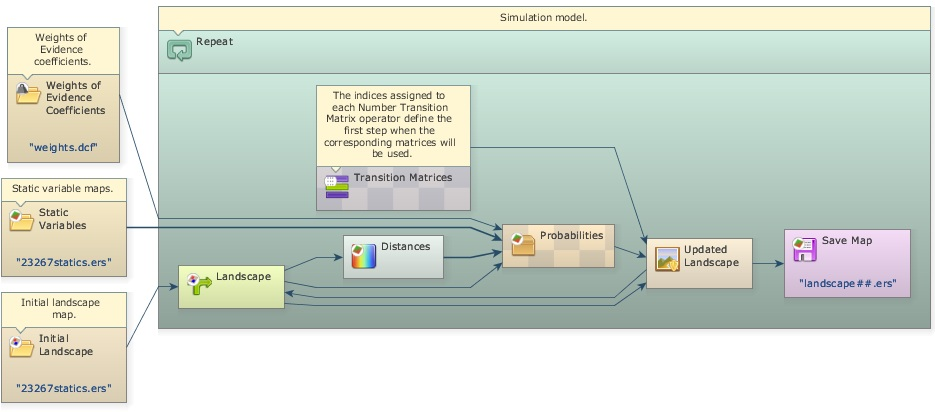

[Select Transition Matrix](functors/Select-Transition-Matrix.html) chooses a transition matrix according to the model step. Each transition matrix is entered in a [Number Transition Matrix](functors/Number-Transition-Matrix.html) placed inside it. Open one of them with the Edit Functor tool:

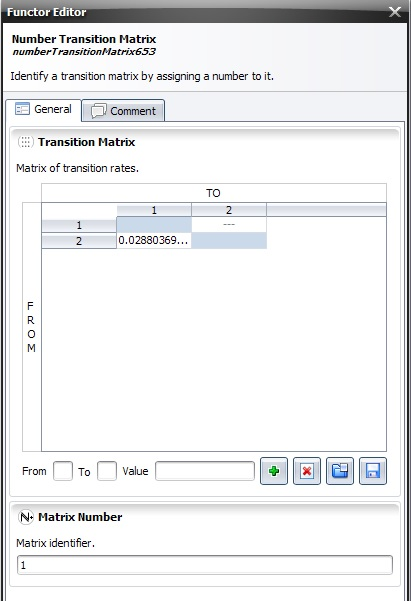

**Matrix Number** is the step from which the matrix is used. The model keeps using a matrix until it reaches the step of the next [Number Transition Matrix](functors/Number-Transition-Matrix.html); from then on, [Select Transition Matrix](functors/Select-Transition-Matrix.html) switches to the new matrix.

> **Tip:** You can use as many transition matrices as time steps. Add more [Number Transition Matrix](functors/Number-Transition-Matrix.html) functors and number them according to the model time intervals.

### Using Different Weights of Evidence Coefficients

The same approach selects other parameters, such as the Weights of Evidence coefficients. Open `simulate deforestation using multiple transition matrix and weights.egoml` from `guidebook dinamica\models\additional resources lucc\multiple parameters\simulate deforestation using multiple transition matrix and weights`.

[Select Weights](functors/Select-Weights.html) selects one of several Weights of Evidence coefficient files. Each file is loaded by a [Load Weights](functors/Load-Weights.html) placed outside the main loop ([Repeat](functors/Repeat.html)) and connected to a [Number Weights](functors/Number-Weights.html) inside [Select Weights](functors/Select-Weights.html). The **Weight Number** of each [Number Weights](functors/Number-Weights.html) is the step from which its coefficients are used.

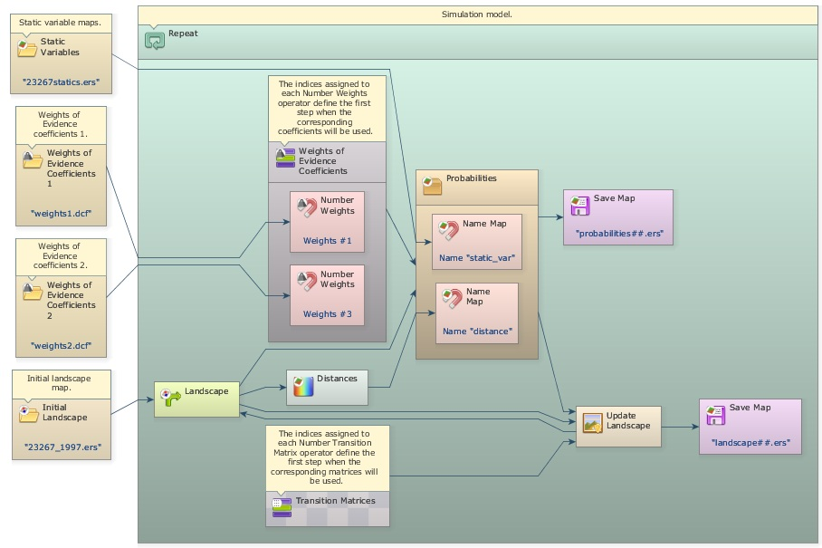

### Using Different Patcher and Expander Parameters by Year or Subregion

[Select Transition Function Parameter Matrix](functors/Select-Transition-Function-Parameter-Matrix.html) manages the parameters of [Patcher](functors/Patcher.html) and [Expander](functors/Expander.html) the same way. Place one [Number Transition Function Parameter Matrix](functors/Number-Transition-Function-Parameter-Matrix.html) inside it for each year or subregion; its number is the year or the subregion identifier.

All the selection functors of the Stack group fall back to the previous number: when no parameter has the requested number, they return the one with the greatest number that is smaller than it. For example, with parameters numbered 10, 21, 40 and 45, a request for 40 returns the parameter numbered 40, and requests for 32, 23 and 22 return the parameter numbered 21.

This approach has two limitations:

- The parameters are part of the model. Adding parameters for more years or subregions means changing the model.
- A parameter cannot depend on both the year and the subregion, because the selection functors cannot be nested.

Tables avoid both limitations. Every parameter type except maps and categorical maps converts to and from a [table](types/Table-Type.html), and tables can be stored as CSV files. Transition function parameters, for instance, use this layout, where columns ending in `*` are keys:

```
From*, To*, Mean_Patch_Size, Patch_Size_Variance, Patch_Isometry
1, 3, 50, 10, 1
2, 1, 10, 5, 1.5
2, 6, 20, 0, 2
```

Adding a `Year*` key column stores the parameters of every year in one file. Rows for a year can be omitted when its parameters are the same as the previous year's:

```
Year*, From*, To*, Mean_Patch_Size, Patch_Size_Variance, Patch_Isometry
1, 1, 3, 50, 10, 1
1, 2, 1, 10, 5, 1.5
1, 2, 6, 20, 0, 2
3, 1, 3, 10, 11, 1
3, 2, 1, 20, 3, 1.5
3, 2, 6, 10, 3, 2
```

Load the file with [Load Table](functors/Load-Table.html) and connect it, together with the current step, to the **Select Sub Table** submodel. It returns the rows of the current year without the `Year*` column, with the same fall back as the selection functors; in the example, years 1 and 2 use the first three rows. The result converts automatically to the parameter matrix expected by [Patcher](functors/Patcher.html) and [Expander](functors/Expander.html).

To vary the parameters by year and subregion, add a second key column and use two Select Sub Table submodels: the first selects the rows of the current year, and the second selects, from those, the rows of the current subregion.

```
Year*, Region*, From*, To*, Mean_Patch_Size, Patch_Size_Variance, Patch_Isometry
1, 1, 1, 3, 50, 10, 1
1, 1, 2, 1, 10, 5, 1.5
1, 1, 2, 6, 20, 0, 2
1, 2, 1, 3, 50, 1, 1
1, 2, 2, 1, 10, 5, 1.5
1, 2, 2, 6, 20, 3, 2
3, 1, 1, 3, 10, 11, 1
3, 1, 2, 1, 20, 3, 1.5
3, 1, 2, 6, 10, 3, 2
3, 2, 1, 3, 10, 11, 1
3, 2, 2, 1, 20, 3, 1.5
3, 2, 2, 6, 10, 3, 2
```

[Get Table From Key](functors/Get-Table-From-Key.html) retrieves rows the same way when every key is present in the table; unlike Select Sub Table, it has no fall back. [Working with Subregions Using Region Manager](Working-With-Subregions.html#selecting-each-regions-parameters) shows this approach inside a region loop.

## Using Subregions in a Simulation Model

Open `simulate deforestation using sub regions.egoml` from `guidebook dinamica\models\additional resources lucc\sub regions\simulate deforestation using sub regions`.

The subregion functors split a map into parts, process each part separately, and combine the results again. This lets a model apply a sequence of operations only to some subregions, or use different parameters and coefficients for each one.

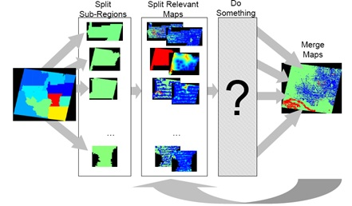

This model uses a different transition matrix and set of Weights of Evidence coefficients for each subregion.

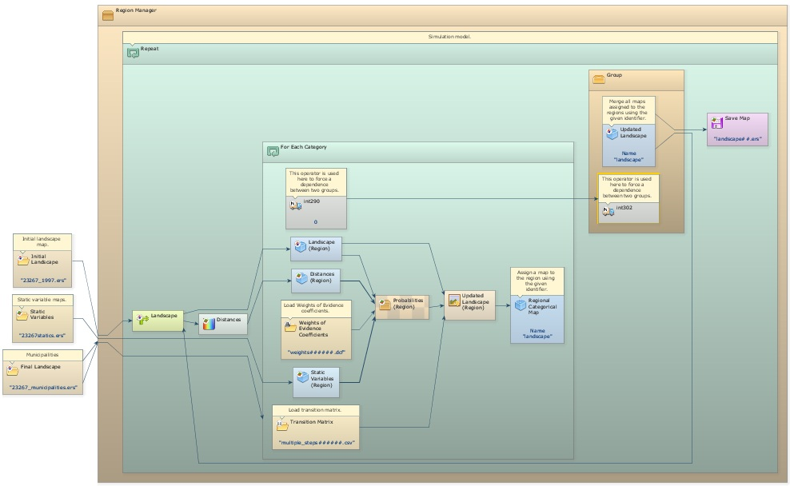

Each subregion needs its own calibration. The models that calculate the transition matrices and the Weights of Evidence coefficients of each subregion are in `guidebook dinamica\models\additional resources lucc\sub regions\calibration`.

The simulation model adds a [Load Categorical Map](functors/Load-Categorical-Map.html) that loads the map of subregions.

> **Tip:** The map of subregions must be categorical. In this example it is the map of municipalities, `23267 municipalities.tif`, where each municipality is identified by its 6-digit code. The code identifies the subregions and controls the regionalization.

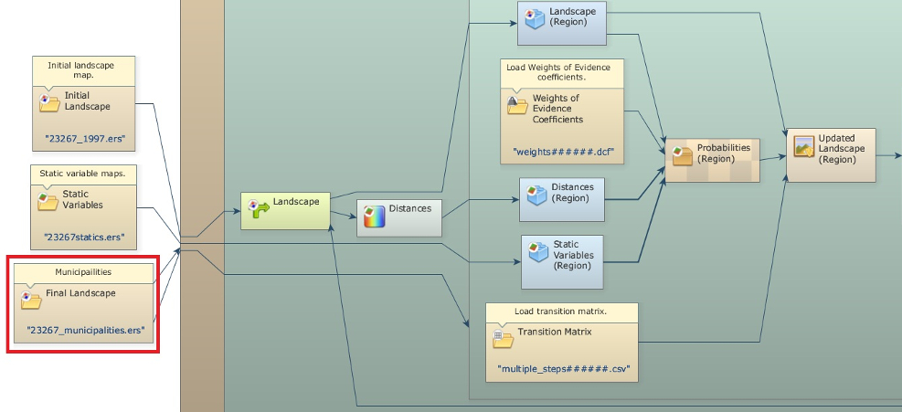

Deforestation is simulated every year for each municipality, and the resulting maps are combined into a new land-use map, which is split again at the beginning of the next step. To keep the results continuous across subregions, some operations, such as the distance map to deforested cells calculated by [Calc Distance Map](functors/Calc-Distance-Map.html), run on the whole map.

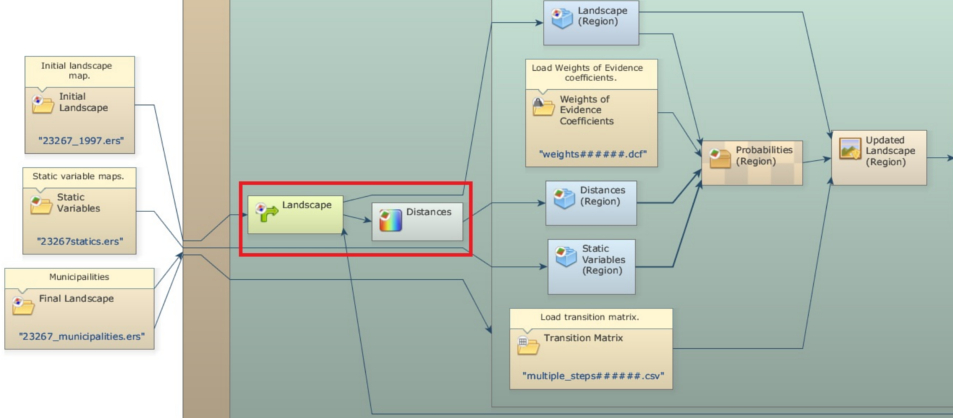

A [Region Manager](functors/Region-Manager.html) placed outside the main loop ([Repeat](functors/Repeat.html)) controls the creation and merging of the subregions.

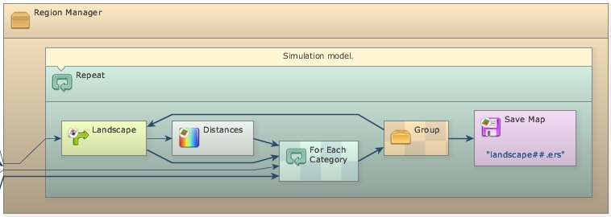

[For Each Category](functors/For-Each-Category.html) repeats the functors inside it for each category of the map of subregions. Connect the map of municipalities to both [For Each Category](functors/For-Each-Category.html) and [Region Manager](functors/Region-Manager.html). A [Step](functors/Step.html) placed inside the innermost container receives the code of the current subregion. Every functor that works on a single subregion goes inside this container.

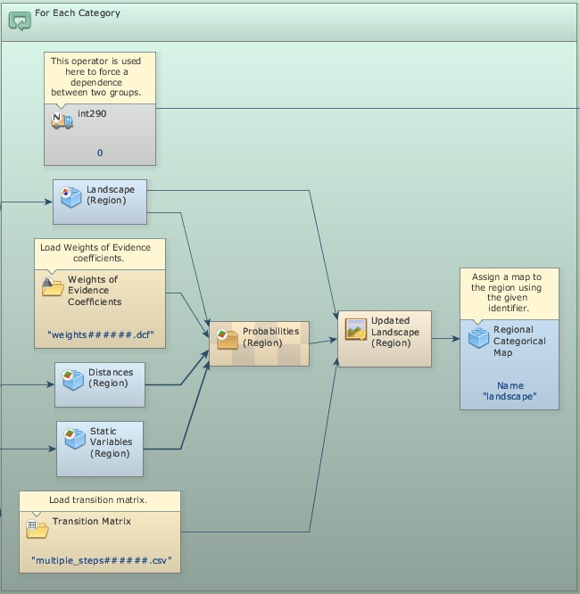

[Regionalize Map](functors/Regionalize-Map.html) and [Regionalize Categorical Map](functors/Regionalize-Categorical-Map.html) split the maps into regional maps. All maps combined after them must have the same dimensions, so regionalize every map used inside the loop, including the distance maps and the static variables.

To use a different transition matrix or Weights of Evidence file for each subregion, add the subregion code as a suffix to the file names and place [Load Table](functors/Load-Table.html) and [Load Weights](functors/Load-Weights.html) inside [For Each Category](functors/For-Each-Category.html).

> **Tip:** Set **Suffix Digits** to 6, the number of digits of the subregion codes.

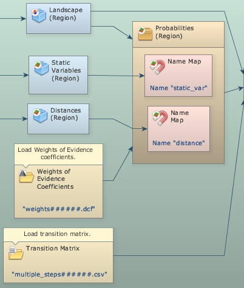

At the end of each iteration of [For Each Category](functors/For-Each-Category.html), a [Regional Categorical Map](functors/Regional-Categorical-Map.html) stores the regional map under a **Global Map Name**. After [For Each Category](functors/For-Each-Category.html) finishes, [Merge Regional Categorical Maps](functors/Merge-Regional-Categorical-Maps.html), placed inside [Region Manager](functors/Region-Manager.html) and using the same **Global Map Name**, merges the regional maps into an updated landscape map.

[Merge Regional Categorical Maps](functors/Merge-Regional-Categorical-Maps.html) must run after the regional maps are stored. The model ensures this by placing it inside a [Group](functors/Group.html) connected to [For Each Category](functors/For-Each-Category.html) through an [Integer Value](functors/Integer-Value.html), which passes a constant from one container to the other and makes the group run afterwards.

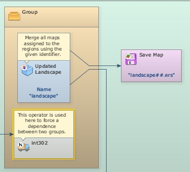

The merged map is fed back into [Mux Categorical Map](functors/Mux-Categorical-Map.html), closing the loop. Each saved landscape map is therefore a mosaic of the changed regional landscapes.

The folder `sub regions` has two variants of this model, which also save the probability maps and the subregion maps.

## Using Sojourn Time

Open `simulate deforestation and abandonment using sojourn time.egoml` from `guidebook dinamica\models\additional resources lucc\sojourn time\simulate deforestation and abandonment using sojourn time`.

With sojourn time, a transition only happens after a certain time has passed since a given event, such as a previous transition. A map keeps, for each cell, the time since that event. At the end of each iteration, the map is updated: the time is set to zero where the event happened and increased by one elsewhere.

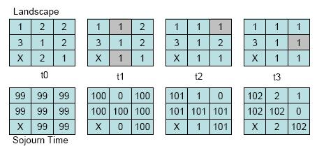

In this example, sojourn time controls the transition from deforested land (1) to abandonment and regrowth (8): land is only abandoned after 4 years of use, counted from deforestation (transition 2 to 1).

The sojourn time map starts with a high value, such as 9999, which distinguishes cells that never changed from cells that changed during the simulation.

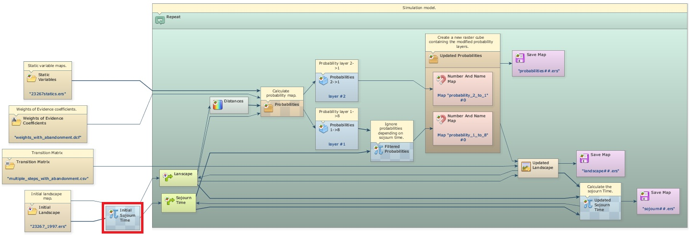

At the end of each iteration, a new sojourn time map is calculated by comparing the previous land-use map with the current one. Where the state changed, the time is set to zero; elsewhere it is increased by one.

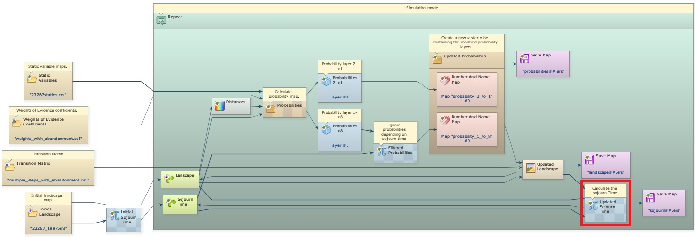

The sojourn time constrains the transition through its probability map. The probability maps of all transitions are stacked in a cube map, so the layers are first separated with [Extract Map Layer](functors/Extract-Map-Layer.html) to be changed by [Calculate Map](functors/Calculate-Map.html).

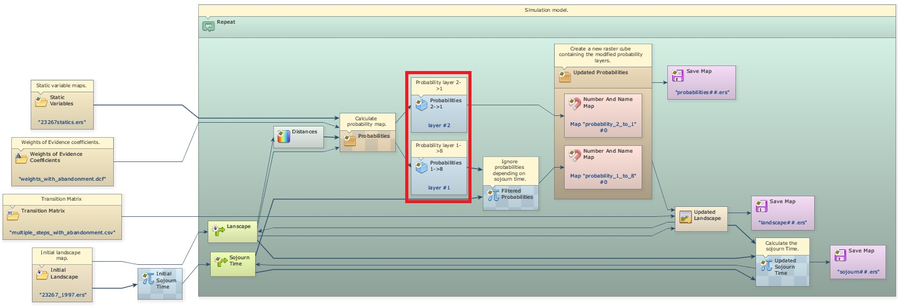

After [Calc W. Of E. Probability Map](functors/Calc-W-Of-E-Probability-Map.html), the layer of the transition from deforested land to abandonment (1 to 8) is recalculated: where a deforested cell is older than 3 years, its probability is kept; otherwise it is set to zero, which prevents the transition.

> **Note:** [Patcher](functors/Patcher.html) and [Expander](functors/Expander.html) do not change cells whose transition probability is zero.

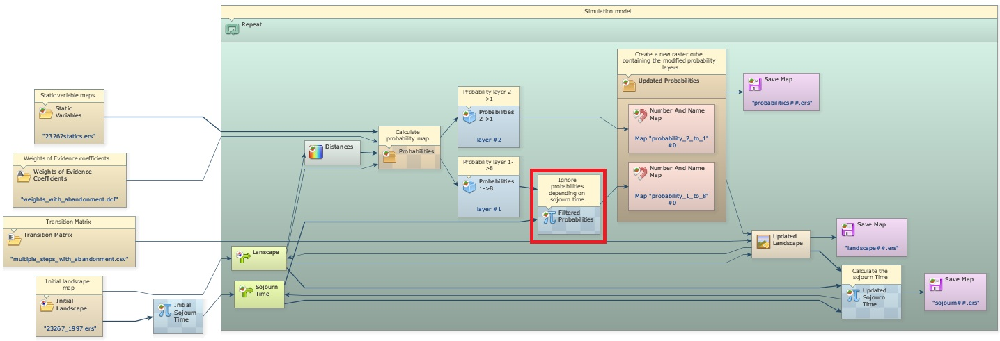

The probability layers, the original one for transition 2 to 1 and the new one for transition 1 to 8, are put together again in a cube map with [Create Cube Map](functors/Create-Cube-Map.html) and passed to [Expander](functors/Expander.html) and [Patcher](functors/Patcher.html).

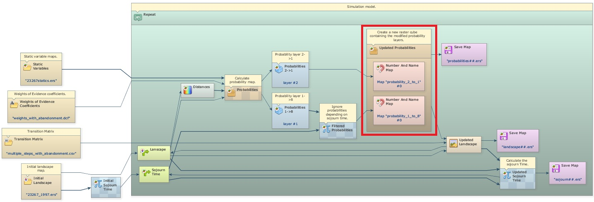

The folder `sojourn time` also has `simulate deforestation and abandonment`, the same model without sojourn time.

### Using Sojourn Time and Deterministic Transitions

Open `simulate def aband and deterministic transition.egoml` from `guidebook dinamica\models\additional resources lucc\sojourn time\simulate deforestation and abandonment using sojourn time and deterministic transition`.

In this example, the transition from abandonment (land undergoing regeneration) to forest depends only on the sojourn time: after a period of regrowth, the abandoned land has a structure similar to mature forest and becomes forest. The minimum sojourn time for this transition is 21 years.

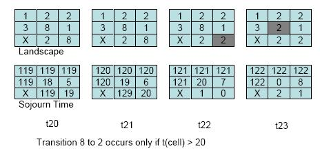

A [Calculate Categorical Map](functors/Calculate-Categorical-Map.html) at the end of the model performs this transition with the rule:

```
if i1 = 8 and i2 > 20 then 2 else i1
```

where `i1` is the landscape map and `i2` is the sojourn time map (forest is 2, abandonment is 8). For simplicity, abandoned land cannot be cleared again (transition 8 to 1); this could be added as a new transition. [Teixeira et al. (2009)](https://doi.org/10.1016/j.foreco.2008.10.011) model the landscape dynamics of the Atlantic Forest with several states, including transitions from forest to various land uses.

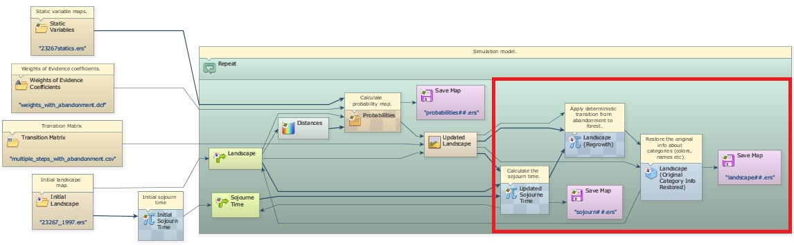

## Using Local Saturation

Open `simulate deforestation using local saturation.egoml` from `guidebook dinamica\models\additional resources lucc\local saturation`.

Local saturation prevents a change inside a neighborhood where the area of a class is above a threshold. It is useful to simulate diffusion processes and to keep a minimum area of remaining forest, such as the one the Brazilian forest code requires on private properties.

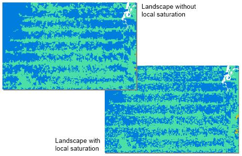

Local saturation reduces the probability of a transition with an asymptotic function:

- P<sub>2</sub> = P<sub>1</sub> × (L − O) / (L + O), when L ≥ O
- P<sub>2</sub> = 0, when L < O

where P<sub>2</sub> is the new probability, P<sub>1</sub> is the original probability, L is the maximum number of cells of a class allowed in a neighborhood, and O is the number of cells of that class in the neighborhood.

In this example, deforestation stops in a 3×3 window (9 cells, or 56.25 hectares) once half of it is deforested, so the threshold L is 5 cells. At each step, the model counts the deforested cells in every 3×3 window of the landscape map.

Three [Calculate Map](functors/Calculate-Map.html) functors add the saturation effect. The first assigns 1 to deforested cells and 0 to forest. The second counts the deforested cells in each 3×3 window with the neighborhood operator:

```
nbCount(i1, 3, 3)
```

where `i1` is map #1 and `3, 3` is the window size in cells; change these values to use a larger neighborhood. The third applies the saturation rule to the probability map:

```
if v1 - i1 >= 0 then i2 * (v1 - i1) / (v1 + i1) else 0
```

where `v1` is the saturation threshold in cells (5 in this example), `i1` is the count of deforested cells and `i2` is the probability map.

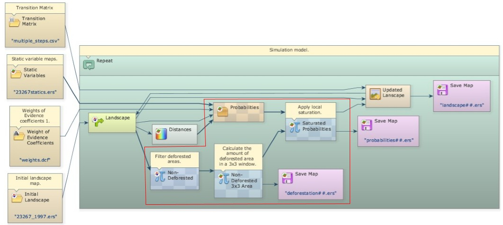

As deforestation reaches the threshold in a neighborhood, it stops there and moves to new areas with lower probability, simulating the diffusion of deforestation.

The folder `local saturation` also has two variants of this model: one built with subregions and one using quadrants.

