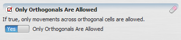


# Boolean Value Type

A [boolean](https://en.wikipedia.org/wiki/Boolean_value) represents one of two possible values: True (yes) and False (no).

## GUI Editor

The boolean editor presents a switch: "Yes" represents the true value, "No" represents the false value.

## EGO Script

Boolean values can be written using either of two equivalent representations:

| Value | Representation |
| --- | --- |
| True | `.yes`   `.true` |
| False | `.no`   `.false` |

By default, Dinamica EGO writes boolean values using the `.yes`/`.no` representation.

## Automatic Conversions

- **Converted from**: [Real Value Type](Real-Value-Type.html), [Integer Value Type](Integer-Value-Type.html), [Non Negative Integer Value Type](Non-Negative-Integer-Value-Type.html), and [Positive Integer Value Type](Positive-Integer-Value-Type.html) — non-zero values convert to True, zero values convert to False.
- **Converted to**: [Real Value Type](Real-Value-Type.html), [Integer Value Type](Integer-Value-Type.html), [Non Negative Integer Value Type](Non-Negative-Integer-Value-Type.html), and [Null Value Type](Null-Value-Type.html) — True converts to one, False to zero. [String Type](String-Type.html) — True converts to `"true"`, False to `"false"`. Boolean does not convert to [Positive Integer Value Type](Positive-Integer-Value-Type.html): False's conversion to zero has no valid representation there.

See [Type System](Type-System.html) for the complete conversion reference across all types.

