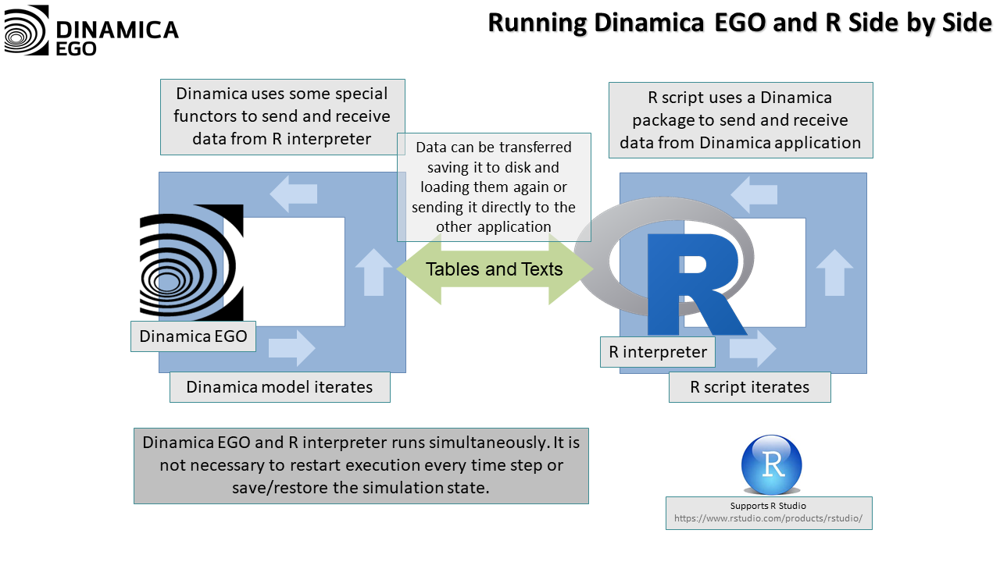
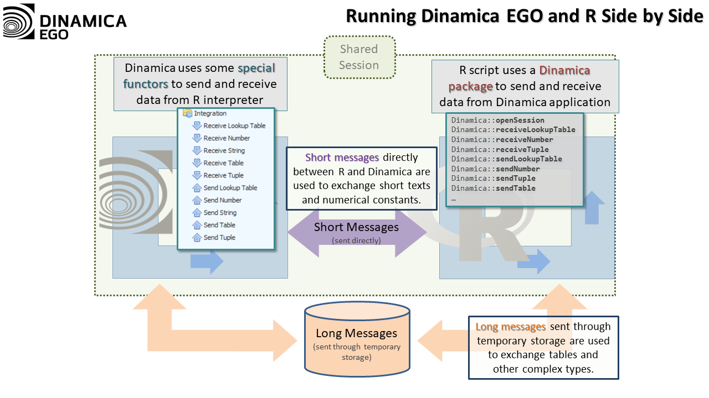
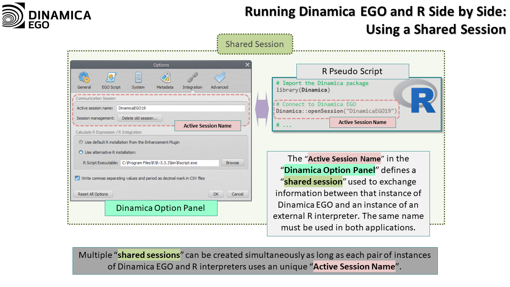
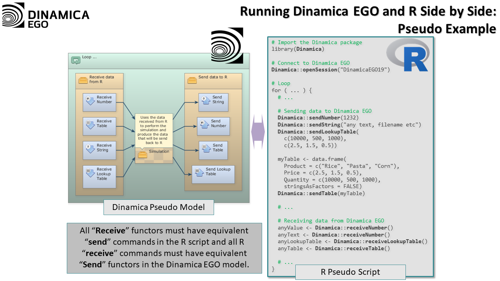
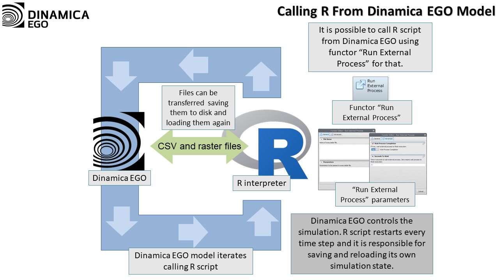
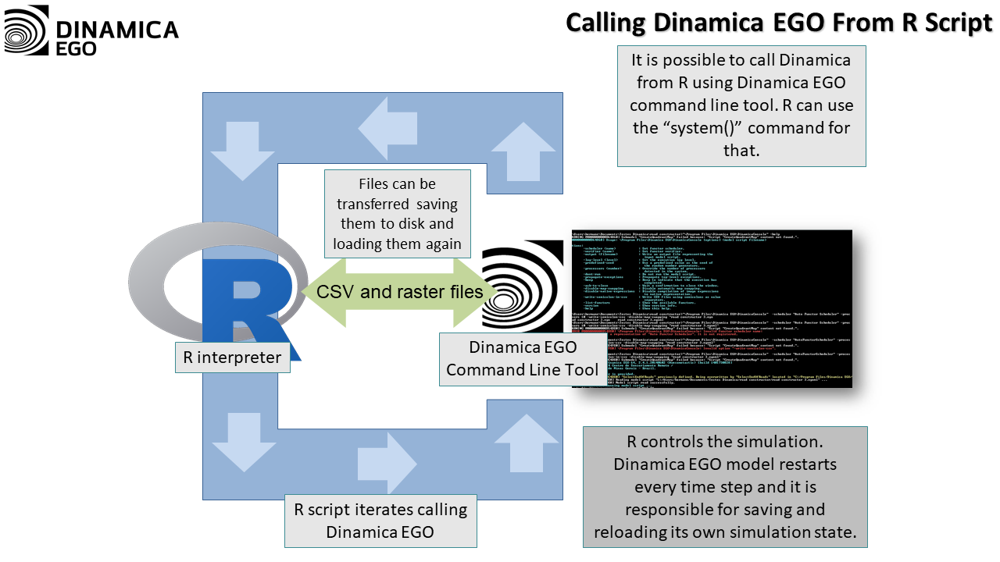


# Coupling with R

Dinamica EGO and R can be coupled in three ways:

- **[Calculate R Expression](functors/Calculate-R-Expression.html)** runs an R script as part of a Dinamica EGO model. This is the preferred way: Dinamica EGO starts and stops the R interpreter, and data goes in through hooks and comes back as a Struct.
- **A communication session** lets a running Dinamica EGO model and a running R session exchange data with send and receive calls on both sides. Neither application has to control the other.
- **Legacy approaches** run R, or Dinamica Console, as an external program and exchange data through files.

## Setting Up R

Calculate R Expression can use the R interpreter of the Dinamica EGO Enhancement Plugin (Windows only) or a local R installation. The setup of both, including the steps for Linux, is described in [Setup](functors/Calculate-R-Expression.html#setup) on Calculate R Expression.

Exchanging data through a communication session always uses a local R installation with the Dinamica package for R.

## Installing the Dinamica Package for R

The Dinamica package for R provides the functions R uses to talk to Dinamica EGO. A local R installation needs it for Calculate R Expression and for communication sessions.

Before installing it, install the packages it depends on:

```r
install.packages(c("Rcpp", "RcppProgress", "rbenchmark", "inline"))
```

On Windows:

- The path of the R installation must not contain spaces.
- [Rtools](https://cran.r-project.org/bin/windows/Rtools/) is required, installed in its default folder (`c:\rtools`) and added to the system `PATH` (an option of the Rtools installer).

Then download the [Dinamica package for R](extra/Dinamica_1.0.8.tar.gz) (`Dinamica_1.0.8.tar.gz`) and install it from that file, replacing the path with the location of the downloaded file:

```r
install.packages("/home/csr/Downloads/Dinamica_1.0.8.tar.gz", repos = NULL, type = "source")
```

On Windows, use a path such as `"c:/Users/<User>/Downloads/Dinamica_1.0.8.tar.gz"`. In RStudio, the same file can be installed with *Tools → Install Packages…*. The package includes its own documentation and examples.

## Exchanging Data Through a Communication Session

With a communication session, Dinamica EGO and R run at the same time and exchange data with matching send and receive calls. On the Dinamica EGO side, the calls are the functors of the *External Communication* group in the Functor Library; on the R side, they are functions of the Dinamica package for R. A receive call blocks until the matching data has been sent, which keeps both applications synchronized.



### How the Session Works

The exchange happens through a shared session between one Dinamica EGO instance and one R interpreter. The session stores the pending messages: short messages, such as numbers and strings, go through a shared queue; long messages, such as tables and lookup tables, are also placed in temporary storage while they are transferred.



Dinamica EGO creates the session automatically when it starts, and its functors always use the current session. If the session cannot be created, the Message Log shows the reason.

Each session has a unique name, so several pairs of Dinamica EGO and R instances can communicate without mixing their data. The name is set in *Tools → Options | Integration | Communication Session*.



R does not create sessions. It connects to the session created by Dinamica EGO:

```r
Dinamica::openSession("DinamicaEGO") # "DinamicaEGO" is the session name.
```

### Order of the Calls

Dinamica EGO runs its functors in the order given by their dependencies in the model, and R runs its commands in the order they are written in the script. Each receive call on one side must be matched by a preceding send call on the other side.

The following figure shows a Dinamica EGO model and an R script exchanging data.



### Sending and Receiving Data

| Data | Dinamica EGO functors | R functions |
| --- | --- | --- |
| Real value | [Send Number](functors/Send-Number.html), [Receive Number](functors/Receive-Number.html) | `Dinamica::sendNumber()`, `Dinamica::receiveNumber()` |
| List of real values | [Send Tuple](functors/Send-Tuple.html), [Receive Tuple](functors/Receive-Tuple.html) | `Dinamica::sendNumberVector()`, `Dinamica::receiveNumberVector()` |
| String | [Send String](functors/Send-String.html), [Receive String](functors/Receive-String.html) | `Dinamica::sendString()`, `Dinamica::receiveString()` |
| Lookup table | [Send Lookup Table](functors/Send-Lookup-Table.html), [Receive Lookup Table](functors/Receive-Lookup-Table.html) | `Dinamica::sendLookupTable()`, `Dinamica::receiveLookupTable()` |
| Table | [Send Table](functors/Send-Table.html), [Receive Table](functors/Receive-Table.html) | `Dinamica::sendTable()`, `Dinamica::receiveTable()` |

#### Real Values and Lists of Real Values

```r
Dinamica::sendNumber(3.141592);
myNumber <- Dinamica::receiveNumber();

myList <- c(1, 5);
Dinamica::sendNumberVector(myList);
receivedList <- Dinamica::receiveNumberVector();
```

#### Strings

```r
Dinamica::sendString("testing!");
receivedString <- Dinamica::receiveString();
```

#### Lookup Tables

A lookup table is sent as two vectors, one for the keys and one for the values. A received lookup table is a list with the columns `Keys` and `Values`:

```r
myLUT <- list(Keys = c(1:5), Values = c(1:5) * 2)
Dinamica::sendLookupTable(myLUT$Keys, myLUT$Values);

receivedLUT <- Dinamica::receiveLookupTable();
# receivedLUT$Keys and receivedLUT$Values hold the received data.
```

#### Tables

Tables follow the same conventions as in [Calculate R Expression](functors/Calculate-R-Expression.html#tables-and-lookup-tables):

- A table sent from R must be a data frame (or compatible).
- Factor columns must be converted to character vectors; build data frames with `stringsAsFactors = FALSE`.
- Key column names can end with `*`.

By default, the first column of a sent table is its key column. The optional second argument of `sendTable()` sets how many leading columns are key columns:

```r
myTable <- data.frame(Product = c("Rice", "Pasta", "Corn"), Price = c(2.5, 1.5, 0.5), Quantity = c(1e6, 500, 1000), stringsAsFactors = FALSE)
Dinamica::sendTable(myTable);

myTable <- data.frame(State = c("Massachusetts", "Massachusetts"), City = c("Boston", "Chelsea"), Population = c(667137, 39398), stringsAsFactors = FALSE)
Dinamica::sendTable(myTable, 2);

receivedTable <- Dinamica::receiveTable();
```

## Legacy Approaches

These approaches are still valid when the ones above do not suffice.

### Calling R from Dinamica EGO

The model runs R with [Run External Process](functors/Run-External-Process.html), like any other external program. Data is exchanged through files: the model saves the data R needs and the R script loads it, and the R script saves its results for the model to load.

Since each call starts and ends a new R interpreter, an R script that needs to keep state between iterations has to save and reload it on every call.



### Calling Dinamica EGO from R

R runs [Dinamica Console](Dinamica-Console.html), using [`system()`](https://stat.ethz.ch/R-manual/R-patched/library/base/html/system.html) or a similar call, and data is exchanged through files in the same way. In this case, Dinamica EGO is responsible for keeping the state of its simulation between calls.



