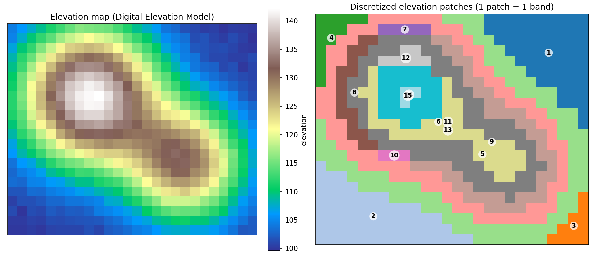
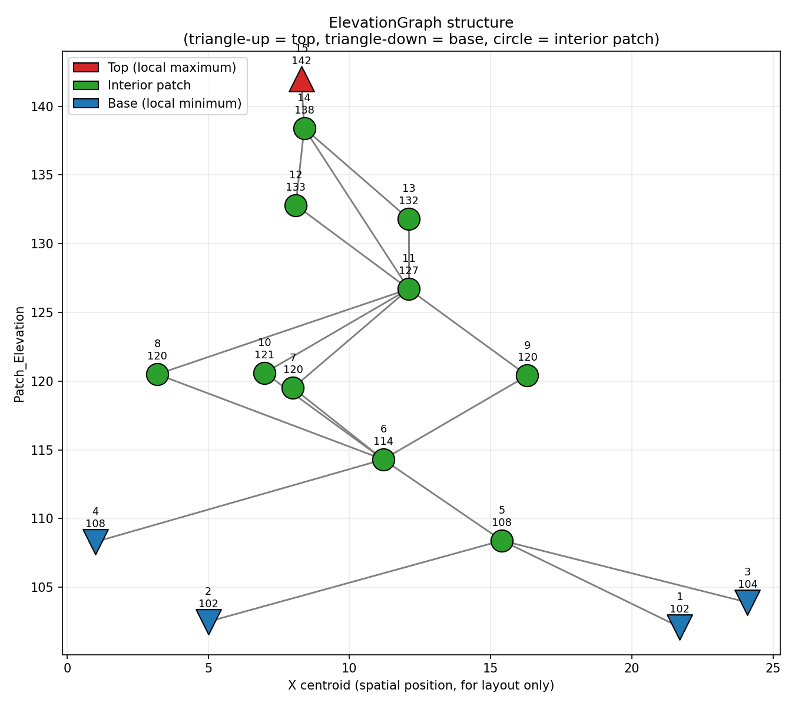


# Elevation Graph Type

Represents a graph where nodes correspond to patches of the elevation map (DEM, elevation map) and the connections in this graph represent the relationship between each patch and its neighboring patches. The parent nodes of a node are those neighbors that have higher elevation than it, while child nodes have lower elevation. Neighboring patches are never allowed to share the same elevation, since that would leave the parent/child relationship between them undefined.

Each node of the graph maintains the following additional information:

- Patch identifier corresponding to the node.
- Elevation of the patch corresponding to the node.
- Area of the patch corresponding to the node itself.
- Combined area of the patch corresponding to the node. This is not supplied directly — it's computed as the sum of the patch's own area and the combined area of all its parent nodes.
- Slope of the patch corresponding to the node.
- Y coordinate of the patch corresponding to the node. Typically, this is the centroid coordinate.
- X coordinate of the patch corresponding to the node. Typically, this is the centroid coordinate.

Thus, this graph represents a discretized version of the elevation map, where each patch represents a portion of the map with the same elevation.

[Create Elevation Graph](Create-Elevation-Graph.html) builds one from a [Neighborhood Table](Neighborhood-Table-Type.html) (defining which patches are spatially adjacent, by patch id) and a properties [Table](Table-Type.html) shaped `Patch_Id*` (Real), `Patch_Elevation` (Real), `Patch_Area` (Real), `Patch_Slope` (Real), `Patch_Y` (Real), `Patch_X` (Real) — supplying every node field above except the derived combined area. [Save Elevation Graph](Save-Elevation-Graph.html), part of the Elevation Graph debugging tools, writes one out for inspection.

## GUI Editor

Elevation Graph Type has no editor. A value can only come from [Create Elevation Graph](Create-Elevation-Graph.html) — never typed in directly.

## EGO Script

For the same reason, Elevation Graph Type has no literal constant syntax in [EGO Script](EGO-Script.html) — see [Constants](EGO-Script.html#constants).

## Automatic Conversions

- **Converted from**: None.
- **Converted to**: [Neighborhood Table Type](Neighborhood-Table-Type.html) and [String Type](String-Type.html) (using [JSON](https://en.wikipedia.org/wiki/JSON) format).

See [Type System](Type-System.html) for the complete conversion reference across all types.

