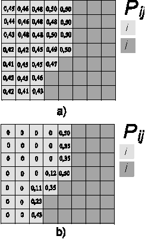


# Expander

## Description

This functor expands or contracts previous patches of a certain class or category.

## Inputs

| Name | Type | Description |
| --- | --- | --- |
| Landscape | [Categorical Map Type](Categorical-Map-Type.html) | Map of classes or categories. |
| Probabilities | [Map Type](Map-Type.html) | Map of spatial probabilities. |
| Changes | [Change Matrix Type](Change-Matrix-Type.html) | Matrix of quantity of changes. |
| Transition Parameters | [Transition Function Parameter Matrix Type](Transition-Function-Parameter-Matrix-Type.html) | Matrix of transition function parameters consisting of mean patch size, patch size variance, and isometry. By varying these parameters, various spatial patterns can be reproduced. Increase the patch size for a less-fragmented landscape. Increase the patch size variance for a more diverse landscape, and set isometry greater than one for more isometric patches. Typically, the isometry defines the aggregation level of a patch: assuming that v is the current isometry value, 0\<v\<1 forces disaggregation, v>1 forces aggregation, and v=1 is ignored. The mean patch size and the variance define the size of the patches that will be added to existing ones. |

## Optional Inputs

| Name | Type | Description | Default Value |
| --- | --- | --- | --- |
| Neighbor Window Lines | [Positive Integer Value Type](Positive-Integer-Value-Type.html) | Number of lines of the neighbor search window. This is an advanced port. | 3 |
| Neighbor Window Columns | [Positive Integer Value Type](Positive-Integer-Value-Type.html) | Number of columns of the neighbor search window. Patches can be created in a diffuse way by increasing the neighbor search window to values greater than 3 for lines and columns; a 3x3 window corresponds to the Moore neighborhood. This is an advanced port. | 3 |
| Prune Factor | [Real Value Type](Real-Value-Type.html) | A multiple of the quantity of cells to be changed, used to size the vector where cells are ranked for the subsequent draw. Prune Factor multiplies the expected number of cells to be changed to set the quantity of possible cells, based on their spatial probability, that take part in the selection mechanism of new patch nuclei. Increasing this value increases the stochasticity of the selection of patch pivot cells. This is an advanced port. | 10 |

## Outputs

| Name | Type | Description |
| --- | --- | --- |
| Changed Landscape | [Categorical Map Type](Categorical-Map-Type.html) | Map of classes or categories. |
| Corroded Probabilities | [Map Type](Map-Type.html) | Map of depleted spatial probabilities. Where a change occurred, the probability value is set to zero. |
| Remaining Changes | [Change Matrix Type](Change-Matrix-Type.html) | Matrix of the quantity of changes that remain for each transition, in case the functor does not succeed in making all the specified changes. |

## Group

[Simulation](Functor-List.html#simulation)

## Notes

Dinamica EGO's transition engine relies on two complementary local cellular-automaton rules to select which cells change: Expander and Patcher. The first process is dedicated only to the expansion or contraction of existing patches of a class, and is called Expander. The second process forms brand-new patches through a seeding mechanism, and is called Patcher.

Patcher searches for cells around a chosen location for a combined transition by first electing the core cell of the new patch, then selecting a specific number of cells around that core cell according to their transition probabilities, as depicted below:

Patch isometry is a number varying from 0 to 2. Patches assume a more isometric form as this number increases.

The size of new patches and expansion fringes is set according to a lognormal probability distribution, so the mean and variance of the patch sizes to be formed must be specified.

Probabilities carries one spatial-probability layer per transition, named `probability_i_to_j`, where i and j are the origin and destination categories of the transition.

See Patterns of Change for different examples of patches generated using [Patcher](Patcher.html) and [Expander](Expander.html).

## Internal Name

Expander

## Usage examples

See practical examples of this functor in Lesson 18: Building a land-use and land-cover change simulation model

