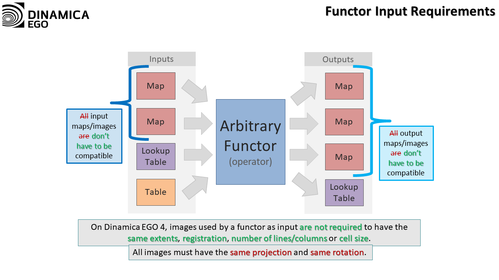
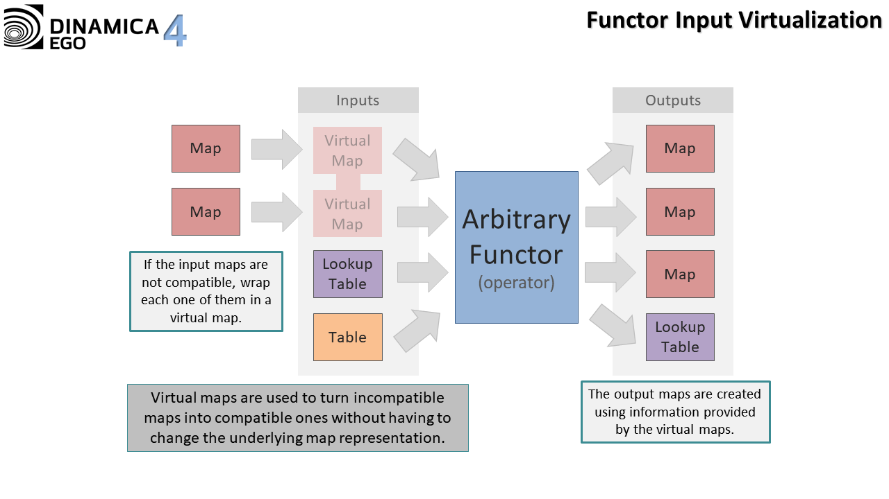
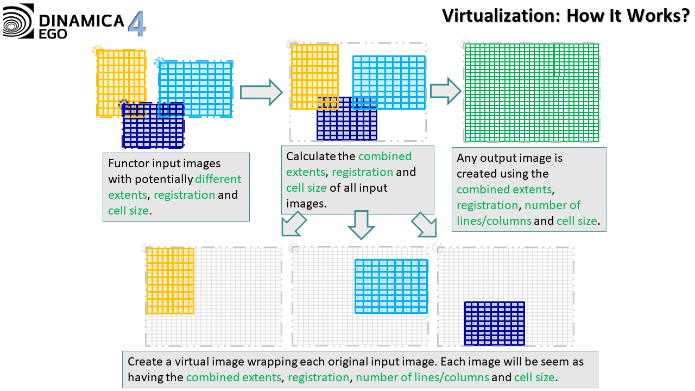
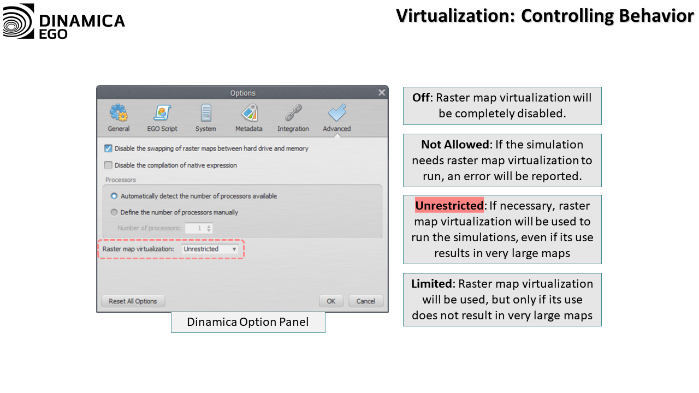
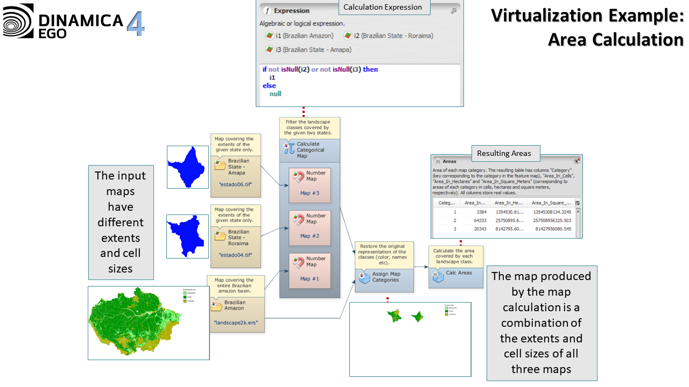
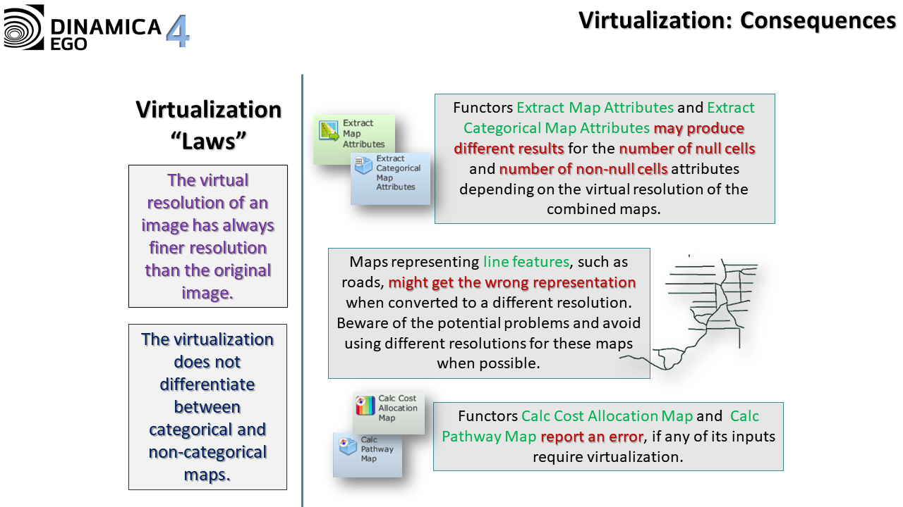
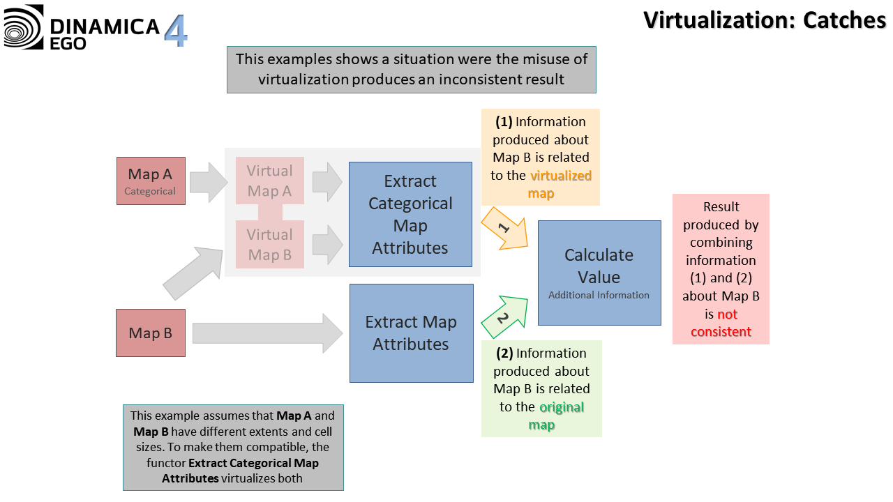


# Image Virtualization

Image virtualization, map virtualization, raster virtualization, or even multi-resolution are the different names given to the ability to manipulate images with different extents, resolutions, or numbers of lines and columns.

Older versions of Dinamica required all maps used as inputs of a model to have the same number of lines and columns (and, as a consequence, the same extents). This was changed by enforcing the proper use of map projections (all maps used as part of a model must share the same projection) and registration coordinates.

Using only input maps with the same extents and resolution always disables virtualization, producing exactly the same result as in older versions of Dinamica EGO, before virtualization was introduced.

## Requirements

Map computations in Dinamica use image virtualization to extend and adjust, at runtime, the image dimensions, making sure that all images presented to any operator have the same number of lines and columns. This allows images used by any computation to have different dimensions while retaining the ability to run the calculation in parallel at high speed.

Typically, the only requirement when using virtualization is that all images share the same projection and rotation (rotation refers to the direction the image's north points toward, and is non-zero if the image's north points in a direction other than the image's top), although different models can use different projections and rotations. It is also possible to use maps with different projections as part of the same model, as long as images with different projections are not given as inputs to the same functors at the same time.

To facilitate the re-projection of maps, ensuring that the projections are the same, a convenient wrapper around [gdal_warp](http://gdal.org/gdalwarp.html) and [gdal_translate](http://gdal.org/gdal_translate.html) called [Transform Map](Transform-Map.html) is provided. This functor simply runs those GDAL utilities distributed with Dinamica EGO.

All analysis concerning projections and what they represent is performed internally using [GDAL](http://gdal.org/). However, the map virtualization itself is performed independently by Dinamica.

## Virtualization Explained

Older versions of Dinamica could only manipulate maps with the same number of lines and columns. Additional information such as registration coordinates, resolution, etc., was not treated uniformly by all functors, and many of them simply ignored this information in the input maps.

Dinamica handles map extents and resolution in a very uniform way. Basically, when a set of maps is given to a functor, they are first analyzed to determine the minimum extent and the highest resolution an input map should have to best cover all necessary cells. Then, each input map is wrapped in a virtual version of itself with this new resolution and extent. The functor receives those virtual versions and uses them to perform the computation. By using this virtualization process, Dinamica ensures that all maps given to a functor have the same number of lines and columns, resolution, and extents. It is also worth noting that the same map might have different virtual representations depending on the original set of maps given to a particular functor.

The virtual resolution of the resulting virtual maps is always the highest resolution (smallest cell size) among all maps involved in the virtualization process. This minimizes the number of cells that need to be analyzed when determining which original cell a given virtual cell corresponds to.

## Controlling Virtualization

The virtualization process is mostly automatic and happens by simply passing maps with different extents and resolutions to any functor. However, the user can constrain the virtualization process using the options available under *Tools* → *Options* \| *Advanced* \| *Virtualization*. The user can choose one of the following options:

- **Not Allowed**: If the simulation needs raster map virtualization to run, an error will be reported. Otherwise, the simulation will run as if using a previous version of Dinamica EGO. It does not have any effect on operations using region managers.
- **Unrestricted**: If necessary, raster map virtualization will be used to run the simulations, even if its use results in very large maps compared to the dimensions of the input maps.
- **Limited**: Raster map virtualization will be used, but only if its use does not result in very large maps compared to the dimensions of the input maps. Otherwise, an error will be reported. It does not have any effect on operations using region managers.

The selected option is also presented in the status bar. Double-clicking the corresponding label in the status bar brings up the relevant tab of the *Options* dialog, where the *Raster map virtualization* option can be edited.

## Example

The following example shows how virtualization works in practice:

## Limitations

Functors [Calc Cost Allocation Map](Calc-Cost-Allocation-Map.html) and [Calc Pathway Map](Calc-Pathway-Map.html) will always report an error if virtualization is required to make their input maps compatible. The reason behind this behavior is simple: virtualization often replicates a cell, turning it into many cells with the same value when the resolution of a map increases, but these functors need the input cost map to have no local minimums. Replicating a cell would create a local minimum, which would prevent these functors from working properly.

Some other functors, such as [Extract Map Attributes](Extract-Map-Attributes.html) and [Extract Categorical Map Attributes](Extract-Categorical-Map-Attributes.html), can produce a result that is different from the result that would be obtained using the original versions of the map. Typically, this is not a problem if the information produced by these functors is used with care. For example, it is safe to extract the number of non-null cells and multiply it by the cell resolution, provided that the values come from the *same* call to [Extract Map Attributes](Extract-Map-Attributes.html) or [Extract Categorical Map Attributes](Extract-Categorical-Map-Attributes.html). This works because map virtualization changes the cell resolution and the number of non-null cells of a map simultaneously, making the multiplication result consistent with the one that would be obtained using the original version of the map. The same is true for all other attributes.

It is also worth noting that certain maps should not be mixed with other maps of different extents/resolutions, such as maps representing line features, especially roads. Some algorithms might assume that a road is always exactly one cell wide, and the virtualization process might produce a map where this assumption does not hold.

---

## See Also

- [Useful Tips for Using the Graphical Interface - Virtualization](gui/Options.html#virtualization)

