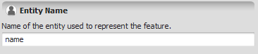


# Name Type

A name is a sequence of characters starting with a letter or underscore ("\_") and followed by any number of letters, digits, or underscores ("\_").

Names are automatically [trimmed](https://en.wikipedia.org/wiki/Trimming_(computer_programming)), and spaces are automatically replaced by underscores ("\_").

## GUI Editor



The name editor presents a text field where the name's characters can be typed directly.

## EGO Script

Names are sequences of valid characters enclosed by double quotes ('"'):

```
"Amazon"
"North"
"landscape123"
"landscape_123"
"x1_and_a_name"
```

A name can be any length.

## Automatic Conversions

- **Converted from**: [String Type](String-Type.html). [Index Or Name Type](Index-Or-Name-Type.html) — can fail; only succeeds if the value holds a name rather than an index.
- **Converted to**: [String Type](String-Type.html), [Index Or Name Type](Index-Or-Name-Type.html), [Table Value Type](Table-Value-Type.html), and [Tuple Type](Tuple-Type.html).

See [Type System](Type-System.html) for the complete conversion reference across all types.

