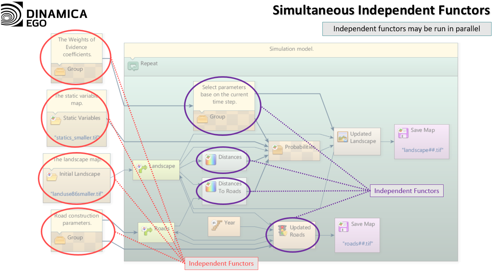
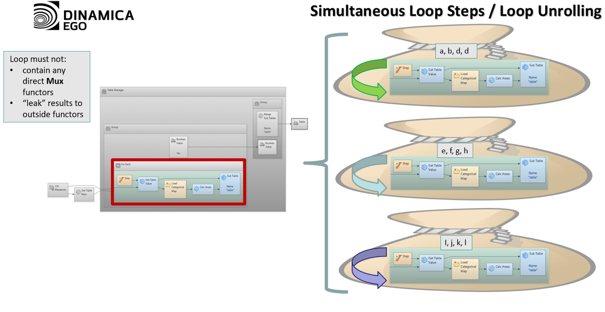
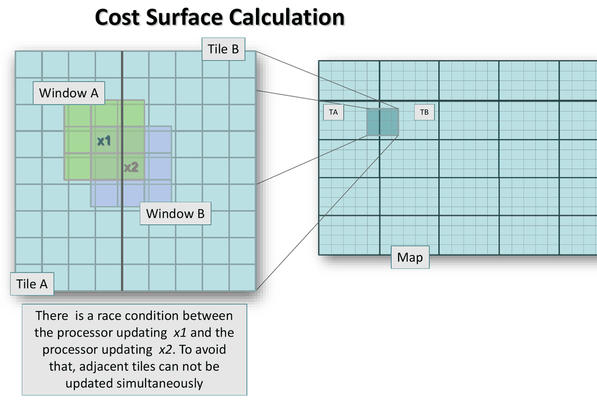
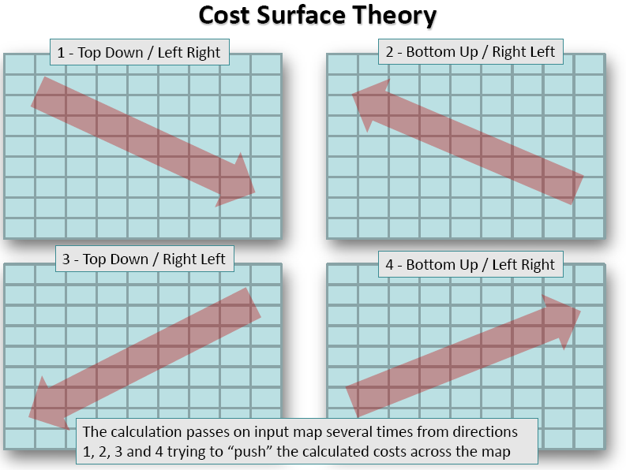
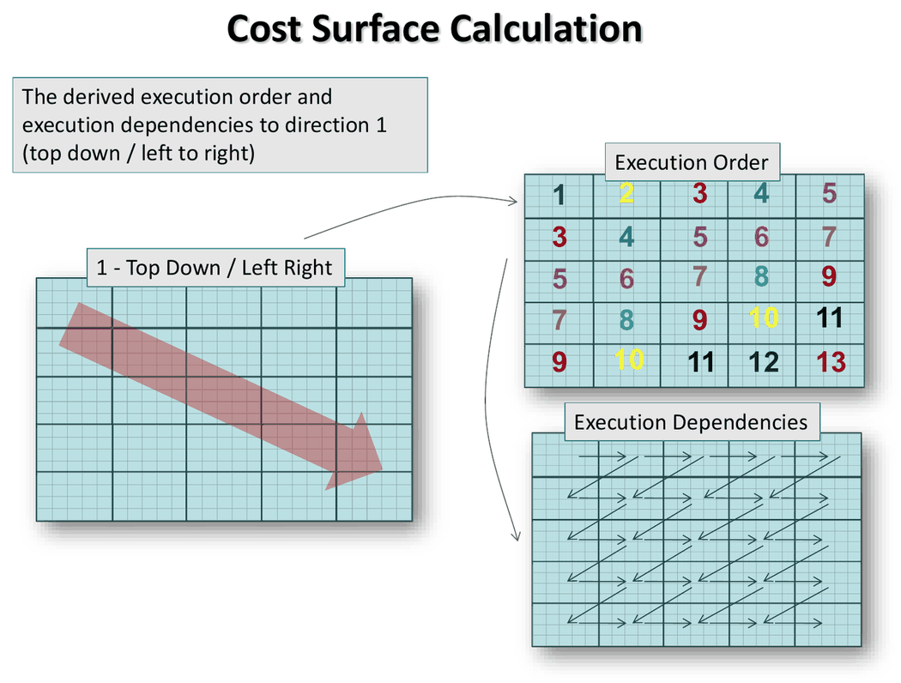
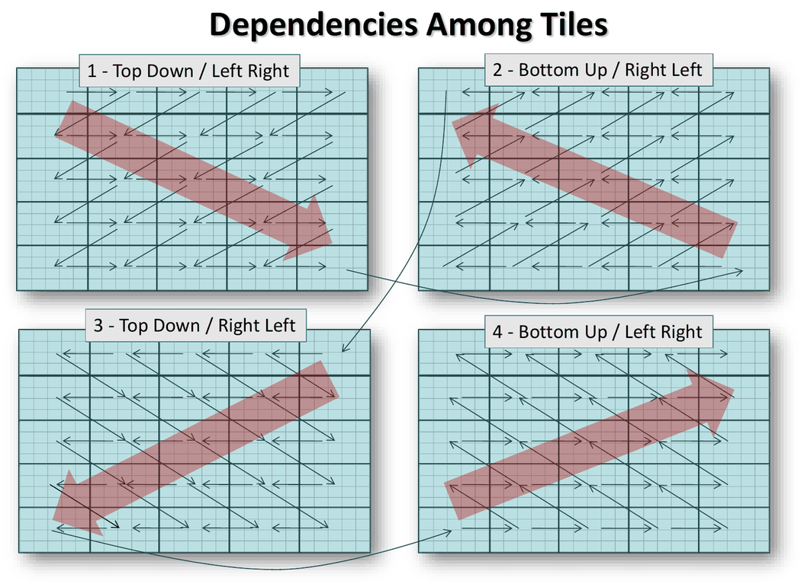
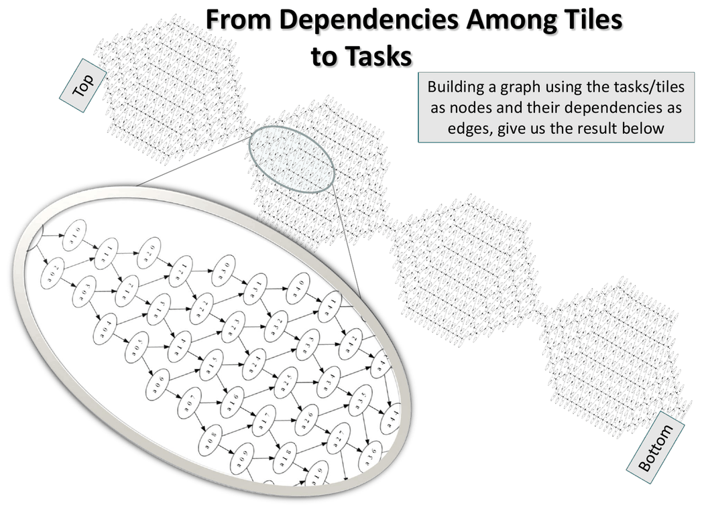
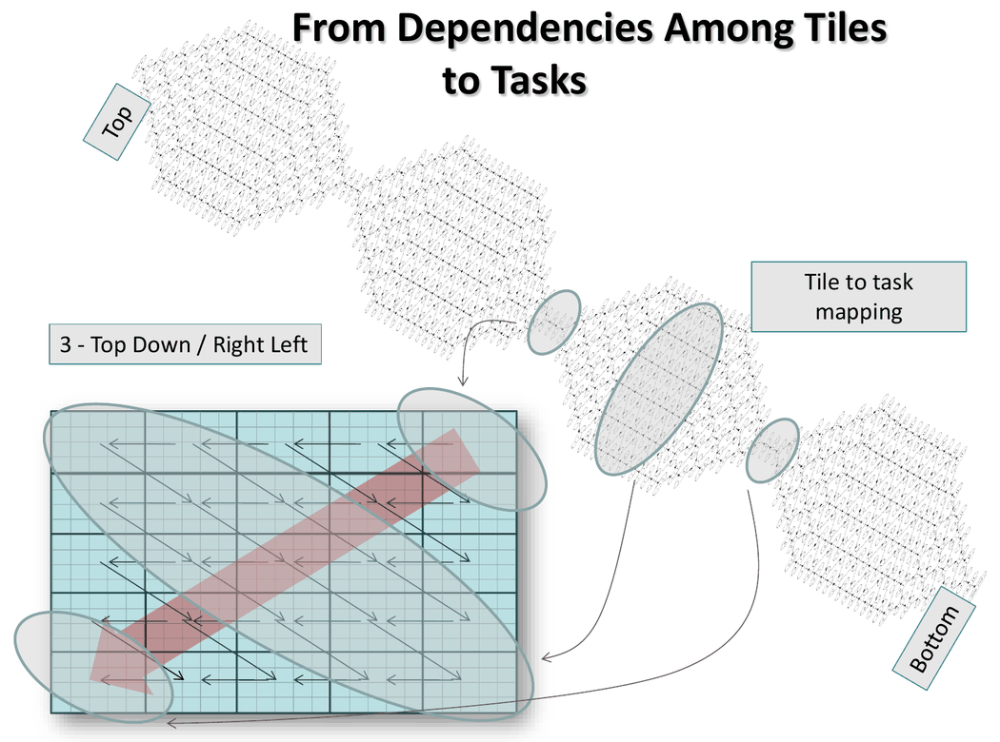
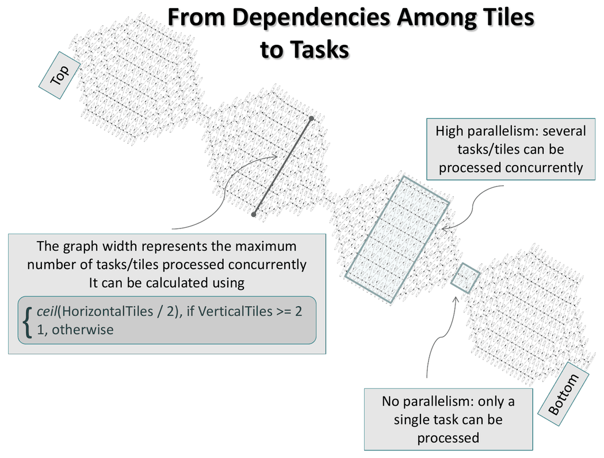


# Parallel Execution

Dinamica EGO runs independent parts of a model at the same time, on several processor cores and, when available, on accelerator devices such as GPUs. The parallelization is automatic: what can run at the same time follows from the model's dependency graph, described in [Basic Data Flow](Basic-Data-Flow.html), so a model needs no changes to run in parallel. This page explains how the work is divided and the options that control it.

## Tasks and Workers

The execution engine breaks a model into **tasks**, according to the dependencies of the model and the resources of the machine, and runs them on a pool of **workers**. By default there is one worker per logical processor.

A worker runs one task at a time. Running a task can create more tasks, and a task can pause and wait for other tasks before it continues. A worker with no task to run is idle.

Each worker keeps its own queue of tasks. A worker that runs out of tasks takes one from the queue of another worker (**work stealing**), so the load is balanced while the model runs, without requiring the tasks to have the same size. Workers can process different parts of the same data at the same time; for example, different parts of a map can be read and written simultaneously.

## What Runs in Parallel

- **Independent functors.** Functors that have no data or sequence connection between them, directly or indirectly, can run at the same time.

- **Loop steps.** The steps of a loop can run at the same time when three conditions hold: no mux is used directly inside the loop, nothing produced inside the loop is used outside it, and no functor inside the loop is used as a submodel's output port. Adding a mux, such as `MuxValue 0 0`, forces the steps to run in sequence. When the steps run in parallel, they are grouped into tasks, and each task runs the loop for a subset of the inputs. See [The one exception: feedback in loops](Basic-Data-Flow.html#the-one-exception-feedback-in-loops). The Explorer's **Attributes** column shows whether a loop can run several steps at the same time.

- **Map loading.** Maps are loaded in parallel.
- **Work inside a functor.** Many functors split their own job, such as processing a map, into tasks that run on different workers. The number of tasks is set by the granularity. These tasks can create new tasks and can depend on each other in complex chains, and a functor can gather tasks into task groups and wait for a whole group to finish.

### Example: Calc Cost Map

[Calc Cost Map](functors/Calc-Cost-Map.html) shows how elaborate the arrangement of tasks inside a functor can be. The cost of each cell depends on the costs of its neighbors, so the map cannot simply be cut into independent pieces.

**Tiles.** The map is divided into a grid of tiles, and each tile is processed by one task. The grid has up to 4 × granularity + 2 rows and as many columns, with at least 10 cells per tile in each direction; small maps get fewer tiles. When the maps cannot be read and written in parallel, the whole map is a single tile.

**Why adjacent tiles wait for each other.** The cost of a cell is calculated from the 3×3 window around it, so the window of a cell at the edge of a tile reaches into the neighboring tile. If two adjacent tiles were processed at the same time, one task could read a cell while the other is updating it. Adjacent tiles are therefore never processed at the same time.

**Four sweeps per pass.** Each pass scans the map four times, each time starting from a different corner. Each sweep has one task per tile.

**Order within a sweep.** In each sweep, a tile's task waits for the tiles before it in the sweep direction. In the first sweep (top down, left to right), a tile waits for the tiles above, to the left and above-right of it. The result is a diagonal front that moves across the map: the numbers below show the step in which each tile runs, and tiles with the same number run at the same time.

**Chained sweeps.** Each sweep starts at the corner where the previous one ends: its first tile waits for the last tile of the previous sweep. That last tile depends on every other tile of its sweep, and every tile of the new sweep depends on the new sweep's first tile, so the sweeps run one after the other. Tasks run at the same time only within a sweep.

**The task graph.** With the tiles as nodes and their dependencies as edges, the four sweeps form one graph of tasks. Each sweep appears as a section of the graph that widens and narrows again.

Each tile of a sweep is one task, so each section of the graph is one sweep. In the third sweep (top down, right to left), the narrow start of its section is the task of the top-right tile, where the sweep begins. The wide middle is the diagonal band of tiles that the front crosses as it moves, all of which can run at the same time. The narrow end is the task of the bottom-left tile, where the sweep ends and the next one begins.

The width of the graph at each point is the number of tasks that can run at the same time. The maximum is the number of tile columns divided by 2, rounded up, when there are at least two tile rows, and 1 otherwise. At the start and end of each sweep, where the graph narrows, only one task can run.

**Task group per pass.** The tasks of the four sweeps form one task group, and Calc Cost Map waits for the group to finish. It then starts a new pass while any cost improved, up to **Maximum Number of Passes**. A tile whose cells and neighboring tiles did not change skips its calculation.

## Number of Workers

The number of workers is set by **Tools → Options → Advanced → Automatically detect the number of processors available** in the graphical interface, or by the `-processors` option of [Dinamica Console](Dinamica-Console.html), where `0` means automatic detection. See [Number of Workers](gui/Options-And-Performance.html#number-of-workers), which also explains when using more workers than processors can help.

## Granularity

The **granularity** is the number of tasks a job is split into. It is the number of workers multiplied by a granularity multiplier, rounded, with a minimum of one. The default multiplier is 2, so with 8 workers a job is split into 16 tasks. More tasks make it easier to balance the load across workers; fewer tasks reduce the cost of creating and coordinating them.

- The `-granularity` option of [Dinamica Console](Dinamica-Console.html) replaces the default multiplier for the whole run.
- The [Execution Policy](functors/Execution-Policy.html) container limits the granularity of the functors inside it: **Maximum Granularity** sets the maximum number of tasks, and **Force Specified Granularity** makes it use exactly that number.

## Accelerator Devices

Accelerator devices are OpenCL devices, usually GPUs. Dinamica EGO can run part of the work on them, alongside the regular workers.

- The `-accelerators-policy` option of [Dinamica Console](Dinamica-Console.html) selects the devices used: `NO_DEVICES=0`, `ALL_DEVICES=1` or `USER_CONFIG=2`.
- `-list-accelerators` lists the available devices without running the model.
- The **Computing Target** port of [Execution Policy](functors/Execution-Policy.html) selects, for the functors inside it, whether accelerator devices may be used (**Default**), are never used (**Processors Only**) or must be used (**Accelerator Devices Only**, which raises an error when no device is available).
- Running the console with `-log-level=6 -log-subsystem=2` logs the OpenCL subsystem in detail, which helps to investigate problems with a device.

> **Tip:** Placing part of a model inside an [Execution Policy](functors/Execution-Policy.html) with **Computing Target** set to **Processors Only** avoids errors from accelerator devices in that part, without changing the accelerator policy of the whole run.

## Turning Parallelism Off

These options of [Dinamica Console](Dinamica-Console.html) disable each kind of parallel execution, which helps to isolate problems or compare results:

| Option | Effect |
| --- | --- |
| `-disable-parallel-functors` | Runs independent functors one at a time. |
| `-disable-parallel-steps` | Runs the steps of loops one at a time. |
| `-disable-parallel-map-load` | Loads maps one at a time. |
| `-processors=1` | Uses a single worker. |

## Running Parts of a Model on Other Machines

The [Run Remotely](functors/Run-Remotely.html) container sends its content to another machine through a coordinator, instead of splitting it among the local workers. See [Remote Execution](Remote-Execution.html).

## Monitoring Parallel Execution

- While a model runs, hovering over the progress bar in the lower-left corner of the interface shows the task each worker is performing. See [Message Log](gui/Interface-Elements.html#message-log).
- **Show model bottleneck only**, in the [Explorer](gui/Interface-Elements.html#explorer), shows only the 10% of functors with the largest total execution time.
- Running [Dinamica Console](Dinamica-Console.html) with `-profile` in an interactive terminal opens a text interface with tabs for the message log, the workers, the accelerator devices and memory use.

