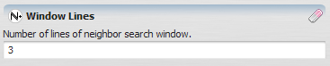


# Positive Integer Value Type

A [positive integer](https://en.wikipedia.org/wiki/Positive_integer) denotes the positive [integers](https://en.wikipedia.org/wiki/Integer).

So, it basically denotes the sequence of positive, non-fractional values starting with 1. Ex: 1, 2, 3 ...

## GUI Editor

## EGO Script

Positive integers in Dinamica EGO use the standard representation for integer numbers.

- 1, 2, 198, etc.

It is not possible to enter integer values using any notation other than decimal.

## Automatic Conversions

- **Converted from**: [Non Negative Integer Value Type](Non-Negative-Integer-Value-Type.html) — can fail; no valid target when the value is zero. [Real Value Type](Real-Value-Type.html) — can fail when not positive; lossy (truncates) otherwise. [Integer Value Type](Integer-Value-Type.html) — can fail; no valid target when the value isn't positive. [Index Or Name Type](Index-Or-Name-Type.html) — can fail; only succeeds if the value holds an index rather than a name. [Log Tag Type](Log-Tag-Type.html) — converts to the level's number (e.g. Info → 4). [Cell Type](Cell-Type.html) — converts to the cell type's number (e.g. Signed 32 Bit Integer → 5). [Table Value Type](Table-Value-Type.html).
- **Converted to**: [Non Negative Integer Value Type](Non-Negative-Integer-Value-Type.html) — lossless; widening, the value itself is unchanged. [Boolean Value Type](Boolean-Value-Type.html) — zero → False, any non-zero value → True — though a Positive Integer is never zero, so this always yields True in practice. [Real Value Type](Real-Value-Type.html). [Null Value Type](Null-Value-Type.html). [Log Tag Type](Log-Tag-Type.html) — the number selects the level by its position in Log Tag Type's table (e.g. 4 → Info). [Cell Type](Cell-Type.html) — the number selects the cell type by its position in Cell Type's table (e.g. 5 → Signed 32 Bit Integer). [String Type](String-Type.html). [Enum Type](Enum-Type.html). [Index Or Name Type](Index-Or-Name-Type.html). [Table Cell Type](Table-Cell-Type.html). [Table Value Type](Table-Value-Type.html). [Tuple Type](Tuple-Type.html).

See [Type System](Type-System.html) for the complete conversion reference across all types.

