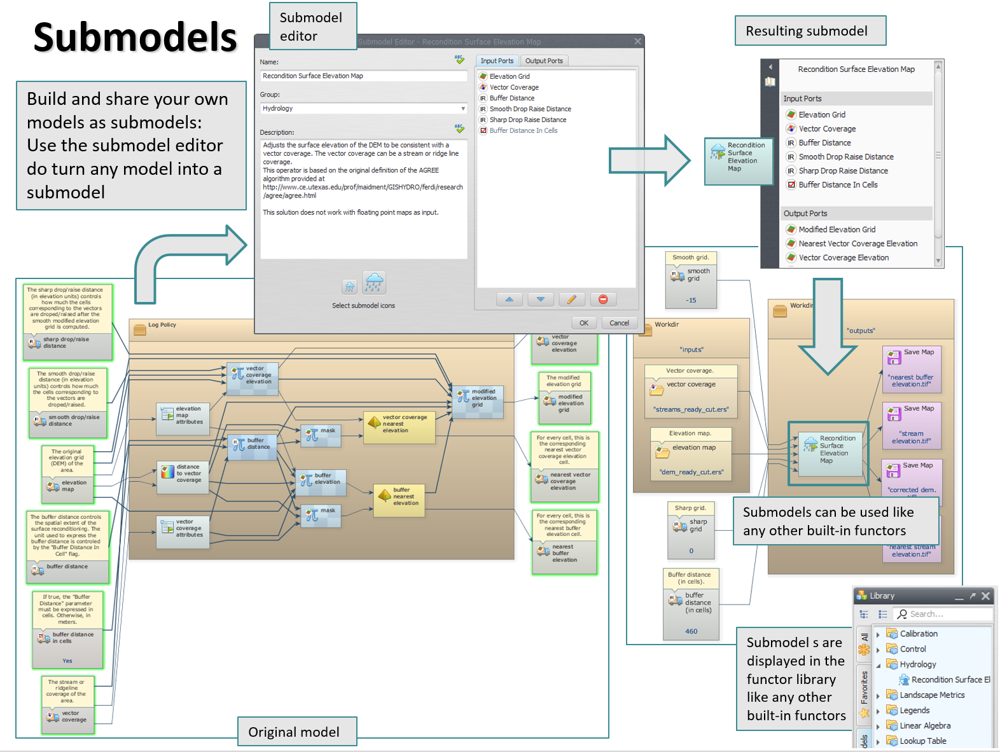
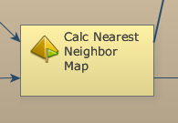
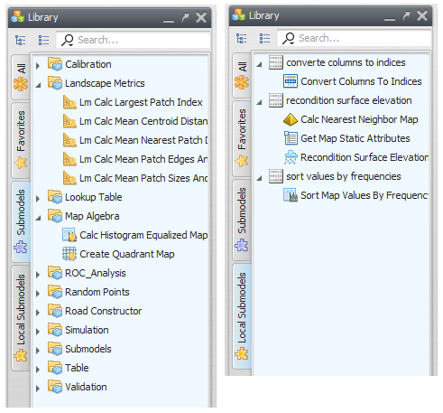
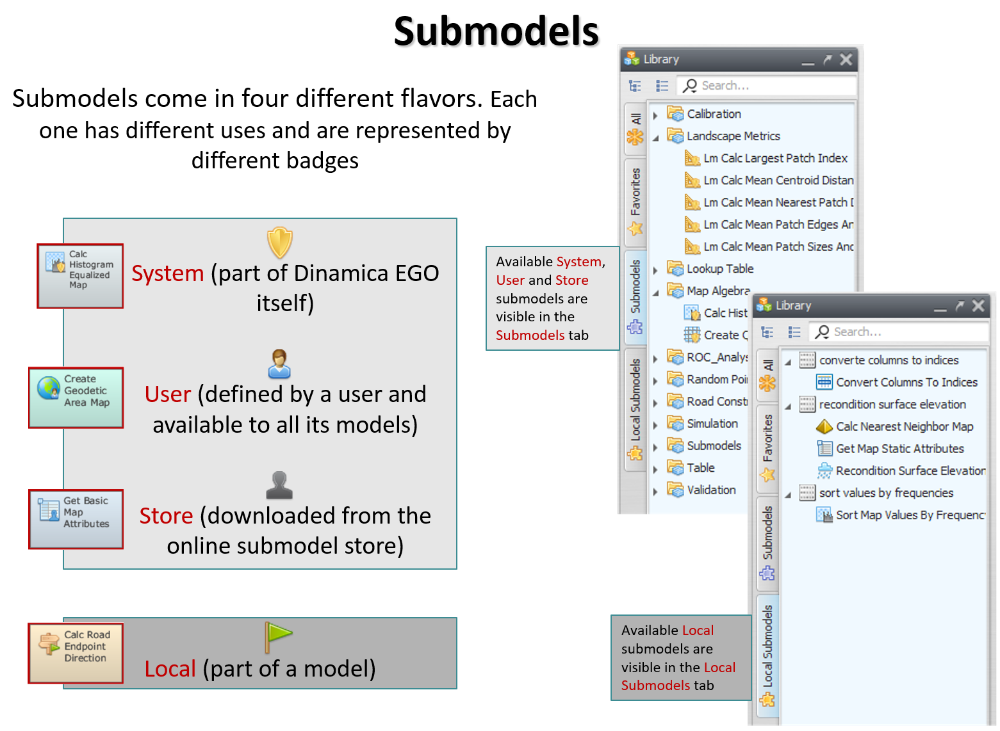


# Submodels

Submodels are a way of reusing parts of a model to perform specific operations inside other models.

By using them, we can reduce the amount of work we have to put in when creating models that share similar functionalities. They are also an important tool for abstraction, hiding unnecessary details and making it easier to reason about the model concept and its implementation.

Conceptually, a submodel is a combination of functors exporting inputs and outputs to be bound externally, but, from the user point of view, a submodel is used just like any other ordinary functor.

Submodels are also first class citizens that can be transferred from one model to another. They can also be modified and updated at any time without breaking the model where they are being used. They can also depend on other submodels, as long as their definitions do not form a cycle — if an operation (creating, updating, or using a submodel) would introduce a dependency cycle, Dinamica detects the potential cycle and prevents the operation from completing.

# Submodels

Submodels are a way of reusing parts of a model to perform specific operations inside other models.

By using them, we can reduce the amount of work we have to put in when creating models that share similar functionalities. They are also an important tool for abstraction, hiding unnecessary details and making it easier to reason about the model concept and its implementation.

Conceptually, a submodel is a combination of functors exporting inputs and outputs to be bound externally, but, from the user point of view, a submodel is used just like any other ordinary functor.

Submodels are also first class citizens that can be transferred from one model to another. They can also be modified and updated at any time without breaking the model where they are being used. They can also depend on other submodels, as long as their definitions do not form a cycle — if an operation (creating, updating, or using a submodel) would introduce a dependency cycle, Dinamica detects the potential cycle and prevents the operation from completing.

## Submodel Types

Basically, we have four different types of submodels in Dinamica EGO: system submodels, user submodels, local submodels, and store submodels. The different types of submodels are identified by different icon badges on the representation of the corresponding functors on the model.

> **Note:** The storage paths mentioned throughout this page (in the table below and in the [Where Submodels Are Stored](#where-submodels-are-stored) section) differ between **Windows** and **Linux**; both are listed where relevant.

| Type | Badge/Decoration | Description |
| --- | --- | --- |
| System Submodel |  | System submodels are submodels provided by Dinamica itself and cannot be changed by the user. System submodels can be used in models created by any user. On Windows, they are usually located at `C:\Program Files\Dinamica EGO <version>\Submodels`. On Linux, system submodels are stored inside the application itself, with no corresponding filesystem path. |
| User Submodel |  | User submodels are submodels created by each user and are available only for that specific user. User submodels can be used in models created only by that user. On Windows, they are usually located at `C:\Users\<User>\Documents\Dinamica EGO <version>\Submodels`. On Linux, they are usually located at `/home/<User>/Dinamica EGO <version>/Submodels`. |
| Local Submodel |  | Local submodels are submodels that are related to a specific model. They are bound to that model and cannot be used in a different model unless they are explicitly transferred to it. |
| Store Submodel |  | Store submodels are submodels downloaded by the user from the online Submodel Store. They are kept in a SQLite database. On Windows, it is typically located at `C:\Users\<User>\AppData\Local\Dinamica EGO <version>\SubmodelDatabase.sqlite`. On Linux, it is typically located at `/home/<User>/.local/share/Dinamica EGO <version>/SubmodelDatabase.sqlite`. |

> **Note:** If submodels of different types share the same name, there is a precedence order: **local submodels** take precedence over **user submodels**, which in turn take precedence over **store submodels**.

System and user submodels are presented in the *Submodels* tab while local submodels are presented in the *Local Submodels* tab of the Functor Library. Local submodels are only presented when their associated model is opened.

In practice, users can only create local submodels. These local submodels can later be promoted to user submodels, making them a definitive part of the user's tool set.

### Access Scope

The four submodel types differ in who can see and use them, from narrowest to broadest:

- **Local Submodel** — scoped to the single model it belongs to. It is not automatically visible from any other model, not even other models owned by the same user; to use it elsewhere, it must be explicitly copied into that other model (see [Copying (Importing) a Local Submodel Between Models](gui/Submodels-In-The-GUI.html#copying-importing-a-local-submodel-between-models)), becoming an independent copy in the process.
- **User Submodel** — scoped to the user account that created it. It is automatically available across all of that user's models, with no import step needed, but it is not visible to other users of the same machine.
- **Store Submodel** — same per-user scope as a user submodel (available across all of that user's models, not visible to other users), but its content comes from the shared online [Submodel Store](#the-submodel-store) rather than from something the user authored. The distinction from a user submodel is about origin, versioning, and storage, not visibility.
- **System Submodel** — the broadest scope: bundled with the Dinamica EGO installation itself, so it is available to every user on every model, and cannot be modified by any user.

This scope ordering is also why local submodels take precedence over user submodels, which in turn take precedence over store submodels, when names collide. A local submodel can be widened to user scope by [publishing](#turning-a-local-submodel-into-a-user-submodel-publishing) it; there is no equivalent operation to widen a user or store submodel into a system submodel.

### Where Submodels Are Stored

#### Local Submodels

Local submodels are stored together with the model script. When using the [EGO Script](EGO-Script.html) (`.ego`) or [EGOML](EGOML-Script.html) (`.egoml`) format, Dinamica creates a folder next to the script named after the script filename, with the extension replaced by `_ego` or `_egoml` and `_Submodels` appended. For example, a model named `simulation model.egoml` will have its local submodels stored in a subfolder called `simulation model_egoml_Submodels`, and the script files corresponding to each local submodel are located inside that folder. Using a unique submodel folder for each script guarantees that submodels from one script are completely independent from the submodels of any other script.

> **Note:** If a folder named "Submodels" exists in the same folder as the script, and the script-specific `..._Submodels` folder described above is not found, Dinamica reads the local submodels from that generic "Submodels" folder instead — this folder is shared among all the scripts located in that folder. This is legacy behavior and may be removed in a future version.

The EGOMLX format works differently: it stores the local submodels and the script together in the same binary file, so no separate submodel folder is used.

#### User Submodels

User submodels are typically stored in the folder `C:\Users\<User>\Documents\Dinamica EGO <version>\Submodels` on Windows, or `/home/<User>/Dinamica EGO <version>/Submodels` on Linux.

#### Store Submodels

Store submodels — those downloaded by the user from the online Submodel Store — are kept in a SQLite database. On Windows, it is typically located at `C:\Users\<User>\AppData\Local\Dinamica EGO <version>\SubmodelDatabase.sqlite`. On Linux, it is typically located at `/home/<User>/.local/share/Dinamica EGO <version>/SubmodelDatabase.sqlite`.

#### Copying Submodels to Another Computer

To use the same submodels on another computer, copy the files that hold them to the same locations on that computer:

- **Store submodels:** copy the `SubmodelDatabase.sqlite` file. On Windows, type `%LOCALAPPDATA%` in the address bar of Windows File Explorer, open the `Dinamica EGO <version>` folder, and copy the file from there. This single file contains all the store submodels downloaded on that computer.
- **User submodels:** copy the contents of the `Submodels` folder in `Documents\Dinamica EGO <version>`.

Close Dinamica EGO before copying files into the destination. Copying `SubmodelDatabase.sqlite` replaces the file already in the destination folder, so any store submodels that exist only on the destination computer are replaced.

#### System Submodels

System submodels are provided by Dinamica itself: on Windows they are usually located at `C:\Program Files\Dinamica EGO <version>\Submodels`, while on Linux they are stored inside the application itself, with no corresponding filesystem path.

> **Tip:** Changing the definition of **user submodels** may break existing models that use that definition, making those models useless unless the user manually updates each one of them. On the other hand, **local submodels** can be safely updated since their updates are propagated to all local submodels from the same model and to the main model itself.

---

## Creating Submodels

Local submodels can be created in the graphical interface (see [Creating Local Submodels](gui/Submodels-In-The-GUI.html#creating-local-submodels)) or written directly in any text editor, which is especially convenient when working with the [EGO Script](EGO-Script.html) language. The properties that declare a submodel in a script are described in [Submodels](EGO-Script.html#submodels) in the EGO Script reference.

### Creating a Submodel Directly as a Script

A submodel does not have to be created through the GUI: any `.ego` file that declares the right set of `@submodel.*` properties (name, description, group, and its input/output port declarations) is a valid submodel. See [Submodels](EGO-Script.html#submodels) in the EGO Script reference for the full property syntax.

Whether a hand-written submodel script becomes a local or a user submodel is determined entirely by where the file is placed, following the same [storage locations](#where-submodels-are-stored) used for submodels created through the GUI — the `@submodel.name` property, not the filename, is what identifies the submodel.

## Turning a Local Submodel into a User Submodel (Publishing)

Once your local submodel has been developed and fully tested, you can turn it into a user submodel.

To publish a local submodel into a user submodel, click the *Publish Submodel* button on the *Submodel Options* drop-down menu located on the model toolbar.

Turning a local submodel into a user submodel makes reusing the submodel easier — the submodel will always be available to be used in your next models — but it has some drawbacks as well. You are fully responsible for the consequences of updating a user submodel. Beware that, unlike local submodels, your models will not carry a copy of a user submodel as part of their definition. So, if you change a user submodel in a way that breaks compatibility with the models using its definition, those models will not work anymore.

### Dependency Propagation When Publishing as a User Submodel

When a local submodel is published as a user submodel, its dependencies become local submodels of the published submodel, rather than independent user submodels of their own.

Consider a local submodel **A** that depends on local submodels **B** and **C**, where **B** also depends on **C**. Publishing **A** as a user submodel produces a single user submodel, **A**, containing **B** and **C** as local submodels of **A**. **B** and **C** sit side by side inside **A**'s own local submodel set, so **B** does not get a separate copy of **C** — it uses the single copy of **C** held by their common parent **A**, the same way one local submodel depends on another local submodel of the same model. **B** and **C** are not added to the user's submodel set as independent, top-level entries — only **A** is.

This flat structure holds regardless of whether **A** uses **C** directly. Even if **C** is used only by **B**, and not by **A** itself, publishing **A** still places **B** and **C** side by side as local submodels of **A** — **C** is not nested inside **B**.

### Republishing and Naming Collisions

Publishing or sending a submodel again — whether because the local submodel changed, or because a user submodel of the same name already exists for some other reason — behaves differently depending on the target:

- **User submodels are overwritten by name.** Publishing a local submodel as a user submodel always replaces whatever user submodel currently holds that name, whether that is an earlier published version of the same submodel or an unrelated existing user submodel that happens to share the name. Since dependencies become local submodels of the published submodel rather than independent user submodels (see [Dependency Propagation When Publishing as a User Submodel](#dependency-propagation-when-publishing-as-a-user-submodel) above), republishing **A** does not touch any independently named user submodels **B** or **C** — it simply replaces **A**'s local submodels **B** and **C** with their current definitions.
- **Store submodels are versioned, not overwritten.** Sending a submodel to the Store again does not replace the previous submission; it creates a new version, tagged with the Dinamica EGO version in use at the time, following the same versioning behavior described in [Versioning and Compatibility](#versioning-and-compatibility).

### Sending a Submodel to the Store

A user submodel can be sent to the online [Submodel Store](#the-submodel-store), becoming a store submodel. There are two ways to do this:

- From a local submodel directly, using the *Publish Submodel as a Store Submodel* option on the *Submodel Options* drop-down menu. This first turns the local submodel into a user submodel, then sends that user submodel to the Store.
- From an existing user submodel, using the corresponding button on the *Submodel Manager* dialog (*Submodels* → *Submodel Manager*), which sends that user submodel to the Store directly.

### Dependency Propagation When Sending to the Store

When a submodel is sent to the Store, its dependencies are packaged with it rather than published as independent store submodels.

Consider the same local submodel **A**, depending on **B** and **C**, with **B** also depending on **C**. Sending **A** to the Store as a store submodel produces the following structure:

- **A** receives its own local submodel copy of **B** and its own local submodel copy of **C**.
- **B**, in turn, receives its own local submodel copy of **C** — a separate copy from the one held directly by **A**.

The store submodel package therefore ends up containing two independent copies of **C**: one local to **A**, and one local to **B**. Once packaged, these copies are independent of each other, the same as any other local submodels obtained through copying (see [Copying (Importing) a Local Submodel Between Models](gui/Submodels-In-The-GUI.html#copying-importing-a-local-submodel-between-models)).

Unlike publishing to a user submodel, this nesting follows the actual dependency graph. If **C** is used only by **B**, and not by **A** itself, the store submodel package nests **C** inside **B** instead of placing it directly inside **A**: **C** becomes a local submodel of **B**, and **B** a local submodel of **A**.

### Dependencies Are Scoped to Their Store Submodel

The local submodel copies of **B** and **C** packaged inside store submodel **A** exist only because **A** depends on them — they have no independent identity of their own. A packaged dependency inside one store submodel is entirely independent of a same-named dependency packaged inside a different store submodel, and of any unrelated user or store submodel that might share the same name; each store submodel's packaged dependencies are private to it.

## The Submodel Store

The Submodel Store is Dinamica EGO's online repository of submodels shared by the community.

### Versioning and Compatibility

Store submodels are versioned in relation to the Dinamica EGO version active at the time each update is published, rather than through an independent version number. Each time a submodel is published or updated, that update is tagged with the Dinamica EGO version used to make it.

When a user requests a store submodel, they receive the **most recently published update that is compatible with their installed version** — that is, the newest update, among all updates tagged with a version less than or equal to the user's own, regardless of whether an even newer update exists for a higher, incompatible version. Updating a submodel using the same Dinamica EGO version as a previous update simply overrides that previous update, since both share the same version tag.

This has a subtle consequence: an update published later using an **older** Dinamica EGO version can still become the newest compatible update for users on a **newer** version, superseding an update they had previously received — as long as no newer update exists that is tagged with an even higher version. The following worked example illustrates this:

1. A user on Dinamica 8.10 publishes Submodel X, then updates it twice more, all while still on 8.10. Since every one of these updates shares the same version tag (8.10), each one overrides the previous one, leaving "Submodel X v3" as the current update tagged 8.10.
1. At this point, both Dinamica 8.10 and Dinamica 8.11 users receive "Submodel X v3" — 8.10 because it is their own version's update, and 8.11 because no update tagged 8.11 exists yet, so the newest compatible update is still the one tagged 8.10.
1. A user on Dinamica 8.11 now updates Submodel X to "v4". This creates a new update tagged 8.11. From this point, Dinamica 8.11 users receive "Submodel X v4" (the newest update compatible with 8.11), while Dinamica 8.10 users are unaffected and still receive "Submodel X v3" (the update tagged 8.11 is not compatible with them).
1. A user on Dinamica 8.10 now updates Submodel X again, to "v3.1". This overrides the existing update tagged 8.10 (previously "v3"). Dinamica 8.10 users now receive "Submodel X v3.1". Because this update is more recent than the "v4" update tagged 8.11, it also becomes the newest compatible update for Dinamica 8.11 users — so Dinamica 8.11 users now receive "Submodel X v3.1" too, even though "v4" still exists.

## Submodel Expansion and Execution

Before executing a model, Dinamica EGO can expand all submodels used in it, replacing each submodel instance with its internal functor definition. This expansion does not modify the model the user is working on — it is applied to a copy of the model that is submitted for execution, leaving the original model and its submodel instances untouched. This removes data copy constraints caused by submodel usage.

- This behavior is controlled by the *Expand submodels before executing a model* option, found under *Tools* → *Options* \| *Advanced*. On the command line, it can be disabled using the `-disable-submodel-expansions` flag of the [Dinamica Console](Dinamica-Console.html).
- When submodel expansion is enabled, the *Remove all unnecessary intermediate carrier functors before executing a model* option (same Options panel; `-remove-redundant-carriers` on the command line) can additionally be enabled to remove unnecessary intermediate carrier functors introduced by the expansion. Use with caution: removal can prevent the content of some output ports from being inspected and, in rare cases, may change model semantics.

It is also possible to manually expand submodels as part of editing the model itself, replacing a submodel instance — local, user, store, or system — with its internal definition. This can be done for the currently selected submodel via *Submodels* → *Expand Selected Submodel* (Ctrl+E), or for every submodel used directly or indirectly by the model via *Submodels* → *Expand All Submodels*. Unlike the automatic expansion that happens before execution, these options do change the model being edited by the user — the expanded functors permanently replace the submodel instance in the model.

---

## Working with Submodels in the Graphical Interface

The interface operations — instantiating, navigating, updating, inspecting dependencies, importing, installing from the Store, and deleting — are described in [Submodels in the GUI](gui/Submodels-In-The-GUI.html).

## See Also

- [Submodels in the GUI](gui/Submodels-In-The-GUI.html)
- [Functor Library](gui/Interface-Elements.html#functor-library)
- [Model Presentation](gui/Interface-Elements.html#model-presentation)
- [Dinamica Console](Dinamica-Console.html)
- [EGO Script — Submodels](EGO-Script.html#submodels)

