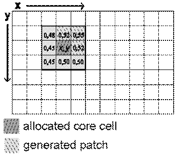


# Patcher

## Description

This functor generates new patches of a certain class or category using a seeding mechanism.

## Inputs

| Name | Type | Description |
| --- | --- | --- |
| Landscape | [Categorical Map Type](../types/Categorical-Map-Type.html) | Map of classes or categories. |
| Probabilities | [Map Type](../types/Map-Type.html) | Map of spatial probabilities. |
| Changes | [Change Matrix Type](../types/Change-Matrix-Type.html) | Matrix of quantity of changes. |
| Transition Parameters | [Transition Function Parameter Matrix Type](../types/Transition-Function-Parameter-Matrix-Type.html) | Matrix of transition function parameters consisting of mean patch size, patch size variance, and isometry. By varying these parameters, various spatial patterns can be reproduced. Increase the patch size for a less-fragmented landscape. Increase the patch size variance for a more diverse landscape, and set isometry greater than one for more isometric patches. Typically, the isometry defines the aggregation level of a patch: assuming that v is the current isometry value, 0\<v\<1 forces disaggregation, v>1 forces aggregation, and v=1 is ignored. The mean patch size and the variance define the size of the new patches. |

## Optional Inputs

| Name | Type | Description | Default Value |
| --- | --- | --- | --- |
| Neighbor Window Lines | [Positive Integer Value Type](../types/Positive-Integer-Value-Type.html) | Number of lines of the neighbor search window. This is an advanced port. | 3 |
| Neighbor Window Columns | [Positive Integer Value Type](../types/Positive-Integer-Value-Type.html) | Number of columns of the neighbor search window. Patches can be created in a diffuse way by increasing the neighbor search window to values greater than 3 for lines and columns; a 3x3 window corresponds to the Moore neighborhood. This is an advanced port. | 3 |
| Prune Factor | [Real Value Type](../types/Real-Value-Type.html) | A multiple of the quantity of cells to be changed, used to size the vector where cells are ranked for the subsequent draw. Prune Factor multiplies the expected number of cells to be changed to set the quantity of possible cells, based on their spatial probability, that take part in the selection mechanism of new patch nuclei. Increasing this value increases the stochasticity of the selection of patch pivot cells. This is an advanced port. | 10 |

## Outputs

| Name | Type | Description |
| --- | --- | --- |
| Changed Landscape | [Categorical Map Type](../types/Categorical-Map-Type.html) | Map of classes or categories. |
| Corroded Probabilities | [Map Type](../types/Map-Type.html) | Map of depleted spatial probabilities. Where a change occurred, the probability value is set to zero. |
| Remaining Changes | [Change Matrix Type](../types/Change-Matrix-Type.html) | Matrix of the quantity of changes that remain for each transition, in case the functor does not succeed in making all the specified changes. |

## Group

[Simulation](../Functor-List.html#simulation)

## Notes

Dinamica EGO's transition engine relies on two complementary local cellular-automaton rules to select which cells change: Expander and Patcher. The first process is dedicated only to the expansion or contraction of existing patches of a class, and is called Expander. The second process forms brand-new patches through a seeding mechanism, and is called Patcher.

Patcher searches for cells around a chosen location for a combined transition by first electing the core cell of the new patch, then selecting a specific number of cells around that core cell according to their transition probabilities, as depicted below:

Patch isometry is a number varying from 0 to 2. Patches assume a more isometric form as this number increases.

The size of each new patch is drawn from a normal distribution with the given mean and variance, converted from hectares to cells, and truncated to a whole number of cells, with a minimum of one cell. When the variance is zero, every patch has the mean size.

Probabilities carries one spatial-probability layer per transition, named `probability_i_to_j`, where i and j are the origin and destination categories of the transition.

See [Simulating the patterns of change](../guidebook/Simulating-Patterns-Of-Change.html) for examples of patches generated with Patcher and [Expander](Expander.html), alone and combined.

### How Patches Are Formed

Forming patches has two stages: choosing a patch seed and forming the patch itself.

**Choosing the patch seed.** The seed is called the pivot cell. To choose it, Patcher collects the probabilities of all cells where the transition is possible, sorts them, and keeps only the cells with the highest probabilities. This step is called pruning. The number of cells kept is the number of expected transitions multiplied by the **Prune Factor**, and the resulting cells are the pivot candidates. A cell is drawn at random from the candidates and submitted to a rejection test. If it passes, it becomes the base of a new patch. Otherwise, another cell is drawn, until a pivot cell is accepted.

**Forming the patch.** The pivot's neighbors are selected using a window with the number of lines and columns defined by **Neighbor Window Lines** and **Neighbor Window Columns**, centered on the pivot cell. All neighbors where the transition is possible are placed in a patch formation pool, which is separate from the pool of pivot candidates. A cell is drawn from this pool in the same way as the pivot, with a rejection test. If the cell passes, it becomes part of the patch and its neighbors are added to the pool. If a neighbor is already in the pool, its probability is increased or decreased using the isometry as a factor. The process repeats until the number of cells expected for the patch is reached. That number is drawn at random from a distribution defined by the mean and variance of the patch size.

## Internal Name

Patcher

## Usage examples

See practical examples of this functor in [Lesson 18: Building a land-use and land-cover change simulation model](../guidebook/Land-Use-Change-Simulation-Model.html) of the Guidebook.

