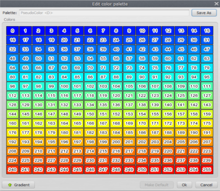
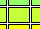
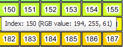
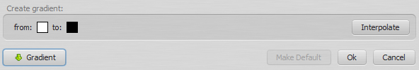


# Color Palette

The palette defines the color of each cell in the visualization area. Cell values are first extracted from the map in their original range and resampled with the [histogram curve](Histogram-Editor.html). The resulting values fall in the range [0, 255], which is mapped to the palette colors.

## Changing Colors Individually

Click a color square to change that color. Hovering over a square shows its color index.

> **Important:** Values changed by a [histogram transformation](Histogram-Editor.html) may not correspond to the expected palette colors, especially when editing the colors of specific cells or categories. Set the histogram transformation to None before editing the colors for specific cell values.

## Generated Palette

A palette can be generated by linear interpolation between two colors (a gradient). Click the gradient button and set the range.

Then click the interpolate button to generate the new palette.

## Saving Your Work

Palettes are not saved until you choose to save them. Click Cancel to discard mistakes. Clicking Ok changes the palette locally, but the change is lost when the application restarts unless the palette is saved.

Saved palettes are stored in the user palette folder `Dinamica EGO/Dmps`, so they are available every time the Map Viewer is opened. Changes to predefined palettes affect only the user's own instance of the application. To restore the predefined palettes, remove the user palette folder and restart the application.

> **Tip:** The user palette folder is usually `C:\Users\<User Name>\Documents\Dinamica EGO\Dmps`.

