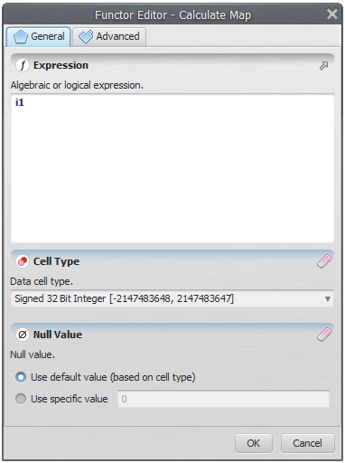
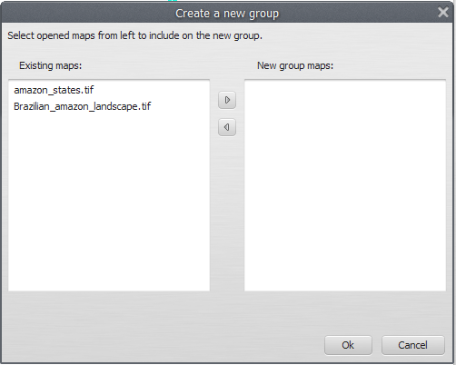
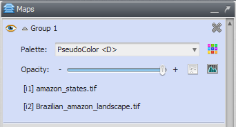


# Expressions and Map Groups

## Calculate Expression

The Map Viewer accepts calculate expressions that are executed on each loaded map or on each [map group](#map-groups). The text area colors the known elements automatically. The expression syntax is described in [Image Expression Type](../types/Image-Expression-Type.html). The default expression for a loaded map is `i1`.

## Map Groups

A map group is created from a series of maps in the stack. Groups aggregate information and allow a single calculate expression to run over several maps.

### Creating a Map Group

Click the "Create map group" toolbar button. In the dialog that opens, select maps in the left column (the loaded stack) and move them to the right column to build the new group.

The new group looks like a normal loaded map, except that it lists the maps in the group with their indices for use in the [calculate expression](#calculate-expression).


