
# Interface Elements

The panels, bars, and tabs of the graphical interface. The [interface map](index.html#interface-map) shows where each one is located. Usage tips for the Functor Library and the Sketch are in [Library and Sketch](Library-And-Sketch.html).

## Functor Library

Shows functors and submodels.

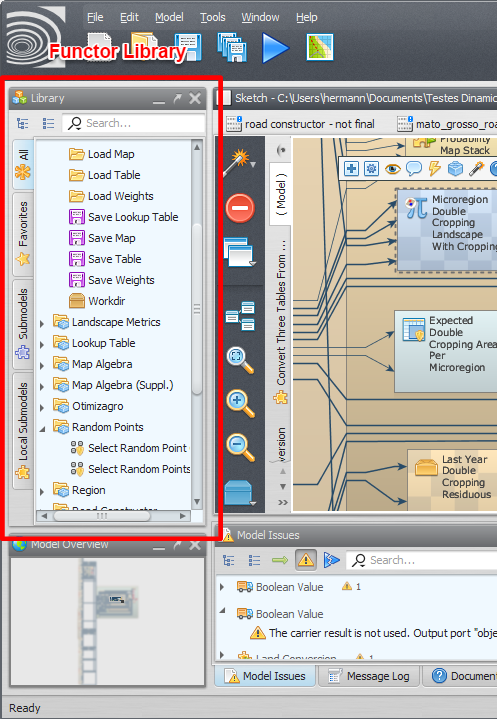

You can search for functors and submodels, view their documentation, [mark them as favorites](https://www.youtube.com/watch?v=GGG2sAKCuU0), and so on. Drag a functor or submodel from the library to the model presentation area to use it in a model.

The library has four tabs:

| Tab | Description |
|---|---|
|  All | All functors, including system and user submodels. Local submodels are not included. Functors and submodels are grouped by category (Input/Output, Table, Control, etc.). |
|  Favorites | Functors and submodels marked as favorites, grouped by category. |
| 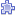 Submodels | System and user submodels, grouped by category. |
|  Local Submodels | Local submodels of the models currently open, grouped by model. |

### Functor Library Bar

Shown when the mouse hovers over a functor or submodel name. It provides the actions available for that item: marking it as a favorite, viewing its documentation, importing a submodel definition, and so on. The available actions depend on the kind of item (regular functor, submodel, local submodel).

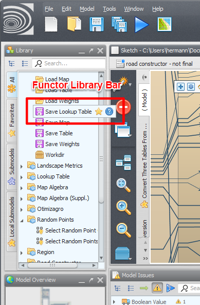

## Model Presentation

The main panel, where models are presented. It is also referred to as the Sketch. To open an existing model, drag its script file from Windows File Explorer to this panel.

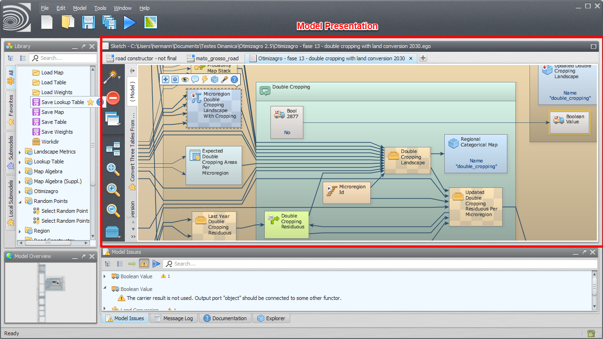

Zoom with the mouse wheel and pan by dragging with the right mouse button. Functor borders and copying and pasting as EGO Script are described in [Sketch](Library-And-Sketch.html#sketch).

### Model Selection Tabs

Select the current model.

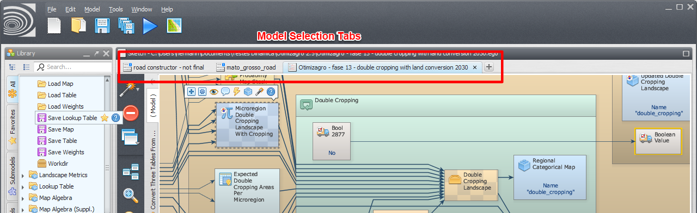

- Drag a tab to reorder it.
- Hover over the tabs and use the mouse wheel to scroll through a long list of open models.
- Hover over a tab and press **Ctrl+C**, or click the tab and choose the option from its menu, to copy the model's full file name or the name of its folder.

### Functor Action Bar

Shown whenever a functor is selected. It provides the actions for the selected functor: editing, commenting, inspecting, and so on. The available actions depend on the functor.

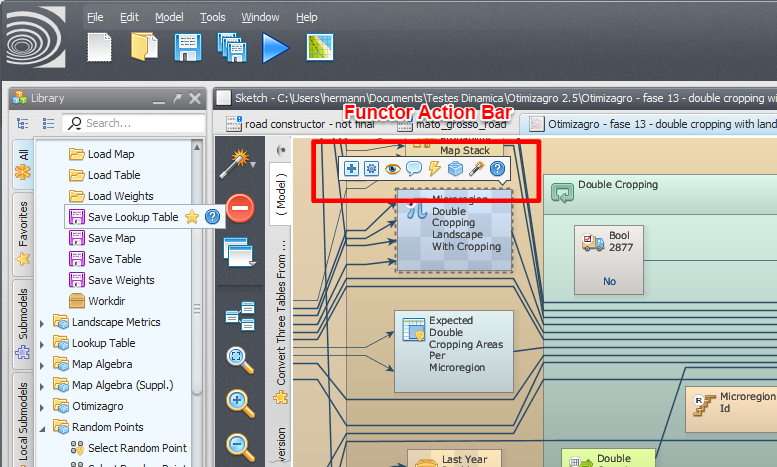

- The bar remains visible when the selected functor is off screen. It then shows the functor's name; click the name to center the view on the functor.
- The bar is not available when more than one functor is selected.
- Clicking the "?" icon opens the functor information panel, which lists the functor's ports. Click a port name to select the corresponding connection in the model view. Next to each port name, the panel shows whether the port is connected, being edited, or being viewed.

To connect functors that are not visible at the same time, see [Sketch](Library-And-Sketch.html#sketch).

### Connection Action Bar

Shown in the upper-right corner of the panel whenever a connection is selected. It provides the actions for the selected connection.

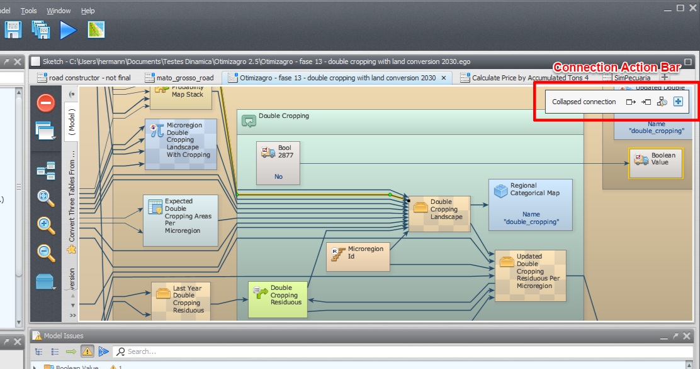

Hovering over a port name in the bar shows a tooltip for the port and for the functor it belongs to, including its banner, comment, and alias.

[Video: navigating connections with the connection action bar](https://www.youtube.com/watch?v=SgMmfTxYg3A)

### Local Submodel Selection Tabs

Select the current local submodel or the main model.

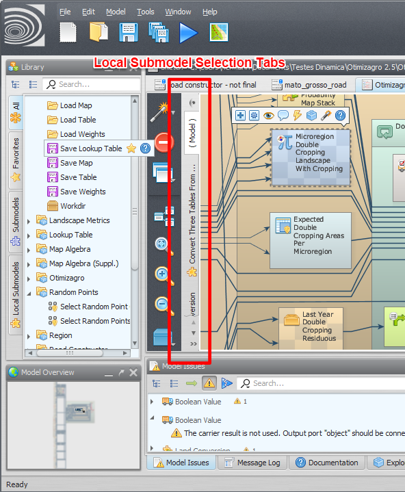

- The main model is named `( Model )`. Local submodels have custom names and a custom icon.
- Drag a tab to reorder it. Hover over the tabs and use the mouse wheel to scroll through a long list.
- A submodel can also be selected with the submodel overview button, above the tabs.

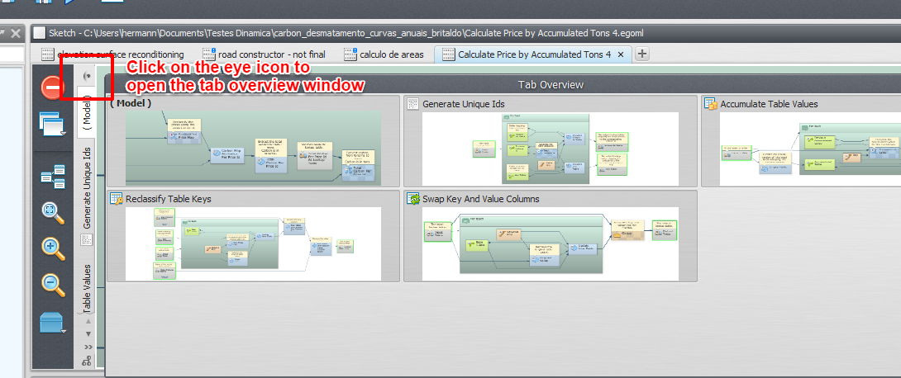

The dependency graph viewer button shows the dependencies of local submodels, including dependencies on user, store, and system submodels. See [Submodel Dependencies](Submodels-In-The-GUI.html#submodel-dependencies).

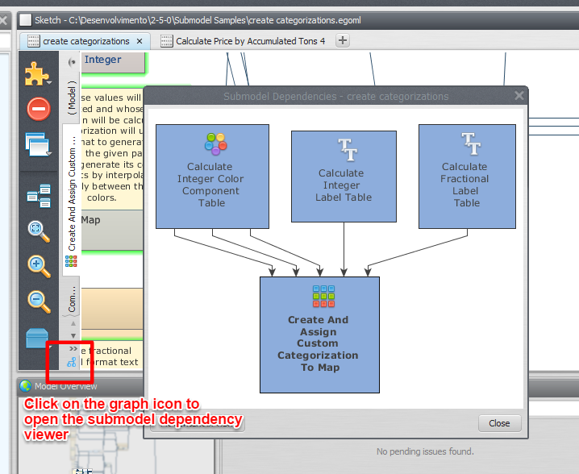

## Model Overview

Shows an overview of the current model or local submodel. Use it to pan and zoom the model view.

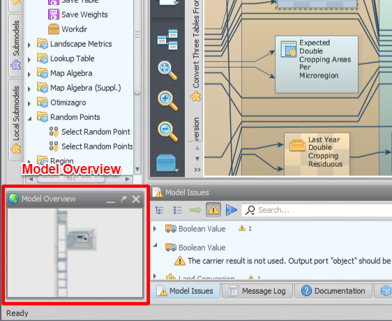

- Drag the visualization square with the left mouse button to pan.

  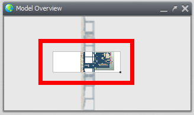

- Drag the marker at the lower-right corner of the square to zoom in and out.

  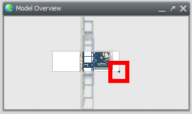

You can also zoom with the mouse wheel directly on the model presentation area; the zoom is centered on the mouse pointer.

[Video: zooming and panning with the model overview](https://www.youtube.com/watch?v=SXikUDsbsXo)

## Explorer

Shows all functors in the current model according to their hierarchy, and can show the total time spent by each functor. Click a functor in the Explorer to go to it in the model. Search filters are described in [Panels and Model Execution](Panels-And-Model-Execution.html#search-filters-specific-to-the-explorer).

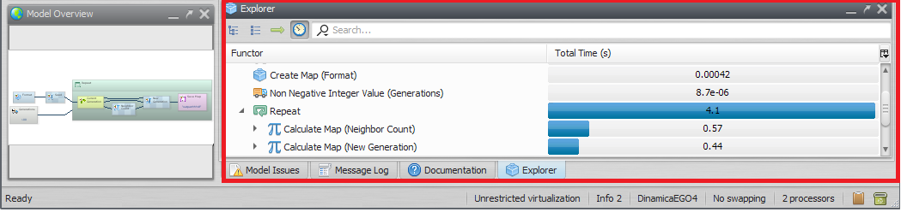

## Issue Panel

Lists functors with their critical and non-critical issues.

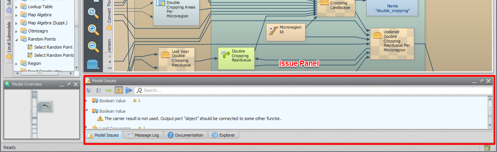

Double-click an issue to locate its functor in the current model or submodel. Use the search field to find specific issues; the filters are described in [Panels and Model Execution](Panels-And-Model-Execution.html#search-filters-specific-to-the-issue-panel).

- **Warnings** are non-critical issues and might not prevent the model from executing correctly.
- **Errors** are critical issues that prevent the model execution from completing.
- **Runtime errors** are issues detected during the last model execution. They might not occur again the next time the model runs.

## Message Log

Shows the log messages produced by all executions in the current session: what is running, the execution steps, explanations of errors, and when each message occurred. The amount of detail is set by the message log level in [Options](Options.html#message-log-level).

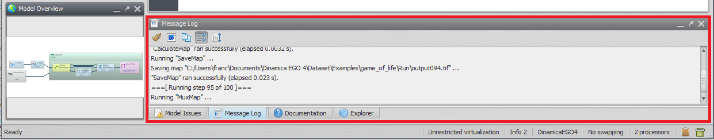

## Documentation Panel

Shows the web documentation of a functor. It appears when you choose to show a functor's documentation from the functor action bar.

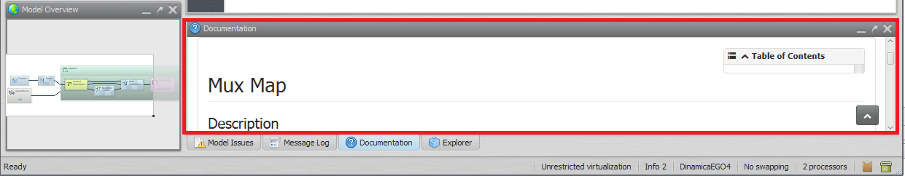

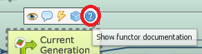

