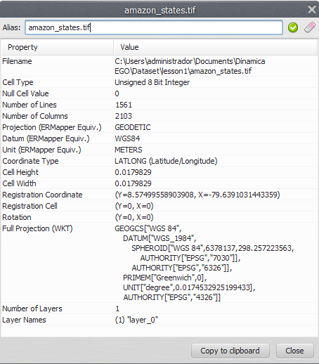
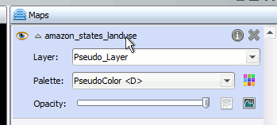
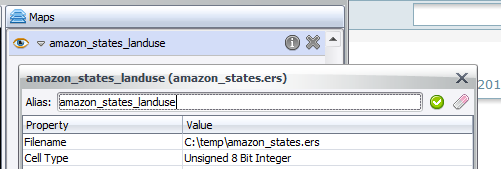


# Map Alias

An alias gives a map a more meaningful name in the Map Viewer.

> **Important:** Aliases are used only by the Map Viewer. Other components of Dinamica EGO do not use them, and they have no impact on simulations.

## Setting an Alias

1. Load a map. See [Loading Maps](Map-Viewer-Interface.html#loading-maps).
2. Click the information icon  to show the map information.
3. In the dialog, type the new alias in the top text field.

   

4. Click "Apply map alias"  to set the alias, or "Restore original alias"  to revert it.

You can also change the alias by double-clicking the map name or alias in the "Maps" window.

After the change, the alias is shown wherever the map file name would appear: the legend, the map information dialog, and the movie maker.


