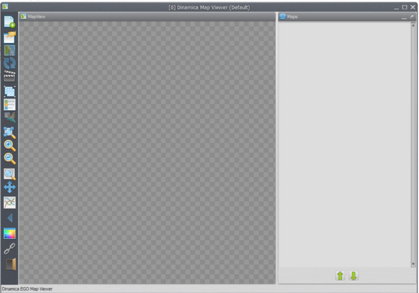
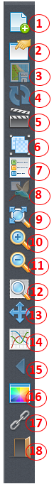
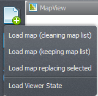
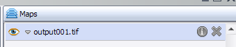
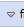
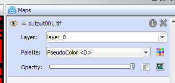
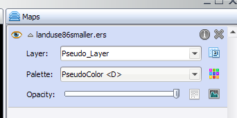
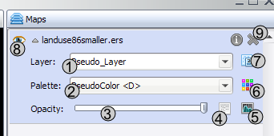
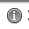


# Map Viewer Interface

## Main Window

The main window holds the viewer state. On the left is the toolbar for the viewer as a whole; on the right is the list of loaded maps and the tools to manage them.

## Toolbar

1. Load maps: discard the previous maps, add maps to the top of the current list, replace the selected map, or load a saved viewer state. See [Loading Maps](#loading-maps).
2. Save the viewer state (transformations, map stack settings, background color, and movie maker settings).
3. Save the current visualization as a bitmap image, including the legend and the overview map if visible.
4. Reload the selected map.
5. Open the movie maker. See [Making a Movie](Making-A-Movie.html).
6. Create or split map groups. Groups allow calculate expressions over a custom stack of maps. See [Expressions and Map Groups](Expressions-And-Map-Groups.html).
7. Toggle the map legend. If the map is in category mode, toggle the categories instead.
8. Toggle the birdview, a small overview map showing the location of the current zoomed view.
9. Zoom to fit the window.
10. Zoom in over the hovered cell.
11. Zoom out over the hovered cell.
12. Zoom to a selection rectangle, which then fills the available space.
13. Pan the visualization area.
14. Analyze cell values in a specified interval.
15. Return to the previous view.
16. Change the background color.
17. Toggle geoposition linking between two or more instances of the Map Viewer.
18. Quit.

## Loading Maps

Maps are loaded from the first toolbar button. To load several maps at once, hold **Ctrl** while selecting the files.

| Option | Effect |
|---|---|
| Load map (cleaning map list) | Erases the current map list (labeled "Maps" in the main window). |
| Load map (keeping map list) | Keeps the current list. The new map is placed on top and made visible. Maps with a different number of lines or columns are turned off. Loading an incompatible map erases the current transformation and restores the default one, which renders to the full screen. |
| Load map on selection | Replaces the selected map with the new one. Available only when a map is selected. Histogram, palette, pan, and zoom are kept. The new map tries to match the active layer selection. |
| Load viewer state | Loads a saved viewer state from a file, replacing the map stack, background color, palettes, histogram transformations, and everything else. |

## Loaded Maps

Loaded maps are listed in the "Maps" stack on the right.

A map is initially collapsed, because the functions of each map are inside its row. Click the expand arrow to show them.

For maps with category information, an additional button toggles between normal mode and category mode. In category mode, the map transformation is ignored and the category colors are used. The legend then shows category colors and names instead of the value range.

### Map Functions

1. Change the map layer. For maps with several layers, only one layer is shown at a time.
2. Change the map [palette](Color-Palette.html).
3. Opacity. Maps are opaque by default; a transparency threshold can be set to combine maps in the stack.
4. [Image expression](Expressions-And-Map-Groups.html) (calculate expression) for the map values.
5. [Histogram](Histogram-Editor.html) transformation.
6. Edit the palette selected in the combo box (2).
7. Toggle category view. Available only for maps with category information.
8. Toggle map visibility.
9. Remove the map from the stack.

### Map Information

Click the information icon to show information about the map.

The information comes from Dinamica EGO, and the available rows vary from map to map. The alias of the map or map group can be set at the top of the dialog; see [Map Alias](Map-Alias.html).

