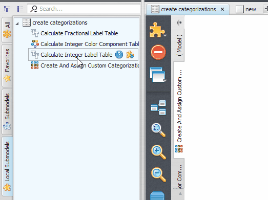


# Submodels in the GUI

This page describes how to create, use, update, and manage submodels in the graphical interface. For what submodels are, their types, scope, and storage locations, and for publishing and versioning, see [Submodels](../Submodels.html).

## Creating Local Submodels

Local submodels can be created by simply selecting the parts of a model that will be converted to a submodel and choosing *Edit* → *Create Submodel* (K). The selection will be replaced by the new submodel and the visual representation of the new submodel will be available to be edited as a new tab on the script editor.

At any time, the user can make changes to the local submodel and apply those changes by clicking *Apply Changes / Edit Submodel Properties* on the model toolbar. See the [Updating Local Submodels](#updating-local-submodels) section below for more information.

It is also possible to select parts of a local submodel and create another local submodel using that selection. The new local submodel will be a dependency of the previous one, but the submodel creation process is basically the same.

If the selection is empty, an empty local submodel will be created. The process for updating an empty submodel is the same process used to update any local submodel.

  <iframe src="https://www.youtube-nocookie.com/embed/YvoteWC_lnI?mute=1" title="Creating local submodels" allow="accelerometer; clipboard-write; encrypted-media; gyroscope; picture-in-picture" allowfullscreen loading="lazy"></iframe>

## Instantiating Local Submodels

Local submodels from a model are placed in a special tab on the Functor Library called *Local Submodels*. These local submodels are grouped by model name.

To instantiate a local submodel as part of a model, just expand the group on the *Local Submodels* tab corresponding to the current model and drag the submodel functor representation to the model presentation area.

It is worth noting that dragging the functor representation belonging to a different model will import the definition of the local submodel from that model — see [Copying (Importing) a Local Submodel Between Models](#copying-importing-a-local-submodel-between-models) below.

### Searching for Submodels

The search boxes throughout the interface (for example, in the Explorer or in the Functor Library) support special filters that narrow results down to submodels: `is:submodel` (any submodel), `is:systemsubmodel`, `is:usersubmodel`, `is:localsubmodel`, and `is:storesubmodel`. The *Also search for additional info* option must be enabled in the search box menu for these filters to work.

## Navigating Submodels

Navigating between the local submodels and the main model in a script editor can be done by clicking on the corresponding model/submodel tab on the model/submodel tabs or clicking on the submodel overview button above the model/submodel tabs.

## Updating Local Submodels

At any time, the user can add or remove inputs and outputs or even change the combination of functors defining the submodel.

The functor action bar of all functors contained inside a submodel script exhibits additional options for *export functor inputs and outputs*. Exporting a new input or output can be performed following the steps below:

First, click on the functor whose inputs or outputs will be exported.

Select *export functor inputs and outputs* on the functor action bar and choose the inputs or outputs that will be exported. It is possible to define the input and output names and their corresponding descriptions. It is also possible to mark an exported input as advanced or optional. Optional inputs can also define an optional value that will be assigned to the port if no explicit value is provided. A submodel's input ports cannot be declared nullable; a caller-optional input is only made available through this *optional* marking and its associated default value, not by accepting a null value directly.

> **Note:** Any port from the integer family of types can be declared a light enum, which presents it in the GUI as a labeled dropdown instead of a free-form numeric field, via the *Make port available as an enum value* control. This is not specific to submodels — it can be set on any carrier functor of an integer value type in any model, provided the carrier has an editor. When such a carrier's port is exported as a submodel input, its light enum configuration carries over into the submodel's interface.

Choose *Submodel Options* on the model toolbar and then click *Apply Changes / Edit Submodel Properties*. That brings up the submodel editor dialog where you can define a new name, description, documentation URL, and icon for the submodel, or reorder its inputs and outputs (or even remove some of them). Clicking *Ok* propagates the changes to all parts of your model (and dependent submodels) where the submodel is used.

The submodel editor dialog also lets you set the submodel's **group**, which controls where it appears in the Functor Library. A group name can contain subgroups by separating them with a colon (`":"`); for example, `"Elevation Graph:Tools:Debug"` places the submodel in a *Debug* subgroup, itself inside a *Tools* subgroup, inside an *Elevation Graph* group. This is specific to submodels: an ordinary functor's placement in the Library is fixed by its own definition and cannot be changed by the user, but a submodel's group — and therefore whether it appears in a subgroup — is under the control of whoever creates or edits it.

Below you can see two examples of updating the input and output ports of a local submodel:

**Example 1** — exporting and updating ports using the functor action bar:

  <iframe src="https://www.youtube-nocookie.com/embed/i6T9GGqfU80?mute=1" title="Updating local submodels ports" allow="accelerometer; clipboard-write; encrypted-media; gyroscope; picture-in-picture" allowfullscreen loading="lazy"></iframe>

**Example 2** — an additional approach to the same task:

  <iframe src="https://www.youtube-nocookie.com/embed/FK5xIYCS0KI?mute=1" title="Updating local submodels ports (additional approach)" allow="accelerometer; clipboard-write; encrypted-media; gyroscope; picture-in-picture" allowfullscreen loading="lazy"></iframe>

Beware that connected inputs cannot be exported. They must be disconnected first.

It is also worth noting that it is possible to safely rename inputs and outputs. The connections to the port will be maintained when the changes are propagated.

> **Tip:** Dinamica EGO comes with a set of icons from the [Fat Cow Icon Set](http://www.fatcow.com/free-icons) that can be used to customize the local submodels created by users. The icons come in size 16x16 and 32x32 pixels. The overall color of the chosen icon is automatically used to define the color of the functor representing the submodel on the graphical interface. The set of icons is usually installed in the folder `IconSamples` in your Dinamica EGO installation folder.

When updating a local submodel, the changes from all dependent local submodels will also be propagated. This means that updating a submodel always updates the whole chain of local submodels that use that submodel as part of their definition.

  <iframe src="https://www.youtube-nocookie.com/embed/wDtyrRbUNo4?mute=1" title="Updating local submodels (propagation through a chain of dependent submodels)" allow="accelerometer; clipboard-write; encrypted-media; gyroscope; picture-in-picture" allowfullscreen loading="lazy"></iframe>

Removing ports from a local submodel is also similar to updating the exported ports. You can remove the ports using the *export functor inputs and outputs* option on the functor action bar and unchecking the corresponding port on the *Exported Ports* dialog, or using the *Apply Changes / Edit Submodel Properties* dialog.

Changing the order of the input or output ports can only be done by editing the port list on the *Apply Changes / Edit Submodel Properties* dialog.

  <iframe src="https://www.youtube-nocookie.com/embed/zx6moYBS3YU?mute=1" title="Removing ports and changing port order" allow="accelerometer; clipboard-write; encrypted-media; gyroscope; picture-in-picture" allowfullscreen loading="lazy"></iframe>

## Submodel Dependencies

Since submodels can use other submodels as part of their definitions, it is very convenient to know how those dependencies are organized. The dependency viewer is not limited to local submodels — it shows the local, user, store, and system submodels a model uses, and how they depend on each other.

You can open it by clicking the graph icon at the bottom of the model toolbar, or by choosing *Submodels* → *Show Model Dependencies* (Ctrl+U).

On the dependency graph viewer, every submodel involved is represented by its name and corresponding icon. An arrow pointing from a submodel A to a submodel B means that submodel A is used by submodel B. Multiple arrows mean that a submodel is used more than once. Clicking on any local submodel shown in the visualization navigates to it.

Clicking the *Remove Unused* button removes all local submodels defined by the current model that are not being used, either as part of the model's own definition or by any of its other local submodels.

## Copying (Importing) a Local Submodel Between Models

It is possible to copy local submodel definitions between models. Once the submodel is copied from one model to another, the submodels can be modified and updated independently.

You can copy a local submodel definition by dragging a local submodel from the Functor Library to the model presentation area. The process is similar to the instantiation of a regular functor.

  <iframe src="https://www.youtube-nocookie.com/embed/v8OKfyWsYoM?mute=1" title="Importing local submodels" allow="accelerometer; clipboard-write; encrypted-media; gyroscope; picture-in-picture" allowfullscreen loading="lazy"></iframe>

It is also possible to copy the submodel definition by clicking the *Import submodel definition* button on the functor library bar of the local submodel tab of the Functor Library. The definitions of system and user submodels can also be imported using the corresponding *Import submodel definition* button on the functor library bar of the submodel tab of the Functor Library.

Submodels already used in the model can also be imported through the *Submodels* menu: *Submodels* → *Import Selected Submodel* (Ctrl+G) imports the definition of the currently selected submodel instance, while *Submodels* → *Import All Submodels* imports the definitions of every system, store, and user submodel used directly or indirectly by the model.

## Browsing and Installing Submodels

To browse and install submodels from the Submodel Store, choose *Submodels* → *Submodel Store* on the model toolbar. Select the desired submodel from the list and click *Install Selected* to download it; it then becomes available locally as a store submodel.

> **Tip:** To publish your own submodel to the Store instead of installing one, see [Sending a Submodel to the Store](../Submodels.html#sending-a-submodel-to-the-store).

## Checking for Updates

To check whether an installed store submodel has a newer, compatible update available (see [Versioning and Compatibility](../Submodels.html#versioning-and-compatibility) above), choose *Submodels* → *Submodel Manager* (Ctrl+G), then use the *Check for Updates* option.

## Deleting Submodels

### Deleting a Local Submodel

To delete a local submodel, select it among the local submodels of the model and choose *Remove Submodel* on the *Submodel Options* menu. If the submodel is still being used — either by the main model script or by another local submodel — Dinamica reports this, shows where it is being used, and the removal fails.

> **Tip:** Before attempting to remove a local submodel, it is a good idea to check the [dependency viewer](#submodel-dependencies) (*Submodels* → *Show Model Dependencies*) to confirm the submodel is not being used elsewhere.

### Deleting a User or Store Submodel

User and store submodels are both removed through the *Submodel Manager* dialog (*Submodels* → *Submodel Manager*): select the submodel in question and click *Remove*.

> **Warning:** Removing a user submodel will break any model script that uses it as part of its definition, since — unlike local submodels — models do not carry their own copy of a user submodel's definition.

