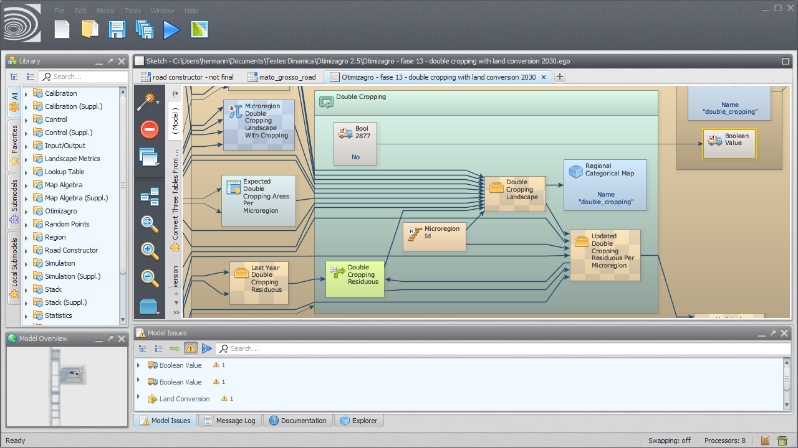


# Dinamica EGO Graphical Interface

## Interface Map

- [Issue Panel](Interface-Elements.html#issue-panel)
- [Message Log](Interface-Elements.html#message-log)
- [Documentation Panel](Interface-Elements.html#documentation-panel)
- [Explorer](Interface-Elements.html#explorer)
- Main Toolbar and Menu
- [Model Presentation Panel](Interface-Elements.html#model-presentation)
- [Model Selector Tabs](Interface-Elements.html#model-selection-tabs)
- [Overview](Interface-Elements.html#model-overview)
- [Functor Library](Interface-Elements.html#functor-library)
- Model Toolbar
- [Local Submodel Selector Tabs](Interface-Elements.html#local-submodel-selection-tabs)
- Status Bar

## In this section

- [Interface Elements](Interface-Elements.html) — the Functor Library, Model Presentation panel, tabs, action bars, Overview, Explorer, Issue Panel, Message Log, and Documentation Panel.
- [Options](Options.html) — workers, memory management, native expression compilation, virtualization, message log level, model backups, and EGO Script formatting.
- [Library and Sketch](Library-And-Sketch.html) — the Functor Library, the Sketch (Model Presentation) panel, copy and paste, and drag and drop.
- [Panels and Model Execution](Panels-And-Model-Execution.html) — search filters, the Overview, the Explorer, the Issue Panel, and the execution progress bar.
- [Functor Editor](Functor-Editor.html) — port tooltips and the editors of the calculator functors.
- [Submodels in the GUI](Submodels-In-The-GUI.html) — creating, instantiating, updating, importing, installing, and deleting submodels in the interface.
- [Wizards](Wizards.html) — exporting ports to wizards.
- [Port Editors by Type](Port-Editors-By-Type.html) — the GUI Editor section of every type page.
- [Keyboard Shortcuts](Keyboard-Shortcuts.html) — global, script graph, window size, Weights Editor, and debug monitor shortcuts.
- [Performance and File Handling](Performance-And-File-Handling.html) — settings that speed up execution, file paths, and loading files from zip files.
- [Map Viewer](Map-Viewer.html) — viewing maps: interface, palettes, histograms, expressions, map groups, aliases, movies, and the command line.

