
# Agent Based Model

### What will you learn?

- What is an agent-based model
- A spatially explicit ABM developed using DINAMICA-EGO.

#### What is an agent-based model

Agent based models (ABM) attempts to reproduce individual processes of movement, behavior, birth, growth and death according to a set of information, such as genotype, history and location of agents. In these models the agents are the crucial components of the analysis. ABMs can be designed primarily as deliberative or reactive architecture systems (Carneiro, 2003). As deliberative systems, the agents have an internal model of the environment and the decisions are made through some type of logical reasoning. On the other hand, agent reactive architectures avoid these internal representations and action choices are made based on the occurrence of a set of conditions of the environment that are pre-programmed in the model. A great variety of entities are represented through ABM approach: atoms, cells, animals, people and organizations (Batty, 2005; Carneiro, 2003; Conte et al. 1997; Epstein and Axtell, 1996; Janssen and Jager, 2000; Scanlan et al., 2006; Weiss, 1999; McLane et al., 2011). ABMs have been applied to several studies involving natural resource management, human decisions (Bousquet and Le Page, 2004, An, 2012; Barbati et al., 2012; Sun and Muller, 2012), urban processes (Batty, 2005; Chen , 2012), and land-use change (Carneiro, 2003; Matthews et al., 2007). In ecology, ABMs focus on how species respond to a set of circumstances, modeling population dynamics, animal movements and behavior (DeAngelis and Mooij, 2005, Nathan et al., 2008; McLane, 2011). Some of these applications take advantage of the spatial dynamic representation of CA models. This possibility was explored particularly by Epstein and Axtell (1996) who developed an ABM of an artificial society, known as Sugarscape, for the study of social phenomena and human behavior.

**A spatially-explicit agent-based model was designed using Dinamica EGO to represent interactions between a rabbit population and the environment**. This model is developed by Alessandro Ribeiro Campos, Juliana Leroy Davis, William Leles Souza Costa and Britaldo Silveira Soares Filho. The model simulates agents'movements, internal states, spatial distribution, and demographic features. Several scenarios were run to analyze the responses of agents to changes in their environment.

## Model Dynamics

The model is composed of agents distributed on a cell grid that interact with different amount of resources distributed heterogeneously on the landscape. Agents and environment coexist through a set of behavioral rules. 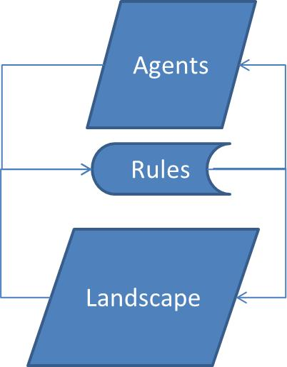

#### Overview

The number of agents, calories of each individual, and the landscape resource can be seen as stocks of rabbits, energy, and resources, respectively.

The number of agents increases with births and decreases with deaths. The landscape resource increases as a function of landscape recovery rate and decreases as it is consumed. The stock of calories of an agent increases with individual intake and decreases as individuals spend energy in metabolism and movement.

The level of stock of landscape resources influences the birth process as well as the size of the rabbit population. The number of agents also influences directly the total consumption of the resources. Decrease in population is a function of the individual ages and stock of calories.

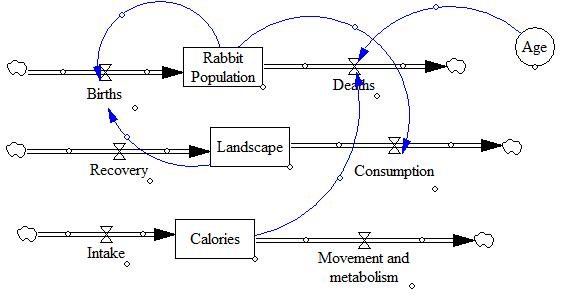

The agents have predefined genetic features (static attributes), such as vision and metabolism, which determine the capacity to locate resources and reach them. The agents have dynamic and individual states, such as location and health state.

Below you can find more details on the agents and landscape attributes and how the model works:

#### Agents

Agents are defined as entities embedded in an environment with which they interact; they are able to see it through sensors and act upon it through actuators (Russell and Norvig 1995).

In the model the agents occupy cells that depict the agent identification.

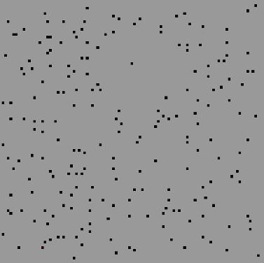

Agents have the following attributes:

- *Vision*: (number of cells in the neighborhood) range of vision of the agent to search for resources on the landscape.

- *Energy spent to survive*: amount of calories necessary to survive at each model step.

- *Maximum absorption of energy*: maximum capacity for energy absorption of agent per model step.

- *Energy spent to move*: amount of calories an agent spends to move across a cell per  model step.

- *Average age*: average of a normal distribution that determines the likelyhood of agent death at a model time step.

- *Type*: group to which the agent belongs.

**Attribute values and Parameters**

| Constants | Values |
|---|---|
| Vision | 3 |
| Maximum absorption of energy | 17, 19, 22 e 25 (according to the type) |
| Average lifespan | 36 |
| Energy spent to survive | 10 |
| Energy spent to move | 10 |
| Initial amount of calories  in agent’s stock | 50 |
| Initial population of agents | 200 |
| Maximum Birth rate | 0.0323 |

#### Landscape

The landscape is represented as a cell grid in which the cell values contain a certain amount of resource.

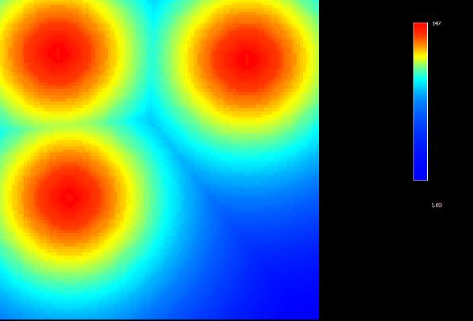

In the example above, the resources are heterogeneously distributed and there are three places with higher resource concentration.

*The maximum capacity of resources* in the cell and the *Recovery rate of the landscape* are attributes of the landscape. At each time step the landscape recovers its resources according to *Recovery rate*. The maximum capacity is represented as the initial values on the landscape map.

**Attribute value**

| Constants | Values |
|---|---|
| Recovery rate of the landscape | 0.01 |

#### Processes

The model iterates as follows:

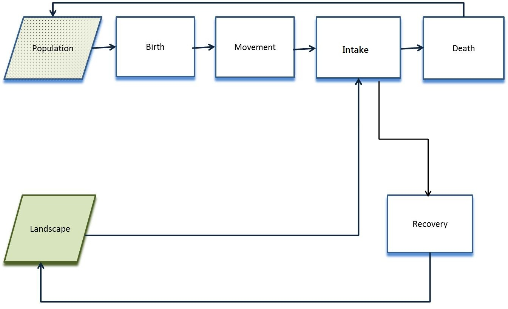

**Births**

The number of births at a time step is determined by the amount of resources on the landscape. This rate multiplied by the number of rabbits defines the number of births. Agents are distributed in groups (types) according to the proportion of types in the population.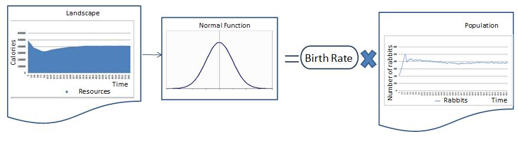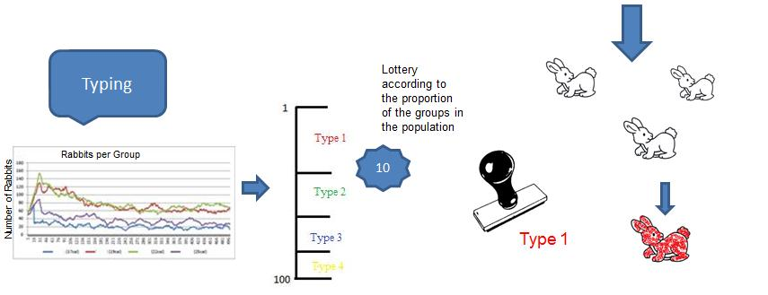

**Movement**

The agent analyzes the amount of resources in the cells around it according to the their vision and attempts to move to cells not occupied by other agents. They always seek the cell with largest amount of resources. When agent moves to this cell the amount of resources given by the parameter attribute “Energy spent to move” is subtracted from the stock of calories.

**Intake**

After the movement, the agent consumes the amount of resources up to the limit of its absorptive capacity according to the parameter “Maximum resource absorption”. This value is subtracted from the corresponding cell in the map of resources and added as energy to the agent’s stock of calories.

**Landscape recovery**

Recovery occurs every time step according to the current amount of resources in the cell and the maximum capacity of resources using a logistic function.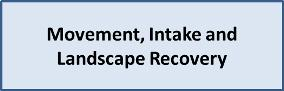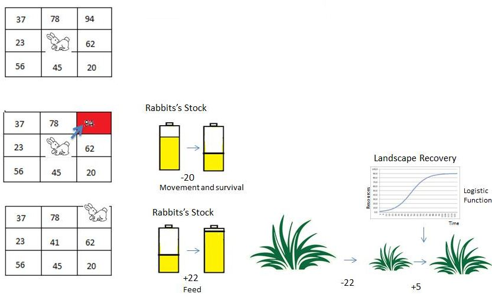

**Death:**
There are two causes of death:

**Starvation:** lack of enough energy to stay alive. It occurs when the agent's stock reaches zero calories.

**Age:** the number of deaths in a time step is defined by the average of a normal distribution of the agent lifespan. The model uses a stochastic draw to determine whether the agent lives or dies.

#### Scenarios

We ran the model under different scenarios represented as different landscape maps (100×100 raster). The amount and distribution of the resources were modified to analyze population dynamics, patterns resulting from agent movements, resource depletion, and population calorie inequality.

#### Homogeneous 100

- This scenario represents a landscape where the resources are distributed equally across the space. In this way, every cell contains the same value: 100 - Totaling 1000000 units of resources, average cell value: 100 -

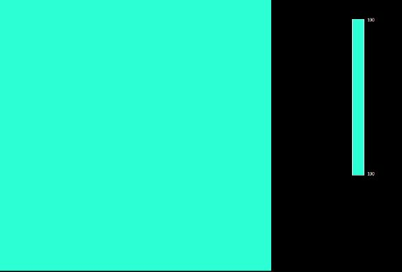

#### Heterogeneous 100

- This scenario represents a landscape where the resources are distributed heterogeneously across space. There are three points with the highest concentrations of resources and the resource decreases as a function of the distance to these peaks. In this way the cells contain different values: 0 to 147 - Totaling 1000000 units of resources, average cell value: 100

#### Heterogeneous 50

- This scenario represents a landscape where the resources are distributed heterogeneously across space. There are three points with the highest concentrations of resources and the resource decreases as a function of the distance to these peaks. In this way the cells contain different values: 0 to 73 - Totaling 500000 units of resources, average cell cell value: 50.

#### Results and Conclusions

### GINI coefficient

It is a measure of inequality developed by the Italian statistician Corrado Gini and published in 1912. It varies from 0 to 1; 0 corresponds to complete equality and 1 corresponds to complete inequality. We use the GINI index to measure the inequality in the rabbit calorie distribution.

-Gini coefficient was higher for the heterogeneous landscapes, demonstrating that unequal distribution of resources increases competition among rabbits leading to inequality.

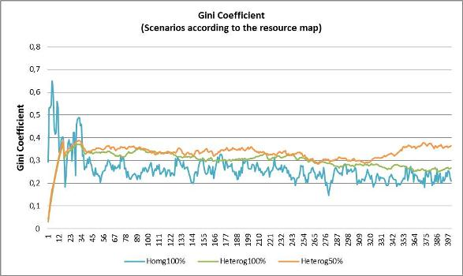

Gini Coefficient in three different landscapes: Hom 100- with resources distributed homogeneously, Het 100-with the same amount of resources distributed heterogeneously and Het 50-with half of resources amount distributed heterogeneously

Here you can see how Gini Coefficient is calculated

#### Population

-The agent population stabilizes regardless of the distribution of resources on the landscape and the amount of resources consumed by each agent according to the group to which it  belongs.

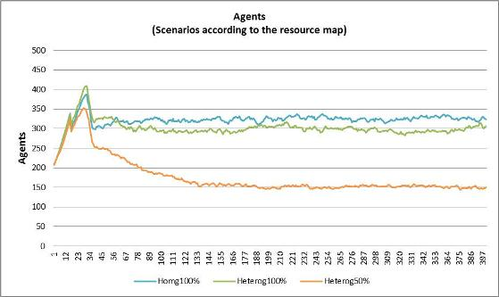

Number of agents in three different landscapes: Hom 100- with resources distributed homogeneously, Het 100-with the same amount of resources distributed heterogeneously and Het 50-with half of resources amount distributed heterogeneously.  
The graph shows that in the three scenarios there is a rapid growth in the first steps of the model followed by a decrease in amount of agents when the first 200 rabbits die almost at the same time because of their same age. Thus the three populations stabilize in different ways.

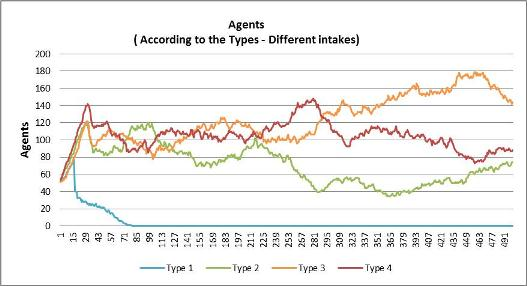

Number of agents, using Hetererogeneous 100 landscape map, divided by different  *Maximum absorption capacity of resources* according to the groups to which each agent belongs. In this case: Type 1 (17 calories), type 2 (19 calories), type 3 (22 calories) and type 4 (25 calories).  
Only type 1 group that eats much less than needed to survive had its population extinct from starvation, considering that it had exhausted its calorie stock to survive in few steps. Type 2 group also eats less than it needs to survive has to use its stock to survive. But the depletion of its stock was not enough to cause its death from starvation before “natural” age death. The other two groups eat more than they need to survive and accumulate calories, but the model doesn't have any rule that favors rabbits with bigger stocks of calories in the birth process. Hence the populations of all groups grow differentially based only on their death rates.

-There are many more deaths from starvation on heterogeneous landsacapes and this number is higher in scenarios with less amount of resources.

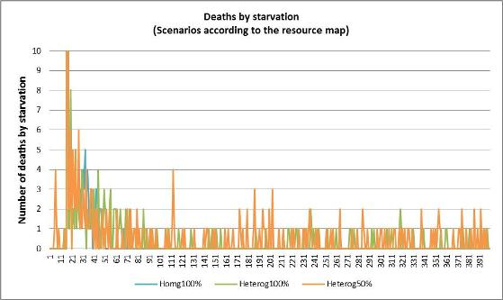

In the three scenarios, there are many deaths in the first steps of the model. This is due to the deaths of Type 1 rabbits, which eat much less than they need to survive. After the step, there are no deaths from starvation in homogeneous scenario and most of the deaths occur on the heterogeneous landscape scenario with half amount of resources. This is due many to rabbits that are born in areas with few resources, hence they cannot accumulate energy and waste their stock and thus die from starvation.

#### Landscape

-The amount of resources available stabilizes as the population also stabilizes leading the amount of resources consumed to a dynamic equilibrium.

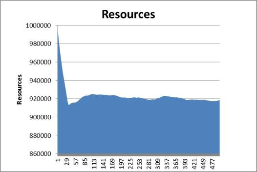

#### Agents movement and landscape dynamics

Videos show rabbits position map and landscape maps under the three different scenarios

The black points are the agents moving across the landscape that is represented using color scale according to the amount of resources.  Red represents larger amount of resources, and blue otherwise.

**Homogeneous scenario: every cell has the same value in this map: 100 -  average cell value: 100 -**

  <iframe src="https://www.youtube-nocookie.com/embed/_bGHgmhAFqM?mute=1" title="Agents movement: homogeneous scenario" allow="accelerometer; clipboard-write; encrypted-media; gyroscope; picture-in-picture" allowfullscreen loading="lazy"></iframe>

**Heterogeneous scenario: cells have values from 0 to 147 - average cell value: 100 -**

  <iframe src="https://www.youtube-nocookie.com/embed/SK80UU8QwHw?mute=1" title="Agents movement: heterogeneous scenario, values 0 to 147" allow="accelerometer; clipboard-write; encrypted-media; gyroscope; picture-in-picture" allowfullscreen loading="lazy"></iframe>

**Heterogeneous scenario: cells have values from 0 to 73 - average cell value: 50 -**

  <iframe src="https://www.youtube-nocookie.com/embed/ayTFM5yKmaU?mute=1" title="Agents movement: heterogeneous scenario, values 0 to 73" allow="accelerometer; clipboard-write; encrypted-media; gyroscope; picture-in-picture" allowfullscreen loading="lazy"></iframe>

On heterogeneous landscapes, the agents move to locations with larger concentration of resources. As a result, this areas are depleted in first place.

### Conclusions

ABM of population dynamics can provide insights about how individuals are affected by the characteristics of the matrix in which they are inserted (Nathan et al., 2008; McLane et al., 2011).

ABM highlights the causal relationships among movement, individual attributes and internal state, demographic and the environment. Analyses of these interactions help understanding the emergence of patterns such inequality due to greater competition resulting from paucity of resources.

#### Download - Model and Inputs

#### Download our AMB model and run it yourself.

The model, with the Gini Coefficient submodel and the Heterogeneous Landscape 100 input map, is in `guidebook dinamica\models\rabbit population abm`, part of [guidebook_dinamica.7z](../extra/guidebook_dinamica.7z).

#### GINI coefficient

It is a measure of inequality developed by the Italian statistician Corrado Gini and published in 1912. It varies from 0 to 1; 0 corresponds to complete equality and 1 corresponds to complete inequality. We use the GINI index to measure the inequality in the rabbit calorie distribution.

Gini Coefficient Calculation

The Gini Coefficient submodel is in the `submodels` folder of the model, `gini coefficient.ego`. To use it with the ABM, install it as a user submodel; see [User Submodels](../Submodels.html#user-submodels).

### References

An, Li. Modeling human decisions in coupled human and natural systems: Review of agent-based models. *Ecological Modelling* v.229, p.221-236. 2012

Barbati, M., Bruno, G., Genovese, A. Applications of agent-based models for optimization problems: A literature review. *Expert Systems with Applications*. V.39, p.6020-6028. 2012

Batty, M., Torrens, P.M. Modelling and prediction in a complex world. *Futures*. v.37, p.745 – 766. 2005

Bousquet, F., C. Le Page. Multi-agent simulations and ecosystem management: a review. *Ecological Modelling* v.76, p.313-332. 2004

Carneiro, T. G. D. P. *Nested-CA: a foundation for multiscale modeling of land use and land change*. São José dos Campos: Inpe, 2003.

Chen, L. Agent-based modeling in urban and architectural research: A brief literature review. *Frontiers of Architectural Research* v.1, p.166-177. 2012

Conte, R., Hegelmann, R., and Terna, P., (eds.), 1997, *Simulating Social Phenomena*. Springer, Berlin

DeAngelis, D.L., Mooij, W.M. Individual-based modeling of ecological and evolutionary processes. *Annual Review of Ecology, Evolution, and Systematics*. v.36, p.147–168. 2005

Epstein, J. M., and R. Axtell. *Growing Artificial Societies: Social Science from the Ground Up*. Brookings Institution Press, Washington, 1996

Janssen, M. A., and W. Jager. The human actor in ecological economic models.// Ecological Economics//. v.35, p.307-310. 2000

Matthews, R.B., Gilbert, N.G., Roach, A., Polhill, J.G., Gotts, N.M. Agent-based land-use models: a review of applications. *Landscape Ecology*. v.22, p.1447-1459. 2007

McLane, A.J., Semeniuk, C., McDermid, G.J., Marceau, D.J. The role of agent-based models in wildlife ecology and management. *Ecological Modelling* v.222, p.1544-1556. 2011

Nathan, R., Wayne M. Getz, W. M., Revilla E., Holyoak M., Kadmon R., Saltz D., Smouse, P. E. A. Movement ecology paradigm for unifying organismal movement research.// PNAS//. v105, p. 19052-19059. 2008

Parker, D.C., Berger, T., Manson, S.M.// Meeting the Challenge of Complexity//. Report and Review of an International Workshop, California, USA, Report No. 6, LUCC Report Series. 2001

Russel, S. J., Norvig, P. *Artificial intelligence – a modern approach*. Nova Jersey: Prentice Hall, 1995.

Scanlan, J.C., Berman, D.M., Grant, W.E. Population dynamics of the European rabbit (Oryctolagus cuniculus) in north eastern Australia: Simulated responses to control. *Ecological Modelling*. v.196, p.221-236. 2006

Soares-Filho, B. S.; Cerqueira, G. C.Araújo, W. L. Modelagem de dinâmica de paisagem: concepção e potencial de aplicação de modelos de simulação baseados em autômato celular. In: Albernaz, A. L.;Silva, J. M. C. D.Valeriano, D. (org.). *Ferramentas para modelagem da distribuição de espécies em ambientes tropicais*. Belém: Ed Museu Paraense Emílio Goeldi 1 ed., v.1, 2003

Soares-Filho, B.S.; Rodrigues, H.O.; Costa, W.L.S. DINAMICA-EGO, uma plataforma para modelagem de sistemas ambientais. In: Simpósio Brasileiro de Sensoriamento Remoto (SBSR), 13, 2007, Florianópolis. *Anais XIII Simpósio Brasileiro de Sensoriamento Remoto*. São José dos Campos: INPE, 2007. Artigos, p. 3089-3096.  Disponível em: &lt; <http://marte.dpi.inpe.br/col/dpi.inpe.br/sbsr@80/2006/11.06.17.59/doc/3089-3096.pdf> >. Acesso em: 29 jul. 2012.

Sun, Z., Muller, D. A framework for modeling payments for ecosystem services with agent-based models, Bayesian belief networks and opinion dynamics models. *Environmental Modelling & Software*. In Press, p.1-14. 2012

Weiss, G. *Multiagent Systems: A Modern Approach to Distributed Artificial Intelligence*. MIT Press, Cambridge. 1999

#### Congratulations, you have successfully completed this lesson!

☞[Next: Simulating the patterns of change](Simulating-Patterns-Of-Change.html)

