
# Lesson 17: Calculating accumulated cost surface and least-cost pathway

## What will you learn?

- How to calculate a friction surface, cost surface and least-cost pathway
- Functors: <br> - *[Calc Cost Map](../functors/Calc-Cost-Map.html)*<br> - *[Calc Pathway Map](../functors/Calc-Pathway-Map.html)*

This exercise requires the calculation of a friction surface, representing the relative cost of crossing a unit cell depending on the land use. We can express this surface both in terms of distance – no differential cost exists among types of land uses; hence the least-cost pathway will be the shortest route, i.e. the Euclidean distance – time, financial cost or some type of effort. Thus, this value is calculated in relation to some unit (time, transportation cost, etc).

In this exercise, we explore the use of the functors *[Calc Cost Map](../functors/Calc-Cost-Map.html)* and *[Calc Pathway Map](../functors/Calc-Pathway-Map.html)*. To find an optimum solution for the accumulated cost surface, the functor *[Calc Cost Map](../functors/Calc-Cost-Map.html)* uses a heuristic algorithm that recursively brushes a map until the best cost surface is obtained. As the number of passes increase so does an approximation of an optimum solution. Use “0” for an optimum solution, but in general, only two passes are sufficient to obtain a surface very close to the optimum solution.

> **Question:**
> We want to define the least-cost pathway for a railway that will connect an existing railroad to a town located in the region. From the engineers’ point of view, it must be the least expensive, i.e. the shortest, but some land use cannot be converted to open space for the rails, thus representing barriers, and others have a very high cost to cross.  
> <u>Our task is to determine the least-pathway between the town and the existing railroad.</u>

The dataset employed in this exercise comprises:

1. A land use and cover map of Northern Mato Grosso region, Brazilian Amazon.(Fig.1) (landuse.tif)
1. A slope map. (slope.tif)
1. A map with the town to be connected. (town1.tif)
1. A map with the current railroad (railroad.tif)

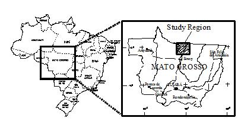

Open Dinamica EGO and load the aforementioned maps from  `guidebook dinamica\database\accumulated cost surface least cost pathway` on the Map Viewer. Open the slope map using “Pseudocolor” as the current color palette and in the Histogram click on Limits to Actual and Histogram Equalize. As a first step, you need to reclassify the land use map to depict the cost of crossing each one of its land uses. Also you need to reclassify the slope map and then combine it with the land use map.

For the land use map we will use the following table:

| Land use | Attribute | Friction | Explanation |
|---|---|---|---|
| Flooded plains | 0 | 10000 | Virtually a barrier |
| Small Rivers | 1 | 50 | There is a need to build bridges |
| Pasture | 2 | 1 | The basic cost |
| Regrowth | 3 | 10 | It is necessary to clear cut the bushes and small trees |
| Forest Remnant | 4 | 500 | It is necessary to obtain a license to suppress the native forest, which has an intrinsic conservation value |
| Urban | 5 | 10000 | Virtually a barrier |
| Roads | 6 | 30 | It is necessary to build overpasses or install signs to halt the traffic |

Friction increases as a function of slope ranges as follows:

| Slope (degrees) | Friction |
|---|---|
| < 1 | 1 |
| 1 to < 5 | 1.3 |
| 5 to < 10 | 1.5 |
| 10 to < 15 | 1.9 |
| 15 to < 20 | 2.5 |
| ≥ 20 | 5 |

Let’s begin the model by loading the maps `landuse.tif` and `slope.tif` using the functor *[Load Map](../functors/Load-Map.html)*. Then, let’s incorporate the two previous tables. Add a *[Lookup Table](../functors/Lookup-Table.html)* from Lookup Table tab.

You should have something like this:

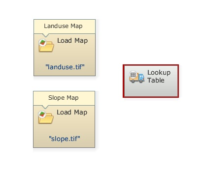

Now place three *[Calculate Map](../functors/Calculate-Map.html)* and four *[Number Map](../functors/Number-Map.html)* functors, one within each *[Calculate Map](../functors/Calculate-Map.html)* and two *[Number Map](../functors/Number-Map.html)* functors within the third, and one *[Number Table](../functors/Number-Table.html)* within one of the two first *[Calculate Map](../functors/Calculate-Map.html)* functors and *[Save Map](../functors/Save-Map.html)*. Open *[Number Map](../functors/Number-Map.html)*, assign a unique number (1 and 2) to each one and assign "1" to *[Number Table](../functors/Number-Table.html)*. Finally connect Map `landuse.tif` and Map `slope.tif` to *[Number Map](../functors/Number-Map.html)* 1 of the two first *[Calculate Map](../functors/Calculate-Map.html)*. Then, connect the two first to the third *[Calculate Map](../functors/Calculate-Map.html)* respectively and it to *[Save Map](../functors/Save-Map.html)*. Open *[Save Map](../functors/Save-Map.html)* and enter `friction.tif`. This is what you should get:

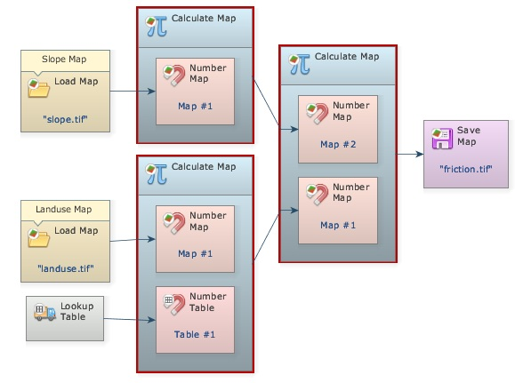

Now, you need to enter the land use table in the functor *[Lookup Table](../functors/Lookup-Table.html)*. Open it with Edit Functor and start adding **keys** and **values** (fill in the fields and press the plus button). Open the *[Calculate Map](../functors/Calculate-Map.html)* that contains the *[Number Table](../functors/Number-Table.html)* and write the following formula: **t1[i1]**

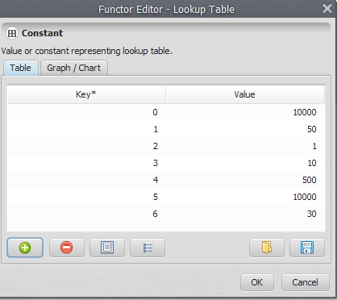

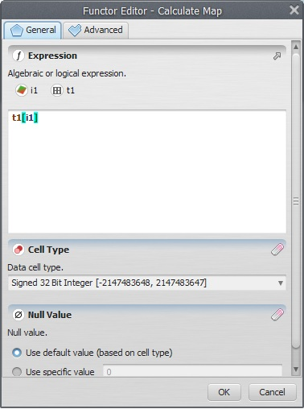

This formula will get the value from the map and use it as a key to access the table, reclassifying the map according to the cost values.

Enter the following equation into the second *[Calculate Map](../functors/Calculate-Map.html)*:

```
if i1 < 1 then 1 else if i1 < 5 then 1.3 else if i1 < 10 then 1.5 else if i1 < 15 then 1.9 else if i1 < 20 then 2.5 else 5
```

This corresponds to the slope friction table.

In the third *[Calculate Map](../functors/Calculate-Map.html)* enter:

```
i1*i2
```

Save the model as `my friction`, and run it.

Open on the Map Viewer `friction.tif`, using “Pseudocolor” as Current Color Palette and in the Histogram click on Limits to Actual and Histogram Equalize.

What do you see? Observe the red color representing the areas with high costs to cross.

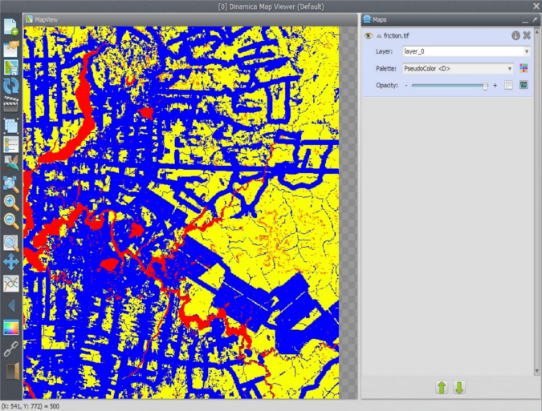

Let’s move on to the second part of this exercise.

Load `town1.tif` from `guidebook dinamica\database\accumulated cost surface least cost pathway` using *[Load Map](../functors/Load-Map.html)* and `railroad.tif` using *[Load Categorical Map](../functors/Load-Categorical-Map.html)*. Remember that this functor categorizes a map.

Drag *[Calc Cost Map](../functors/Calc-Cost-Map.html)* and *[Calc Pathway Map](../functors/Calc-Pathway-Map.html)* from the Map Algebra tab and *[Save Map](../functors/Save-Map.html)*.

> **Info:** Here are some notes on this algorithm:
>
> The algorithm that calculates the cost map is a general type of "Pushbroom". However, its spatial performance approximates the so called "Pushgrow" algorithm, especially when using two or more passes.
>
> By default, the cells dimensions (width and height) are not considered in the calculation of cost. To take this into consideration, turn on in Advanced options **Friction is relative**.
>
> Penalization for diagonal movements is effective only when friction values are high or the cost map is represented using real numbers.
>
> Friction map with cells represented in real numbers requires cost map with cells represented in real numbers or an error will be reported.
>
> Each pass used to calculate the cost map corresponds to four map passes originating from opposite directions.
>
> Unreachable places on the friction map are excluded on the cost map and thus represented as null value cells. Cost are not accumulated across null value cells, thus regions surrounded by null value cells will not have their cell costs calculated, unless there is a source feature inside this region.

The **Source** port of [Calc Cost Map](../functors/Calc-Cost-Map.html) functor will receive the Map `railroad.tif` and the **Friction** port will receive the map output by the third *[Calculate Map](../functors/Calculate-Map.html)*. Turn on **Diagonals Cost More**. This will penalize the movement across diagonal cells. Set **Maximum Number of Passes** to “2”. Leave all other options untouched.

Open *[Calc Pathway Map](../functors/Calc-Pathway-Map.html)* now with the Edit Functor Ports. Link Map `town1.tif` to the **Source** port.

> **Tip:** **TIP**: **Source**, in this case, also represents the destiny since the cost map was built from the existing railroad. Thus, this algorithm will search for the least-cost pathway from the source to the existing feature, i.e. the railroad.

Link the map output from *[Calc Cost Map](../functors/Calc-Cost-Map.html)* to the port **Cost** and Map `railroad.tif` to **Network** (because it represents a linear feature network) and the output **Network** port to *[Save Map](../functors/Save-Map.html)*.

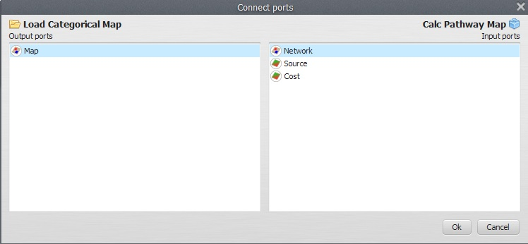

Activate the option **Use Lottery** (this is an artifact that allows the model to solve the path when two or more local minima are found).

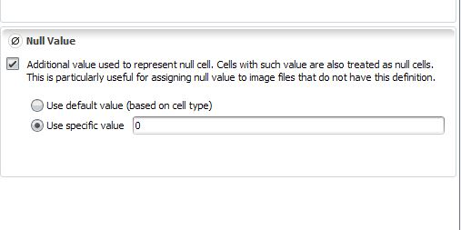

*[Calc Pathway Map](../functors/Calc-Pathway-Map.html)* ignores cells with values equal, less than 0 or null cells. In turn *[Calc Cost Map](../functors/Calc-Cost-Map.html)* needs a network map with null cells representing non-features. Go to *[Load Categorical Map](../functors/Load-Categorical-Map.html)* and open it with the Edit Functor. Press the flag **Null Value** and make sure **Use specific value** is set to “0”.

Click on *[Save Map](../functors/Save-Map.html)* with the Edit Functor, change the folder to an upper level, change the file format to “geotiff” and set **Suffix to Digits** to “0”, finally enter `railway.tif`. The final model will look as follows:

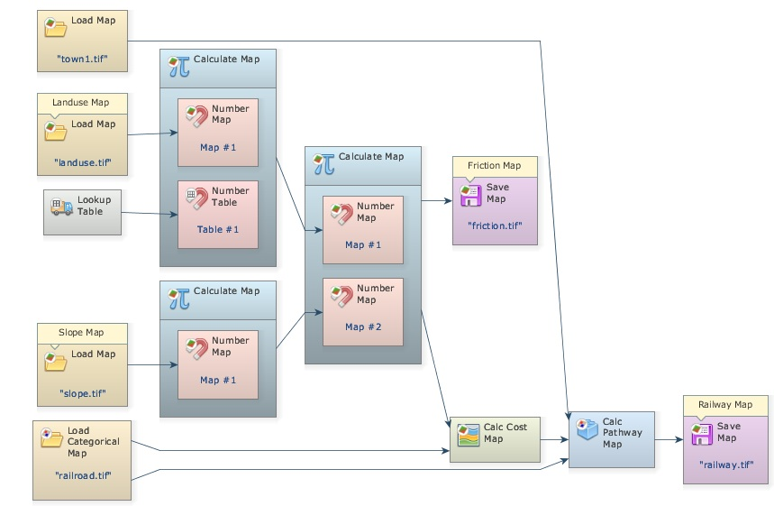

Save the model to a new file `my pathway.egoml`, and run it. This is going to take only a little while. Dinamica EGO has superior performance in relation to most commercial GIS packages; you may want to try this model on other software just for performance comparison. Open on the Map viewer `railway.tif`, using "PseudoColor" as **Current Color Palette**. What do you see?

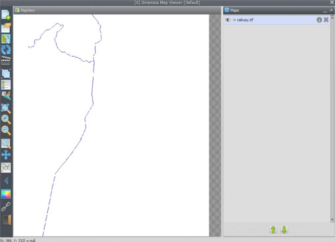

You may try to maximize the solution for the *[Calc Cost Map](../functors/Calc-Cost-Map.html)* algorithm by setting the **Maximum Number of Passes** to “0”. Compare the time spent by this run and its resulting path with that of previous model. Did it make a big difference?

This type of model can also be modified to develop simultaneously multiple paths. Open the model `join towns.egoml` in the folder of this lesson.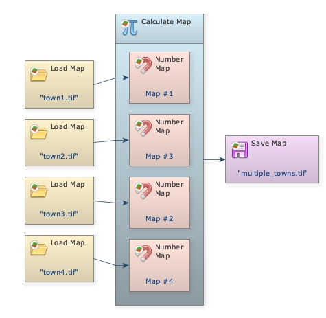

This model shows how you can use *[Calculate Map](../functors/Calculate-Map.html)* to merge information from several maps into a single one. The product will be a map depicting the center cells for four towns. TIP: use always a sole cell to represent a location to be reached by *[Calc Pathway Map](../functors/Calc-Pathway-Map.html)*.

Now replace, into model `my pathway.egoml`, the input in Map `town1.tif` with the file `multiple towns.tif` and change the file in Map `railway.tif` to `xrailways.tif`.

Did you get something like this?

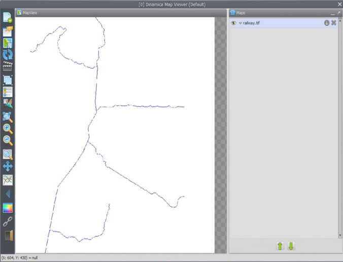

### Congratulations, you have successfully completed this lesson!

☞[Next: Lesson 18: Building a land-use and land-cover change simulation model](Land-Use-Change-Simulation-Model.html)

