
# Lesson 11: Creating local Submodels and using a Submodel in a Model

Local submodels can be created by simply selecting the parts of a model that will be converted to a submodel and clicking on the tab `Edit -> Create Submodel`. The selection will be replaced by the new submodel and the visual representation of the new submodel will be available to be edited as a new tab on the script editor. At any time, the user can make changes to the local submodel and apply those changes clicking on **Apply changes / Update Submodel Properties** on the model toolbar.

It is also possible to select parts of a local submodel and create another local submodel using that selection. The new local submodel will be a dependency of the previous one, but the submodel creation process is basically the same. If the selection is empty, an empty local submodel will be created. The process for updating an empty submodel is the same process used to update any local submodel.

Initially, we will learn how to create a submodel and next we will learn how to use it in a Model.
We will start with the model `5 calculate lookup table.egoml` located in `\guidebook dinamica\models\creating and using local submodels`. Using this model we will answer the following question:

**What is the productivity for each crop across the considered time window?**

- Select the functors of the model that should be included in the submodel as shown by the image below.

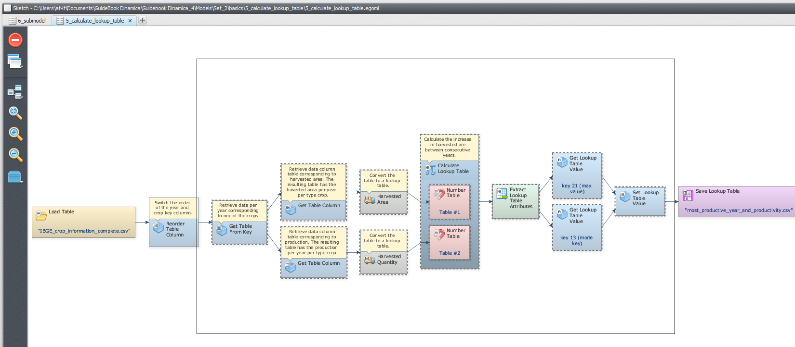

- With this selection active, Click on **Edit** tab and next on **Create a Submodel** to encompass all the selected functors into a local submodel:

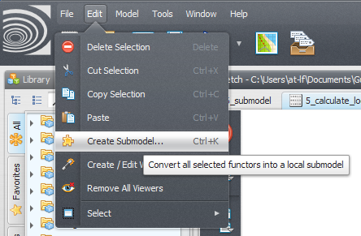

- In the Submodel Editor window, insert a submodel name (e.g. Calc Most Productive year), specify the input and output ports of this submodel and click ok, creating the submodel.

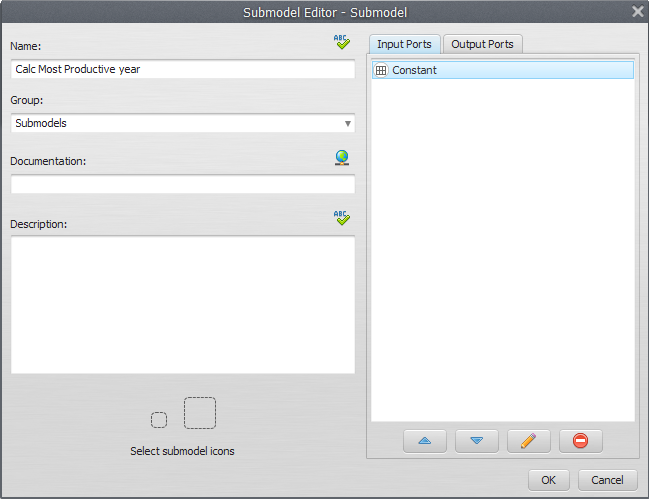

- You will see:

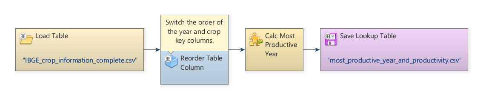

## Using the submodel in an independent model

- Previously, the submodel only calculated productivity for crop 3. Now, we must give the user the option to choose the crop to be analyzed. For this, it is necessary to create an entry where it will be possible to specify the crop to be analyzed (1, 2 or 3).

> **Important:** To edit the submodel creating this input for the submodel, you need to open the submodel by clicking on its name in the lateral bar.

- So, with the model open to be edited, place a functor Integer value (where the user can choose the crop - 1, 2 or 3) and connect to get table from key functor:

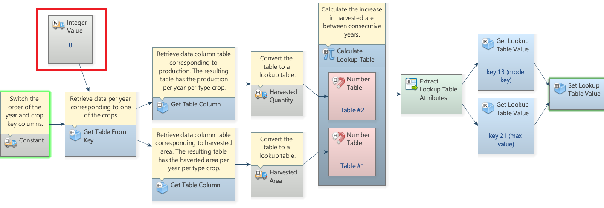

- On the top bar of the Functor integer value, click on the option Export functor inputs and outputs, and, in the new window, double-click the editor icon (pencil) and enter the name "Crop". Click Ok:

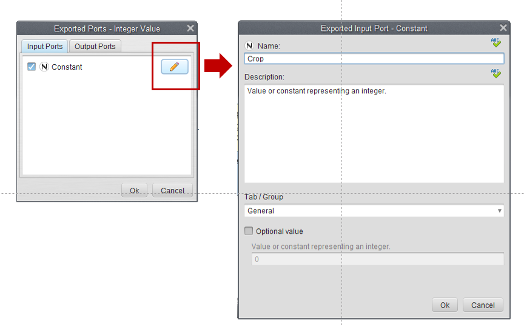

- After including the changes, click on Apply changes / Edit Submodel Properties as shown in the image below and click OK:

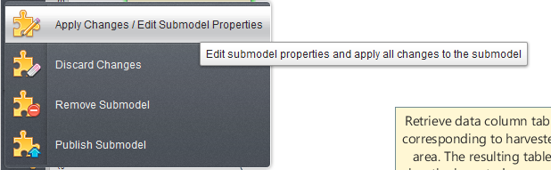

Next, click OK, and again OK:

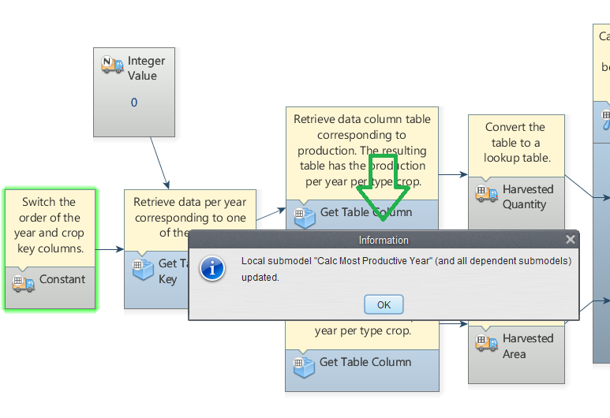

- Create a new model script, grab a **[Load Table](../functors/Load-Table.html) Functor** and place it on the sketch. Double click the Load Table Functor and open the `ibge crop information complete.csv` file located in `\guidebook dinamica\models\add table column set table by key`. Grab a **[Reorder Table Column](../functors/Reorder-Table-Column.html)** and place it on the sketch to switch the order of the year and crop key columns. Connect the Load Table to Reorder Table Column. In the Functor Editor window insert the index of the column to be moved (1) and the new column index (0) and click OK.

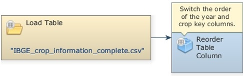

- To insert our previously created Submodel, click on the Local Submodels tab and from the library window grab the Calc Most Productive year submodel and place it on the sketch. This will import the submodel, click ok on the prompted warning.

- We want to calculate the most productive year for each crop; thus, we will use this Submodel 3 times, i.e. for the crops 1, 2 and 3. For this, Double click in each submodel loaded and insert the number that corresponds to each crop, as the image below.

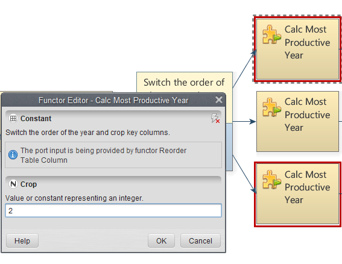

- To save the results to a file, grab three **[Save Table](../functors/Save-Table.html)** functors, place them on the sketch and connect to each Submodel (for the three crops). Open **Save Table** Functors, browse to the `\guidebook dinamica\models\creating and using local submodels` and write the file names (e.g. `most productive year for crop 1.csv`, `most productive year for crop 2.csv` and `most productive year for crop 3.csv`).

- The final model will look like the one in the imagem below. Save and run the model.

> **Note:** The red box highlights the window in which the crop should be chosen

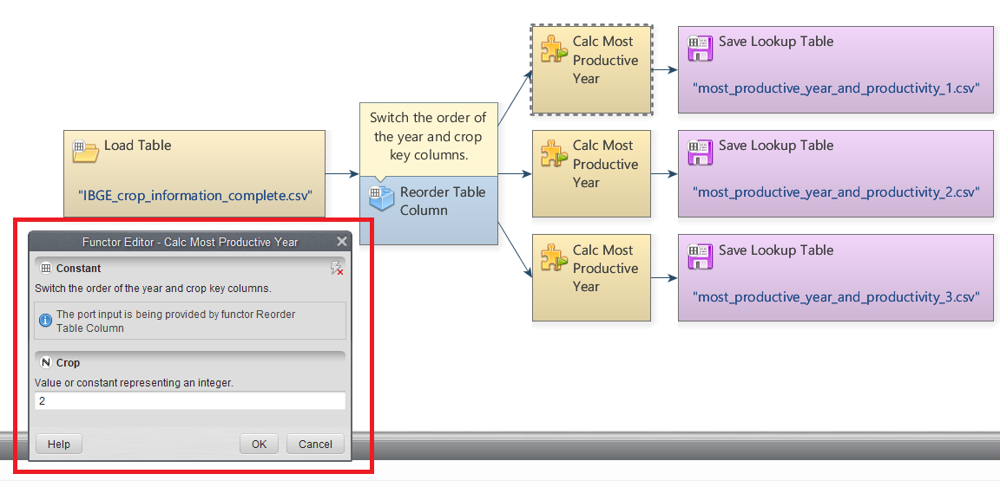

- Now, click on eye button of **Save Table** to see the result. These functors outputs are tables that looks like this:

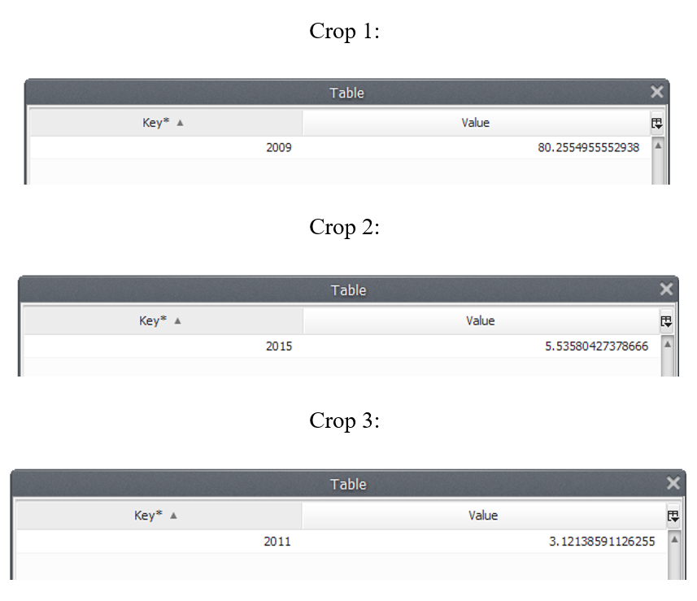

## What does this result say about the productivity for each crop within the analyzed period?

We can infer that 2009 was the most productive year for Crop 1 along the analyzed period, with a productivity of 80.25549 tons/ha. For the Crop 2, 2015 was the most productive year, with a productivity of 3.535804 tons/ha and 2011 was the most productive year for Crop 3, with a productivity of 3.121386 tons/ha.

## Congratulations, you have successfully completed this lesson!

☞[Next: Lesson 12: Updating, importing and publishing a local submodel](Updating-Importing-And-Publishing-Submodels.html)

