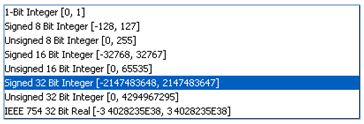


# Lesson 1: Dinamica EGO data structures and file format

## What will you learn?

- Dinamica EGO data structures
- Dinamica EGO file formats

Dinamica EGO handles data in several formats, including raster maps or images, tables, matrices, and a Weights of Evidence coefficient file.

For spatial data, Dinamica EGO supports raster datasets for most analyses, but vector can also be input and then transformed into raster or used in Python or R hybrid EGO operators. Geo-referencing is mandatory, same projection and datum. Dinamica EGO virtualization machine can process maps with different spatial resolution and tie point.

- Dinamica EGO reads and writes raster data in many ways: check all the Supported Map Formats
- Dinamica EGO supports most of the coordinate systems.

> **Important:** In map algebra, the null concept is very important to obtain an intelligible result from a model execution. Null means absence of data. Thus a map containing an irregular geographic area of interest, which does not completely cover the geographic plane, must contain a representation for the null cell. The value reserved for null cell representation may vary depending on the data cell type, i.e. the size in bits used to store the cell values of a map. Dinamica EGO supports data cell types as follows:
>
> 
>
> Usually, the lowest negative value is used to represent the null value. For example -32768 for Signed 16 Bit Integer. Choose a data cell type able to encompass the range of values contained in a variable. For example: elevation, varying from -10 meters to 4000 meters, must be represented as Signed 16 Bit Integer or IEEE 754 32 Bit Real. If there is more than one choice, choose always the most economical data format in number of bits

> **Tip:** You may need to define the null value when loading a Geotiff and some other dataset, which lacks this definition. Learn in Building a simple model Lesson how to do this.

Tables are a convenient way to represent attribute data, usually pertaining to a certain geographic zone, for example: country, state or counties. Dinamica EGO can also read data in Comma Separated Value format. It is possible to use two different kinds of tables: [tables](../types/Table-Type.html) and [lookup tables](../types/Lookup-Table-Type.html).

---

## Table

| Key* | Key2* | Value | Value2 |
|---|---|---|---|
| 1 | 2 | 10 | 60 |
| 2 | 6 | 30 | 40 |
| 3 | 9 | 15 | 20 |

---

## Lookup Table

| Key | Value |
|---|---|
| 1 | 10 |
| 2 | 30 |
| 3 | 15 |

The first line of the lookup table must contain the columns titles “Key” and the variable name, such as population, countries, etc.

---

## Transition Matrix

A transition matrix is represented by the following format, in which each row gives the rate of transition from one category to another:

| From* | To* | Rate |
|---|---|---|
| 1 | 2 | 0.223567 |
| 1 | 3 | 0.379618 |
| 2 | 1 | 0.024841 |
| 2 | 3 | 0.030573 |
| 3 | 2 | 0.000348 |

The previous table is equivalent to the following transition matrix. Note that the diagonal values do not need to be filled in.

|  | 1 | 2 | 3 |
|---|---|---|---|
| **1** | - | 0.223567 | 0.379618 |
| **2** | 0.024841 | - | 0.030573 |
| **3** | 0 | 0.000348 | - |

Another supported format is the Weights of Evidence file, a text file containing the Weights of Evidence coefficients. This file is obtained through the Weights of Evidence method used in the calibration process of the model.

> **Tip:** You can edit this file directly on a text editor or using the Weights of Evidence graphical editor linked to [Load Weights Functor](../functors/Load-Weights.html).

Congratulations, you have successfully completed this lesson!

☞[Next Lesson](Exploring-The-Graphical-Interface.html)

