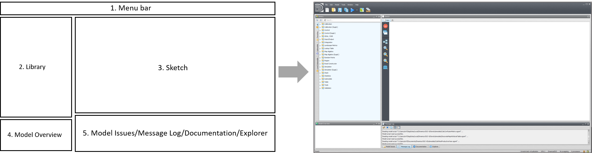
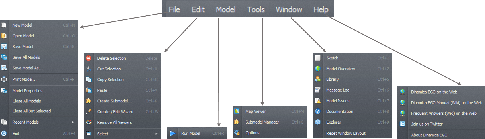
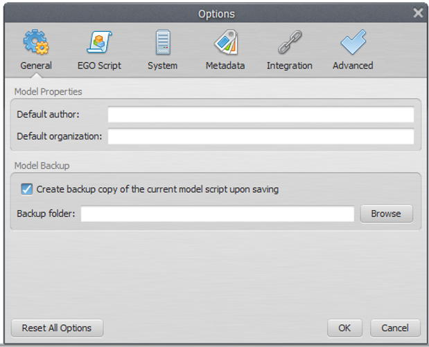
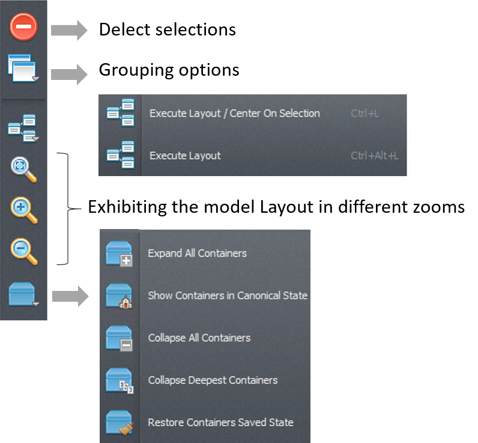
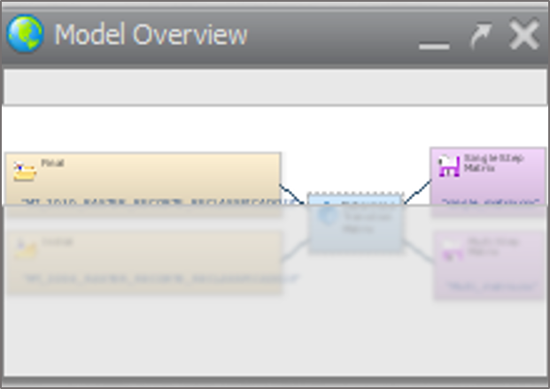
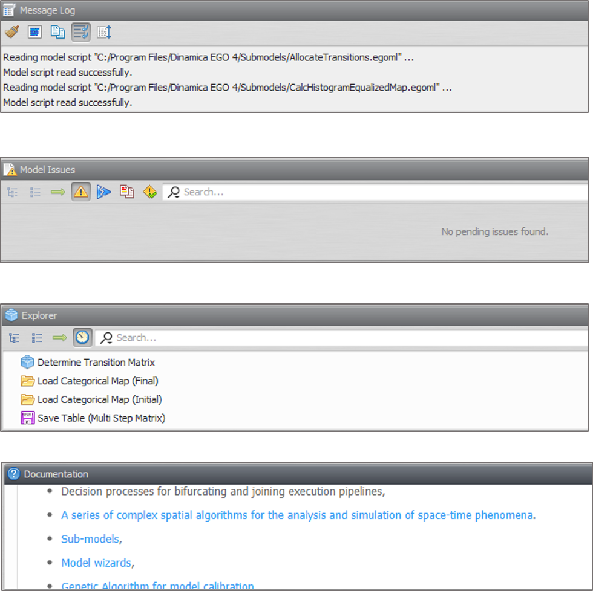
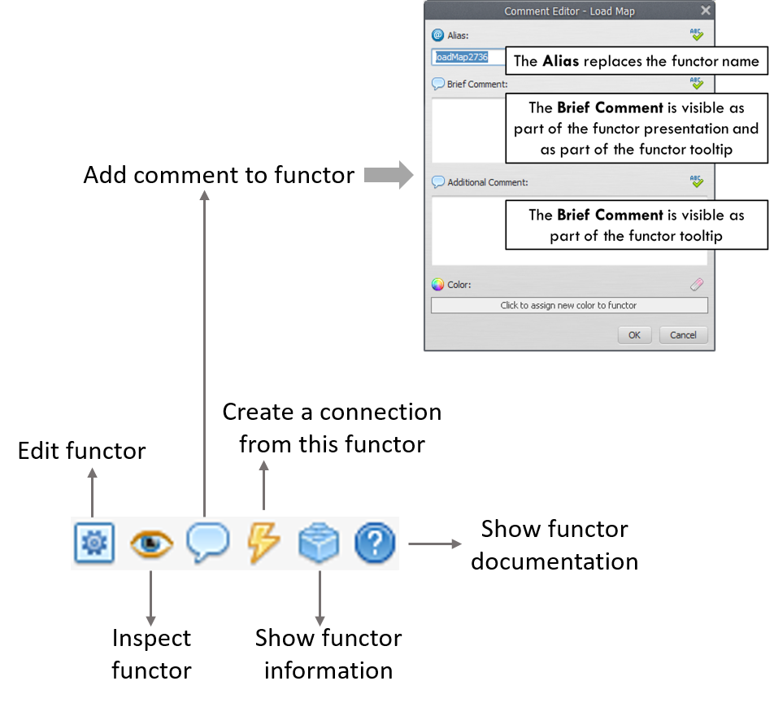
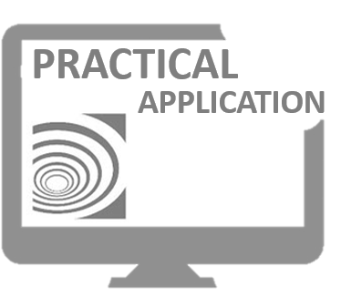


# Lesson 2: Exploring the Graphical Interface

When Dinamica EGO starts, you are presented with the graphical interface below.

> **Note:** It is possible to open more than one instance of Dinamica EGO. This can be useful when comparing the structure of two models. However, beware that operations such as copying and pasting data between two or more instances of Dinamica EGO are not allowed

The five components of the Dinamica EGO interface are described in more detail in the following sections. The complete reference for the interface is in [Graphical Interface](../gui/index.html).

---

## 1. Menu Bar

The menu bar is a graphical control element with several dropdown menus. It provides access to various features using a standard hierarchical menu. The top-level menus and a summary of some of the menu options are listed below together with the associated icons.

> **More information:** [Options and Performance](../gui/Options-And-Performance.html) describes every setting in the Options window. [Keyboard Shortcuts](../gui/Keyboard-Shortcuts.html) lists the available shortcuts.

The icons on the menu bar are shortcuts to create, open, save a model, save model to a new file, work with model wizards, check model script operator integrity, check model script connection integrity, run a model, open the map viewer and work with submodels:

A new option window is available to enter model information and to set Dinamica EGO environment parameters. Go to Main menu Tools – Options:

The Options window is divided into 7 tabs. The General tab has options for filling in information on the model properties and model backup settings.The System tab holds options related to system setup, such as enabling and disabling auto updates. The Metadata allows inspecting and editing the current metadata template for output maps. The Integration tab enables configuring the active session name and plugins such as R Integration with Dinamica. The execution defines the number of processors, the use of GPU and parallel processing options. The EGO script tab defines the EGO script format. The Advanced tab enables the user to set memory management and parallel processing behavior.

---

## 2. Library

In the library window you will find the available functors and submodels organized in subsets according to their nature and application.

> **More information:** [Functor Library](../gui/Interface-Elements.html#functor-library) and [Functor Library Bar](../gui/Interface-Elements.html#functor-library-bar).

---

## 3. Sketch

The sketch toolset enables deleting selections, provides grouping options, executing layout options, zooming in, out and fitting the model to sketch and container options.

> **More information:** [Model Presentation](../gui/Interface-Elements.html#model-presentation), [Model Selection Tabs](../gui/Interface-Elements.html#model-selection-tabs) and [Copying and Pasting](../gui/Interface-Elements.html#copying-and-pasting).

---

## 4. Model Overview

The Model Overview provides a synoptic view of the model and is especially useful for large models that do not fit entirely on the sketch when shown at default size. The shaded area on the bird view corresponds to the sketch window. Move the shade to zoom to a particular part of the model. The tree view provides a hierarchical view of the model allowing one to select or locate a functor and subsequently to edit its properties through the functor property window.

> **More information:** [Model Overview](../gui/Interface-Elements.html#model-overview) and [Searching in the Panels](../gui/Interface-Elements.html#searching-in-the-panels).

---

## 5. Model Issues / Message Log / Documentation / Explorer

The message log window is a reserved space for reporting textual messages showing results, errors, warnings, information and debug information. By default, the log text will output all information, but the user can change this in the Options Window and clicking on the System Tab to tweak the desired information level.

> **More information:** [Explorer](../gui/Interface-Elements.html#explorer), [Issue Panel](../gui/Interface-Elements.html#issue-panel), [Message Log](../gui/Interface-Elements.html#message-log) and [Documentation Panel](../gui/Interface-Elements.html#documentation-panel).

> **Tip:** You can change the interface layout by dragging interface panels to new locations. The modified interface layout is automatically saved and reused next time Dinamica EGO is open. It is possible to restore the interface component layout to its original configuration clicking on Window >> Reset Window Layout.
>
> You can also resize or close windows. This may become useful as the model increases in number of functors. You just need to increase the sketch size at the expense of the other windows.

---

## Models on Dinamica EGO

Models are expressed in Dinamica EGO as a sequence of functors connected via compatible inputs and outputs. Data flow through these operators to produce a desirable outcome that represents the solution to a query on some environmental topic or the output of the model itself.

> **Note:** **How do I create a model on Dinamica EGO?** A model is designed simply by dragging functors from the library window and placing them on the sketch.

---

## Functor action bar

In the functor action bar you will find tools that allow connecting, editing, inspecting, selecting, moving functors, editing the functor ports, writing comments to a functor and organizing the model layout:

> **More information:** [Functor Action Bar](../gui/Interface-Elements.html#functor-action-bar), [Connection Action Bar](../gui/Interface-Elements.html#connection-action-bar) and [Functor and Port Editors](../gui/Functor-And-Port-Editors.html).

> **Tip:** The action bar is context sensitive and changes its options based on the functor selected and the type of model that is being edited.

**RUN THE DINAMICA EGO AND EXPLORE ITS GRAPHICAL INTERFACE. DRAG FUNCTORS TO SKETCH, COMMENT ON THEM. GET TO KNOW THE ITEMS IN THE LIBRARY.**

Congratulations, you have successfully completed this lesson!

☞[Next: Lesson 3: Exploring the Map Viewer](Exploring-The-Map-Viewer.html)

