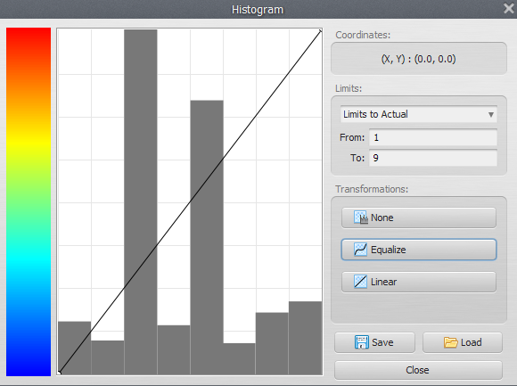
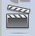
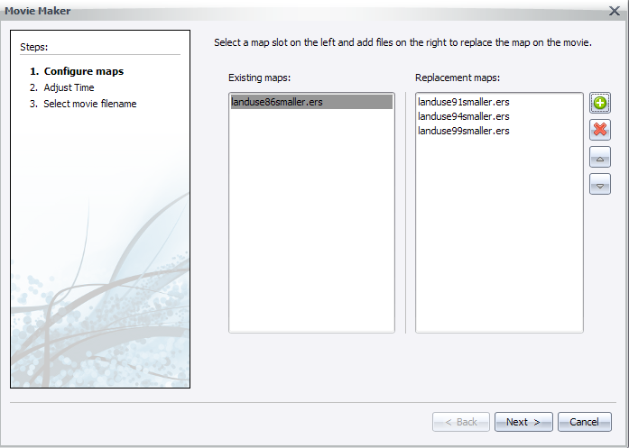
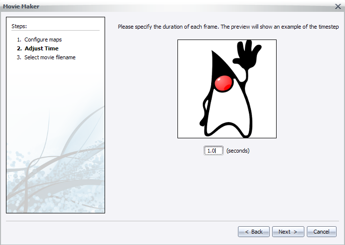
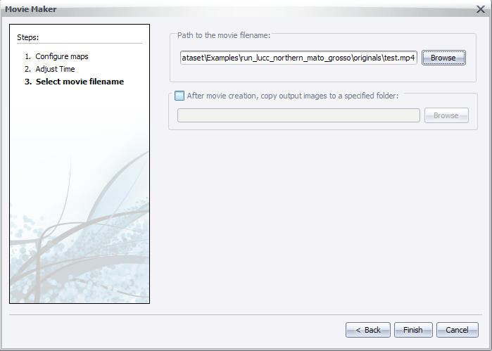
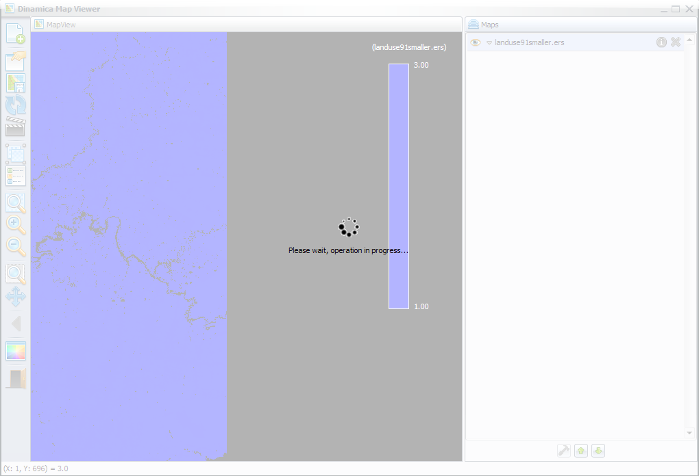
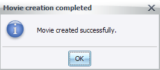


# Lesson 3: Exploring the Map Viewer

The Dinamica EGO Map Viewer is a tool designed to view and interpret map information.

The components of the **Map Viewer** interface are described in more detail in the following sections:

#### Main Window

The main window is where most information regarding the viewer state is located. On the left you have the toolbar of the Map Viewer as a whole, on the right you have a list of loaded maps and tools to manage them.

---

#### Toolbar

Each toolbar button is described below:

1. Load new maps discarding the previous ones, load new maps at the top of the current map list, load new map replacing a selected one, load saved viewer state.

2. Save viewer state (save transformations, map stack settings, background color and movie maker settings).

3. Save current visualization (including legend and overview map, if visible) as a bitmap image.

4. Reload current selected map.

5. Open movie maker (allow users to [make *.mp4 movies from a series of maps](../gui/Making-A-Movie.html) in a easy way).

6. Create/Split map groups (grouping maps allow users to apply calculate expressions on top of a custom stack).

7. Toggle map legend (and if image is currently in category mod, toggle categories visualization).

8. Toggle birdview (render a small overview map showing the location of the currently zoomed view).

9. Zoom to fit window.

10. Zoom in (zoom in over hovered cell).

11. Zoom out (zoom out over hovered cell).

12. Zoom to selection rectangle (selected rectangle will cover entire screen space available).

13. Pan (allow users to move the current visualization area).

14. Analyze cells values in specified interval.

15. Previous view (if the user is making many visualization steps, it is possible to go back to the last step using this button).

16. Background color (change application background color).

17. Toggle geoposition linking between two or more instances of the map viewer.

18. Quit.

---

## Color Palette

Allow users to select which color represents each cell in visualization area. Cells are first extracted from the map in their original values (in any range) and then re-sampled using the histogram curve. After that, their values fall in the [0, 255] range, which are mapped to palette colors.

---

## Changing colors individually

The color corresponding to each individual value can be changed by clicking on the corresponding color rectangle. You can also check color index value by hovering your cursor over the color rectangle.

> **Important:** Values changed by [histogram transformation](../gui/Histogram-Editor.html) may not correspond to palette colors as expected, specially when the user is trying to edit the colors for specific cells/categories. To avoid this issue, remove the histogram transformation (set them to None) before editing the colors for specific cell values.

## Generated palette

You can also create a color palette using a linear interpolation between two color values (gradient). All you have to do is click the gradient button and set your range.

After that, you can click the interpolate button and the new palette view be generated.

---

## Saving your work

Keep in mind that palettes are not saved until the user chooses to do so. If you made any mistake, you can just click "Cancel" and try again. If you click "Ok", the palette will be changed locally, but will reset if you restart the application.

Saved palettes are stored on the disk in the user palette folder `Dinamica EGO/Dmps`, so every time you reopen the map viewer, you will still have them. Changes made by the users in predefined palettes only affect their own instance of the application. To reset the predefined palettes to their default state, remove the user palette folder and restart the application.

> **Tip:** Usually, but not always, the user palette folder is `C:\Users\<User Name>\Documents\Dinamica EGO\Dmps` on Windows

---

## Histogram Editor

The histogram window is responsible for assigning transformations from image original values (in any range) to palette range [0, 255]. The histogram curve will adjust any value smaller than the "From:" limit to 0, and any value greater than the "To:" limit to 255. Any other values will be mapped using the histogram curve to the "Y" coordinate on the color palette on the left.

---

### Transformations

- **None**: This option does not apply any transformation, leaving cell value "as it is".
- **Linear**: Linearly maps values between the "from" and "to" ranges.
- **Equalize**: Constructs an appropriate curve based on [Equalization](https://en.wikipedia.org/wiki/Equalization).

---

### Load a map

There are currently four options for loading maps (or a group of maps, if you hold the CTRL key while selecting the filenames on the file browser):

|   |   |
|---|---|
| **Load map (cleaning map list)** | Erase the current map list (label "Maps" on main dialog). |
| **Load map (keeping map list)** | Load the new map at the top of the current map list. Every incompatible map (different number of lines or columns) will be turned off (made non-visible). Keep in mind that if you open a incompatible map, the current transformation will be erased and the  default transformation restored. |
| **Load map on selection** | Load the new map replacing the selected map. This option is only available if there is a map selected. All transformations (histogram, palette, pan, zoom) will be left untouched. The new map will try to match the active map layer selection |
| **Load viewer state** | Load an stored viewer state from a file, replacing the map stack, the background color, current palettes, histogram transformations and everything else. |

#### Map loaded, what now?

After your map is loaded, its name will displayed on the "Maps" list on the right side of the map viewer interface.

Initially, the setting corresponding to a loaded map is **Collapsed**. To expand the settings panel, just click on its corresponding "expand arrow".

As you can see, this button is just a toggle between "normal" mode and "category" mode. Enabling the category mode ignores the map transformation and uses the category colors instead. Also, when showing legends in category mode, category colors and names are displayed instead of the legend range.

---

### Map information

You can retrieve map information by clicking on the icon "i" (Layer information).

This information comes from Dinamica EGO itself, the available rows can vary from map to map.

> **Tip:** It is possible to assign aliases to maps and map groups. You can set the alias on the top part of the information dialog.

---

### Map functions

The functions you have for each map are described below:

1. Change map layer. If your map has many layers, you can select the active layer to be shown. Only one layer can be used at a time.
2. Change map [palette](../gui/Color-Palette.html).
3. Opacity (by default, viewer show opaque maps, but you can set a transparency threshold for better visualization).
4. [Image Expression](../gui/Expressions-And-Map-Groups.html) (calculate expression - just like calculate map on Dinamica EGO - for map values).
5. [Histogram](../gui/Histogram-Editor.html) transformation.
6. Edit color [palette](../gui/Color-Palette.html) selected on the left combo box (2).
7. Toggle category view (only available for maps with category information).
8. Toggle map visibility.
9. Remove map from [stack](../gui/Map-Viewer-Interface.html)

---

### How to Make a Movie

Map Viewer can be used to generated movies (in [mp4 format](https://en.wikipedia.org/wiki/MPEG-4_Part_14)) from a set of maps. This is useful because:

- You can make presentations and display temporal changes in an interactive way.
- Output movies can be read by any devices and/or applications that support mp4, it isn't tied to map formats or Dinamica EGO itself.
- Generated frames for movie can be saved separated in PNG, that way you can also use your favorite movie creation tool.

#### Movie files

On a computer, movies are just a series of frames (or pictures) that are displayed in a particular order.

Usually, when you see formats as (.mp4) it means that you have a set of images and a sound file tied together. Movies produced by the Map Viewer follow the same definition. The user is required to load the maps (which are going to be the images in the movie) ​wanted ​to be displayed and then configure the viewer main area as if it was the movie itself. Transformations (zoom, pan) are kept on the movie, as well as histogram curves, palettes for each images and transparency.

#### Making a movie

1. User load the maps to display on the movie. Check out [Load a map](../gui/Map-Viewer-Interface.html#loading-maps), if you are unsure about how to load maps.
1. Transformations are configured, [histogram](../gui/Histogram-Editor.html) curves are defined and [color palette](../gui/Color-Palette.html) set.
1. The movie maker is invoked.

- As soon as the movie maker wizard pops up, the user is prompted to select frames to be replaced (left column) and frames to replace them after each frame (right column).

- Next, the user configures the time between each frame (a preview of the replace speed will be shown).

- Finally, the user selects the final path for the output movie file (the .mp4) and if he/she desires to keep generated frames.

- After clicking next, the user will be prompted to wait while the movie is being generated.

> **Tip:** A good way to keep progress is to watch the changes in frame names, on the Map column in main interface. A notification will pop up when the process finishes.

---

### Map Alias

The Dinamica EGO Map Viewer now offers support for map aliases. By supporting map aliases, map viewer can assign meaningful information to what is being displayed.

> **Important:** The aliases assigned by the map viewer are not used by other components of Dinamica EGO and have no impact on the simulations.

---

#### Setting up alias

- You need a loaded map to assign an alias, if you are unsure about how to load maps, please check [Load a map](../gui/Map-Viewer-Interface.html#loading-maps).
- With a map loaded, click on the information icon () to show selected map information.
- A dialog will popup and you will be able to change the map alias by writing the new alias on the top text field.

- The alias will be changed when you hit the "Apply map alias" () or "Restore original alias" () icons.
- You can also change the map alias by double clicking the map name/alias on the "Maps" window.

- After changing the map alias, you will see the new alias every time a map filename would be shown instead (legend, map information dialog, movie maker).

---

### Command Line

The map viewer can be used as a command line tool to load ".egov" files and save the resulting ".png" image representing the stack of maps.

The command line syntax is:

`"<Folder where Dinamica EGO is installed>\DinamicaMapViewer" <egov filename> <resulting png filename> [png width] [png height]`

| Parameter | Description |
|---|---|
| egov filename | The filename where the egov file is located. |
| resulting png filename | The filename where the resulting png file will be located. |
| png width | The width of the output png file. This parameter is optional. |
| png height | The height of the output png file. This parameter is optional. |

Example:

`"C:\Program Files\Dinamica EGO\DinamicaMapViewer" "c:\Maps\maps.egov" "c:\Outputs\result.png" 800 600`

Congratulations, you have successfully completed this lesson!

☞[Next Lesson](Opening-And-Saving-Maps.html)

