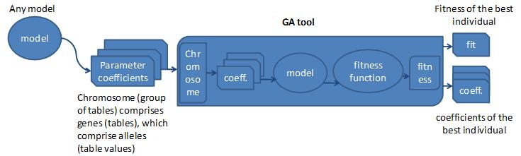
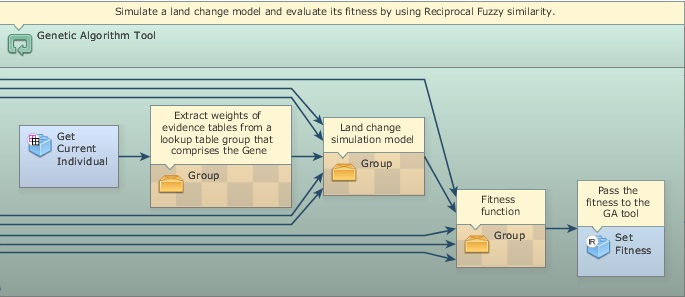
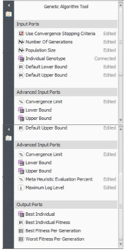
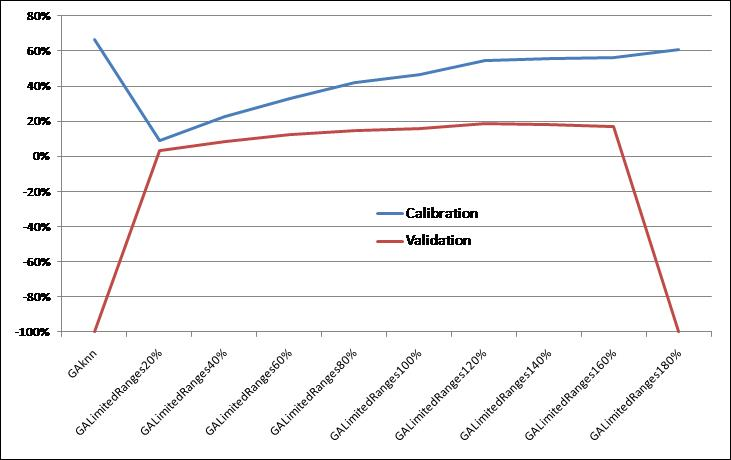


# Heuristic calibration of models by using Genetic Algorithm

## What will you learn?

- How to calibrate a land change model by using Genetic Algorithm
- How to set up a gene from model parameters
- How to get model parameter coefficients from a gene
- How to pass the model fitness to the GA tool
- Functors:<br> - *[Genetic Algorithm (GA) Tool](../functors/Genetic-Algorithm-Tool.html)*<br> - *[Create Lookup Table Group](../functors/Create-Lookup-Table-Group.html)*<br> - *[Extract Lookup Table from Lookup Table Group](../functors/Extract-Lookup-Table-From-Lookup-Table-Group.html)*<br> - *[Get Current Individual](../functors/Get-Current-Individual.html)*<br> - *[Set Fitness](../functors/Set-Fitness.html)*

The *[Genetic Algorithm (GA) Tool](../functors/Genetic-Algorithm-Tool.html)* provides a powerful means of calibrating environmental models[( Soares Filho et al., 2013)](http://dx.doi.org/10.1016/j.envsoft.2013.01.010). By mimicking the principle of biological evolution (Koza, 1992), GA tool uses massive computing and heuristics to seek for a global optimum solution for a set of model parameters. Dinamica EGO´s GA tool consists of a container, which requires the placement of a sequence of functors within it and, in particular, of two associated functors: *[Get Current Individual](../functors/Get-Current-Individual.html)* and *[Set Fitness](../functors/Set-Fitness.html)*. Fig. 1 depicts a model calibration scheme using GA tool. First, one needs to get the coefficients from the model parameters to be calibrated and assemble these coefficients in tables. Thus each model parameter will represent an allele in a table that corresponds to a gene. In turn, these tables are assembled by using *[Create Lookup Table](../functors/Create-Lookup-Table.html)* Group in a group of tables to form a chromosome. This group of tables is an input to GA tool. GA tool spawns a population based on the genotype passed in a group table. Inside GA tool, *[Get Current Individual](../functors/Get-Current-Individual.html)* is placed to get the genes from the individuals of a generation. Other functors, such as *[Extract Lookup Table from Lookup Table Group](../functors/Extract-Lookup-Table-From-Lookup-Table-Group.html)*, are sequenced to catch the parameter coefficients and pass them to the model, which is executed once per individual. An evaluation function is coupled to the output of the model and its result is passed to *[Set Fitness](../functors/Set-Fitness.html)*, which returns the fitness value to GA tool for the selection process. The internal sequence of functors will iterate a number of times equal to the number of individuals multiplied by generations, as specified in GA tool´s input ports. When GA tool terminates, it will output the fitness of the overall best individual as well as the group of tables that comprises its genes.



In the example provided, we make available an application of GA tool to calibrating a model of deforestation. The aim of this exercise is to demonstrate the potential of GA tool for calibrating any type of model-as long as there is sufficient computer power to run a model together with its evaluation function numerous times-as well as the overspecialization problem that may arise when using such hard predictors, as artificial neural network and GA itself.

First, load the model `cal reciprocal fitness1x1.ego` from `\guidebook dinamica\models\genetic algorithm\weofe`. This model calculates the reciprocal fitness of a deforestation model that was calibrated using the Weights of Evidence method – a soft predictor. Run the model and access its output `reciprocal fitness1x1.csv` using either a spreadsheet or enabling table viewer on the output port of Set Key 1. The concept of this validation measure is provided in sixth  and seventh chapters of lesson Building a Land use and Land-cover Change Simulation Model. The fitness obtained for this model is 0.2060. Open the Weights of Evidence tables in `\guidebook dinamica\database\genetic algorithm\tables` and their corresponding maps in `\guidebook dinamica\database\genetic algorithm\maps`. In this model, *[Calculate Map](../functors/Calculate-Map.html)* replaces *[Calc W. E. Probability Map](../functors/Calc-W-Of-E-Probability-Map.html)*. Open it to see the equation that integrates the weights of evidence to produce the transition probability map. The weights of evidence coefficients are input as separate tables, so they can form a group of table and thereby the gene.

Now, open `gareciprocal fitness1x1.ego` from `\guidebook dinamica\models\genetic algorithm\gaknn\reciprocal fitness1x1`. Compare the structure of this model with the diagram from Fig.1. Open GA tool. This container envelops three *[Group](../functors/Group.html)*s and two functors. *[Get Current Individual](../functors/Get-Current-Individual.html)* obtains the gene of an individual pertaining to a generation and passes it to a sequence of functors that extract the lookup tables that compose the gene. A land change simulation model receives those tables as input and its execution results are passed to a fitness function that assesses its spatial performance. In turn, this function returns the fitness measure that is caught and passed to GA tool by *[Set Fitness](../functors/Set-Fitness.html)*.



Click on GA tool with the Edit Functor Ports. As input, GA tool receives **Number of Generations** (30) and **Population Size** (100), i.e. number of individuals per generation, and Use **Convergence Stopping Criteria**. This last parameter forces GA tool to terminate if GA evolution becomes asymptotical, as defined by the **Convergence Limit** (0.99) that must be achieved within the span of generations established by the **Number of Generations**. **Meta Heuristic** **Evaluation Percent** enables the model to calculate the fitness for a percentage of individuals by use of a meta-heuristic estimation method known as KNN (K-Nearest Neighbor), thus saving computer time. Additional inputs for this model are:** Default Lower Bound** and **Default Upper Bound**, respectively set at -5 and 5. These parameters set a range within which the allele values may vary.



Run this model. It may take a while depending on the capabilities of the computer system used. Remember that, as a hard predictor, **GA tool** uses massive computing, which in principle would demand a high-performance computer system. Nevertheless, Dinamica EGO 2.2 is designed to take advantage of computer power, such as dual or more processors, extended virtual memory, and pre-compilations of algebraic and logical equations, making it feasible to run the current GA tool model even on a laptop computer.  Follow the log report and open the file “Reciprocal_fitness_of the_overall_best_individual.csv”. The overall best individual attained a fitness of 0.3439, and hence an increase of 66% with respect to the Weights of Evidence method. Now, let´s validate this model.

> **Note:** **Note**: Model fitness can be increased by lowering **Prune Factor** in [Patcher](../functors/Patcher.html). This diminishes model stochasticity, but often results in less realism.

Open `validation fitness1x1.ego` from `\guidebook dinamica\models\genetic algorithm\gaknn\reciprocal fitness1x1` and run it. What is the fitness now? Surprised? What happened?

The answer is simple. GA tool attained a very high fitness in the calibration process through overspecialization. That is, it adapted so well to this specific situation given by the map of changes from 1997 to 2000, that the probability map obtained with GA tool results became useless when applied to model validation, which is performed by using deforestation from 2000 to 2003. Thus, although GA tool can achieve high scores in the calibration process, it will become overspecialized if the formation of genes in the reproduction process (mostly through mutation and crossover) is not constrained within a certain range of variation from the characteristics of the primeval individual.

Dinamica EGO´s GA tool provides a means to overcome overspecialization by enabling the user to specify an envelope of maximum variation to the new genes that will be formed during the reproduction process. So, instead of default values, this envelop is delimited by two group tables, consisting, respectively, of the upper and lower gene bounds.

Open model `gareciprocal fitness1x1.ego` from `\guidebook dinamica\models\genetic algorithm\galimitedranges120\reciprocal fitness1x1` and examine *[Group](../functors/Group.html)* "Lower Bound Envelope". Open it. Each *[Calculate Lookup Table](../functors/Calculate-Lookup-Table.html)* establishes a lower bound for a weights of evidence table by using the following equation:

```
t1[line] - abs(t1[line]) * 1.2
```

Likewise, the *[Group](../functors/Group.html)* "Upper Bound Envelope" will set an upper bound as follows:

```
t1[line] + abs(t1[line]) * 1.2
```

The use of these tables as gene bounds will constrain the new genes to an envelope of ±120% of the absolute values of the original weights of evidence coefficients (using the absolute value keeps the lower bound below the upper bound for negative coefficients), thus providing a trend around which the global optimum solution must be found. Although this constraint will result in lower calibration scores (Run `validation fitness1x1.ego` located in `\guidebook dinamica\models\genetic algorithm\galimitedranges120\reciprocal fitness1x1`), it will tame the *GA tool* engine, allowing it to improve the Weights of Evidence result for application to a general prediction process (Figs. 2 and 3).

In conclusion, hard predictors like GA tool must incorporate prior knowledge in order to overcome overspecialization. When this is taken into consideration, GA tool can really push the envelope of model optimization.  Use your expertise to develop other GA tool calibration processes following the scheme of Fig. 1 and examples provided.

*GA tool* is a contribution from the master´s degree dissertation of Flávio Oliveira at the graduate program on Modeling Environmental Systems of Universidade Federal de Minas Gerais (www.csr.ufmg.br/modelagem).



![Fig.3- a) Transition probability map from Weights of Evidence (blue: low probability, red: high probability), b) Simulated changes (red) by using map from a) over historical changes from 1997 to 2000 (black). c) Transition probability map using weights output from //:Genetic Algorithm Tool// limited within a 120% envelope. d) Simulated changes (red) using map from b) over historical changes from 1997 to 2000 (black). e) Weights of evidence of deforestation as a function of distance to previously deforested areas (WofE- Weights of Evidence method, GAknn - GA sole method, others: GA with values limited, respectively, within 80% and 120% envelope of original weights of evidence values, f ) Simulated changes (red) using map from c) over historical changes from 2000 to 2003 (black).](../image/guidebook_ga__5.1.jpg)

### Congratulations, you have successfully completed this lesson!

> **See also:** [Weights of Evidence Calibration](../Weights-Of-Evidence-Calibration.html) explains the method, its parameters and each calibration step in more depth.

☞[Next: Agent Based Model](Agent-Based-Model.html)

