
# Lesson 8: Inserting and getting a specific value into a table

The aim of this lesson is getting and inserting specifics values from and into a table on Dinamica. We will use the [Get Table Value](../functors/Get-Table-Value.html), [Set Table Cell Value](../functors/Set-Table-Cell-Value.html), [Add Table Column](../functors/Add-Table-Column.html), [Set Table By Key](../functors/Set-Table-By-Key.html) and [Get Table From Key](../functors/Get-Table-From-Key.html) functors and the following files:

- The IBGE crop information Table (`guidebook dinamica\database\tables\ibge crop information.csv`)
- The 1999_production_value Table (`guidebook dinamica\database\tables\1999 production value.csv`)
- The 1999_harvested_area Table (`guidebook dinamica\database\tables\1999 harvested area.csv`)
- The 1999_production Table (`guidebook dinamica\database\tables\1999 production.csv`)

**Let's go!**

- From the Input/Output tab, grab a [Load Table](../functors/Load-Table.html) and place it on the sketch. Double click it, browse to the folder `guidebook dinamica\database\tables` and open the `ibge crop information.csv` file.

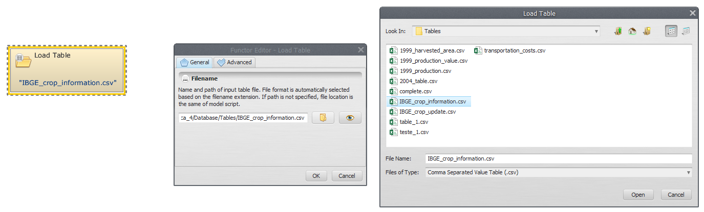

> **Important:** Only multi-column CSV - comma separated value format is accepted

- The first two columns are considered the keys of the file, being used to access a certain data in the table. Click on eye button of [Load Table](../functors/Load-Table.html) to see the table.

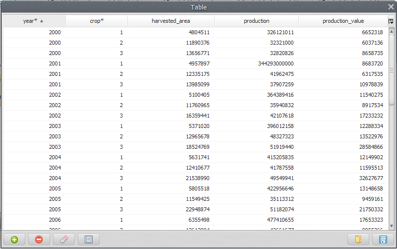

- Grab a [Get Table Value](../functors/Get-Table-Value.html) and place it on the sketch. Connect [Load Table](../functors/Load-Table.html) to [Get Table Value](../functors/Get-Table-Value.html).

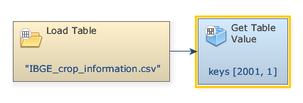

- Double click the Get Table Value to enter the keys corresponding to the sought-after values and the column name (highlighted by an asterisk). In the box Keys, enter `2001`. Next, enter `1` (The Key to identify the wanted value on the table). Also, in the Column tab, add `4`, i.e., the column name or index where the value is located.

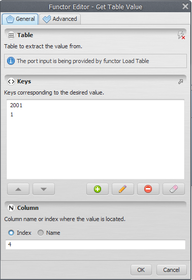

> **Note:** If the given keys are not found in the input table and the <u>Value If Not Found</u> parameter, in the Advanced Tab, is not provided, an error will be reported.

- From the Table tab, grab a [Calculate Value](../functors/Calculate-Value.html) and place it on the sketch. Assign a number to [Number Value](../functors/Number-Value.html) and connect the [Get Table Value](../functors/Get-Table-Value.html) to [Number Value](../functors/Number-Value.html). In the Connect ports window, select <u>Value</u>.

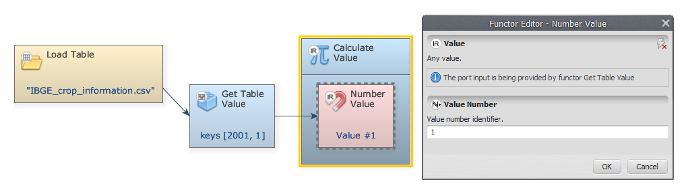

- Double-click on [Calculate Value](../functors/Calculate-Value.html) to add a logic or an algebraic expression. We divide `v1` (the selected value) by 1000, `v1/1000`, and click OK.

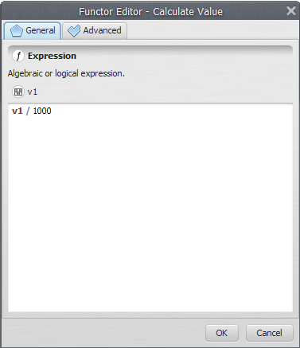

- From the Table tab grab a [Set Table Cell Value](../functors/Set-Table-Cell-Value.html) and place it on the sketch. Connect [Calculate Value](../functors/Calculate-Value.html) and [Load Table](../functors/Load-Table.html) to [Set Table Cell Value](../functors/Set-Table-Cell-Value.html).  In the Connect Ports window, select <u>Value</u> input port for the output of [Calculate Value](../functors/Calculate-Value.html).

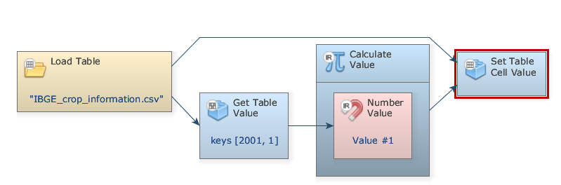

- Double-click [Set Table Cell Value](../functors/Set-Table-Cell-Value.html). To identify where the sought-after value is located, on the <u>Keys</u> input enter `2001`, `1` (corresponding to Year 2001 and Crop 1) and add the Index `4` on the <u>Column</u> input.

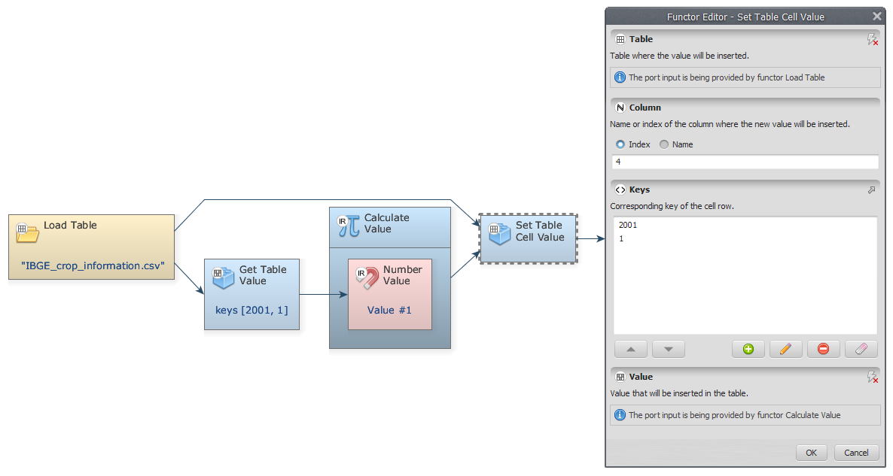

- From the Input/Output tab, grab a [Save Table](../functors/Save-Table.html) and place it on the sketch. Connect [Set Table Cell Value](../functors/Set-Table-Cell-Value.html) to [Save Table](../functors/Save-Table.html), browse to `\guidebook dinamica\models\add table column set table by key` and enter the file name `ibge crop information updated.csv`, which the next lesson uses. The final model will look like this:

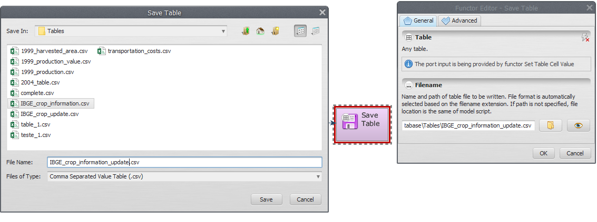

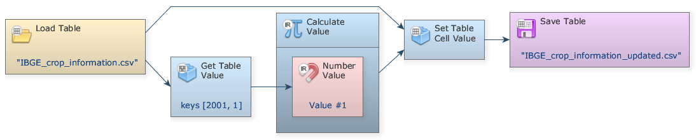

- Save and run your model. Select the [Save Table](../functors/Save-Table.html) functor and click on the eye button to see the result.

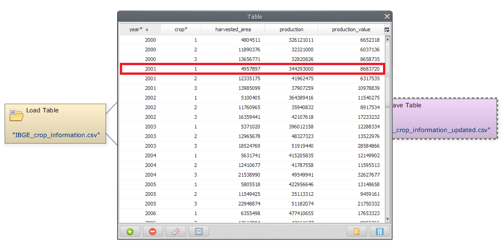

## Congratulations, you have successfully completed this lesson!

> **See also:** [Manipulating Tables and Lookup Tables](../Manipulating-Tables-And-Lookup-Tables.html) covers the table and lookup table functors and techniques in more depth.

☞[Next: Lesson 9: Working with maps and tables](Working-With-Maps-And-Tables.html)

