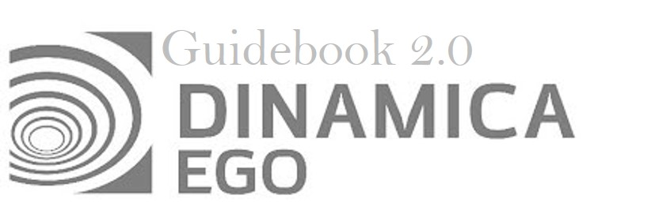


# Introduction

Welcome to Dinamica EGO!

A **E**nvironment for **G**eoprocessing **O**bjects with simplicity, flexibility and good performance, optimizing speed and computer resources.

**In this section will you learn What Dinamica EGO is, What a functor is and What this guidebook is about.**

## What Dinamica EGO is?

**Dinamica EGO** is a modeling environment, with outstanding possibilities for the design from the very simple static spatial model to very complex dynamic ones, which can ultimately involve nested iterations, dynamic feedbacks, multi-region approach, manipulation and algebraic combination of data in several formats, such as maps, tables, matrices and constants, decision processes for bifurcating and joining execution pipelines, and a series of complex spatial algorithms for the analysis and simulation of space-time phenomena.

The aim of this guidebook is to introduce the user to the innumerous possibilities of **Dinamica EGO** for the design of models that can fully represent the complexity of various geographic phenomena.

## In this new Guidebook:

