
# Lesson 18: Building a land-use and land-cover change simulation model

## What will you learn?

* How to simulate land-use change  
* How to calculate transition matrix  
* How to calibrate a land-use change model  
* Using Weights of Evidence  
* Map Correlation  
* Model Validation  
* Functors:   - *[Determine Weights Of Evidence Ranges](../functors/Determine-Weights-Of-Evidence-Ranges.html)*  - *[Determine Weights Of Evidence Coefficients](../functors/Determine-Weights-Of-Evidence-Coefficients.html)*  - *[Calc W. Of E. Probability Map](../functors/Calc-W-Of-E-Probability-Map.html)*  - *[Calc Change Matrix](../functors/Calc-Change-Matrix.html)*  - *[Patcher](../functors/Patcher.html)*  - *[Expander](../functors/Expander.html)*

This lesson explores the use of Dinamica EGO as a simulation platform for land-use and cover change (LUCC) models. The goal is to calibrate, run and validate a LUCC model, in this case a simulation model of deforestation. You will need to go through 10 steps in order to complete the model, as depicted in the fig.1 . To facilitate this process, each one of these steps will be represented as a separate model. Although, all steps could be joined into a single model, for sake of simplicity we will keep them as separate models.

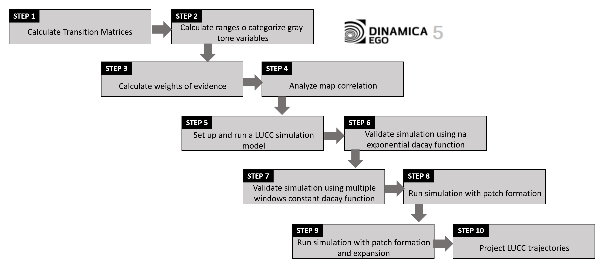

The study area with respect to Rondonia state and Brazil as illustrated in the fig.2:

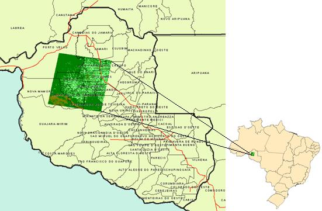

The input dataset represents a region of Rondonia state, around the town of Ariquenes, in the Brazilian Amazon, fig.2. Open the maps `23267 1997.tif` and `23267 2000.tif`, located in `\guidebook dinamica\database\lucc files` using the Color Palette, "Amazon". These maps correspond to a Landsat image (232/67) classified by PRODES [(INPE, 2008)](https://web.archive.org/web/20140321092206/http://www.obt.inpe.br/prodes/index.php) – Brazilian program for monitoring deforestation - for the years 1997 and 2000.

In this LUCC model, Dinamica EGO will use the 1997 map as the initial landscape and the 2000 map as the final, considering the  landscape as a bi-dimensional array of land use types.

The landscape maps have the following classes; the null is represented by 0:

| Key | Land cover classes |
|---|---|
| 1 | Deforested |
| 2 | Forested |
| 3 | Non-forest |

> **Tip:** **TIP**: Keep in mind the numbers that identify the map classes, since Dinamica EGO does not explicitly handle class names, although they can be visualized in the viewer with customized colors and specified in the metadata as well as in the header of geotiff files. See functor [Assign Map Categories](../functors/Assign-Map-Categories.html).

## First step: Calculating transition matrices

First, you need to calculate the historical transition matrices. The transition matrix describes a system that changes over discrete time increments, in which the value of any variable in a given time period is the sum of fixed percentages of values of all variables in the previous time step. The sum of fractions along the column of the transition matrix is equal to one. The diagonal line of the transition matrix need not to be specified since Dinamica EGO does not model the percentage of unchangeable cells, nor the transitions equal to zero. The transition rate can be passed to the LUCC model as a fixed parameter or be updated from model feedback.

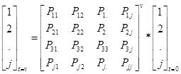(1)

The single-step matrix corresponds to a time period represented as a single time step, in turn the multiple-step matrix corresponds to a time step unit (year, month, day, etc) specified by dividing the time period by a number of time steps. For Dinamica EGO, time step can comprise any span of time, since time unit is only an external reference. A multiple-step transition matrix can only be derived from an Ergodic matrix, i.e. a matrix that has real number Eigen values and vectors.

The transition rates set the net quantity of changes, that is, the percentage of land that will change to another state (land use and cover attribute), and thus they are known as net rates, and denoted in percentage. In turn, gross rates are specified as an area unit, such as hectares or km2 per unit of time. In the case that there is not a solution for the multiple-step transition matrix, you still can use the submodel: Calc Net Transition Rates (See online store). Regardless matrix ergodicity, this functor calculates gross transition rates for a time-period and specified number of time-steps and then derives the matrix of mean net transition rates. Output transition matrix is an approximation of the multiple-step transition matrix at the order of 0.1% (for most cases) and thus can be used as input for multiple-step land change simulations. Or you can calculate fixed gross rate per time step (e.g. year) by dividing the accumulated change over the period by the number of steps over which the period is composed. Dinamica EGO converts gross rates into net rate, dividing the extent of change by the fraction of each land use and cover class prior to change, before passing it to the transition functors: *[Patcher](../functors/Patcher.html)* and *[Expander](../functors/Expander.html)*.

Open the model `determine transition matrix.egoml` located in `\guidebook dinamica\models\lucc model\1 transition matrix calculation`

This model calculates the single-step and multiple step matrices.

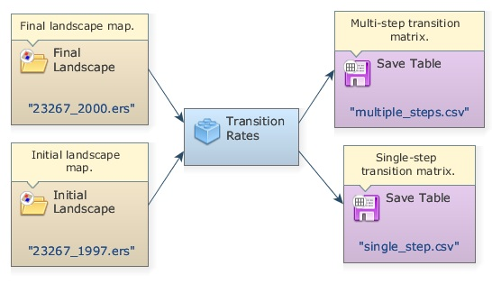

Open the functor *[Determine Transition Matrix](../functors/Determine-Transition-Matrix.html)* with the Edit Functor Ports.

> **Tip:** **TIP**: This functor, together with others applied to calibrate the model, is found in Calibration tab.

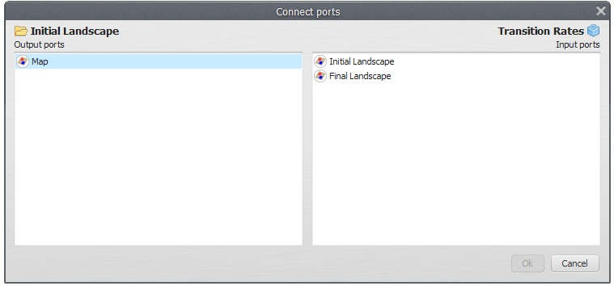

Note that *[Load Categorical Map](../functors/Load-Categorical-Map.html)* `23267 1997.tif` connects to the **Initial Landscape** port and the `23267 2000.tif` to the **Final Landscape**. Check the number of time steps. In this case “3”, therefore, you want to determine the multi-step matrix per annual steps (2000 – 1997 = 3 years).

Set **Register viewer** on in the output ports and run the model. Open the resulting matrices by clicking with the right button on the output ports. Is this what you got?

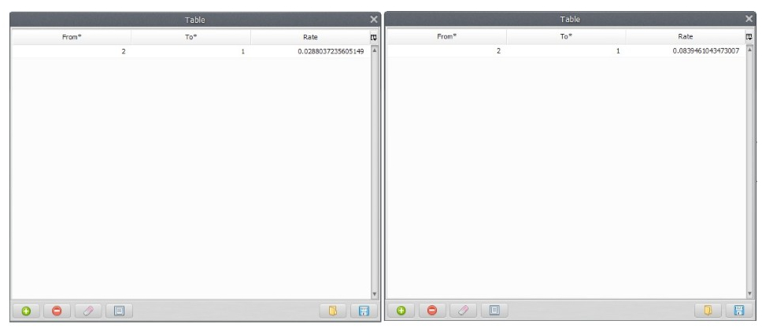

You can also see the model results in the window message. You just need to browse it back.

> **Tip:** TIP: you can copy the results from the log window and paste them as follows:

Single Step Transition Matrix:

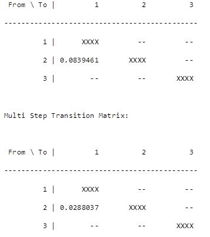

The only transition occurring is from forest (2) to deforested (1). The rates indicate that a percent of the forest is changing to deforested per unit time step, which is 3 years for the first matrix and 1 year for the latter. Thus, within this time-period deforestation is occurring at a net rate of 2.8% per year, which means that the remaining forest is shrinking 2.8% per year. Bear in mind that like interest rates, transition rates are superimposed again and again over the stock variable, which in this case is represented by the extent of remaining forest.  
The net transition matrix is passed to the simulation model and Dinamica EGO browses the landscape (land use and cover) map to count the number of cells to calculate the gross rate in terms of quantity of cells to be changed. In order to set a constant gross rate you will need to pass a variable net rate to the model, which is also possible due to the ability of Dinamica EGO to incorporate feedback into the simulation. Let’s move on to the next step.

## Second step: Calculating ranges to categorize gray-tone variables

> **See also:** [Weights of Evidence Calibration](../Weights-Of-Evidence-Calibration.html) explains the method, its parameters and each calibration step in more depth.

The Weights of Evidence method [(Goodacre et al. 1993](http://dx.doi.org/10.1016/0040-1951(93)90011-8)[, Bonham-Carter 1994)](https://books.google.com/books?printsec=frontcover&vid=ISBN0080424201&vid=ISBN0080418678&vid=LCCN94028315#v=onepage&q&f=false) is applied in Dinamica EGO to produce a transition probability map (fig. 3), which depicts the most favorable areas for a change [(Soares-Filho et al. 2002](http://dx.doi.org/10.1016/S0304-3800(02)00059-5)[, 2004)](http://dx.doi.org/ 10.1111/j.1529-8817.2003.00769.x).

Weights of Evidence consists of a Bayesian method, in which the effect of a spatial variable on a transition is calculated independently of a combined solution. The Weights of Evidence represent each variable’s influence on the spatial probability of a transition i-j and are calculated as follows.

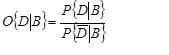 (2)

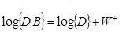 (3)

Where W+ is the Weight of Evidence of occurring event D, given a spatial pattern B. The post-probability of a transition i j, given a set of spatial data (*B, C, D,... N*), is expressed as follows:

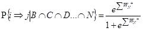 (4)

Where B, C, D, and N are the values of k spatial variables that are measured at location *x,y* and represented by its weights *W+N*

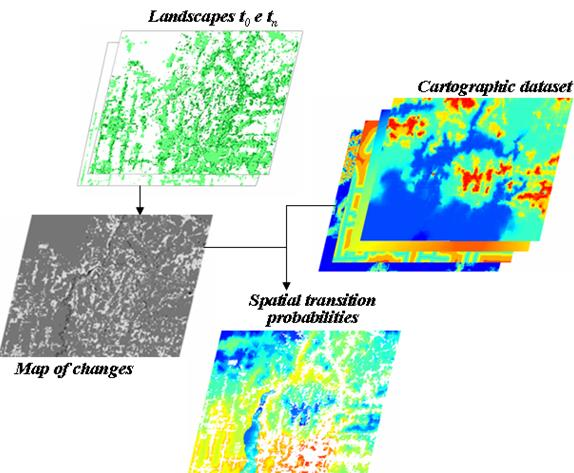

Since Weights of Evidence only applies to categorical data, it is necessary to categorize continuous gray-tone maps (quantitative data, such as distance maps, elevation, and slope). A key issue to any categorization process concerns the preservation of the data structure. The present method adapted from Agterberg & Bonham-Carter (1990), calculates ranges according to the data structure by first establishing a minimum delta – specified as the increment in the graphical interface – (*Dx*) for a continuous gray-tone variable x that is used to build n incremental buffers (*Nx*) comprising intervals from *Xminimum* to *Xminimum* + *nDx*.Each *n* defines a threshold that divides the map into two classes: *(Nx)* and *(Nx2)*. *An* is the number of cells for a buffer (*Nx*) multiple of *n* and *dn* is the number of occurrences for the modeled event (*D*) within this buffer. The quantities An and dn are obtained for an ordered sequence of buffers *N(xminimum + nDx)*. Subsequently, values of *W+* for each buffer are calculated using equations 2 to 4. A sequence of quantities *An* is plotted against *An*exp(W+)*. Thereafter breaking points for this graph are determined by applying a line-generalizing algorithm (Intergraph, 1991) that contains three parameters: 1) minimum distance interval along *x, mindx*, 2) maximum distance interval along *x, maxdx*, and 3) tolerance angle *ft*. For *dx* (a distance between two points along x) between *mindx* and  *maxdx*, a new breaking point is placed whenever *dx >= maxdx* (an angle between *v* and *v’*- vectors linking the current to the last point and the last point to its antecedent, respectively) exceeds the tolerance angle *ft*. Thus, the number of ranges decreases as a function of ft. The ranges are finally defined by linking the breaking points with straight lines. Note that *An* is practically error-free whereas *dn* is subject to a considerable amount of uncertainty because it is regarded as the realization of a random variable. Since small *An* can generate noisy values for *W+*, [Goodacre et al. (1993)](http://dx.doi.org/10.1016/0040-1951(93)90011-8) suggest that, instead of calculating it employing equations 2 and 4, one should estimate *W+* for each defined range through the following expression:

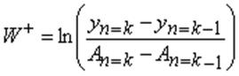  (5)

where *Yn=An*exp(W+)* and *k* represents the breakpoints defined for the *n* increments of *Dx* (Fig.4):

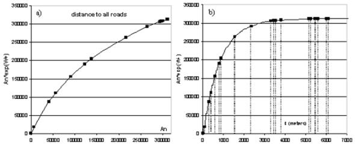

The best-fitting curve can be approximated by a series of straight-line segments using a line-generalizing algorithm as explained in the text. This approach is used to define the breaking points for this curve and subsequently category intervals for a continuous variable (b).

Now, open the model `determine weights of evidence ranges.egoml` located in `\guidebook dinamica\models\lucc model\2 weights of evidence ranges calculation`.

This model calculates ranges in order to categorize continuous gray-tone variables for deriving the Weights of Evidence. It selects the number of intervals and their buffer sizes aiming to better preserve the data structure. See the help for a further description of this method. As a result, its output is used as input for the calculation of Weights of Evidence coefficients.

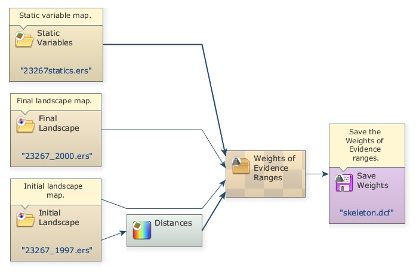

In addition to the initial and final landscape maps, this model receives a raster cube composed of a series of static maps, e.g. vegetation, soil, altitude (they are named so because they do not change during model iteration. A raster cube encompasses a set of co-registered map layers.
Open the file `23267statics.tif` from `\guidebook dinamica\database\lucc files` on the Map Viewer. An option to select the layer will appear on the Maps (right of window). Change the layer to examine the other maps.

> **Tip:** **TIP**: you can build a raster cube assembling a set of co-registered raster maps through the functor *[Create Cube Map](../functors/Create-Cube-Map.html)* and extract a layer from the cube using the functor *[Extract Map Layer](../functors/Extract-Map-Layer.html)*.

Furthermore, Dinamica EGO can incorporate dynamic layers into the simulation, which are so-called because they are updated during model iteration. For this model you will include the variable "distance to previously deforested areas" as a dynamic map.  For this purpose, the model employs the functor *[Calc Distance Map](../functors/Calc-Distance-Map.html)*. Open it with the Edit Functor Ports.

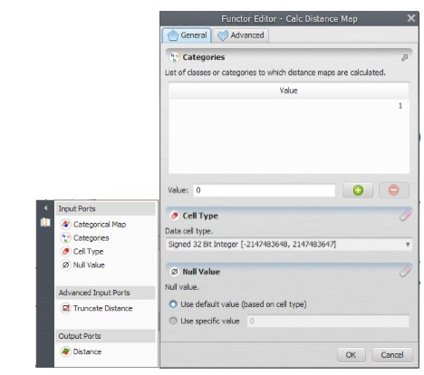

This functor receives as input a categorical map, in this case the landscape map. Click now on the **Categories** port. This functor generates a map of frontage distance (nearest distance) from the cells of each map class of category defined by the user. In this case class “1” represents deforested land. Thus, the model takes into account the proximity of the previously deforested land on the probability of new deforestation. Now open the container *[Determine Weights Of Evidence Ranges](../functors/Determine-Weights-Of-Evidence-Ranges.html)* clicking on the icon on its top left side.

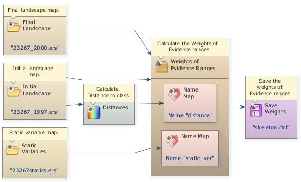

Instead of *[Number Map](../functors/Number-Map.html)*, now you find *[Name Map](../functors/Name-Map.html)* within this container. This functor is applied to containers that need a map name or alias to identify the maps passed to them. *[Name Map](../functors/Name-Map.html)* is found in the Create Hook into container action bar. This can be any name, but you must be consistent, therefore using the same names when setting the container internal parameters, as shown below. Examples of containers that need Name Map are *[Determine Weights Of Evidence Ranges](../functors/Determine-Weights-Of-Evidence-Ranges.html)*, *[Determine Weights Of Evidence Coefficients](../functors/Determine-Weights-Of-Evidence-Coefficients.html)*, and *[Calc W. Of E. Probability Map](../functors/Calc-W-Of-E-Probability-Map.html)*.

There are two *[Name Map](../functors/Name-Map.html)* functors within this container, one for the map `23267statics.tif` and another for the distance map output from the *[Calc Distance Map](../functors/Calc-Distance-Map.html)*.

Now open *[Determine Weights Of Evidence Ranges](../functors/Determine-Weights-Of-Evidence-Ranges.html)* with the Edit Functor. Resize the window as follows:

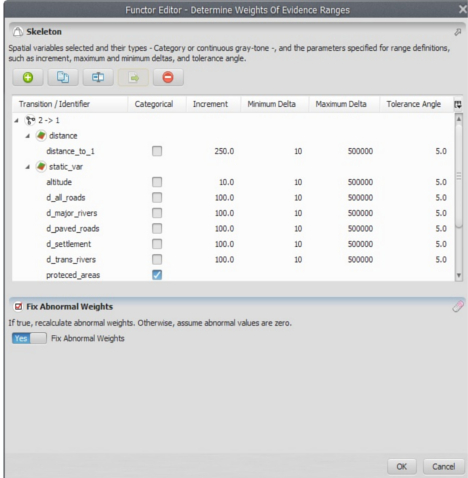

Note that *[Name Map](../functors/Name-Map.html)* "distance" has layer named "distance_to_1" and "static_var" has a series of layers, each one representing a cartographic variable.

The raster cube contains the layers altitude, "d_all_roads" (in this examples, d means distance), "d_major_rivers", "d_paved_roads", "d_settlement", "d_trans_rivers", "protected_areas", "slope", "urban_attraction" (a potential interaction map), and "vegetation".

> **Important:** Layer names must be the same as the ones specified in the header/xml file.

Protected areas, vegetation and soil are already categorical data, thus mark them as such. The others will need to be categorized. The parameters for the categorization process are the increment – the map unit minimum buffer increment, e.g. in meters or degrees the minimum and maximum deltas representing intervals on the Y axis of the graphs in fig.4, and the tolerance angle, which measures the angle of deviation from a straight line. Some default values are suggested. The output of this functor will be a Weights of Evidence skeleton file, showing the categorization ranges, but with all weights set to zero. Run the model and open the output file with a text editor.

> **Tip:** **TIP**: if the model has more than one transition, you can copy and paste the range parameters on the other transitions’ windows. Dinamica EGO enables defining different ranges for each transition.

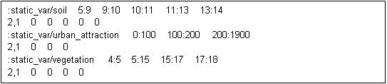

The first line contains the ranges and the second the transition and their respectively Weights of Evidence coefficients, which are still set to zero.

Although the mathematical fundamentals of this module may be a little hard to grasp at the first sight, it provides an easy means to handle models with multi-states and transitions. Let’s move on to the Weights of Evidence calculation.

## Third step: Calculating Weights of Evidence coefficients

Open the model `determine weights of evidence coefficients.egoml` located in `\guidebook dinamica\models\lucc model\3 weights of evidence coefficient calculation`.

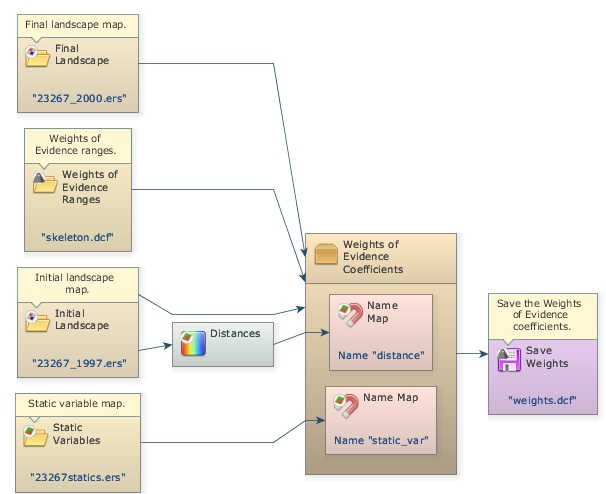

The same dataset of the previous step is applied again, plus the WEOFE skeleton, which is loaded through the *[Load Weights](../functors/Load-Weights.html)* functor located in the input/output tab. There is no parameter to set in the *[Determine Weights Of Evidence Coefficients](../functors/Determine-Weights-Of-Evidence-Coefficients.html)* functor, you only need to set the proper links as follows.

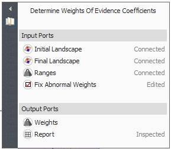

As well as the input maps:

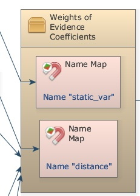

> **Important:** Use always the same names in *[Name Map](../functors/Name-Map.html)*.

Maximize the log window and run the model, let’s analyze the results for variable "distance_to_1".

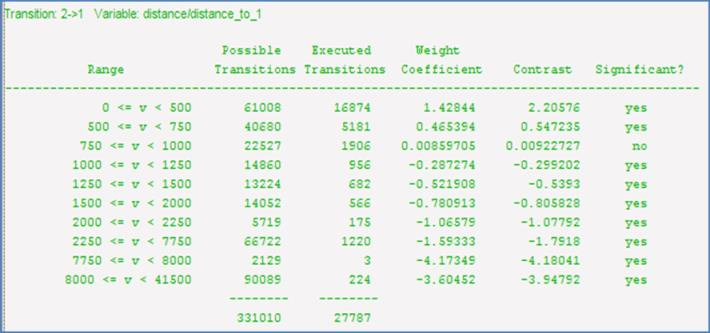

The first column shows the ranges, the second the buffer size in cells, the third the number of transitions occurring within each buffer, the fourth the obtained coefficients, the fifth the Contrast measure and the last the result for the statistical significance test. Go to help for further details.

> **Note:** Dinamica EGO Help brings a detailed description of more complex algorithms, such the ones employed in calibration and validation functors.

Notice that the first ranges show a positive association, favoring deforestation, especially the first, in contrast, the final ranges show negative values, thus repelling deforestation. The middle range shows values close to zero, meaning that these distance ranges do not exert an effect on deforestation.

The Contrast measures the association/repelling effect. Near zero, there is no effect at all, while the larger and more positive it becomes, the greater is the attraction; on the other hand, the larger and more negative the value, the greater is the repelling effect.

Now open the graphical Weights of Evidence editor within the [Save Weights](../functors/Save-Weights.html) functor (eye icon).

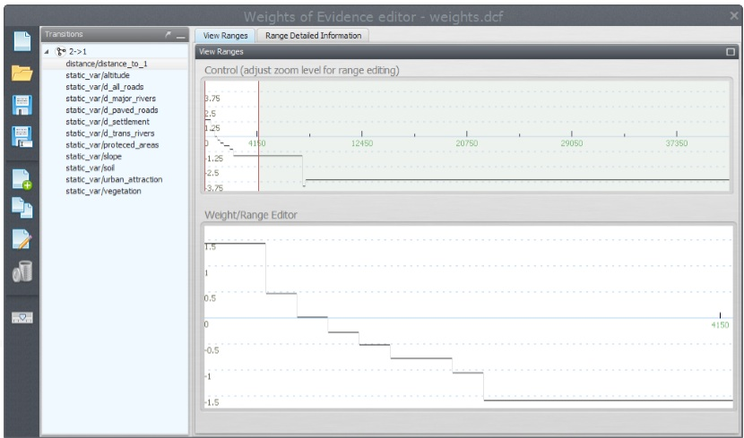

                                                                                                       You can graphically edit the *Weights of Evidence coefficients* and also get a view of a continuous Weights of Evidence function, clicking on the bird view button. Notice how deforestation likelihood varies as a function of distance to previously deforested areas.

## Fourth step: Analyzing map correlation

The only assumption for the Weights of Evidence method is that the input maps have to be spatially independent. A set of measures can be applied to assess this assumption, such as the Cramer test and the Joint-Uncertainty Information [(Bonham-Carter, 1994)](https://books.google.com/books?printsec=frontcover&vid=ISBN0080424201&vid=ISBN0080418678&vid=LCCN94028315#v=onepage&q&f=false). As a result, correlated variables must be disregarded or combined into a third that will replace the correlated pair in the model.

Open model `weights of evidence correlation.egoml` in `\guidebook dinamica\models\lucc model\4 weights of evidence correlation`.

The model in `3 and 2 weights of evidence ranges and coefficient calculation` corresponds to steps 2 and 3 joined together.

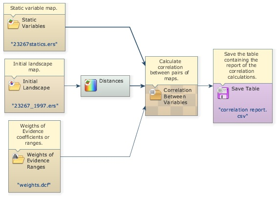

This model performs pairwise tests for categorical maps in order to test the independence assumption. Methods employed are the Chi^2, Cramer, the Contingency, the Entropy and the Uncertainty Joint Information [(Bonham-Carter, 1994)](https://books.google.com/books?printsec=frontcover&vid=ISBN0080424201&vid=ISBN0080418678&vid=LCCN94028315#v=onepage&q&f=false). In addition to the links to be connected, the only parameter to be set in the Determine Weights of Evidence Correlation is the transition as follows:

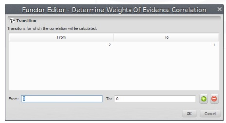

Before running the model, maximize the log window. This is a part of the log reported:

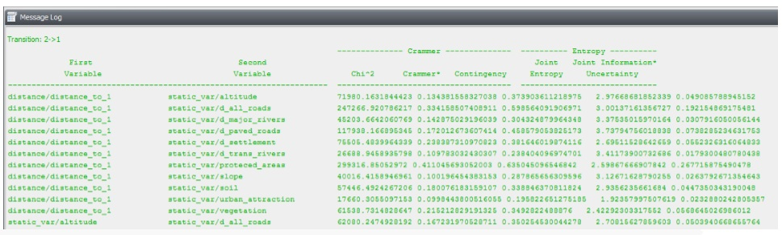

> **Tip:** **TIP**: If you want to copy the result and use it in a spreadsheet, connect the output port named "Report" from [Determine Weights of Evidence Correlation](../functors/Determine-Weights-Of-Evidence-Correlation.html) to a [Save Table](../functors/Save-Table.html) and save the table to a CSV file. Then, open the CSV file in the spreadsheet.

Let’s check for correlated pairs of maps. The following pair draws our attention:

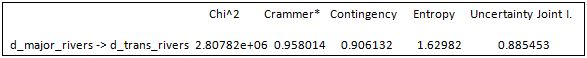

Although there is no agreement on what threshold should be used to exclude a variable, all tests highlight a high correlation for this pair of variables. Hence you must exclude one of these. Let’s remove "d_major_rivers". Delete the variable from the Weights of Evidence file using its graphical editor. Open it on the *[Load Weights](../functors/Load-Weights.html)* using the eye icon.

Now save the WEOFE coefficients as `new weights.dcf` in the folder `\guidebook dinamica\models\lucc model\4 weights of evidence correlation`.

Great, you have come through the calibration process, now you can start setting up the simulation model. Let’s move forward.

## Fifth step: Setting up and running a LUCC simulation model

Let’s start setting up the deforestation simulation model by loading the input data. You will need *[Load Categorical Map](../functors/Load-Categorical-Map.html)* to load the initial landscape: `23267 1997.tif`, *[Load Map](../functors/Load-Map.html)* for `23267statics.tif`, *[Load Weights](../functors/Load-Weights.html)* for `new weights.dcf`, and *[Load Lookup Table](../functors/Load-Lookup-Table.html)* for the multi-step transition matrix: `originals/multiple steps.csv` because you will run the model in annual time-steps. Add the following comments to each functor:

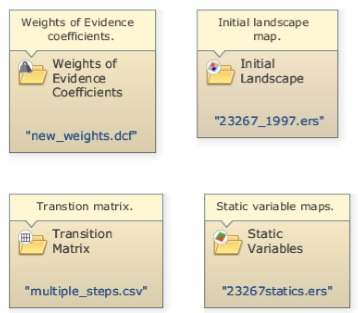

Now, drag a *[Repeat](../functors/Repeat.html)*, and place within it one *[Calc Distance Map](../functors/Calc-Distance-Map.html)*, one *[Mux Categorical Map](../functors/Mux-Categorical-Map.html)* from Control tab, one *[Calc W. Of E. Probability Map](../functors/Calc-W-Of-E-Probability-Map.html)* and one *[Save Map](../functors/Save-Map.html)*. Also place two *[Name Map](../functors/Name-Map.html)* functors within *[Calc W. Of E. Probability Map](../functors/Calc-W-Of-E-Probability-Map.html)*. Rename them with the same alias as the second and third steps. Open the *[Save Map](../functors/Save-Map.html)* and write `probabilities.tif` in the folder `\5 run lucc`.  Leave the option **Suffix Digits** = “2”.

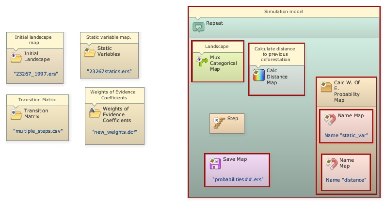

Drag a *[Calc Change Matrix](../functors/Calc-Change-Matrix.html)* from Simulation tab within *[Repeat](../functors/Repeat.html)*. Now let’s connect the functors: first *[Load Categorical Map](../functors/Load-Categorical-Map.html)* `23267 1997.tif` to the **Initial** port of the *[Mux Categorical Map](../functors/Mux-Categorical-Map.html)*, the output from this to *[Calc Distance Map](../functors/Calc-Distance-Map.html)*, *[Calc Change Matrix](../functors/Calc-Change-Matrix.html)* and *[Calc W. Of E. Probability Map](../functors/Calc-W-Of-E-Probability-Map.html)*. Connect *[Load Table](../functors/Load-Table.html)* `multiple steps.csv` to *[Calc Change Matrix](../functors/Calc-Change-Matrix.html)*, *[Load Map](../functors/Load-Map.html)* `23267statics.tif` to *[Name Map](../functors/Name-Map.html)* "static_var", the output from *[Calc Distance Map](../functors/Calc-Distance-Map.html)* to *[Name Map](../functors/Name-Map.html)* "distance", *[Load Weights](../functors/Load-Weights.html)* `new_weigths.dcf` to *[Calc W. Of E. Probability Map](../functors/Calc-W-Of-E-Probability-Map.html)* and its output to *[Save Map](../functors/Save-Map.html)* `probabilities.tif` (Note that this map will receive a ## suffix from the model iteration).

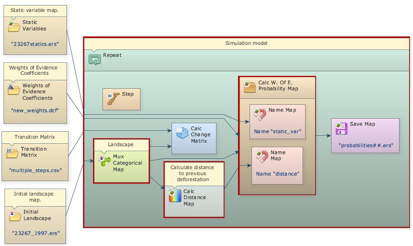

Now place two additional functors, *[Patcher](../functors/Patcher.html)* from the Simulation tab and another *[Save Map](../functors/Save-Map.html)*. Enter `Landscape.tif` and leave “2” as **Suffix**. Connect the output from *[Mux Categorical Map](../functors/Mux-Categorical-Map.html)* to the *[Patcher](../functors/Patcher.html)* **Landscape** port, the output from *[Calc W. Of E. Probability Map](../functors/Calc-W-Of-E-Probability-Map.html)* to the *[Patcher](../functors/Patcher.html)* **Probabilities** port, and the output from *[Calc Change Matrix](../functors/Calc-Change-Matrix.html)* to the **Changes** port of the *[Patcher](../functors/Patcher.html)*.

To close the loop you will need to connect the output port **Changed Landscape** of *[Patcher](../functors/Patcher.html)* to the port **Feedback** of *[Mux Categorical Map](../functors/Mux-Categorical-Map.html)* and to *[Save Map](../functors/Save-Map.html)* `Landscape.tif` to save the maps from model execution.

The functor *[Mux Categorical Map](../functors/Mux-Categorical-Map.html)* enables dynamic update of the input landscape map. It receives the *[Load Categorical Map](../functors/Load-Categorical-Map.html)* `23267 1997.tif` in its **Initial** port in the beginning of the simulation and thereafter the map output from *[Patcher](../functors/Patcher.html)* via the **Feedback** port.

The functor *[Calc W. Of E. Probability Map](../functors/Calc-W-Of-E-Probability-Map.html)* calculates a transition probability map for each specified transition by summing the Weights of Evidence, using equation 4.

In turn, the *[Calc Change Matrix](../functors/Calc-Change-Matrix.html)* receives the transition matrix, composed of net rates, and uses it to calculate crude rates in terms of quantity of cells to be changed by multiplying the transition rates by the number of cells available for a specific change.

Let’s set the other functors’ parameters. Open *[Calc Distance Map](../functors/Calc-Distance-Map.html)* and enter “1”. Remember that you want “distance_to_1” (deforested areas). Open *[Calc W. Of E. Probability Map](../functors/Calc-W-Of-E-Probability-Map.html)* and enter transition "2 to 1", which represents deforestation. Finally open *[Repeat](../functors/Repeat.html)* and set the **Number of Iterations** to “3”, as you will run the model in annual time steps. The model should now look like this:

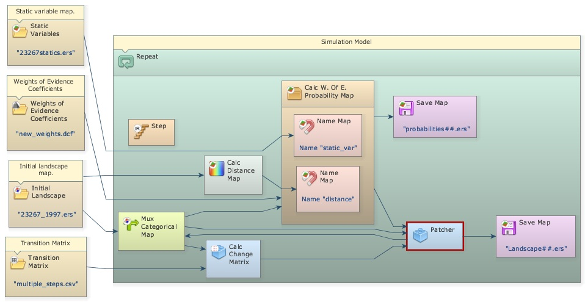

Dinamica EGO uses as a local Cellular Automata rule a transition engine composed of two complementary transition functions, the *[Expander](../functors/Expander.html)* and the *[Patcher](../functors/Patcher.html)*, especially designed to reproduce the spatial patterns of change (both are found in the Simulation tab). The first process is dedicated only to the expansion or contraction of previous patches of a certain class, while the second process is designed to generate or form new patches through a seeding mechanism. The *[Patcher](../functors/Patcher.html)* searches for cells around a chosen location for a joint transition. The process is started by selecting the core cell of the new patch and then selecting a specific number of cells around the core cell, according to their *Pij* transition probabilities.

By varying their input parameters, these functions enable the formation of a variety of sizes and shapes of patches of change. The *Patch* **Isometry** varies from 0 to 2. The patches assume a more isometric form as this number increases. The sizes of change patches are set according to a lognormal probability distribution. Therefore, it is necessary to specify the parameters of this distribution represented by the mean and variance of the patch sizes to be formed. Open this functor with the Edit Functor and enter its parameters as follows (leaving the others untouched):

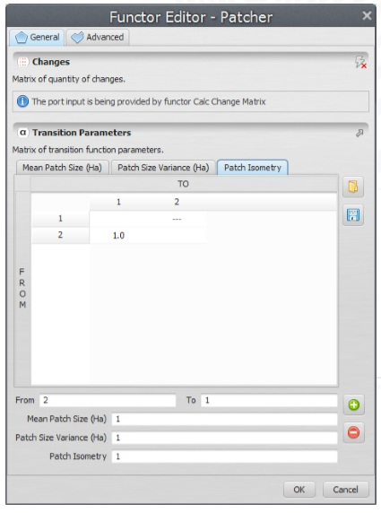

Since the input map resolution is approximately 250 meters, setting the **Mean Patch** and **Patch Size Variance** to “1” won’t allow the formation of patches.

Finally verify the model and run it. Check the log reported and open the maps `probabilities3.tif` using “PseudoColor” and `landscape3.tif` using “Amazon” **Color Palette** on the Map Viewer.

> **Tip:** **TIP**: When Save Map is placed within *[Repeat](../functors/Repeat.html)*, it saves one output map per time step, if you want only the final simulated landscape, drag it out of *[Repeat](../functors/Repeat.html)*.

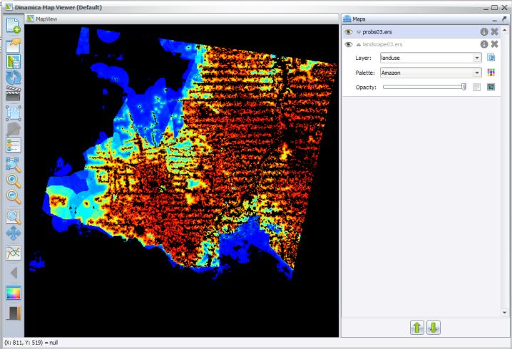

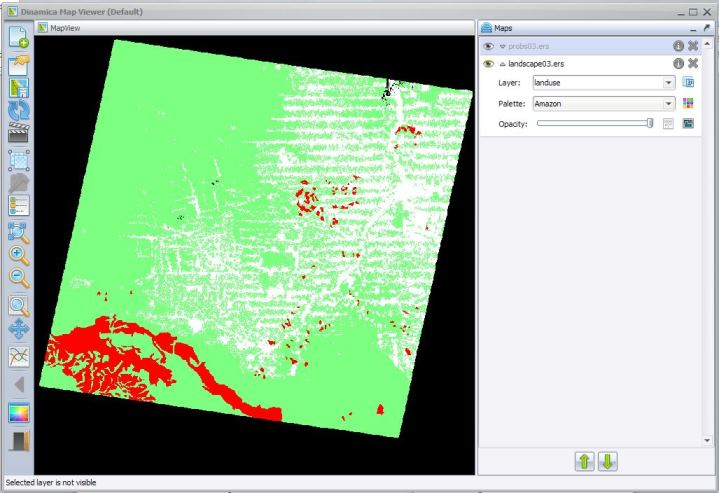

Observe the high probability areas for deforestation and compare the simulated map `landscape3.tif` with the final landscape `23267 2000.tif`. Do they resemble each other? In order to perform a quantitative comparison, let’s move on to the next step.

## Sixth step: Validating simulation using an exponential decay function

Spatial models require a comparison within a neighborhood context, because even maps that do not match exactly cell-by-cell could still present similar spatial patterns and likewise spatial agreement within a certain cell vicinity. To address this issue several vicinity-based comparison methods have been developed. For example, [Costanza (1989)](http://dx.doi.org/10.1016/0304-3800(89)90001-X) introduced the multiple resolution fitting procedure that compares a map fit within increasing window sizes.[Pontius (2002)](https://web.archive.org/web/20240521003732/http://www.clarku.edu/~rpontius/pontius_2002_pers.pdf) presented a method similar to Costanza (1989) that differentiates errors due to location and quantity. [Power et al. (2001)](http://dx.doi.org/10.1080/136588100750058715) provided a comparison method based on hierarchical fuzzy pattern matching. In turn, [Hagen (2003)](http://dx.doi.org/10.1080/13658810210157822) developed new metrics, including the Kfuzzy, considered to be equivalent to the Kappa statistic, and the fuzzy similarity which takes into account the fuzziness of location and category within a cell neighborhood.

The method we apply here is a modification of the latter and named in Dinamica EGO as *[Calc Reciprocal Similarity Map](../functors/Calc-Reciprocal-Similarity-Map.html)*. This method employs an exponential decay function with distance to weight the cell state distribution around a central cell (See scheme in fig. 5 about the Fuzzy comparison method and then go to Help for further details on this method).

Open the model `determine-similarity-of-differences.egoml` in `\guidebook dinamica\models\lucc model\6 validate using exponential decay function`.

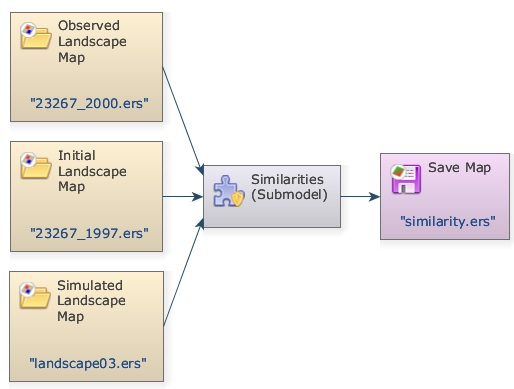

As inputs, the model receives the initial and final landscapes, and the final simulated landscape. Because simulated maps inherit the spatial patterns of the initial landscape map, to remove this inheritance, the *Similarities submodel* evaluates the spatial fit between maps of changes.

> **Info:** A [submodel](../Submodels.html) is a set of other functors (a model) combined to perform specific operations.

This operator calculates the map of differences between a initial map (first one of a time series) and an observed map (last one of a time series) and the differences between a initial map and a simulated map (the simulated one corresponding to the observed map).

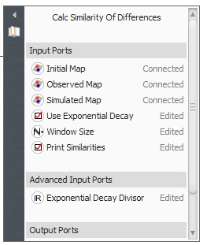

Therefore, the resulting map only depicts the cells that have changed. These maps of differences are used by *[Calc Reciprocal Similarity Map](../functors/Calc-Reciprocal-Similarity-Map.html)* to calculate a two-way similarity, from the first map to the second and from the second to the first. It is advisable to <u>always choose the smaller similarity value</u> since random maps tend to produce an artificially high fit when compared univocally, because they spread the changes all over the map.

> The *Similarities Submodel* includes a set of functors to choose the smaller similarity map.
>
> 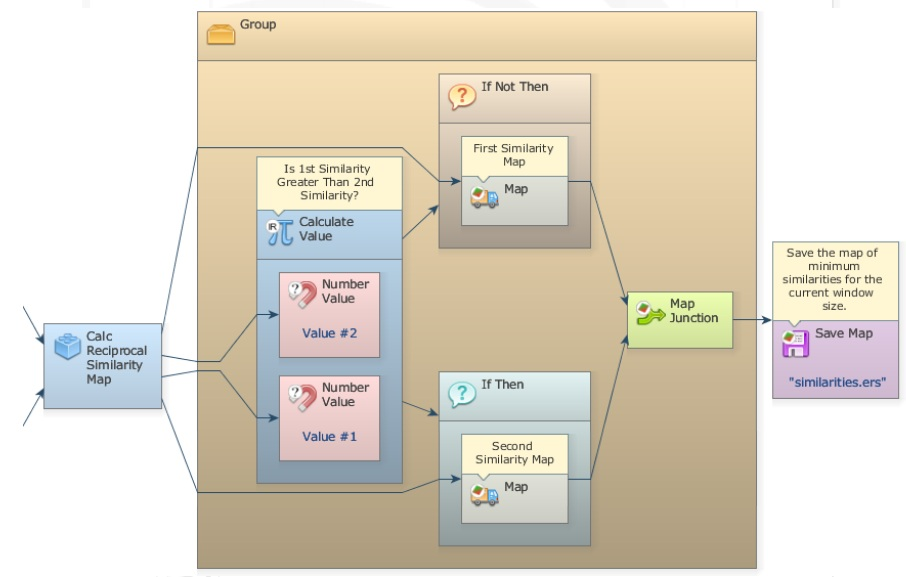
>
> *[If Then](../functors/If-Then.html)*, *[If Not Then](../functors/If-Not-Then.html)* and *[Map Junction](../functors/Map-Junction.html)* – available in the Control tab. The first two are containers that receive a Boolean flag as input (0 negates the condition and any number other than 0 asserts it). Before them *[Calculate Value](../functors/Calculate-Value.html)* examines the two values output from *[Calc Reciprocal Similarity Map](../functors/Calc-Reciprocal-Similarity-Map.html)*, the **First Mean** and the **Second Mean**, passing 0 or 1 depending on which one is greater. *[If Then](../functors/If-Then.html)* envelops a *[Calculate Map](../functors/Calculate-Map.html)* that receives the **First Similarity** Map and *[If Not Then](../functors/If-Not-Then.html)* one that receives the **Second Similarity** Map. Depending on the Boolean result of the *[Calculate Value](../functors/Calculate-Value.html)*, one of the two containers will pass on to *[Map Junction](../functors/Map-Junction.html)* its result, thus always permitting the map with the minimum overall similarity value to be saved.
> TIP: These three new functors allow the design of model that contains bifurcation to two or more execution pipelines. See fig. 1 in the introduction of this guidebook. This is a fantastic feature for the design of complex models.

> **Warning:** Several submodels come with Dinamica EGO installation. Do not change the submodels files. Otherwise you might have problems with the software automatic updater.

This test employs an exponential decay function truncated outside of a window size 11x11.

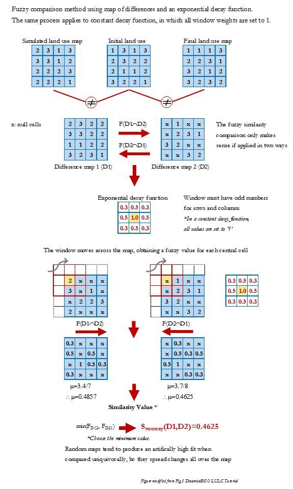

Open the *Similarities Submodel* with Edit Functor.
The three parameters to set are the **Window Size**, the **Use Exponential Decay** and the **Print Similarities**.

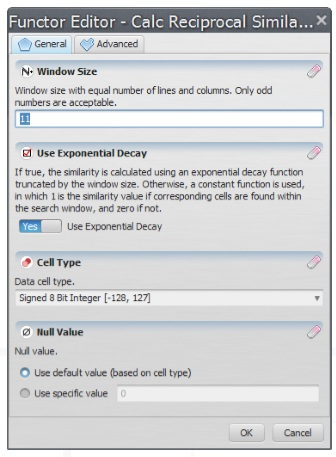

The minimum similarity map corresponds to the similarity obtained by comparing the simulated changes against the actual ones.

Visualize now the resulting similarity map by opening it on the Map Viewer. Use** PseudoColor**, **Limits to Actua**l, and **Histogram Equalize**.

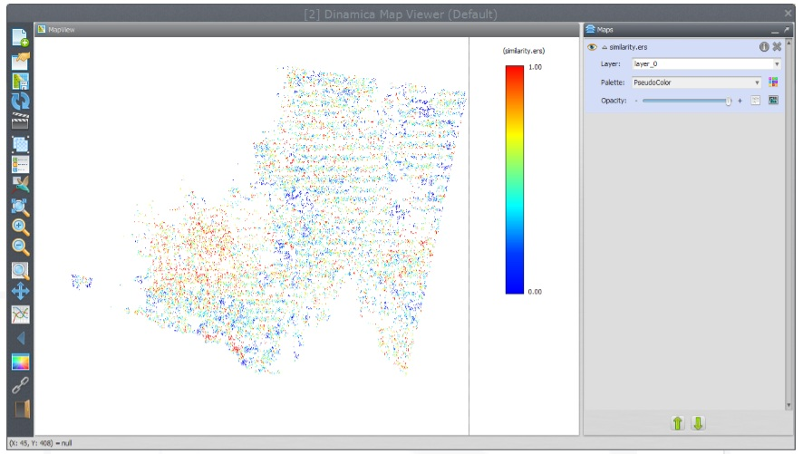

The red and yellow areas show high to moderate spatial fit, whereas blue indicates poor fit.

Another way to measure the spatial fitness between two maps is by means of multiple window similarity analysis. This method employs a constant decay function within a variable window size. If the same number of cells of change is found within the window, the fit will be 1 no matter their locations. This represents a convenient way to assess model fitness through decreasing spatial resolution. Models that do not match well at high resolution may have an appropriate fit at a lower resolution. Let’s develop a multiple resolution fitness comparison in the next step.

## Seventh step: Validating simulation using multiple windows and constant decay function

Open the model `determine-multi-window-similarity-of-differences complete.egoml` in folder `\guidebook dinamica\models\lucc model\7 validate using multiple windows constant decay function`.

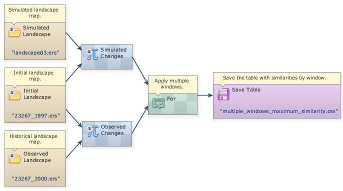

The first part of this model is similar to the previous one. Two *[Calculate Map](../functors/Calculate-Map.html)* functors are employed to derive the maps of changes. Now open the *[For](../functors/For.html)* functor. Let’s examine its contents in detail.

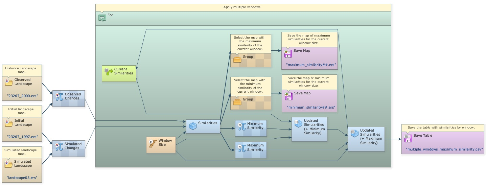

At the center is located a *[Calc Reciprocal Similarity Map](../functors/Calc-Reciprocal-Similarity-Map.html)*. Open it with the Edit Functor. Note that the option **Use Exponential Decay** is off, what means that a constant decay function is being used.

Click on the link between this functor and *[Step](../functors/Step.html)* with the Edit Functors Port.

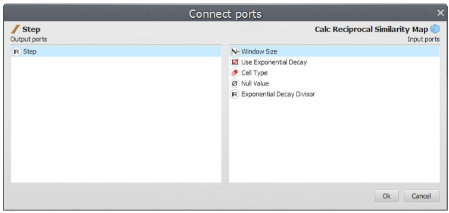

The *[Step](../functors/Step.html)* coming from the enveloping *[For](../functors/For.html)* is controlling the **Window Size**. *[For](../functors/For.html)* is a particular case of *[Repeat](../functors/Repeat.html)*, in which initial and final steps as well as the step increment can be defined as follows:

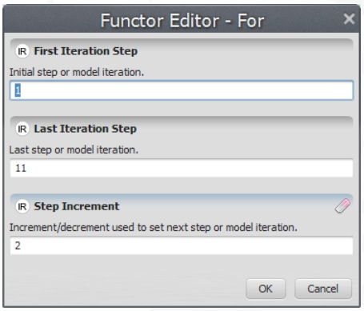

In this *[For](../functors/For.html)* container, step goes from 1 to 11 by an increment of two. This is necessary because **Window Size** must be odd numbers. As a result Window Size will vary from 1x1, to 3x3, 5x5, 7x7, 9x9, and 11x11.

Similar to the use of *[Mux Categorical Map](../functors/Mux-Categorical-Map.html)* in the fifth step, *[Mux Table](../functors/Mux-Table.html)* is employed to update the table containing the minimum and maximum similarity means of window sizes. Open *[Group](../functors/Group.html)* containing the functors that update these tables.

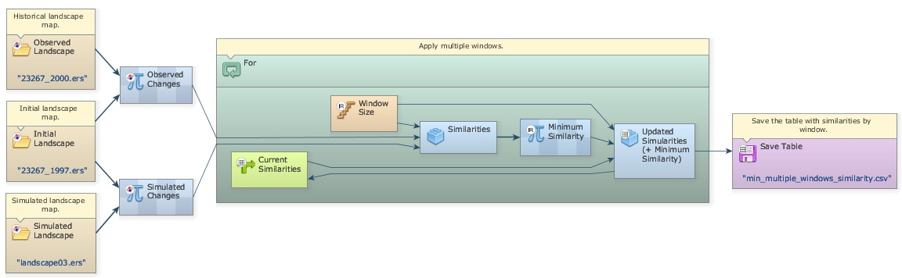

*[Calculate Value](../functors/Calculate-Value.html)* selects the minimum fitness value (formula applied is `min(v1, v2)`) and passes it to *[Set Table Cell Value](../functors/Set-Table-Cell-Value.html)*, which also receives as input the current step as the table key.

As the *[For](../functors/For.html)* iterates, the *[Calc Reciprocal Similarity Map](../functors/Calc-Reciprocal-Similarity-Map.html)* calculates similarity values for a window size and passes them to *[Calculate Value](../functors/Calculate-Value.html):*, which selects the minimum and passes it on to *[Set Table Cell Value](../functors/Set-Table-Cell-Value.html)*, which updates the value for the table key corresponding to the model step. A second *[Set Table Cell Value](../functors/Set-Table-Cell-Value.html)* updates the maximum similarity and feedbacks the updated table to *[Mux Table](../functors/Mux-Table.html)*. When *[For](../functors/For.html)* is finished, the table is passed to *[Save Table](../functors/Save-Table.html)*.

Register viewer on the **Result** port of *[Set Table Cell Value](../functors/Set-Table-Cell-Value.html)*, run the model and analyze the resulting table by clicking on **Result** port with the right button.

The fitness goes from 21% at 1 by 1 cell to 90% at 11 by 11 cell resolution. Because the simulation receives as input a fixed transition matrix setting the quantity of changes, we only need to assess the model fitness with respect to the location of changes. Taking into account that cell resolution is 250 meters and the window search radius is half of the resolution, you can draw a graph depicting model fitness per spatial resolution.

> **Tip:** **TIP**: Use *[Get Table Column](../functors/Get-Table-Column.html)* and *[Lookup Table](../functors/Lookup-Table.html)* to convert the column corresponding to the minimum similarity to a [lookup table type](../types/Lookup-Table-Type.html). Then, open table with the chart editor to produce the following graph.

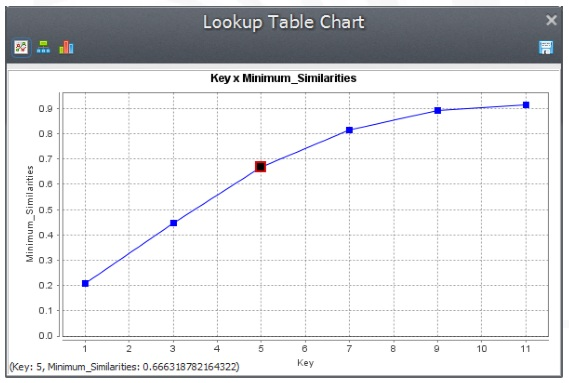

From the graph in fig. 6, we can assert that the simulation reached a similarity fitness value over 50% at a spatial resolution of ˜800 meters.

> **Note:** This method applies to multiple transitions too.

> **To do:** This model also selects **the map with the maximum similarity of the current window**, **the map with the minimum similarity of the current window**. Open the groups to see how this is done.
>
> 

> **Info:** In the same folder `\7 validate using multiple windows constant decay function` there is an other model `determine-multi-window-similarity-of-differences` that contains a Multi-Window Similarities Submodel that performs the procedure described above: calculate the minimum fuzzy similarity using maps of changes for different window sizes.
>
> 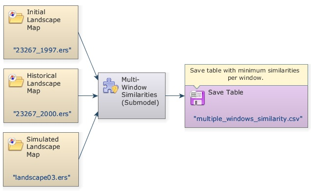

Now that the validation phase is completed, you can start playing with the simulation model parameters to explore possible outcomes. Let’s do it in the next step.

## Eighth step: Running simulation with patch formation

Before going through this step, read [Simulating the patterns of change](Simulating-Patterns-Of-Change.html). It presents and discusses the results of a series of simulations using simplified synthetic maps and varying the parameters of the transition functions. The simulation results are evaluated using selected landscape structure metrics, such as fractal dimension, patch cohesion index, and nearest neighbor distance. These simulation examples are used to show how these functions can be calibrated, as well as its potential to replicate the evolving spatial patterns of a variety of dynamic phenomena [(Soares-Filho et al., 2003)](http://marte.dpi.inpe.br/col/ltid.inpe.br/sbsr/2002/11.16.12.49/doc/06_257.pdf). You can also examine these models in `guidebook dinamica\extras\examples\patterns of change`.

This step aims at analyzing the parameters of the *[Patcher](../functors/Patcher.html)* transition function on the structure of the simulated landscape. Open the model `simulate deforestation from 1997 2000 with patch formation.egoml` from `\guidebook dinamica\models\lucc model\8 run lucc with patch formation`. This is the same model as the one in the fifth step.

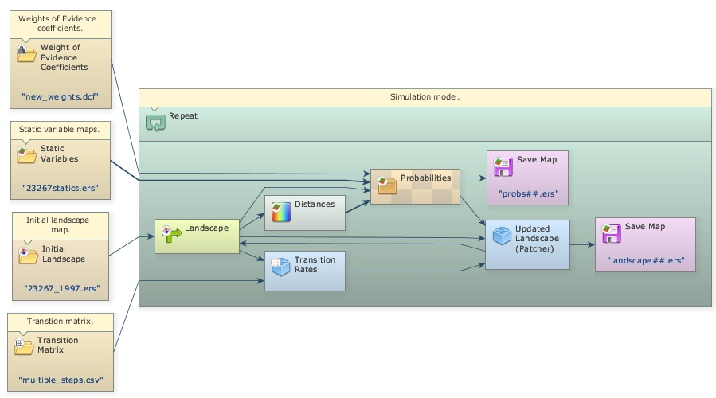

Now open *[Patcher](../functors/Patcher.html)* with the Edit Functor tool.

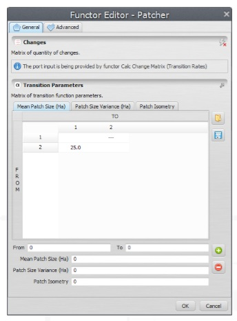

**Mean Patch Size** is set to 25 ha, **Patch Size Variance** to 50 ha, and **Patch isometry** to 1.5. Since cell size is equal to 6.25 hectares (250 x 250 meters), the patches to be formed will have in average 4 cells and a variance of 8 cells.

Run the model; open both `landscape3.tif` files from this model and from the fifth step as well as `23267 2000.tif` for visual comparison.

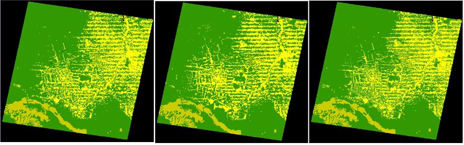

Note that the simulated landscape from this step shows a landscape structure closer to that of the final historical landscape. Let’s now add the *[Expander](../functors/Expander.html)* Functor to the simulation model.

## Ninth step: Running simulation with patch formation and expansion

The *[Expander](../functors/Expander.html)* functor is dedicated only to the expansion or contraction of previous patches of a certain class. Thus in the *[Expander](../functors/Expander.html)*, a new Pij spatial transition probability depends on the amount of cells type j around a cell type i, as depicted in fig. 7.

Now, open the model `simulate deforestation from 1997 2000 with patch formation and expansion.egoml` in the folder `\guidebook dinamica\models\lucc model\9 run lucc with patch formation and expansion`.

> **Important:** The submodel *Allocate Transitions* (operator using the alias *Updated Landscape (Submodel)* in this model) includes all the functors below and performs transition allocation on a landscape map using *[Expander](../functors/Expander.html)* and *[Patcher](../functors/Patcher.html)* according to a transition matrix specifying the net rates, a probability map and other parameters defining patch geometry.
>
> 
>
> This model differs from the previous by three new functors: *[Modulate Change Matrix](../functors/Modulate-Change-Matrix.html)*, *[Expander](../functors/Expander.html)*, and *[Add Change Matrix](../functors/Add-Change-Matrix.html)*.
>
> Inside the submodel, *[Modulate Change Matrix](../functors/Modulate-Change-Matrix.html)* splits the number of cells to be changed per transition into two matrices: **Modulated Changes** and **Complementary Changes**. The first goes to *[Expander](../functors/Expander.html)* and the second to *[Add Change Matrix](../functors/Add-Change-Matrix.html)*.  In this case, 20% of the changes 2 to 1 go to *[Expander](../functors/Expander.html)*.
>
> 
>
> Also, the probability map coming from the *[Calc W. Of E. Probability Map](../functors/Calc-W-Of-E-Probability-Map.html)* goes first to *[Expander](../functors/Expander.html)*, usually placed before *[Patcher](../functors/Patcher.html)*, because one can not ensure that the *[Expander](../functors/Expander.html)* will execute the total quantity of changes passed to it. The output **Changed Landscape** and **Corroded Probabilities** are connected to *[Patcher](../functors/Patcher.html)*, and **Remaining Changes** to *[Add Change Matrix](../functors/Add-Change-Matrix.html)*.
>
> 
>
> Thus, *[Patcher](../functors/Patcher.html)* will receive the landscape map after *[Expander](../functors/Expander.html)* has modified it and the probability map corroded (set to 0) where transitions took place. In case *[Expander](../functors/Expander.html)* does not succeed in making all specified changes, a matrix of remaining quantity of changes for each transition will be passed to *[Add Change Matrix](../functors/Add-Change-Matrix.html)*, which will combine the matrices coming from *[Modulate Change Matrix](../functors/Modulate-Change-Matrix.html)* and the port **Remaining Changes** of *[Expander](../functors/Expander.html)*. Its other parameters are set like those of *[Patcher](../functors/Patcher.html)*.
>
> 

**Percent of Transitions by Expansion**, **Patch Expansion Parameters** and **Patch Generation Parameters** can be set by editing the *Allocate Transitions* functor

Now run the model, access the log for the report, and compare its output with the previous ones.

Did this model approximate more closely to the structure of the final historical landscape?

Try to change the parameters of *[Modulate Change Matrix](../functors/Modulate-Change-Matrix.html)*, *[Expander](../functors/Expander.html)* and *[Patcher](../functors/Patcher.html)* to see what you get.

> **Important:** Change only one parameter at a time. Now that model is calibrated both in regard to the location of changes and the landscape structure as well as validated, you can apply it for projection purpose. Let’s move on to the last step.

## Tenth step: Projecting deforestation trajectories

Simulation models can be envisaged as a heuristic device useful for assessing, from short to long terms, the outcomes from a variety of scenarios, translated as different socioeconomic, political, and environmental frameworks. A special class among them, spatially explicit models simulate the dynamics of an environmental system, reproducing the way its spatial patterns evolve, to project the probable ecological and socioeconomic consequences from the system dynamics.

Thus, as the current example, we can apply the simulation model to assess the impacts of future trajectories of deforestation under various socioeconomic and public policies scenarios, on the emission of greenhouse gases [(Soares-Filho et al., 2006)](http://dx.doi.org/10.1038/nature04389), regional climate change (Schneider et al., 2006, COLA Technical Report 226; [Sampaio et al, 2007)](https://doi.org/10.1029/2007GL030612), fluvial regime [(Costa et al, 2003](http://dx.doi.org/10.1016/S0022-1694(03)00267-1)[,Coe et al, 2009)](http://dx.doi.org/10.1016/j.jhydrol.2009.02.043), habitat loss and fragmentation[(Soares-Filho et al., 2006,](http://dx.doi.org/10.1038/nature04389) [Texeira et al., 2009)](http://dx.doi.org/10.1016/j.foreco.2008.10.011) as well as the loss of the forest environmental services and economic goods [(Fearnside, 1997)](http://dx.doi.org/10.1016/S0921-8009(96)00066-3).

Open the model `simulate deforestation from 1997 2000 30years ahead.egoml` available in `\guidebook dinamica\models\lucc model\10 run deforestation trajectories`.

The only differences between this model and the prior one consist of the initial landscape, which is now the 2000 map, the number of iterations set to “30”.

As this model uses fixed transition rates, we can consider that it projects the historical trend into the future, thus named as the historical trend scenario.

Run the model and open `landscape2030.tif`.

> **Tip:** **TIP**: You might want to save only the final landscape map. To do this, you just need to drag *[Save Map](../functors/Save-Map.html)* out of *[For](../functors/For.html)*

This is what you get:

Note that the forest virtually disappears outside of protected areas, which begin to be encroached. This is what will happen if the recent historical deforestation trend persists into the future.

Animated maps are a very powerful tool to make the general public aware of the possible outcomes of system dynamics, such as the Amazon deforestation. Go to our [movie maker tutorial](../gui/Movies-And-Command-Line.html#making-a-movie) to learn how to do it.

You may want to improve this model by incorporating dynamic rates, other dynamic variables, submodels, such as the road constructor, and feedbacks from the landscape attributes to the transition rate calculation. All of these are possible in Dinamica EGO. An example of road constructor module is found in the model `mato grosso road.egoml` in `guidebook dinamica\extras\examples\run lucc northern mato grosso\run roads`. Also, Dinamica EGO allows the incorporation of economic, social and political scenarios into a model that integrates the effect of  these underlying causes [(Geist, & Lambin, 2001)](https://web.archive.org/web/20131015102059/http://eldis.org/go/topics&id=14501&type=Document) on the trajectory of deforestation (usually these variables are input to the model using tables with keys assigned to a geographic unit, such as county, state or country).

### Congratulations, you have successfully completed this lesson!

> **See also:** [Additional LUCC Resources](../Additional-LUCC-Resources.html) extends this model with parameters that vary during the simulation, subregions, sojourn time and local saturation.

☞[Next: The wizard editor](The-Wizard-Editor.html)

