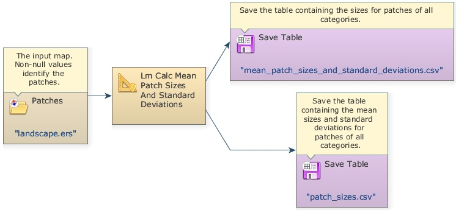
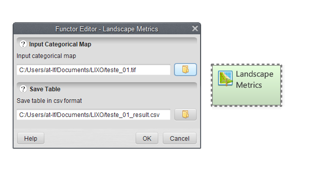


# Lesson 16: Calculating landscape metrics

## What will you learn?

- Calculate landscape metrics

We introduce here a series of models designed to calculate landscape metrics. Instead of providing a black box solution, all these metrics are developed using Dinamica EGO modeling language, thus they serve as templates to derive a wide variety of metrics.

Landscape metrics [(McGarigal and Marks, 1995)](https://doi.org/10.2737/PNW-GTR-351) can be useful tools to assess the quality of habitats when extensive biodiversity inventories or ecological data are not available or are difficult to obtain, as landscape metrics are strongly related to biodiversity indicators [(Metzger, 2006)](https://web.archive.org/web/20160528112802/http://www.pantanalecoturismo.tur.br/fotos/arquivos/854.pdf). For example, landscape metrics can be applied to identify the best landscape configuration for forest species conservation - regardless of the perceptions of individual species - which is hypothetically  a landscape with: i) a high forest cover; ii) a small number of forest fragments; iii) a high largest forest patch index that can support stable populations and be a source for small patches; iv) a large mean forest patch area; and v) a high mean forest proximity index  [(Teixeira et al., 2009)](http://dx.doi.org/10.1016/j.foreco.2008.10.011). Therefore, the application of these metrics consists of a powerful tool to describe the consequences of land-use and land-cover dynamics on the conservation of biodiversity.

Load the model `calc mean patch sizes and standard deviations.ego` from `\guidebook dinamica\models\landscape metrics\calc mean patch sizes and standard deviations`

The Calc Mean Patch Sizes and Standard Deviations is a [submodel](../Submodels.html) that calculates the size of each patch of a landscape class and for each class the mean patch size and patch size standard deviation. A table is output for each metric.

> **Note:** Remember: a [submodel](../Submodels.html) is a set of functors (a model) combined to perform a specific operation.

Now, load the model `calc mean patch edges and standard deviations.ego` from `\guidebook dinamica\models\landscape metrics\calc mean patch edges and standard deviations`.

This model calculates the edge length of each patch of a landscape class and for each class the mean patch edge length and patch edge length standard deviation.

These two set of metrics are input for more complex metrics, such as fractal dimension and largest patch index.  For example, fractal dimension for a landscape class can be estimated using the perimeter-area relationship, if sufficient data are available, the slope of the line obtained by regressing log(P), patch edge lengths, on log(A), patch areas, is equal to 2/D (Burrough, 1986). Check other landscape metrics models, such as mean patch distance, largest patch index, in `guidebook dinamica\models\landscape metrics`.

> **Note:** Recently, a new submodel was built to calculate various landscape metrics quickly and easily in Dinamica EGO. This model is called **landscape metrics.egoml** and you can find it at the following directory: `guidebook dinamica\models\landscape metrics`

To use this submodel, load and double click the submodel, and, in the new window, load the map you want to calculate the landscape metrics, and choose a destination and a name to save the results table:

☞[Next: Lesson 17: Calculating accumulated cost surface and least-cost pathway](Cost-Surface-And-Least-Cost-Pathway.html)

