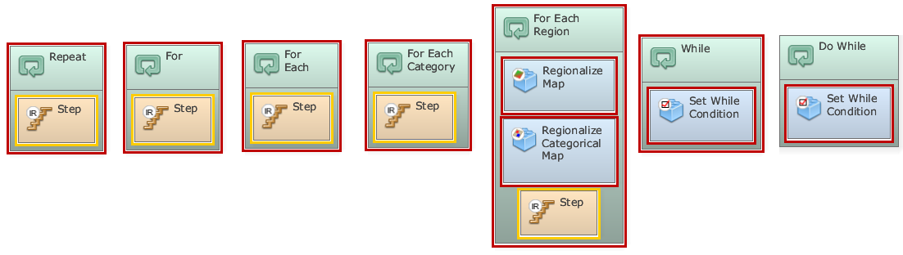
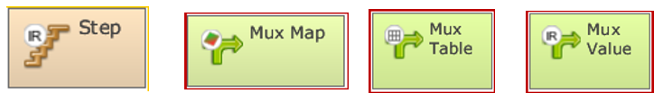


# Lesson 13: Loop structures introduction

## What will you learn?

- The main iteration algorithms (containers)
- Their main auxiliary operators

Dinamica EGO has several iteration control functors. These functors in the form of container allow to developing iteration including closed loops. For example, run model steps, each time with different values or using a dynamic data, such as a map that is updated during the iteration execution. Iteration algorithm can execute a block of code a number of times. In this lesson we show types of iteration algorithms and how to work with them.

### Container operators that repeat the functions within them

**Repeat:** This container makes a set of functors linked in a dataflow chain iterate a predetermined number of times.

**For:** This container makes a set of functors linked in a dataflow chain iterate while a given condition is met.

**For each:** This container executes the contained functors once per each element of a given lookup table.

**For each category:** This container executes the contained functors once per each class or category of a categorical map specified as input.

**For each region:** This container creates and manages regions identified in a categorical map, whose classes represent regions (for example, a country, state, etc). It manages both processes of splitting a map into several maps, each one comprising a region, and the subsequent merging of all regional maps in a mosaic, that is a new map, after a sequence of processing of the regional maps. The container also iterates the functors inside it for each region.

**While:** the condition is checked at the beginning of the iteration and if the condition is true, he container iterates.

**Do while:** The condition is checked after the execution of all functors within the container and the container iterates until the condition remains true.

### Auxiliary operators to control iterations:

**Step:** This functor receives and passes on the current step or iteration.

**Mux Map:** This functor enables a map to become dynamic, feeding back a new map output from the model iteration. In the beginning of the first iteration, it reads the map input to the initial port.

**Mux Table:** This functor enables a table to become dynamic, feeding back a new table output from the model iteration. In the beginning of the first iteration, it reads the table input to the initial port.

**Mux Value:** This functor enables a value to become dynamic, feeding back a new value output from the model iteration. In the beginning of the first iteration, it reads the input value to the initial port.

### Congratulations, you have successfully completed this lesson!

☞[Next Lesson](Regions-With-For-Each-Category.html)

