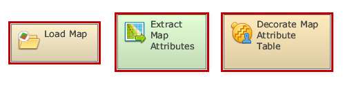
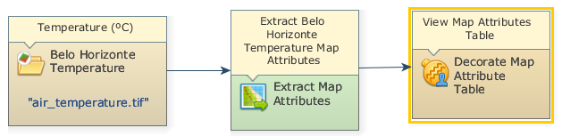
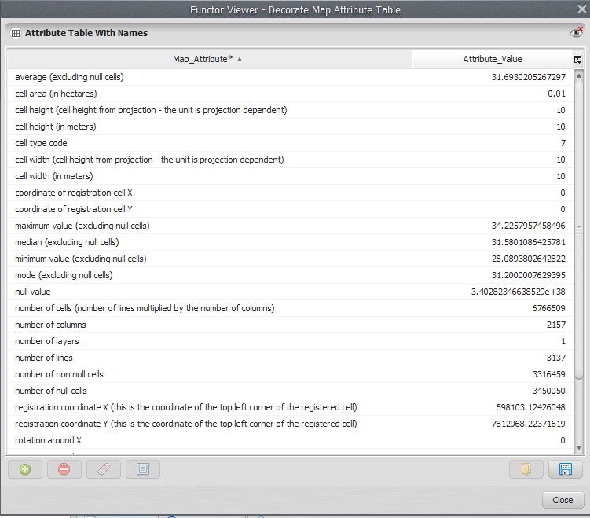


# Lesson 6: Extracting the attributes and calculating basic statistics from a map

In this lesson we would like to demonstrate some details on how Dinamica EGO extracts the attributes and calculates basic statistics from a map, creating a table that contains these extracted attributes.

**Which Functors will you use in this lesson?** [Load Map](../functors/Load-Map.html), [Extract Map Attributes](../functors/Extract-Map-Attributes.html) and Decorate Map Attribute Table

> **Note:** Decorate Map Attribute Table is a submodel (more about that later) and it is stored in the Dinamica Store. To install it go to the menu Tools >> Submodel Store, search for `Decorate`, select the Decorate Map Attribute Table submodel and click on the Install button at the bottom of the Submodel Store window.

**Here, we will use**: The air_temperature raster layer `Guidebook_Dinamica_5\Database\Climate_bh\air_temperature.tif`

**Let's go!**

First, click on the Input/Output tab, grab and place on the sketch one [Load Map](../functors/Load-Map.html) and open the air_temperature.tif file. Next, click on the Map Algebra tab, place on the sketch one [Calculate Map](../functors/Calculate-Map.html) container. Additionally, click on the Map Algebra tab and place one [Extract Map Attributes](../functors/Extract-Map-Attributes.html) and one Decorate Map Attributes Table.

Now you can connect the functor [Load Map](../functors/Load-Map.html) to [Extract Map Attributes](../functors/Extract-Map-Attributes.html) and [Extract Map Attributes](../functors/Extract-Map-Attributes.html) to Decorate Map attributes Table. A Connect Ports window should pop up when making the last connection, connect Attributes to Attribute [Lookup Table](../functors/Lookup-Table.html).

Click once on the Decorate Map Attribute Table to prompt the functor toolbar, then click on the eye icon - Inspect functor. Inside the functor viewer window that will pop up, click on the eye icon - Inspect port output, this will mark the port for inspection. You can close the window, save and run the model.

The final model will look like this:

Click again on the eye icon on the functor toolbar of Decorate Map Attribute Table. In the next window the table will be displayed.

Congratulations, you have successfully completed this lesson!

☞[Next Lesson](Table-Columns.html)

