
# Multiple Criteria Evaluation

## What will you learn?

- MCE for urban and regional planning.
- Functors: <br> - [Calculate Distance to Feature Map](../functors/Calc-Distance-To-Feature-Map.html)<br> - [Group](../functors/Group.html)

[Multiple Criteria Evaluation](http://en.wikipedia.org/wiki/Multi-criteria_decision_analysis#A_typology) (MCE) is a method often used for environmental impact assessments or urban and regional planning. In this exercise you will apply MCE to identify areas that are favorable to develop a new town in Northern Mato Grosso – an Amazonian frontier region –, mitigating at the same time possible environmental impacts from urban settlement. Again, we confront two points of views, one from developers and another from conservationists. A way to solve this question is to list all criteria that favor the location of a future urban site and the ones that constrain or impede it.

In this problem, we have two types of criteria, the ones that constrain our analysis only to specific areas, thus they are Boolean, either 1 or 0, and the others that assign a degree of suitability for a site depending on its biophysical and infrastructure attributes.

Our criteria are:

> 1. Distance to main roads &lt; 15 kilometers.
> 1. Driving distance to neighboring towns &lt;  30 minutes
> 1. At least 10 km away from existing towns.
> 1. At least 1000 meters away from flooded plains (Malaria is endemic in the region)
> 1. In addition, we need to consider that not all land is available. We don’t want to encourage more deforestation in the region, thus we need to use only land that is deforested or abandoned.  Also existing urban areas, rivers and flooded plains must be excluded.
> 1. At least areas larger than 1000 hectares.
> 1. Average slope &lt; 0.5 degrees.

## First step: Finding unconstrained areas

The land use map has the following classes:

| Id | Land use |
|---|---|
| 0 | Flooded plains |
| 1 | Small Rivers |
| 2 | Pasture |
| 3 | Regrowth |
| 4 | Forest Remnant |
| 5 | Urban |
| 6 | Roads |

Load `\guidebook dinamica\database\multi criteria evaluation\landuse.tif` it on the Map Viewer and change the Current color palette to "mt".

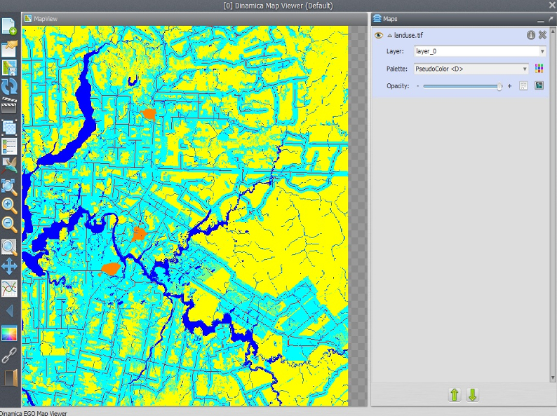

Let's start developing the model. Place *[Load Categorical Map](../functors/Load-Categorical-Map.html)* on the sketch and open the file `\guidebook dinamica\database\multi criteria evaluation\landuse.tif`. Now place *[Calculate Map](../functors/Calculate-Map.html)* and *[Number Map](../functors/Number-Map.html)* within it. Enter "1" in **Map Number** in *[Number Map](../functors/Number-Map.html)*. Now place *[Save Map](../functors/Save-Map.html)* and enter `unconstrained areas.tif`. We can save in the folder `\guidebook dinamica\models\multi criteria evaluation` Change file format to **Geotiff** and set **Suffix Digits** to "0".

> **Tip:** **TIP**: you can increase model performance by avoiding saving intermediate map files. In this step, you will save the map just to check the result from this operation. Do not forget to connect all functors.

Now open the *[Calculate Map](../functors/Calculate-Map.html)* with the Edit Functor and write the following equation:

```
if i1 = 0 then null else if i1 = 1 then null else if i1 =4 then null else if i1 = 5 then null else 1
```

The null value will mask out rivers, flooded plains, urban areas, and roads in subsequent map operations. Do not forget to set **Cell Type** to "Unsigned 8 Bit Integer" and **Null Value** to 0.

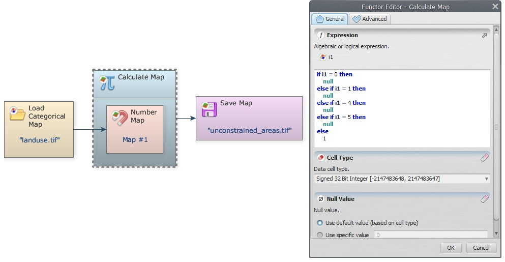

Save the model as `My_MCE_part1.egoml`, run it and examine the resulting map on the Map Viewer.

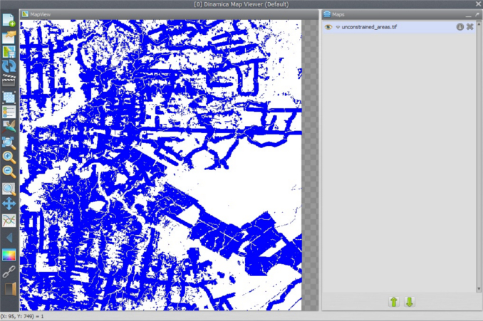

## Second step: Building buffers to define unsuitable areas

In this step you need to build buffers to solve distance criteria to towns and flooded areas.

Load one *[Calculate Categorical Map](../functors/Calculate-Categorical-Map.html)* together with its *[Number Map](../functors/Number-Map.html)*

> **Note:** The only difference between *[Calculate  Map](../functors/Calculate-Map.html)* and *[Calculate Categorical Map](../functors/Calculate-Categorical-Map.html)* is that the latter outputs a categorical map.

You will need *[Calculate Categorical Map](../functors/Calculate-Categorical-Map.html)* in order to use the functor *[Calc Distance to Feature Map](../functors/Calc-Distance-To-Feature-Map.html)*; you can access it from the Map Algebra tab too. Although not necessary, you can save the map by placing *[Save Map](../functors/Save-Map.html)*. Save it as `distance to towns.tif`.  
Now connect Categorical Map `landuse.tif` to *[Number Map](../functors/Number-Map.html)*, after setting the **Map Number** to "1". Open *[Calc Distance to Feature Map](../functors/Calc-Distance-To-Feature-Map.html)* with the Edit Functor Ports.

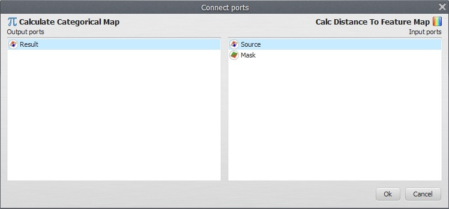

**Source** is a map containing the features to which distances will be calculated. A feature is represented by a non-null value. **Mask** is a map used to mask the distance calculation on its null cells. Let’s connect the output from *[Calculate Categorical Map](../functors/Calculate-Categorical-Map.html)* to **Source** and Categorical Map `landuse.tif` to **Mask**. Now open the *[Calculate Categorical Map](../functors/Calculate-Categorical-Map.html)* and write the following equation:

```
if i1 = 5 then 1 else null
```

Remember that 5 is the number identifier for urban. You do not need to change either **Cell type** or **Null Value** in both functors, although to save memory you could set "Signed 8 Bit Integer" and **Null Value** to "0" in *[Calculate Categorical Map](../functors/Calculate-Categorical-Map.html)*. You may also turn on the option **Truncate Distance** in Calc Distance to Feature Map. This will avoid exceeding the maximum numerical representation selected for **Cell type**.

Now connect the port **Distance** in *[Calc Distance to Feature Map](../functors/Calc-Distance-To-Feature-Map.html)* to *[Save Map](../functors/Save-Map.html)*. The model should be ready to run. Always save the model before putting it to run. Save it as `my_MCE_part1&2.egoml`. Examine the result with the Map Viewer.

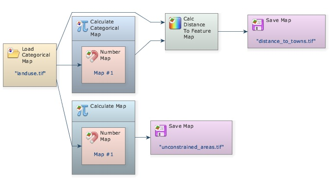

As a last procedure, add one *[Calculate Map](../functors/Calculate-Map.html)* and its *[Number Map](../functors/Number-Map.html)*, connect the output of *[Calc Distance to Feature Map](../functors/Calc-Distance-To-Feature-Map.html)* to its *[Number Map](../functors/Number-Map.html)* and output the result with *[Save Map](../functors/Save-Map.html)* `away from towns.tif`.  Notice that at this stage, we are omitting some steps, which should be well-known by now. Write in the equation box of the *[Calculate Map](../functors/Calculate-Map.html)*:

```
if i1 < 10000 then null else 1
```

> **Note:** The distance map is always produced in meters; the constraint criterion is always set to null.

You will have the following model.

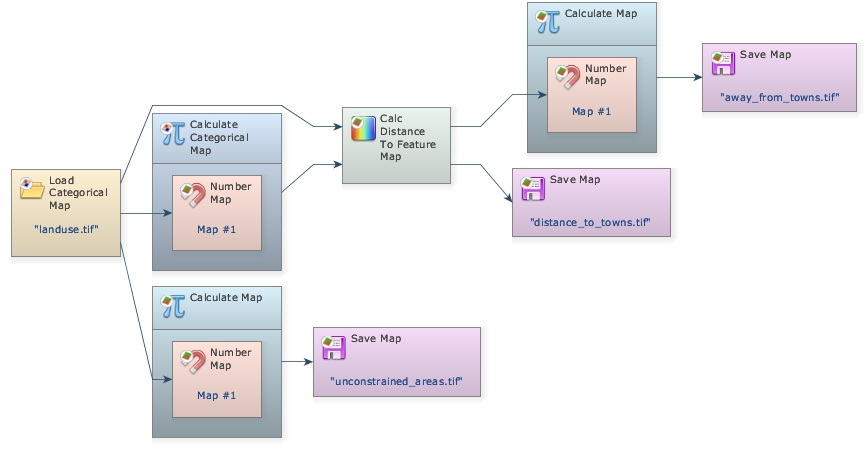

Save and run it. Open the map `away from towns.tif`. Is this what you got?

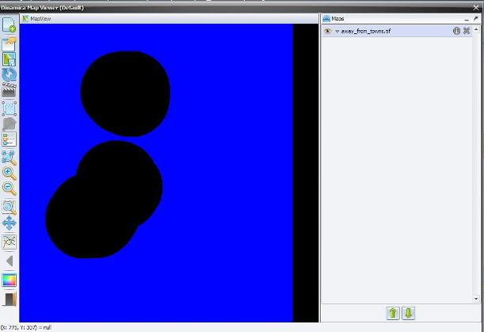

How would you solve the problem having the following criteria?

- Distance to major roads &lt; 15 kilometers.
- At least 1000 meters away from flooded plains.

You will need to load another *[Load Categorical Map](../functors/Load-Categorical-Map.html)* and enter the file `mainroads.tif` from folder lesson5. You will need to turn on the option **Define Null Value** and set the **Null Value** to "0". You can connect this functor directly to another *[Calc Distance to Feature Map](../functors/Calc-Distance-To-Feature-Map.html)* that you will need to place on the sketch. Use *[Categorical Map](../functors/Categorical-Map.html)* `landuse.tif` again as the **Mask**.
Use the following equations in the respective *[Calculate Map](../functors/Calculate-Map.html)* (you will need to place one for each criterion):

```
if i1 > 15000 then null else 1
```

Now connect its output to *[Save Map](../functors/Save-Map.html)* `not too far from mainroads.tif`.

You will have the following model.

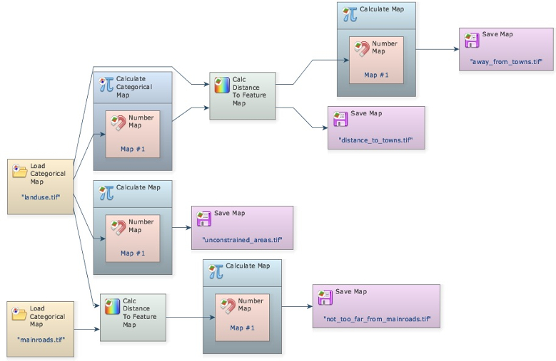

Check its integrity, save as `my_MCE_part1&2.1.egoml` and run it.

Did you get a `not too far from mainroads.tif` map like this?

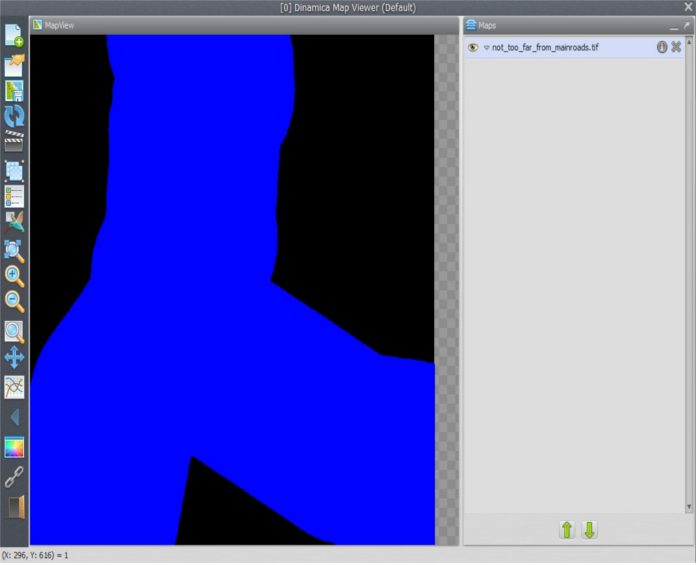

For the flooded plains criterion, you will need to add another *[Calculate Categorical Map](../functors/Calculate-Categorical-Map.html)* to pinpoint the flooded areas before passing the resulting map to *[Calc Distance to Feature Map](../functors/Calc-Distance-To-Feature-Map.html)*.
Connect *[Categorical Map](../functors/Categorical-Map.html)* `landuse.tif` to it and write the following equation in the *[Calculate Categorical Map](../functors/Calculate-Categorical-Map.html)* equation box:

```
if i1 = 0 then 1 else null
```

Now connect this output to *[Calc Distance to Feature Map](../functors/Calc-Distance-To-Feature-Map.html)* as the **Source** port, again use *[Categorical Map](../functors/Categorical-Map.html)* `landuse.tif` as the **Mask** port, then connect its output to another *[Calculate Map](../functors/Calculate-Map.html)* and write the following equation:

```
if i1 < 1000 then null else 1
```

Save the output as `malaria free zone.tif`
The model for the three criteria combined should look like this:

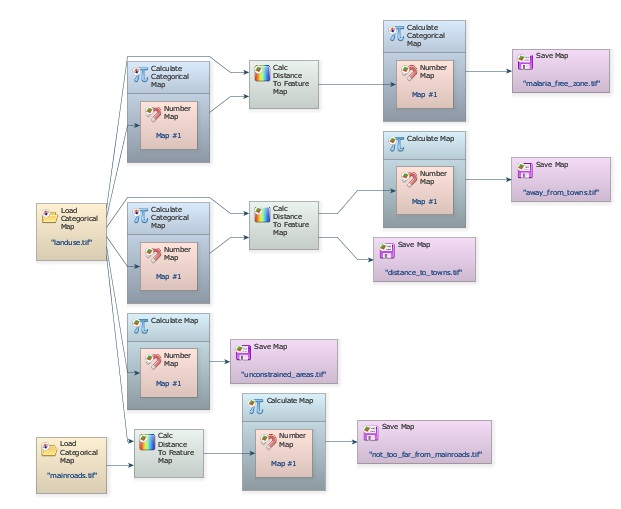

Check the model, save it as `my_MCE_part1&2complete.egoml`, run and analyze the map `malaria free zone.tif`. Does it look like this?

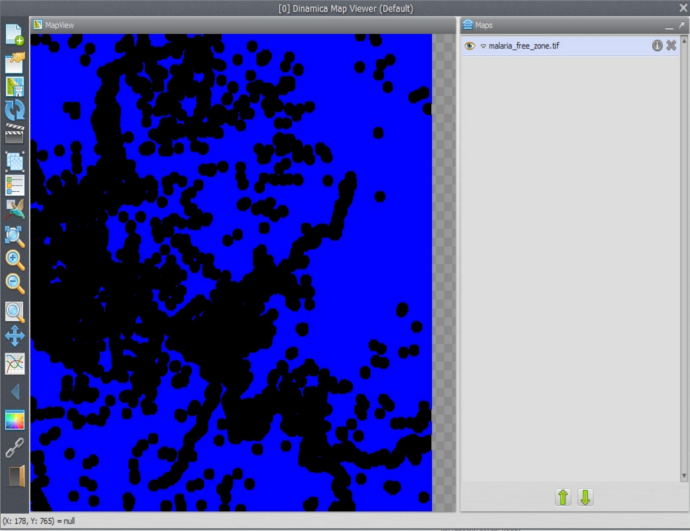

## Third step: Calculating driving time to neighboring towns

Driving traveling time to neighboring towns must not exceed 30 minutes. This fourth criterion requires the use of [Calc Cost Map](../functors/Calc-Cost-Map.html) as well as a transportation friction surface.

To solve this criterion the model will establish two speeds of traveling: one for the road network and another for all types of land uses. Traveling on road has an average speed of 60km/h. Thus the corresponding speed to cross a unit cell of 100 meters of resolution will be 0.1 minutes. In turn, traveling through the outback has an average speed of 20 km/h, which is equivalent to 0.3 cell/minute.

> Explanation
> x (hour) -> 0.1 km
> 1 h -> 60 km
> This is equal to = 0.1 km/60 km x 60 minutes = 0.1 minute

Let’s then reclassify `Map landuse.tif` to produce the friction surface. In order to this you need to place another *[Calculate Map](../functors/Calculate-Map.html)* and write into its equation box the following equation:

```
if i1 = 6 then 0.1 else 0.3
```

Now connect its output to a *[Calc Cost Map](../functors/Calc-Cost-Map.html)* functor (to its **Friction** port). You will need another *[Calculate Map](../functors/Calculate-Map.html)* to pinpoint the neighboring towns from the land-use map using the equation below:

```
if i1 = 5 then 1 else null
```

> **Important:** Important: Do not forget to change **Cell Type** both in *[Calculate Map](../functors/Calculate-Map.html)* that generates the friction map and also in *[Calc Cost Map](../functors/Calc-Cost-Map.html)* to "IEEE 754 Bit Real". Remember that the cell cost is expressed in fractional number.

After connecting the output of the last *[Calculate Map](../functors/Calculate-Map.html)* to  the *[Calc Cost Map](../functors/Calc-Cost-Map.html)* functor (to its **Source** port), pass the output of the *[Calc Cost Map](../functors/Calc-Cost-Map.html)* to another *[Calculate Map](../functors/Calculate-Map.html)* to produce a Boolean map according to the maximum time of traveling, as follows:

```
if i1 < 30 then 1 else null
```

Finally save the output map as `near town region.tif`. Note that you have added to the model three additional *[Calculate Map](../functors/Calculate-Map.html)* functors, three *[Number Map](../functors/Number-Map.html)* functors, one *[Calc Cost Map](../functors/Calc-Cost-Map.html)* and another *[Save Map](../functors/Save-Map.html)*. The model should look like the following figure.

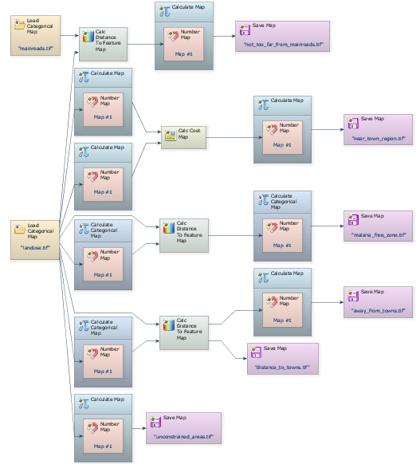

Save the model as `my_MCE_part1&2&3.egoml`, and run it. Examine map `near town region.tif`. Is this what you got?

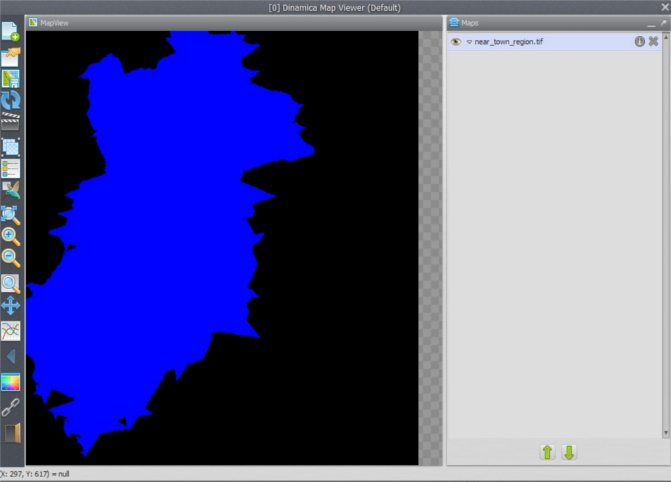

## Fourth step: Combining the Boolean criteria

So far you have solved the following criteria:

> 1. Distance to main roads &lt; 15 kilometers.
> 1. Driving distance to neighboring towns &lt;  30 minutes
> 1. At least 10 km away from existing towns.
> 1. At least 1000 meters away from flooded plains.
> 1. In addition, we need to consider that not all land is available. We don’t want to encourage more deforestation in the region, thus using only land that is deforested or abandoned. Also existing urban areas, rivers and flooded plains must be excluded.

The two remaining criteria (areas equal or greater than 1000 hectares, and average slope &lt; 0.5 degrees) must be solved using a zonal approach as provided by the Region functors. Before moving on to this step, you need to combine all criteria already solved into a single map.

As you have noticed this model has reached a certain level of complexity, and it beginning to become difficult to grasp its structure through the graphical interface. Dinamica EGO presents some facilities to reduce the visual complexity of models.

Firstly, you can delete the *[Save Map](../functors/Save-Map.html)* functors, since you have already checked their results. Second, you can add comments to some functors highlighting their outcomes. Let’s do it!

Grab the Add Comment to Functor tool from the sketch toolbar. Describe the outcome in each functor preceding the *[Save Map](../functors/Save-Map.html)* functors, so you can trace each data flow back to its initial node (that is Map `landuse.tif`). Do it by clicking on its top left icon.

Write in respective functors: Near town regions, Malaria free zone, Away from towns, Unconstrained land uses, Not too far from main roads.

At this stage, you can delete the *[Save Map](../functors/Save-Map.html)* functors, since you have already checked their results. After doing so, organize the layout from left to right.

> **Tip:** **TIP**: resize the window sketch to get a closer view at the model. This is what you should get.

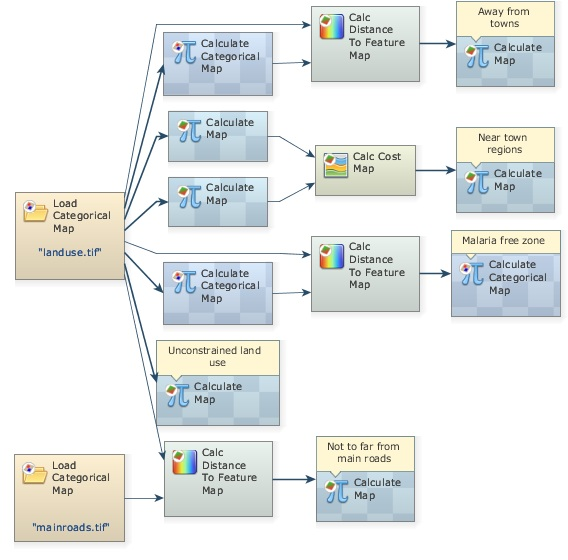

The five titled *[Calculate Map](../functors/Calculate-Map.html)* functors produce the five criteria solved so far. Now you just need to combine them with *[Calculate Map](../functors/Calculate-Map.html)*.

Now place five *[Number Map](../functors/Number-Map.html)* functors within it. Open it and write the following equation.

```
i1*i2*i3*i4*i5
```

> **Important:** The *[Calculate Map](../functors/Calculate-Map.html)* does not process null cells.

Change **Cell Type** to  "UnSigned 8 Bit Integer" **Null Value** to "0"; write the comment "Combine five criteria" and add *[Save Map](../functors/Save-Map.html)* to view the result, naming the file as `five criteria combined.tif`. Finally organize the layout left to right.

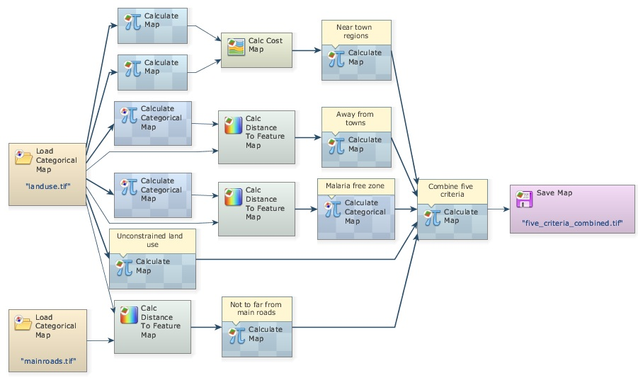

Close the right-most container to show the comments, save the model as `my_MCE_part1&2&3&4.egoml`, check and run it. Is this what you get?

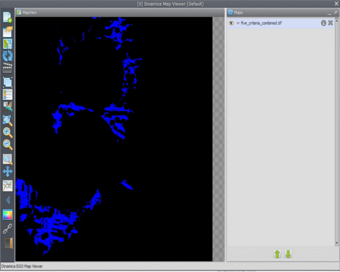

To further simplifier the view of the model, another resource available in Dinamica EGO is the *[Group](../functors/Group.html)* functor. Drag five *[Group](../functors/Group.html)* functors from the Control tab and place them on the sketch. Now select each functor of a data flow chain that ends up in *[Calculate Map](../functors/Calculate-Map.html)* "Combine five criteria" (Press **Crt + right button** to keep on continually selecting functors), leave the *[Categorical Map](../functors/Categorical-Map.html)* functors out, now drag them into a *[Group](../functors/Group.html)*. [Repeat](../functors/Repeat.html) this procedure for the five criteria.

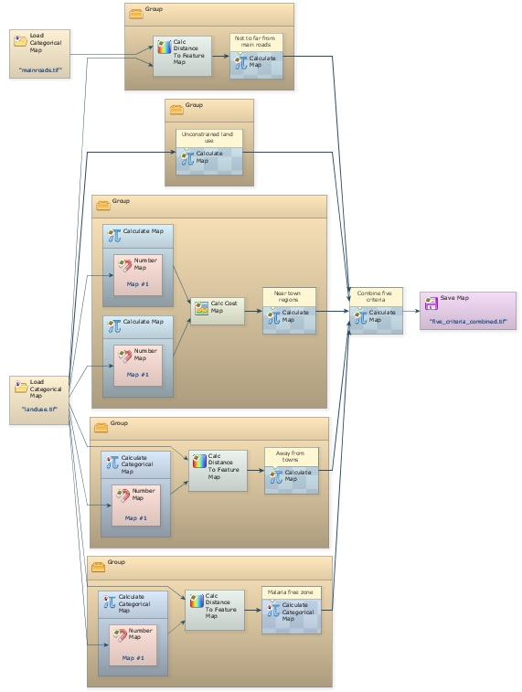

Close each *[Group](../functors/Group.html)* and write the following comments in their respective *[Group](../functors/Group.html)*. You may need to zoom in.

Produce near town regions  
Produce malaria free zone  
Produce areas away from towns  
Produce unconstrained land uses  
Produce areas not too far from main roads

See model on the next page. Didn’t the model become much easier to visualize? Of course, you will need to open the *[Group](../functors/Group.html)* functor to understand how the data are produced. You can do this one by one. Note that the function of the *[Group](../functors/Group.html)* functor is to help organize the model diagram.

> **Note:** *[Group](../functors/Group.html)* is also used to ensure a proper order of execution, given that it always executes its enveloped functor before other subsequent functors.

Save this model as `my_MCE_part1&2&3&4group.egoml` and let’s move forward to the next step.

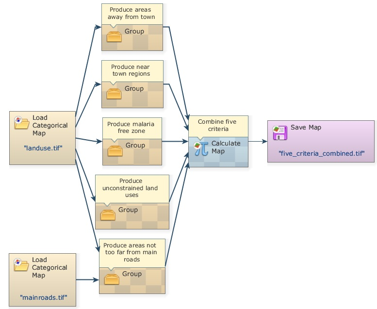

## Fifth step: identifying suitable areas

In this step, you will identify the suitable areas equal to or greater than 1000 hectares. First, delete *[Save Map](../functors/Save-Map.html)* `five criteria combined.tif`. Remember that the less the software accesses the disk, the faster the model runs. Now, drag from Map Algebra tab the functor [Calc Patch Label Map](../functors/Calc-Patch-Label-Map.html). This functor labels patches of cells using sequential numbers. A patch consists of a continuous group of neighboring cells of the same category. You need this in order to solve the area criterion. Connect the output from "Combine Five Criteria" to it. Some of its parameters are:

**Initial Patch Label**: Set it to "1".

> **Important:** Important: Set **Null Value** to "0" and **Cell Type** to **Signed 32 Bit Integ**er.

This will be sufficient to store all patch label number identifiers. Leave the other parameters untouched. Go to help for further details. Now connect its output to [Calc Areas](../functors/Calc-Areas.html), available in the Map Algebra tab. As output this functor provides one table with three columns. See [Calc Areas](../functors/Calc-Areas.html#notes) for additional information about the [Calc Areas](../functors/Calc-Areas.html) result.

Now, place on the sketch one *[Calculate Map](../functors/Calculate-Map.html)* and one *[Number Map](../functors/Number-Map.html)* and one *[Number Table](../functors/Number-Table.html)* within it. Connect *[Calc Areas](../functors/Calc-Areas.html)* to Table 1 (this implies that output of *[Calc Areas](../functors/Calc-Areas.html)* is a lookup table), and **Map** output from *[Calc Patch Label Map](../functors/Calc-Patch-Label-Map.html)* to Map #1. Now open *[Calculate Map](../functors/Calculate-Map.html)* and write:

```
if (t1[ [i1]["Area_In_Hectares"] ] < 1000) then null else 1
```

Using this formula, the functor will analyze the size of each patch and then eliminate the patches smaller than 1000 hectares. Now place one *[Save Map](../functors/Save-Map.html)* and enter `big areas.tif`.

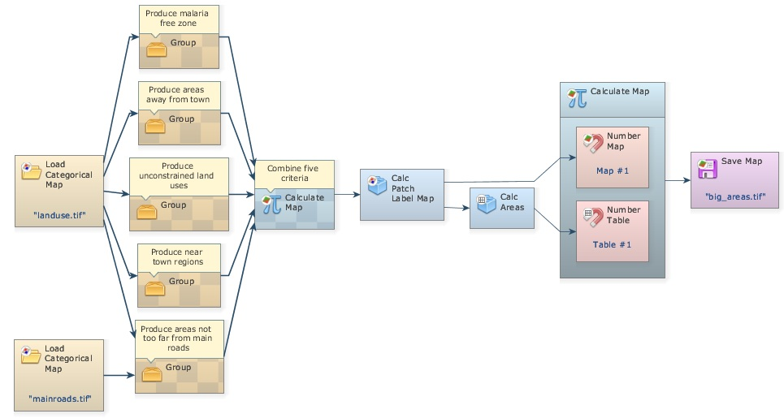

Check the model, save it as `my_MCE_part1&2&3&4&5.egoml`, run it and examine its output. Is this what you got?

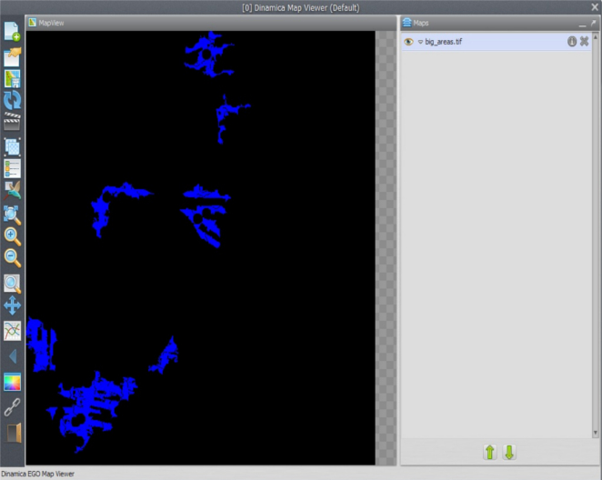

Great, what a haul! But before moving on to the next step, there is still a last thing to do. In order to keep the patch labels, you need to multiply the output from the last *[Calculate Map](../functors/Calculate-Map.html)*, to which you have added the comment "Identify big patches", with the output from *[Calc Patch Label Map](../functors/Calc-Patch-Label-Map.html)*. Therefore, you will keep only the labels for the big patches.

Place one *[Calculate Categorical Map](../functors/Calculate-Categorical-Map.html)* and two *[Number Map](../functors/Number-Map.html)* functors within it. Set their *[Number Map](../functors/Number-Map.html)* functors to "1" and "2" respectively, and remove the *[Save Map](../functors/Save-Map.html)* functor. Now connect functors as follows:

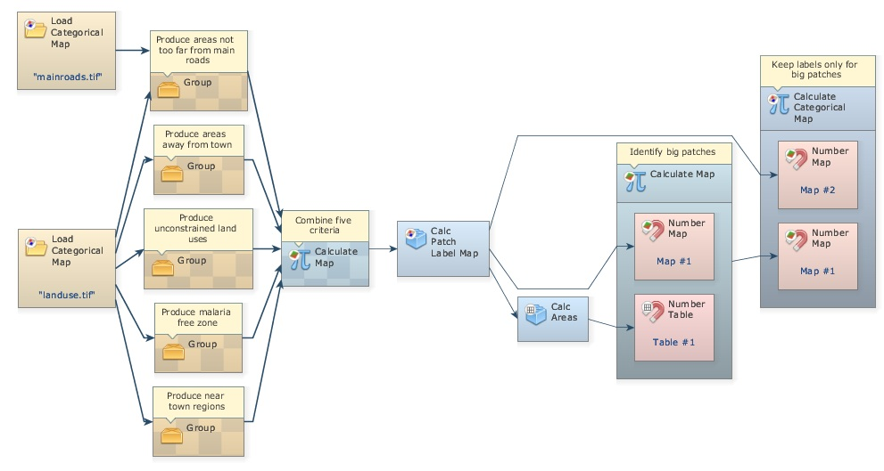

> **Important:** You need *[Calculate Categorical Map](../functors/Calculate-Categorical-Map.html)* instead of *[Calculate Map](../functors/Calculate-Map.html)*, because patch labels will be used ahead to regionalize the slope map, set **Null Value** to "0" and **Cell Type** to "Signed 32 Bit Integer".

Write `i1*i2`, close the functor and insert the comment "Keep labels only for big patches". Now you are ready to move on to the last step.

## Sixth step: identifying suitable areas 2

The final criterion establishes that the average slope on the selected patches must be less than 0.5 degrees. Place *[Load Map](../functors/Load-Map.html)* and load it with `\lesson4\originals\slope.tif`. Now revise Lesson3, as you will to need to reapply the concept of region.

Drag *[For Each Region](../functors/For-Each-Region.html)*, *[Regionalize Map](../functors/Regionalize-Map.html)*, and *[Step](../functors/Step.html)*, insert the two latter functors within the previous and connect them as follows.

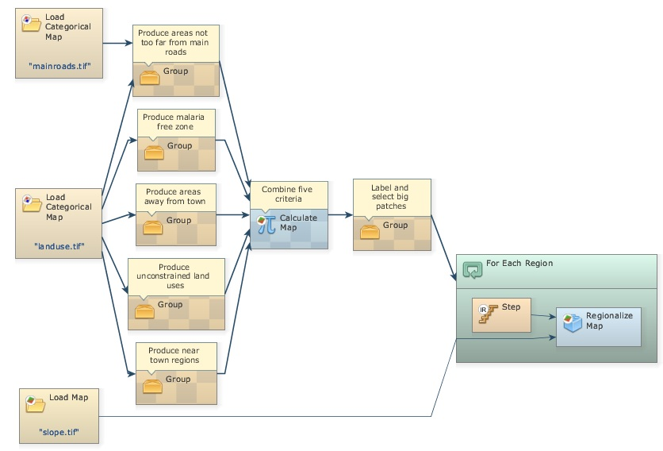

The map to be regionalized is the `slope.tif`.  The map output from the last *[Calculate Categorical Map](../functors/Calculate-Categorical-Map.html)* will control *[For Each Region](../functors/For-Each-Region.html)*. Remember that this functor enables the model to iterate according to the map categories passed to it. Now place one *[Mux Lookup Table](../functors/Mux-Lookup-Table.html)*, one *[Extract Map Attributes](../functors/Extract-Map-Attributes.html)*, one *[Calculate Value](../functors/Calculate-Value.html)*, one *[Number Table](../functors/Number-Table.html)* and one *[Set Lookup Table Value](../functors/Set-Lookup-Table-Value.html)*, all within *[For Each Region](../functors/For-Each-Region.html)* and connect them as follows.

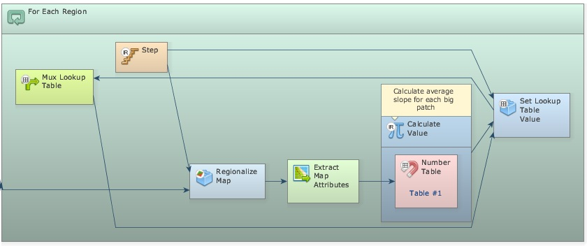

Write the equation `t1[13]` in the *[Calculate Value](../functors/Calculate-Value.html)*. Remember that 13 is the key for the average of all non null cells in the attribute table. This submodel is very similar to the one introduced in Lesson 3. Open *[Extract Map Attributes](../functors/Extract-Map-Attributes.html)* and set the option:

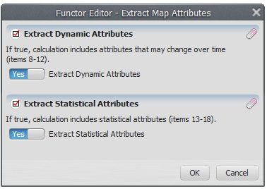

Remember to link *[Step](../functors/Step.html)* to **Key** on the *[Set Lookup Table Value](../functors/Set-Lookup-Table-Value.html)*

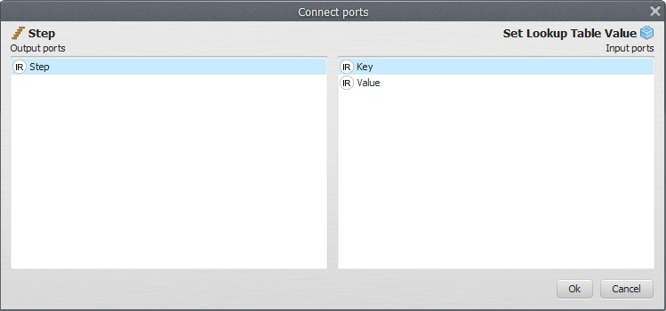

As well as **Updated Table** to **Feedback**

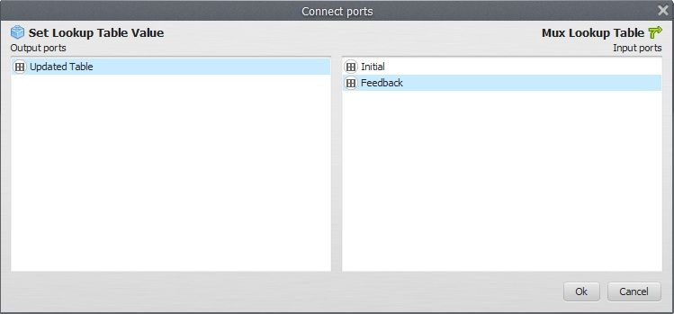

Open *[Mux Lookup Table](../functors/Mux-Lookup-Table.html)* with the Edit Functor Ports and click on **Initial**, enter a blank table. Just enter once "0" and "0", as **Key** and **Value**. Register the **Table** output port to be viewed. You might want to see the results.

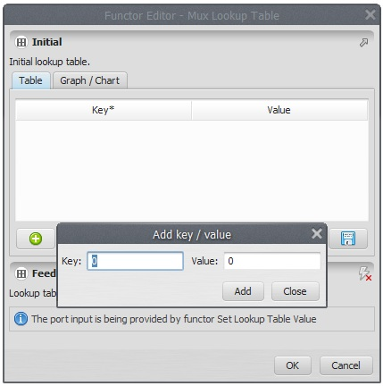

Finally place *[Calculate Categorical Map](../functors/Calculate-Categorical-Map.html)* after the *[For Each Region](../functors/For-Each-Region.html)* and place *[Number Map](../functors/Number-Map.html)* and *[Number Table](../functors/Number-Table.html)* within it. Number them and write the following equation:

```
if t1[i1] > 0.5 then null else i1
```

Save the result as `suitable for a new town.tif` on the lesson5 folder.

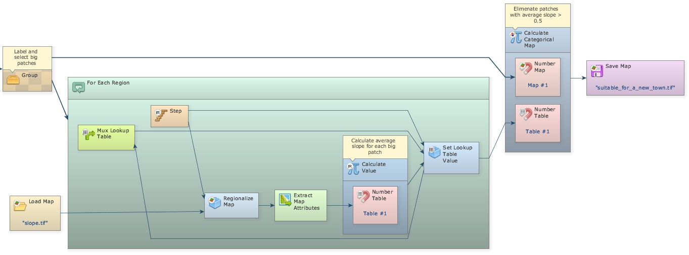

Check the model, save it as `my_MCE_part1&2&3&4&5&6.egoml` and run it. Is this what you got?

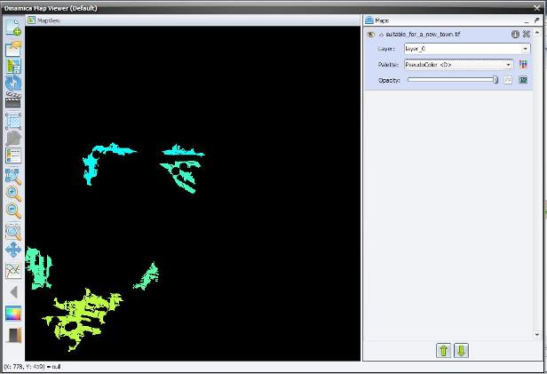

Finally you just need to organize the model in a more legible layout. Place one *[Group](../functors/Group.html)* and drag *[Calc Patch Label Map](../functors/Calc-Patch-Label-Map.html)*, *[Calc Areas](../functors/Calc-Areas.html)*, *[Calculate Map](../functors/Calculate-Map.html)* "Identify big patches", and *[Calculate Categorical Map](../functors/Calculate-Categorical-Map.html)* "Keep labels only for big patches" into it.

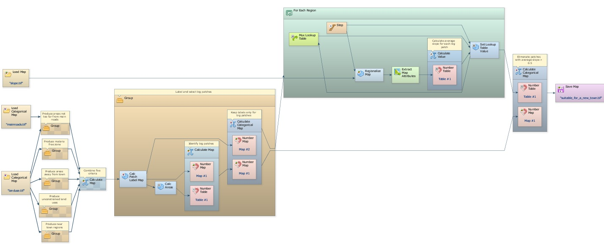

Close it and add the comment "Label and select big patches", close the *[Region Manager](../functors/Region-Manager.html)* and add "Calculate average slope for each big patch", close the last *[Calculate Map](../functors/Calculate-Map.html)* functor and add "Eliminate patches with average slope > 0.5" and lastly, add the comment "Save final map" to Map `suitable for a new town.tif`.

Save the model as `my mce part1&2&3&4&5&6 complete.egoml`. This is the final model.

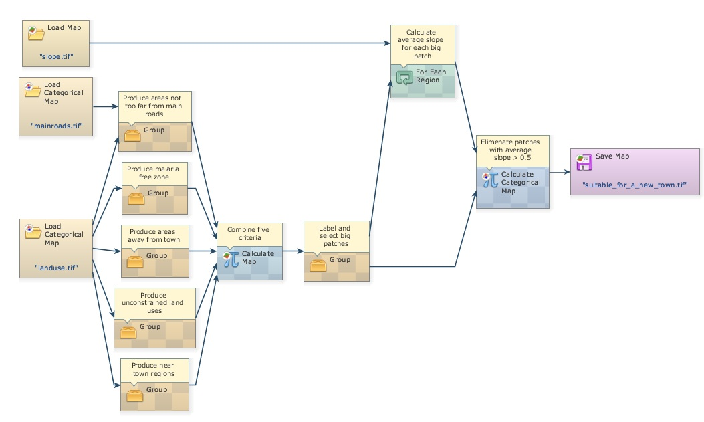

> **To do:** **HOME WORK**
> Examining the map `suitable for a new town.tif`, you will note a large patch on its southwest portion, which would be the best target for a new town, considering the areal extent as an additional criterion. Would you be able to add a submodel to the current model to pinpoint this patch?

> **Tip:** **TIP**: You will need to recalculate the areas for the remaining patches and pass this table to *[For Each](../functors/For-Each.html)*, which allows to browse through a table. Place two *[Mux Value](../functors/Mux-Value.html)* inside the *[For Each](../functors/For-Each.html)*, one will handle the maximum area value and the other will store its key.

### Congratulations, you have successfully completed this lesson!

☞[Next: Simulating road expansion according to various road lattices](New-Road-Constructor.html)

