
# New Road Constructor

### What will you learn?

- This page describes the submodels and algorithms used as foundations for defining a new road constructor for use with Dinamica EGO LUCC models.

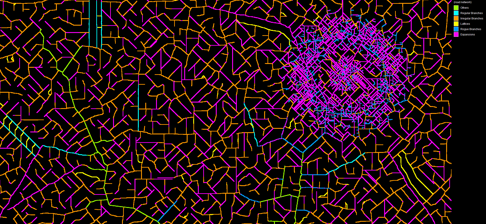

```
Examples of road network constructed using the tools described below
```

#### Road Canonization

Roads used by the new road constructor tool are always adapted by a process we call “canonization”. The cells in their canonical feature representation are always connected using a Von Neumann neighborhood (https://en.wikipedia.org/wiki/Von_Neumann_neighborhood, cross pattern). This representation has the advantage of turning features into barriers, preventing them from being "crossed" by cost surface calculations (this restriction is important for all algorithms described below). The canonization can optionally bridge one-cell wide gaps that might be splitting some of the input features in separate features. The canonization process is automatically applied by any of the road construction algorithms.

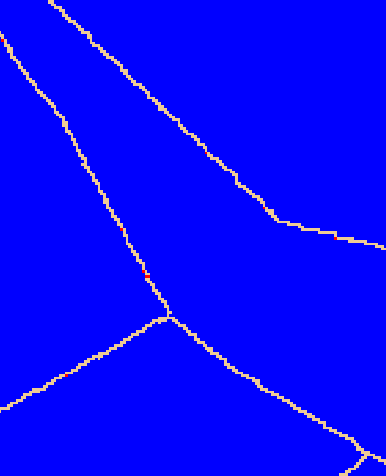

```
Example of a road in modified to be in its canonical form - red cells represent areas modified during the canonization procedure
```

## Road Construction Algorithms

The road constructor is formed by a combination of one or more of the following submodels:

- Build Road Expansions
- Build Irregular Branches
- Build Regular Branches
- Build Road Lattice

### Build Road Expansions

//
//

> **Tip:** Existent roads are expanded by sprouting new segment from their endpoints.

//
//

##### Algorithm

1.	First, it calculates a map depicting only the cells representing the endpoints of the given features. Endpoints are detected using a technique described in the paper Convolution Approach for Feature Detection in Topological Skeletons Obtained from Vascular Patterns (psu.edu). Each endpoint is assigned a unique id value. Optionally, branches in features that are only one-cell long can be ignored. The feature map must be provided in their canonical representation.

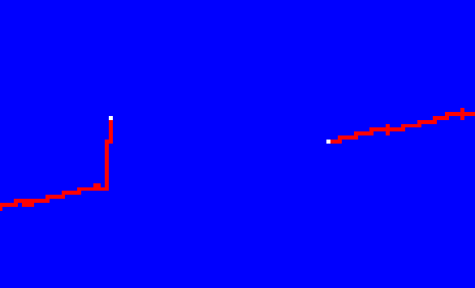

```
Example of road endpoints -- white cells represent the areas depicting the road endpoints, but ignoring branches that are only one cell long
```

2.	Then, it calculates the cost and direction map to reach the “least costly” road endpoint. The existent roads are treated as barriers which can make some parts of the map inaccessible to the cost calculation.

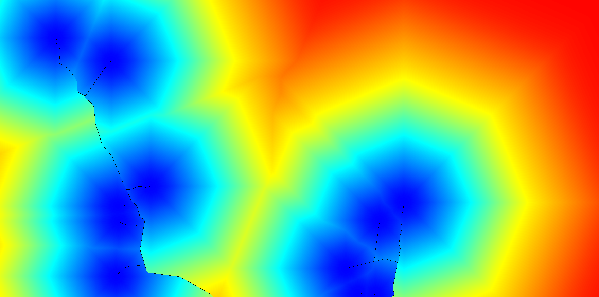

```
Costs to reach the “least costly” road endpoints --“blueish” areas represent the vicinities of road endpoints
```

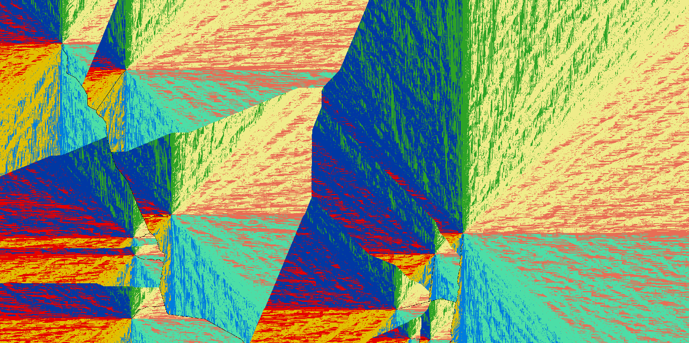

```
Directions that must be followed to reach the “least costly” road endpoints
```

3.	As the next step, the resulting cost map is used to group the reachable cells using an allocation calculation. This process defines which endpoint dominates each area of the map. Additionally, the dominance areas are “fenced” preventing any following cost map calculations from crossing the area boundaries.

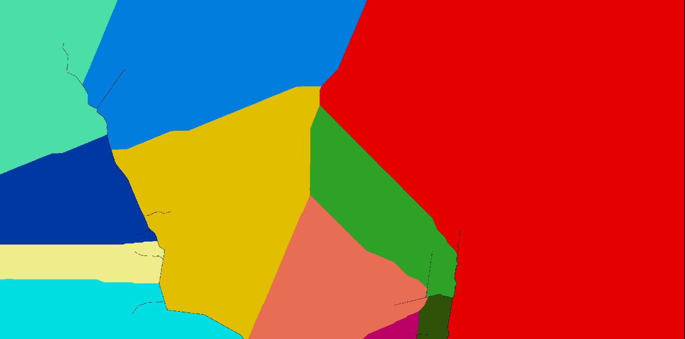

```
Road endpoint dominance areas -- each color corresponds to the region of dominance of a road endpoint located in that area
```

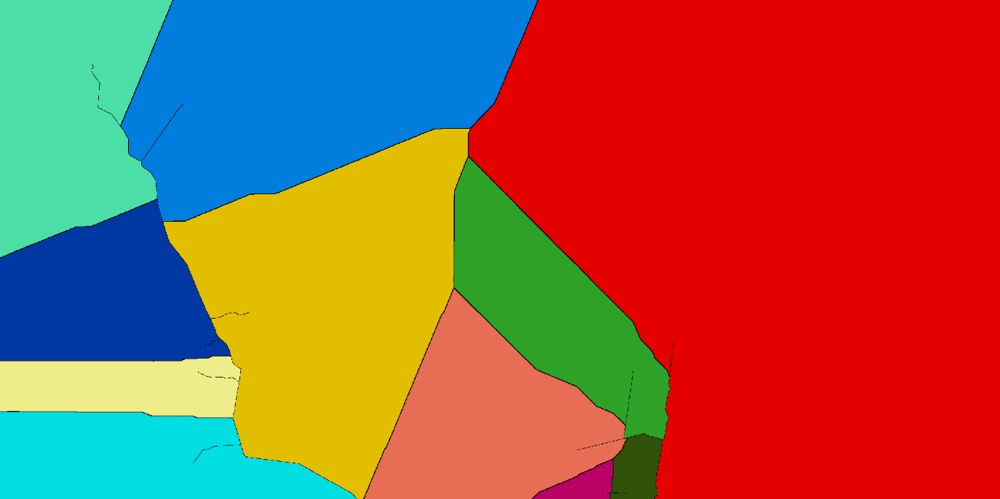

```
Road endpoint dominance areas with “fences” around them – “fences” are made of contiguous null value cells
```

4.	Now, for each endpoint dominance area, it calculates the angle (in degrees) between all cells and the corresponding feature endpoint vector. The calculation uses theta = acos(dot(u, v) / (mod(u)*mod(v))), where u is the vector representing the feature endpoint direction (which is also calculated for each of the endpoints, using the same technique described in the paper Convolution Approach for Feature Detection in Topological Skeletons Obtained from Vascular Patterns (psu.edu)) and “v” is the vector representing the direction of the new possible feature segment. The direction of each one of the endpoints is a discrete value and uses one the following eight possible representations: NW=1, N=2, NE=3, E=4, SE=5, S=6, SW=7, W=8 and Undefined=0.

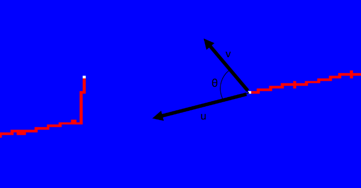

```
Calculation of road endpoint angles
```

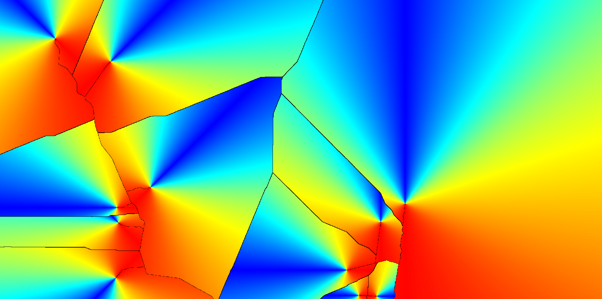

```
Angle map -- blueish values represent small angles while red values represent large angles
```

5.	The resulting angle map is then filtered: angles and “areas” satisfying a set of constraints, such as “Maximum Road Travel Cost “and “Maximum Road Ending Vector Angle”, are used to define a “viable” cone-shaped area per road endpoint in the friction map. This friction map will be used to calculate another cost map in the next step. The “Minimum Road Travel Cost” is not used yet to ensure that cost calculations using the resulting friction map can still reach the corresponding road endpoint.

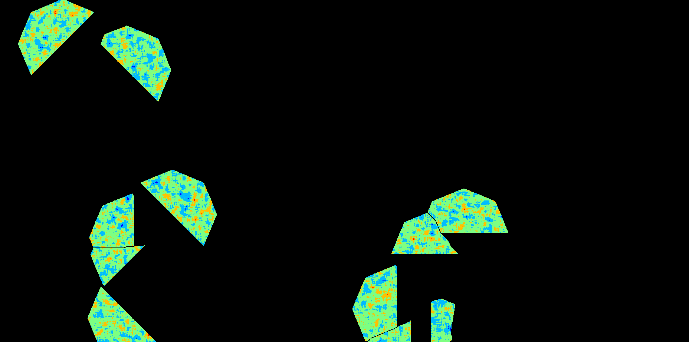

```
Frictions within the “viable” cone-shaped areas
```

6.	Now, it calculates the cost and direction map to reach the corresponding road endpoint within each cone-shaped area.

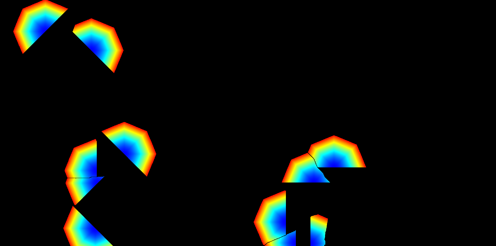

```
Costs to reach the “least costly” road endpoints within the cone-shaped areas --“blueish” areas represent the vicinities of road endpoints
```

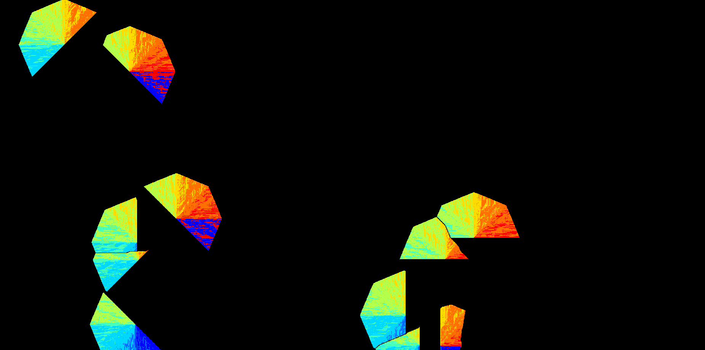

(directions that must be followed to reach the “least costly” road endpoints)

7.	Then, the cost map calculated using the cone-shaped areas, and the “Minimum Road Travel Cost” are used to filter the probability areas from where the new road destinations can be selected.

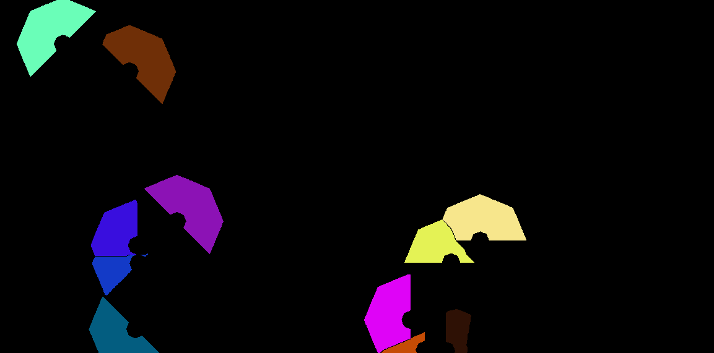

```
Valid areas from where road destinations can be selected
```

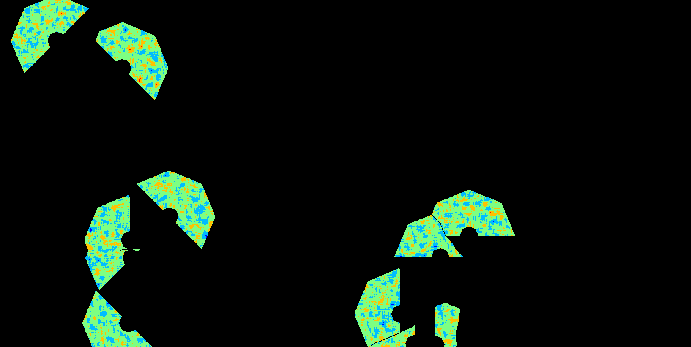

```
Valid probabilities to select new road destinations
```

8.	As the last step, the selected new road destinations, together with the direction map, are used to construct segments connecting them and the corresponding road endpoint in their respective cone-shaped dominance area.

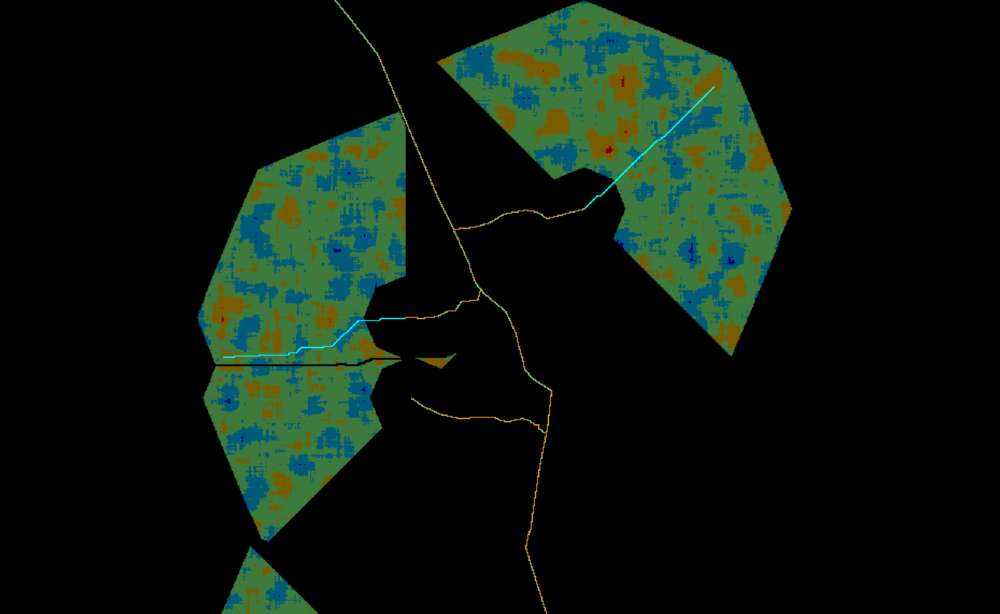

```
Example showing some of the new road segments [cyan color] with the probabilities in their cone-shaped dominance areas in the background – the example shows only a portion of the previous images for better visualization
```

### Build Irregular Branches

//
//

> **Tip:** The original roads are updated with branches of any shape connecting newly selected destinations to some existent road segment.

//
//

##### Algorithm

1.	When the “Minimum Road Endpoint Travel Cost” is greater than zero, the algorithm starts by calculating a map depicting only the cells representing the endpoints of the given features. Endpoints are detected using a technique described by in the paper Convolution Approach for Feature Detection in Topological Skeletons Obtained from Vascular Patterns (psu.edu). Each endpoint is assigned a unique id value. Optionally, branches in features that are only one-cell long can be ignored. The feature map must be provided in their canonical representation.


```
Example of road endpoints -- white cells represent the areas depicting the road endpoints, but ignoring branches that are only one cell long
```

2.	Then, it calculates the cost map to reach the “least costly” road endpoint.


```
Costs to reach the “least costly” road endpoints -- “blueish” areas represent the vicinities of road endpoints
```

3.	The next step is to remove all cells from the friction map that are too close to the road endpoints using the cost map calculated in the previous step and the “Minimum Road Endpoint Travel Cost” parameter.

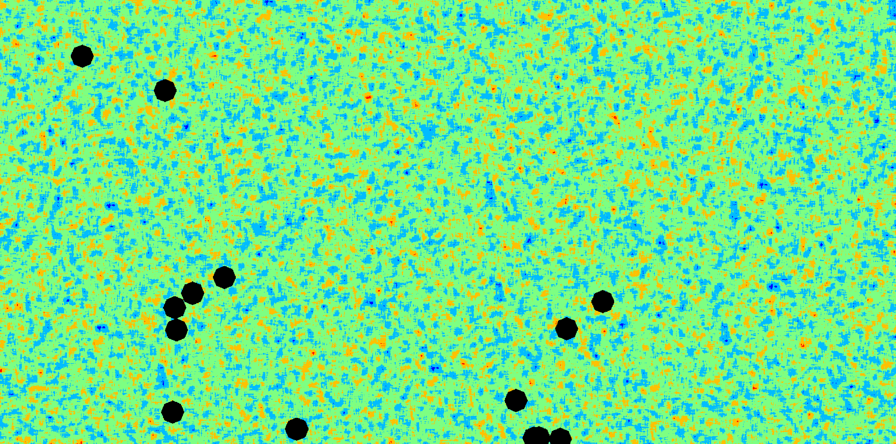

```
Fraction map excluding all the areas too close to road endpoints
```

4.	The resulting friction map is used to calculate another cost and cost direction maps depicting the costs and directions, respectively, to reach the “least costly” road segments.

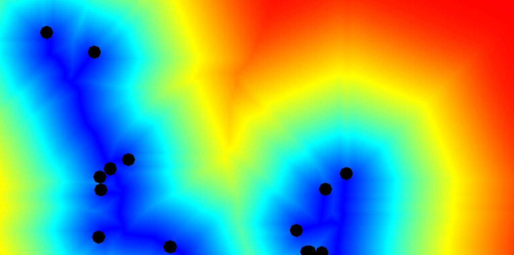

```
Costs to reach the “least costly” road segment, but excluding the areas too close to the road endpoints
```

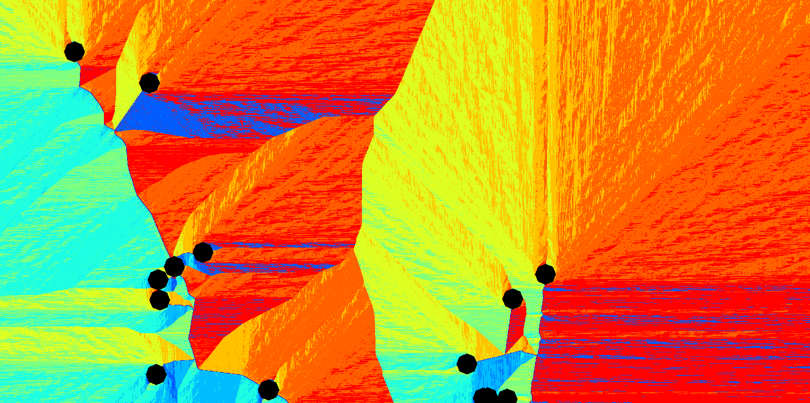

```
Directions that must be followed to reach the “least costly” road segment, but excluding the areas too close to the road endpoints
```

5.	Now, a probability map, showing only the potential areas where new road destinations can be selected, is produced comparing the “Minimum Road Travel Cost” and “Maximum Road Travel Cost” parameters against the cost map calculated in the previous step.

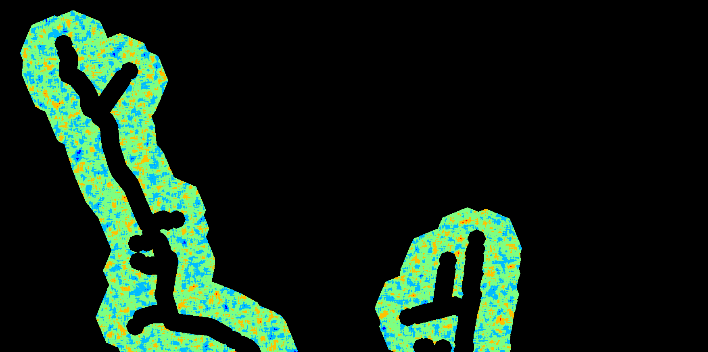

```
Probabilities, but excluding areas too close and too far from existent road segments
```

6.	As the last step, the selected new road destinations, together with the direction map, are used to construct segments connected to the existent road network.

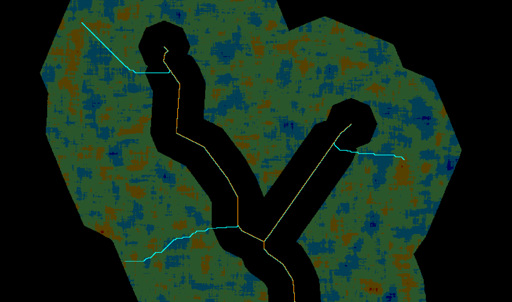

```
Example showing some of the new road segments [cyan color] with the probabilities in the background – the example shows only a portion of the previous images for better visualization
```

//
//

### Build Regular Branches

//
//

> **Tip:** The original roads are updated with regular branched roads connecting the newly selected destinations with their corresponding road segments. Unlike irregular branches, regular branch segments only travel through its corresponding segment region, therefore following a straight line. They are also perpendicular to the original road.

//
//

##### Algorithm

> **Warning:** The pictures shown below may not cover the same area for better visualization

1.	First, the existent roads are split into segments of approximately “Road Branching Lane Width” cells. Segments that are too small or cannot be successfully grouped are discarded. Each segment is assigned a unique id.

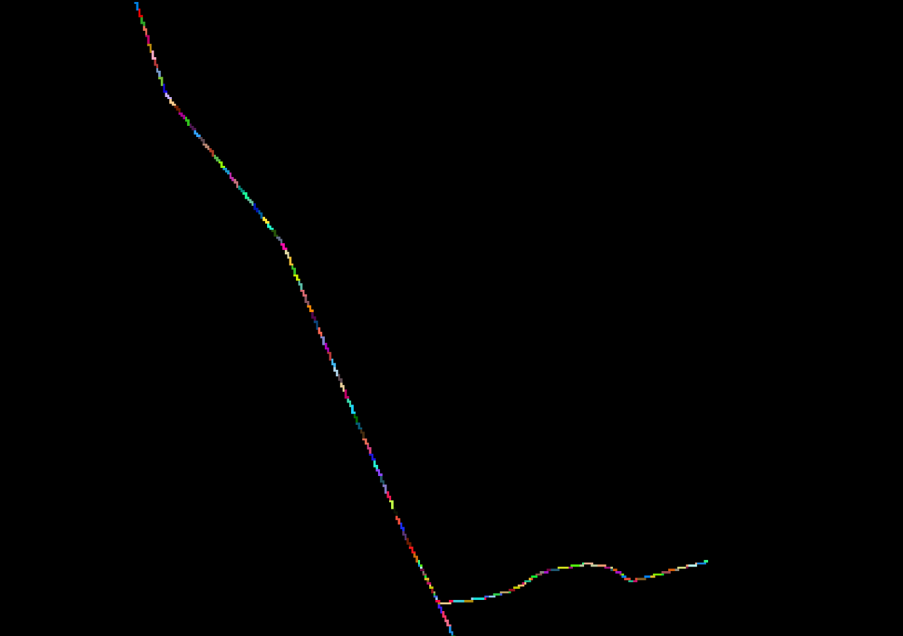

```
Zoom showing the road split into segments with unique ids – it shows only a portion of the following images for better visualization
```

2.	Additionally, a cost map depicting the costs to reach the “least costly” road segments is also calculated.

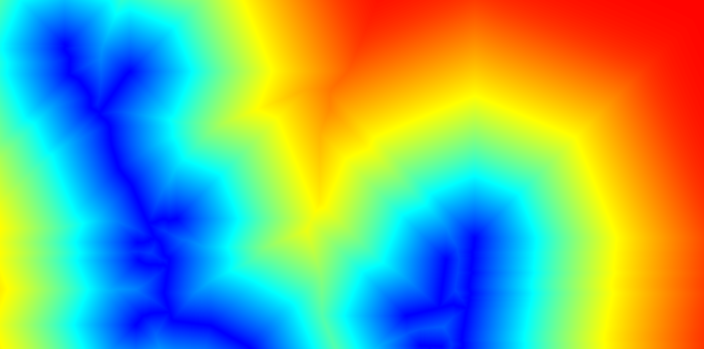

```
Costs to reach the “least costly” road segment
```

1.	Next, the regions of influence of each one of the road segments are calculated and the regions that are not “appropriately” shaped are discard. A “properly” shaped region is defined by value “Road Branching Irregularity Threshold” and flag “Try To Enforce Double Road Branching”.

a.	The region boundaries are delimited using the “Maximum Road Travel Cost” and the cost map calculated previously. The result represents a uniform friction map, where all the values in the non-null areas are the same.

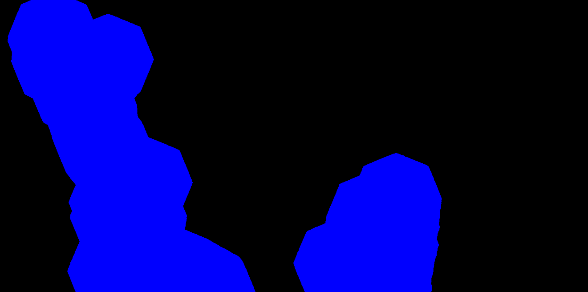

```
Uniform friction map delimiting the region boundaries
```

b.	The uniform friction map is used to calculate a direction map showing the directions that must be followed, for each cell, to reach the “closest” road segment.

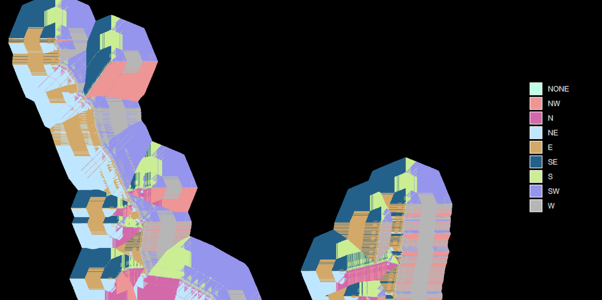

```
Direction map showing the directions that must be followed to reach the “closest” road segment
```

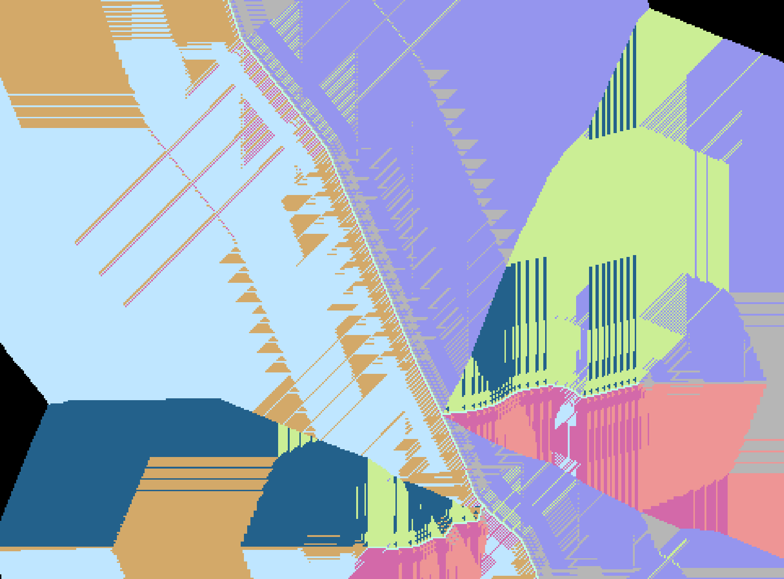

```
Zoom showing some details in the direction map above
```

c.	The direction map is used to calculate the dominance area of each one of the road segments. Each dominance area is assigned the same unique id used by its corresponding road segment.

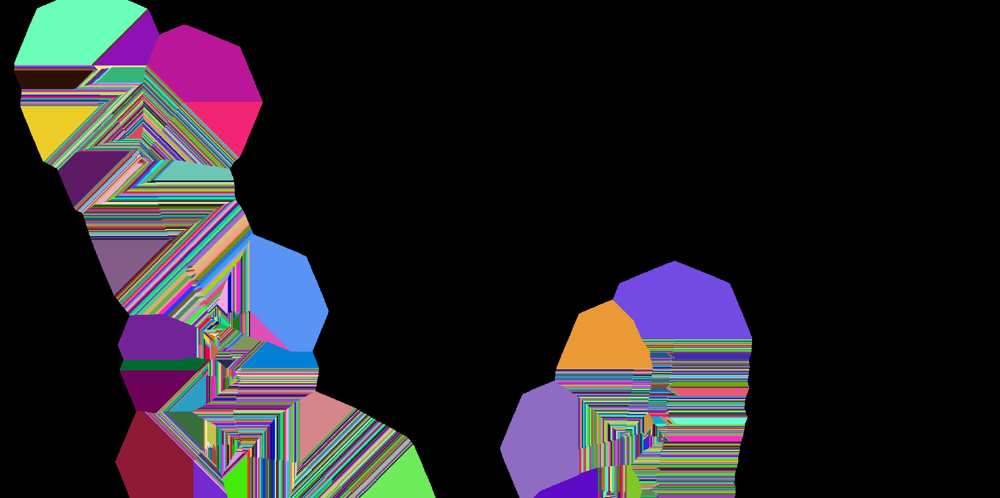

```
Road segment dominance areas
```

d.	The direction map and the segment dominance map are then used to calculate which areas are “properly” shaped. Areas that do not satisfy the “proper” shape criteria, according to the “Road Branching Irregularity Threshold” value and “Try To Enforce Double Road Branching” flag are discarded. Typically, areas with “proper” shapes are very regular, having cells of only two opposite directions [e.g., N/E (North/East), NW/SE (North-West/South-East)] in approximately the same numbers.


```
“Properly”-shaped dominance areas
```

2.	The probabilities covered by “properly”-shaped dominance areas are combined, as their average, and the resulting value is assigned to the cells of the corresponding road segment. This new probability map will be used to select “seeds”. These “seeds” are road segments from where new regular branches can sprout.

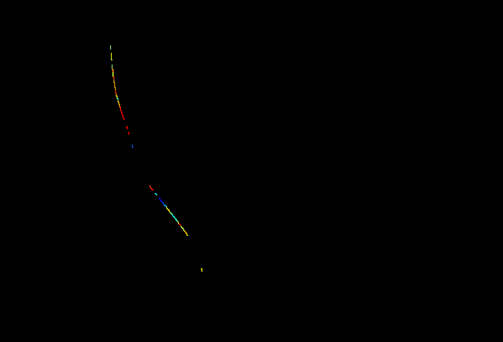

```
Zoom showing the average probability of some “properly”-shaped dominance areas – it shows only a portion of the previous images for better visualization
```

3.	Once the specified “Number Of Road Branching Seeds” are selected, a new friction map covering only the dominance area of the selected “seeds” is produced.

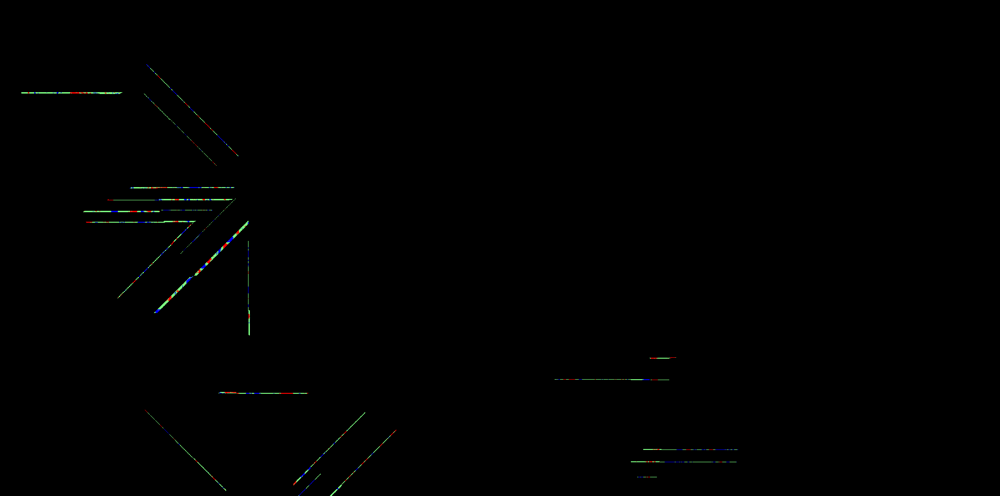

```
Friction map corresponding to dominance areas of the selected “seeds”
```

4.	The resulting friction map is used to calculate a cost and direction maps to reach the road segment in the corresponding dominance area.

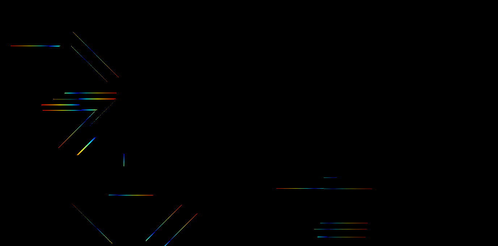

```
Costs to reach the road segment in the dominance area
```

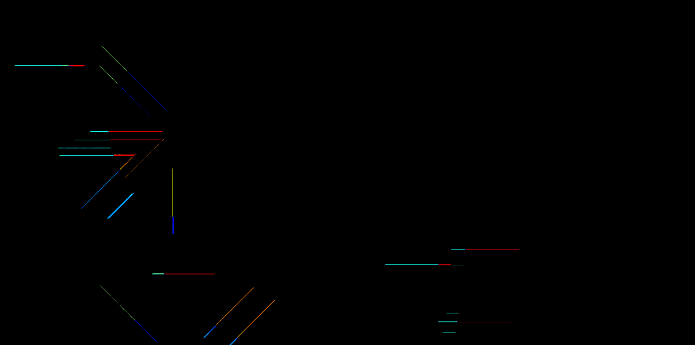

```
Direction map showing the directions that must be followed to reach the road segment in the dominance area
```

5.	Depending on the state of the flags “Try To Enforce Double Road Branching” and “Use Random Road Branching”, the dominance areas where “seeds” were selected previously are also split in one or two probability areas depending whether or not double road branching should be enforced on that area. Basically, the area is split in two when double road branching is not used, but it is kept intact, otherwise. Double road branching occurs when a seed segment sprouts two new road branches, one for each side of the road. Each one of the resulting probability areas is assigned a unique id.

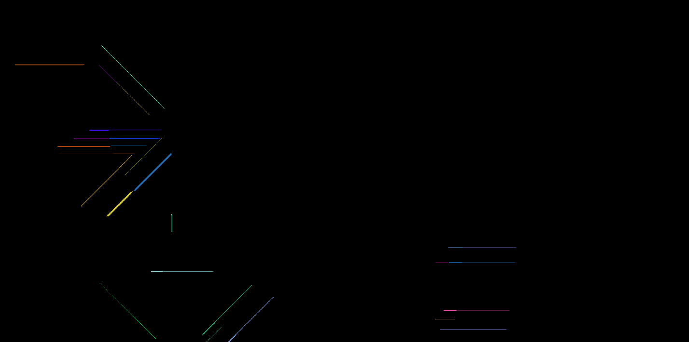

```
Probability regions with unique ids
```

6.	A new probability map is produced filtering the valid probabilities according to the “Minimum/Maximum Road Travel Cost” and the values of the cost map to reach the “least costly” road segment. This new probability and the map depicting the probability areas calculated in the previous step are then used to select the new road destinations.

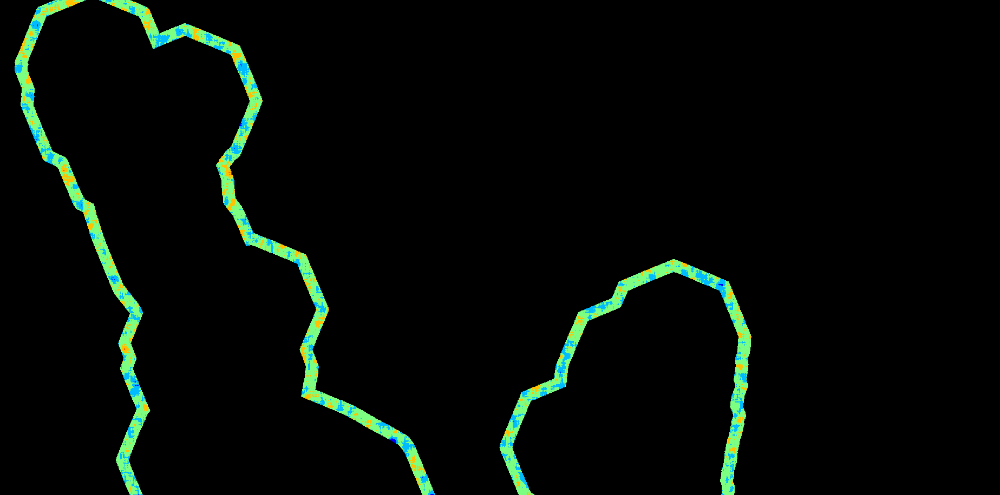

```
Valid probabilities
```

7.	As the last step, the selected new road destinations, together with the last direction map, are used to construct segments connected to the existent road network.

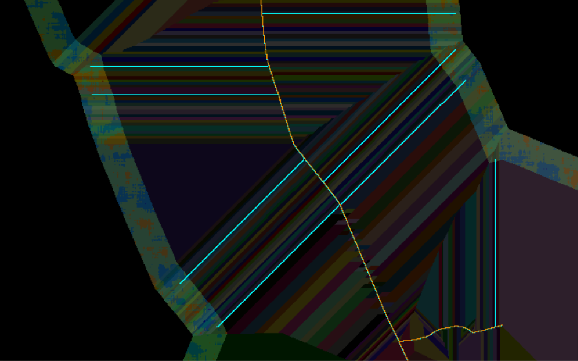

```
Example showing some of the new road segments [cyan color] with the probabilities and all dominance regions [valid and invalid] in the background -- the example shows only a portion of the previous images for better visualization
```

//
//

### Build Road Lattice

//
//

> **Tip:** Lattices are built by connecting two or more road branches. Lattice road segments are parallel segments built alongside non-branched roads that connect branches sprouting from that same base road.

//
//

##### Algorithm

> **Important:** The lattice construction tool, unlike the other road construction algorithms, receives two road network maps: a map that does not include the road segments used as branching points for the lattice (referred as “base roads”) and a map that includes all the roads (referred as “roads with branches”).

1.	When the “Allow Lattice Segments Around Base Road Endpoints” is set to false, the algorithm starts by calculating a map depicting only the cells representing the endpoints of the “base roads” (roads not including the lattice branching points). Endpoints are detected using a technique described by in the paper Convolution Approach for Feature Detection in Topological Skeletons Obtained from Vascular Patterns (psu.edu). Each endpoint is assigned a unique id value. Optionally, branches in features that are only one-cell long can be ignored. The feature map must be provided in their canonical representation.


```
Example of road endpoints -- white cells represent the areas depicting the road endpoints, but ignoring branches that are only one cell long
```

1.	Then, it calculates the cost and direction map to reach the “closest” road endpoint among those identified in the previous step.

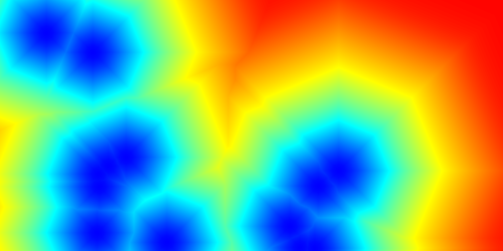

```
Costs to reach the “closest” road endpoint
```

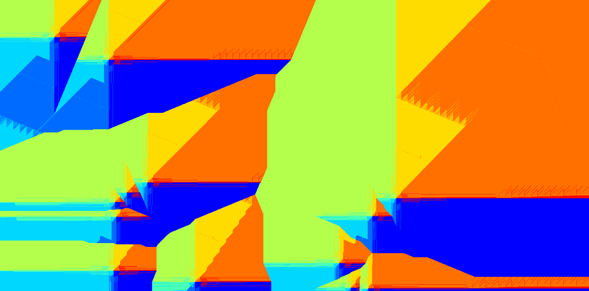

```
Direction map showing the directions that must be followed to reach the “closest” road endpoint
```

2.	The direction map is then used to calculate the area of dominance of each one of the road endpoints.

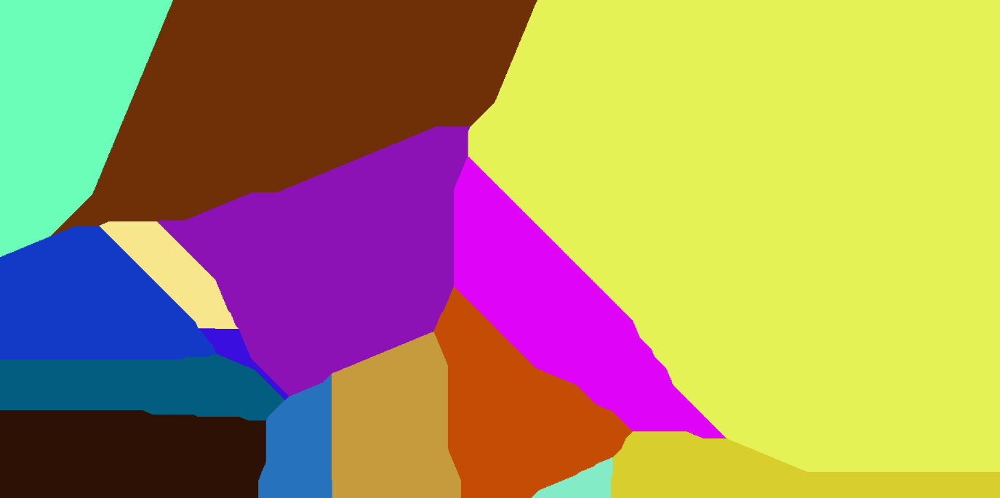

```
Road endpoint dominance areas
```

3.	Now, for each endpoint dominance area, it calculates the angle (in degrees) between all cells and the corresponding feature endpoint vector. The calculation uses theta = acos(dot(u, v) / (mod(u)*mod(v))), where u is the vector representing the feature endpoint direction (which is also calculated for each of the endpoints, using the same technique described in the paper Convolution Approach for Feature Detection in Topological Skeletons Obtained from Vascular Patterns (psu.edu)) and “v” is the vector representing the direction of the new possible feature segment. The direction of each one of the endpoints is a discrete value and uses one the following eight possible representations: NW=1, N=2, NE=3, E=4, SE=5, S=6, SW=7, W=8 and Undefined=0.


```
Calculation of road endpoint angles
```

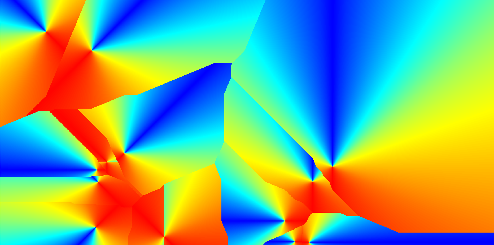

```
Road endpoint angle map -- blueish values represent small angles while red values represent large angles
```

4.	The next step is the calculation of another cost map. This time, the cost represents the cost, in total distance, to reach the “closest” road segment from “base roads”.

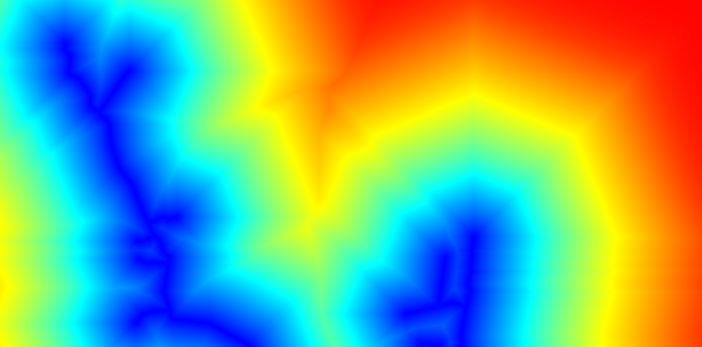

```
Costs, in total distance, to reach the “closest” road from “base roads”
```

5.	Then, the cost map calculated in the previous step, the road endpoint angle map, and the parameters “Allow Lattice Segments Around Base Road Endpoints”, “Lattice Lane Width”, and “Maximum Distance From Base Road” are used to construct lanes along the “base roads”. Each lane is assigned a unique id.

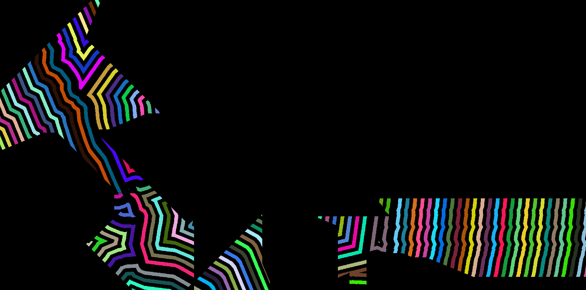

```
“Base road” lanes with unique ids
```

6.	Another cost map is calculated. This one shows the cost, in total distance, along the lanes to reach the “closest” segment from the “roads with branches” that intercepts each of the lanes. The resulting map automatically discard all the lanes that do not intercept at least one segment from the “roads with branches”.

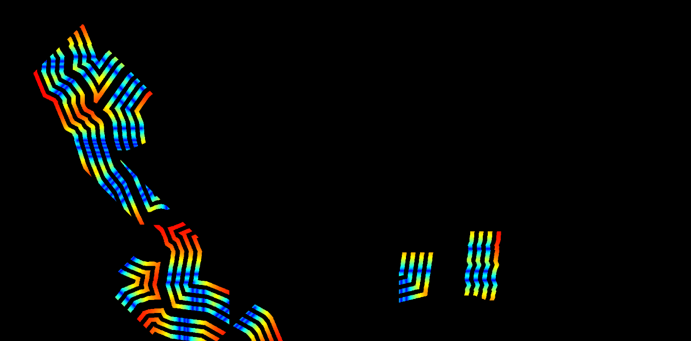

```
Costs to reach road segments intercepting the lanes
```

7.	Those costs are also used to discard the sections of the lanes that to not satisfy the “Maximum Lattice Segment Extension” criteria and produce another map of valid-lane sections. Costs greater than that value indicate lane sections that might generate lattice segments longer than expected.

8.	With those valid-lane sections, it calculates a cost and direction map to reach the “closest” “road with branches” segments intercepting the lanes. It is worth noting that the resulting cost map can be remarkably similar, or even indistinguishable, from the cost map calculated above. This happens  if the “Maximum Lattice Segment Extension” is

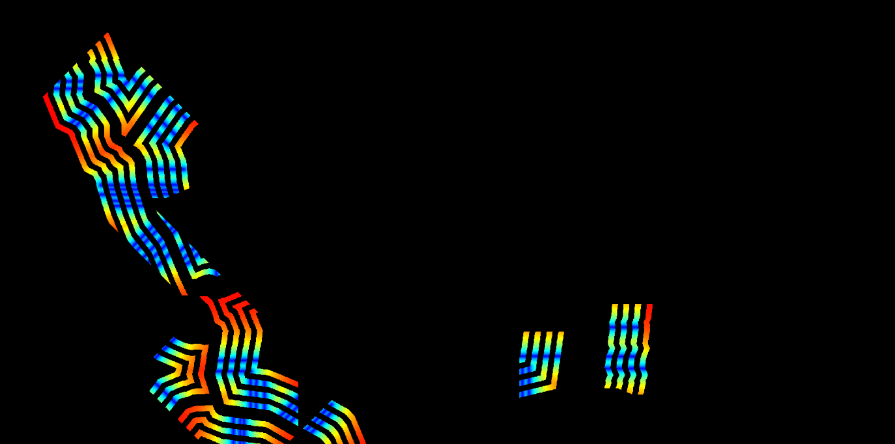

```
Costs to reach the “closest” road segments intercepting the valid-lane sections
```

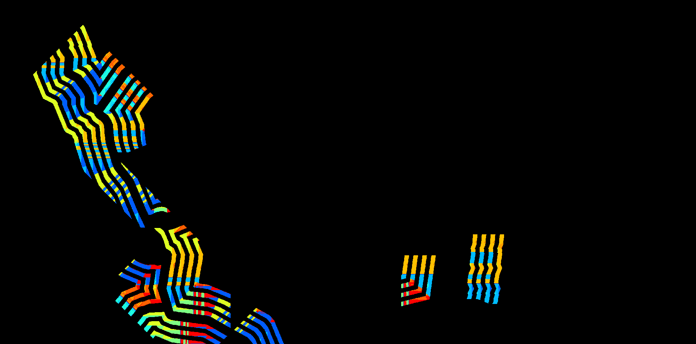

```
Directions that must be followed to reach the “closest” road segments intercepting the valid-lane sections
```

9.	Then, the direction map is used to calculate the dominance area of each “roads with branches” segments intercepting the valid-lane sections. A unique id is assigned to each one of the areas found.

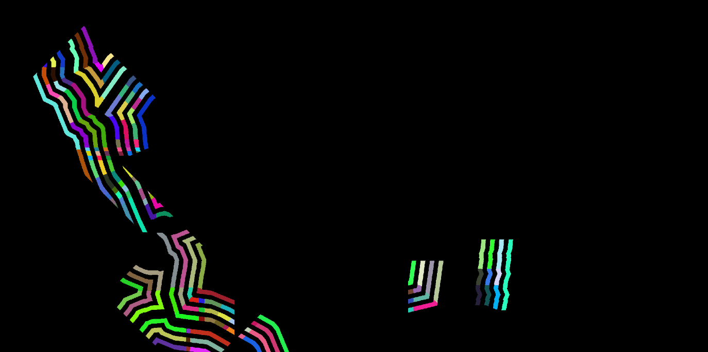

```
Dominance areas of the “road with branches” segments intercepting the valid-lane sections
```

10.	Now, the algorithm selects the “road with branches” segments intercepting the lanes where a new lattice segment should start. For that, it first identifies the segments intercepting the lanes and assigns to them the average probability of all cells contained in the corresponding dominance area. Then, it tries to select one cell from the “road with branches” segments that intercept the lanes for each one of the lane ids.

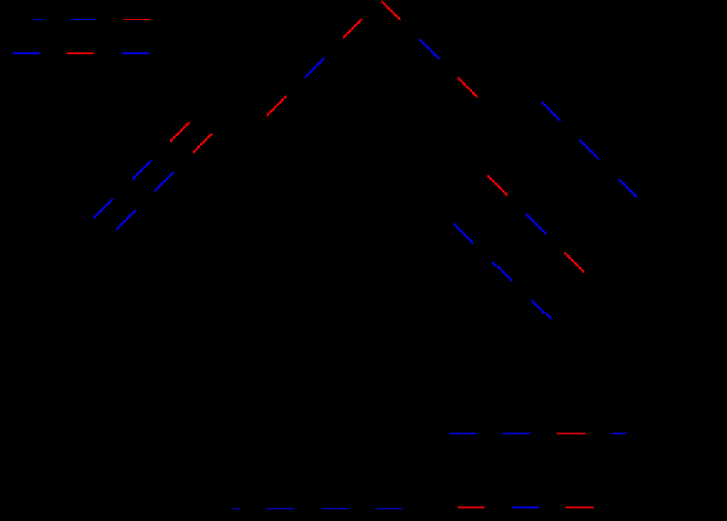

```
Zoom showing the probabilities assigned each “road with branches” segments intercepting lanes
```

11.	The lattice start cells are used to calculate another cost and direction maps showing the costs to reach the lattice cell in the corresponding lane.

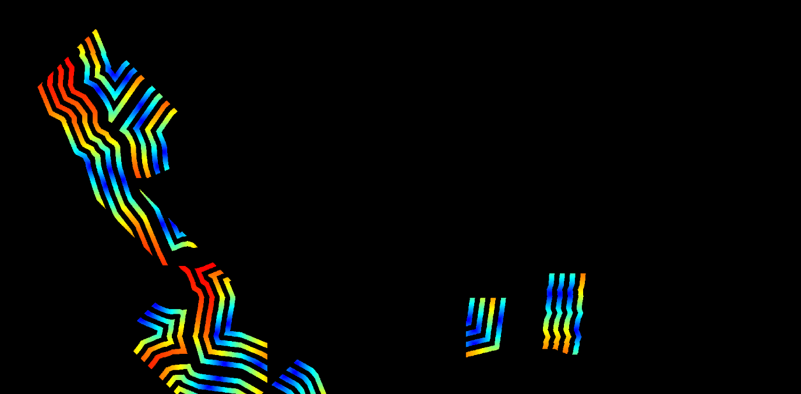

```
Costs to reach the lattice start cell in each lane
```

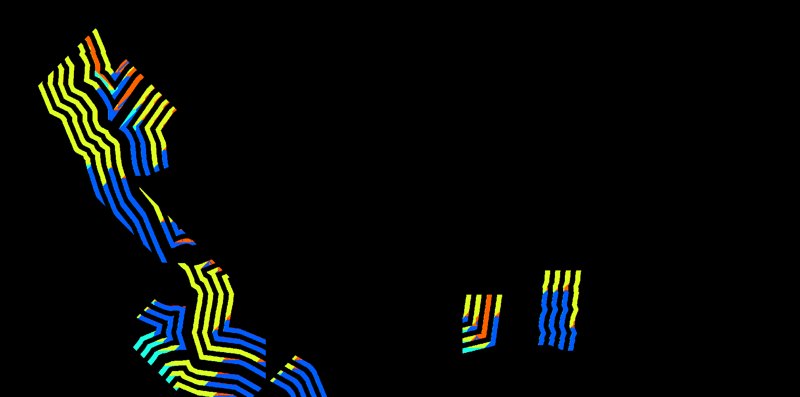

```
Directions that must be followed to reach the lattice start cell in each lane
```

12.	Now, the algorithm selects the “road with branches” segments intercepting the lanes where a new lattice segment should end. Again, it first identifies the segments intercepting the lanes, excluding the segments where the lattice segment should start, and assigns to them the average probability of all cells contained in the corresponding dominance area. Then, it tries to select one cell from the “road with branches” segments that intercept the lanes for each one of the lane ids.

13.	As the last step, the selected new road destinations, together with the last direction map, are used to construct segments connected to the existent road network.

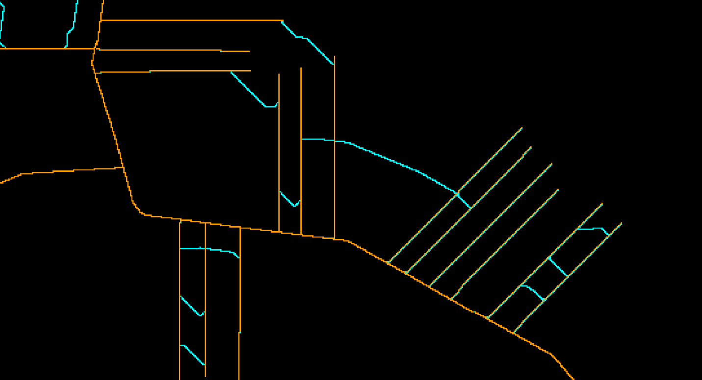

```
Example showing some of the new road segments [cyan color] -- the example shows only a portion of the previous images for better visualization
```

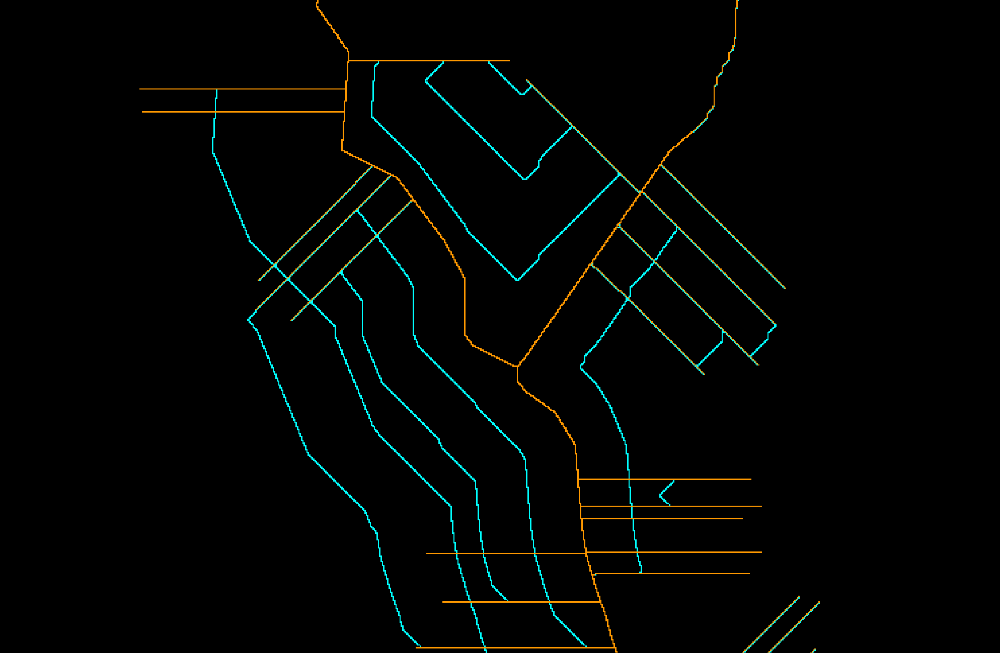

```
Example showing some of the new road segments [cyan color] -- the example shows only a portion of the previous images for better visualization
```

☞[Next: Projecting deforestation rates based on socioeconomic variables and developing a carbon bookkeeping model](REDD-Case-Study.html)

