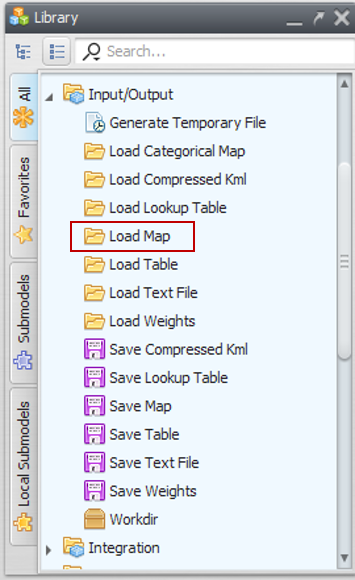
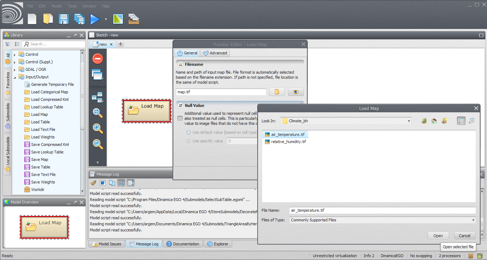
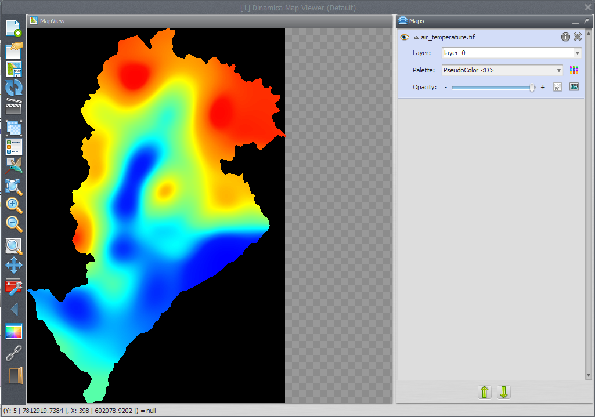
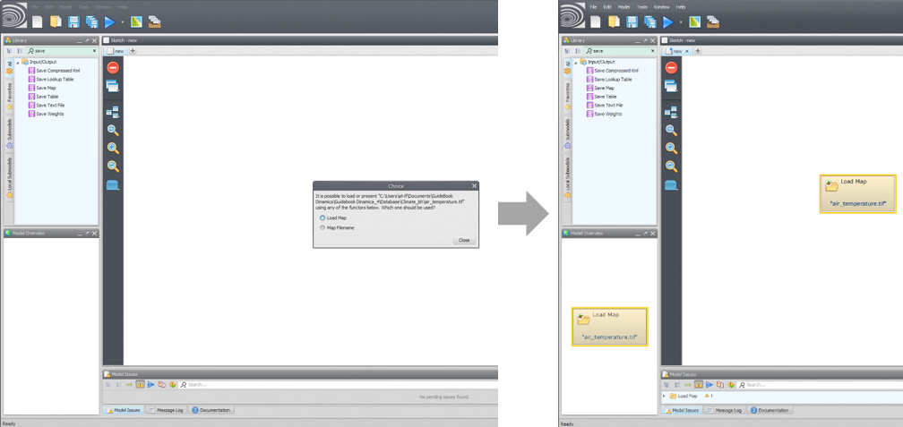
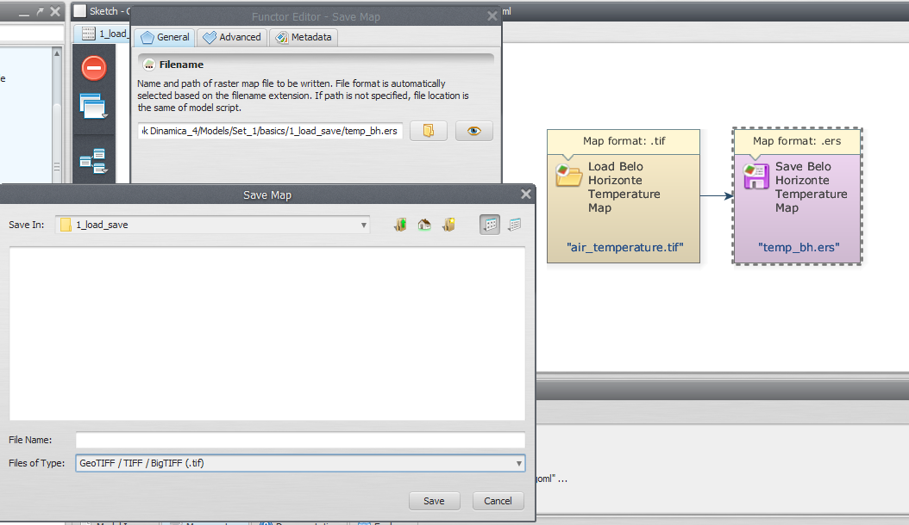
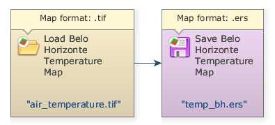


# Lesson 4: Opening and Saving maps

## In this lesson we show how to load a map and save it to a different file format.

**Which functors will you use in this lesson?** [Load Map](../functors/Load-Map.html) and [Save Map](../functors/Save-Map.html)

**What will the model do?** It will load “air_temperature.tif” file and save this map to a different file with another extension. This new map will be saved to the new format in the selected folder. We will use initially the air_temperature raster layer `Guidebook_Dinamica_5\Database\Climate_bh\air_temperature.tif`

**Let's go!**

There are two ways to load a raster file into Dinamica EGO. The first is through the functor [Load Map](../functors/Load-Map.html). To do so, click on the Input/Output tab from the Library window, drag a [Load Map](../functors/Load-Map.html) and place it on the sketch:

Double click the [Load Map](../functors/Load-Map.html) functor in the model sketch, click on the file icon to browse to the folder `Guidebook_Dinamica_5\Database\Climate_bh\` and select the air_temperature.tif file. Click OPEN and then OK to choose the map that will be loaded when the model runs.

> **Tip:** If the file is not listed, check if the Files of Type combo box at the bottom of the dialog window is set to the right file format.

> **Note:** Dinamica EGO Map Viewer application can also be opened as a stand-alone application (check the “Dinamica EGO Map Viewer” icon on your desktop or within Dinamica EGO folder).

To view the loaded map, double click on your [Load Map](../functors/Load-Map.html) functor and then click on the eye button. The map will be opened in Dinamica Map Viewer. Click on the down arrow next to the map name on the map list inside of the map viewer, then click on the Histogram icon to adjust the visualization of the map. Select “Limits to Actual” inside the “Limits” options and then choose one of the transformations options. The following image depicts a map with an “Equalize” transformation:

Another way to load your map into Dinamica EGO is to drag the raster from the source folder to the Sketch. Doing so, Dinamica EGO will ask which functor would you like to use, select [Load Map](../functors/Load-Map.html) and click "Close".

> **Tip:** To make the model more intelligible, you MUST name alias, add comments on the functors and change their colors. For this, click on the balloon button in the functor action bar.

**Learn how to save a map.** From the Input/Output tab on the Library window grab a Save Map functor and place it on the sketch. In this example we will save the “air_temperature” to another file format. To do so, click on the lightning button in the functor action bar and connect the arrow to the Save Map functor.

> **Tip:** The connection is set automatically because there is only one option for compatible ports in the respective functors and containers.

Open the [Save Map](../functors/Save-Map.html) functor and click on the file icon. Note that you have to choose the file path and map format. Let’s choose “.ers”. Now, select a path to save your map and name your new file. We suggest to browse to `Guidebook_Dinamica_5\Models\load_save` and write the file name “temp_bh.ers”.

Save your model (disk button on the main toolbar) and then run it by clicking on the run button (blue arrow on the main toolbar).
The final model will look like this:

Congratulations, you have successfully completed this lesson!

☞[Next Lesson](Simple-Map-Algebra.html)

