
# Projecting deforestation rates based on socioeconomic variables and developing a carbon bookkeeping model

## REDD case study

> **Important:** We do not support the application of deforestation modeling to fix REDD baselines for crediting purpose.

## What will you learn?

- How to project deforestation rates based on socioeconomic variables
- Convert gross rates into net rates
- How to develop a carbon bookkeeping model
- Functors:    *[Calc Neighborhood](../functors/Calc-Neighborhood.html)*  *[Calc Spatial Lag](../functors/Calc-Spatial-Lag.html)*

Tropical deforestation is the second source of anthropogenic GHG (Greenhouse Gases). Seven to twenty eight percent of the worldwide CO2 emissions come from tropical deforestation, what is equivalent to 0.5 to 2.4 billion of tons of carbon emitted per year [(Houghton et al., 2005)](http://www.ipam.org.br/biblioteca/livro/id/315). A proposal to compensate countries for reducing emissions from deforestation and forest degradation (REDD) was initially presented by IPAM and other institutions at the ninth Climate COP (Conference of the Parties) in Milan, 2003 [(Santilli et al. 2005](http://dx.doi.org/10.1007/s10584-005-8074-6)[;Moutinho & Schwartzman 2005)](http://www.ipam.org.br/biblioteca/livro/id/315). This proposal recommended that developing countries that were able to reduce deforestation below a historical baseline over a period of time would be eligible to receive financial compensation from the international community through a market of carbon credits. Later, this proposal was officially endorsed by Papua-New Guinea, Costa Rica, and other tropical countries during the eleventh COP in Montreal, 2005 [(Silva-Chavez and Petsonk 2006;](http://www.rainforestcoalition.org/documents/CFForestryarticle.pdf) [Schlamadinger et al. 2007](http://dx.doi.org/10.1016/j.envsci.2006.12.004)[; Skutsch et al 2007](http://dx.doi.org/10.1016/j.envsci.2006.08.009)[; Sedjo and Sohngen 2007)](http://www.rff.org/rff/Documents/RFF-DP-07-47.pdf). In December 2007, the thirteenth Climate COP held in Bali, Indonesia, laid out a road map to a post-Kyoto climate protocol, beginning 2013, which stressed the need to pursue mechanisms to provide incentives for developing countries to reduce carbon emissions from deforestation. This occasion triggered a worldwide discussion on how to establish evaluation methods, rules and economic means for REDD programs.

One of the main matters of REDD consists of measuring the contribution of a project (country, state or region level) to reducing carbon emissions from deforestation and forest degradation in order to credit this effort. This topic is one of the most contentious issues of REDD because there are several ways to weigh this reduction effort depending on the region’s deforestation history, stocks of forest carbon, and potential for future deforestation (e.g. [Cattaneo, 2008)](http://unfccc.int/resource/docs/2008/smsn/ngo/040.pdf). For example, the concept of reducing emissions below a historical baseline applies well to countries with a historically high rate of deforestation, thus with a large margin to reduce its emissions from deforestation, such as the case of Brazil with a baseline of 19.500 km2/year. On the other hand, countries with large expanses of tropical forest and current low deforestation rates (e.g.  Peru) would not be eligible to be compensated, since there is no additionality in its effort to curb deforestation (fig. 1). However, deforestation in Peru is likely to increase after the completion of the paving of Interoceanic highway, which links Brazil to the Pacific Ocean, as well other infrastructure projects underway in the region (fig. 2). These projects have already triggered a large inflow of people to the Madre de Dios department in Peru.

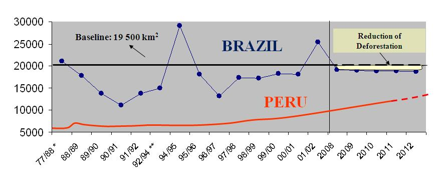

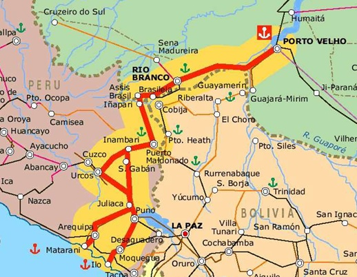

To perform an ex ante evaluation of the potential for future deforestation under a Business-as-Usual (BAU) scenario, pioneer REDD projects, such as the JUMA conservation PPD – Project Design Document [(FAS, 2008)](http://fas-amazonas.org/versao/2012/wordpress/wp-content/uploads/2013/06/FAS_Juma-REDD-Project-summary.pdf) adopted the use of simulation models [(Soares-Filho et al., 2006)](http://dx.doi.org/10.1038/nature04389). In this case, a set of assumptions is established to differentiate the BAU from the governance scenario, such as road paving, agricultural expansion, population movements, expansion and consolidation of protected areas and the effectiveness of public policies in curbing deforestation. The model simulates deforestation trajectories under the modeled scenarios and calculates their respective carbon emissions. So, instead of a historical baseline, the potential for reduction is compared by subtracting the accumulated amount of emissions under the governance scenario from the one under the BAU scenario by a specific future year (in general 2050).

Although simulation models play an important role in modeling the effects of alternative land-use policy scenarios on the landscape dynamics, this methodology should be applied with caution to REDD projects. The need to estimate potential future emissions as a way to measure the contribution of a public policy or conservation initiative to REDD, such as the creation of a protected area, is rapidly disseminating the use of simulation models as a tool for REDD projects. Several commercial and non-commercial packages are available for developing spatial simulation models. However, there is no ready solution for a specific REDD project (despite that some vendors say so). In addition to simulating the effects of spatial determinants on the location of deforestation (see lesson 7), there is a need to model the local, regional, and even international drivers of deforestation. This is far more difficult and relies heavily on the availability of temporal socioeconomic data at several scales as well as wall-to-wall deforestation time series. Those models must be built from the ground (i.e. using bottom-up approaches rather than top-down models), incorporating our knowledge of the proximate and underlying causes of deforestation, and must pass through validation not only in terms of their spatial prediction, but also regarding the power to predict the recent deforestation trajectory based on changes in the socioeconomic and political context. Even so, simulation models are no crystal ball, modeled future trajectories must be regarded as a likely possibility only; beyond that it is all speculation.

In this context, the model presented here aims to demonstrate the possibilities of Dinamica EGO in representing land-change phenomena, no matter their complexity. Therefore, instead of a ready solution for a REDD project, which probably will not work anyway, the Dinamica EGO modeling platform provides the means to materialize in a computer realm our knowledge about complex dynamic phenomena, such as the way the local, regional and international socioeconomic and political contexts interact, producing as a result deforestation.

### Developing an econometric projection model that predicts deforestation rates based on changes in the socioeconomic context of municipalities

In this example, an econometric model is coupled to a spatially-explicit simulation model of deforestation. The econometric projection model predicts deforestation rates based on changes in the socioeconomic context of municipalities (Soares-Filho et. al, 2008, [Soares-Filho et. al, 2010](http://www.pnas.org/cgi/doi/10.1073/pnas.0913048107)). A spatial lag regression is applied to compute the influence of five variables on the deforestation trajectory:  Crop area expansion, cattle herd growth, percent of protected areas, proximity to paved roads, and migration rates. A spatial neighborhood matrix allows the model to incorporate the influence of the socioeconomic context of neighboring municipalities in the prediction of deforestation rates within a certain municipality.

Load the model `simulate deforestation under socioeconomic scenarios.egoml` from `\guidebook dinamica\models\redd case study`. This model is composed of three main parts: the input data, pre-calculation, and the simulation model itself.

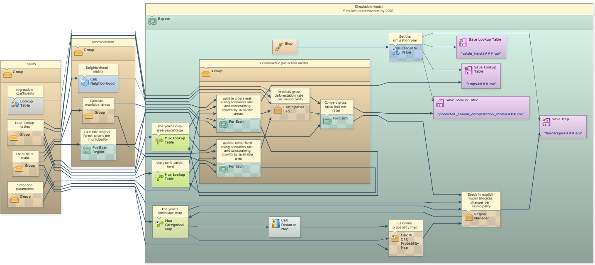

In this simplified version of Soares-Filho et al. (2008), the user can modify the scenario by changing the annual rates of crop expansion and cattle herd growth, which are input to the model. Other variables could be also changed by editing the input lookup tables.

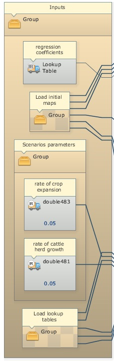

The pre-calculation group calculates the original forest extent per municipality, the municipality area, and the neighborhood matrix (*[Calc Neighborhood](../functors/Calc-Neighborhood.html)*) that defines which municipalities are neighbors. These are going to be inputs for the projection model. Open the [Group](../functors/Group.html) named “Econometric projection model”.

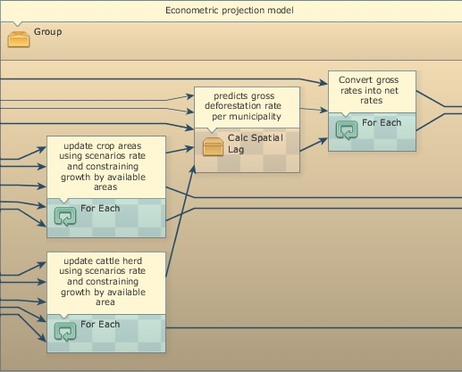

This *[Group](../functors/Group.html)* contains three *[For Each](../functors/For-Each.html)* and one *[Calc Spatial Lag](../functors/Calc-Spatial-Lag.html)*. The two first *[For Each](../functors/For-Each.html)* update the cattle herd and crop area lookup tables and calculate their annual rates of change, which are input to the spatial lag regression.

> **Tip:** **TIP**: *[For Each](../functors/For-Each.html)* browses the elements of a table allowing its manipulation.

In addition to the lookup tables of the five independent variables, *[Calc Spatial Lag](../functors/Calc-Spatial-Lag.html)* receives as input the lag coefficient, the neighborhood matrix, an initial x1 dependent variable table, the regression coefficients, and a random error term. This functor represents a spatial lag regression equation as follows [(Anselin, 2002)](http://dx.doi.org/10.1177/0160017602250972):

y = pWy+XB+e

Where "p" is the autoregressive coefficient, "W" is a first order neighborhood matrix, "y" the dependent variable, "X" the matrix of observations for the independent variables, "B"  the vector of regression coefficients and "e" a random error term. In this equation the term "pW" is calculated in an iterative way using moving averages of the "y" responses from the neighboring municipalities. In this case, instead of a classical linear model, a spatial lag regression was adopted since the regression model failed the autocorrelation tests [(Anselin, 2002)](http://dx.doi.org/10.1177/0160017602250972).
Dinamica EGO does not provide a method to develop a spatial lag regression, but only to solve the equation, which was developed using Geoda (www.geoda.uiuc.edu).

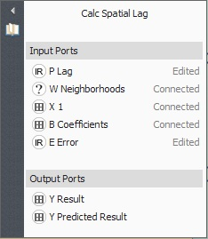

Finally, the third *[For Each](../functors/For-Each.html)* converts gross deforestation rates output from *[Calc Spatial Lag](../functors/Calc-Spatial-Lag.html)* into net deforestation rates using the following formula:

**if t1[v1] / t2[v1] > 1 then 1 else if t1[v1] / t2[v1] &lt; 0 then 0 else  t1[v1] / t2[v1]**

where t1[v1] is the gross rate and  t2[v1] the original forest extent of a municipality.

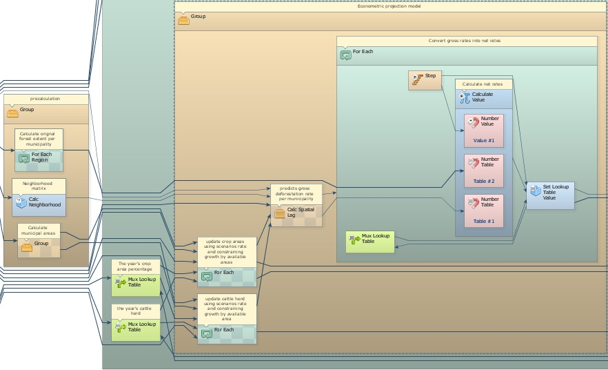

The econometric model passes on the predicted deforestation rates to a spatially explicit model that allocates deforestation in each municipality using the subregion approach of lesson "Using subregions in a simulation model"

### Developing a carbon bookkeeping model

This model calculates annual carbon emissions by identifying annual deforestation and then overlaying these areas on a map of forest carbon biomass – figure below [(Saatchi et al., 2007)](http://dx.doi.org/10.1111/j.1365-2486.2007.01323.x), and assuming that carbon content is 50% of wood biomass [(Houghton et al., 2001)](http://dx.doi.org/10.1111/j.1365-2486.2001.00426.x) and that 85% of the carbon contained in trees is released to the atmosphere with deforestation [(Houghton et al., 2000)](http://dx.doi.org/10.1038/35002062).

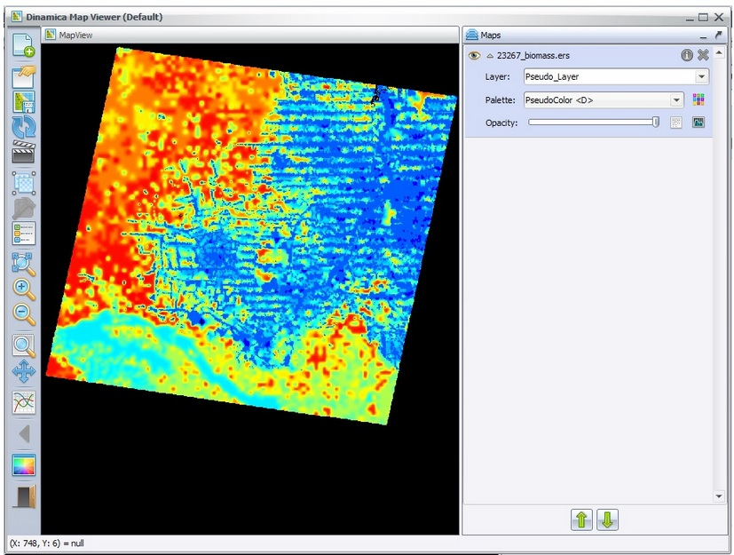

In order to calculate annual deforestation, the model compares in each time step the current land-use map with the previous one. Dinamica EGO allows the loading of multiple maps using *[Load Map](../functors/Load-Map.html)* within *[Repeat](../functors/Repeat.html)* and passing *[Step](../functors/Step.html)* as a pointer to the name file that has the model step number as its suffix. Note that in this case the suffix has 6 digits to bear the simulation year (2002-2020).

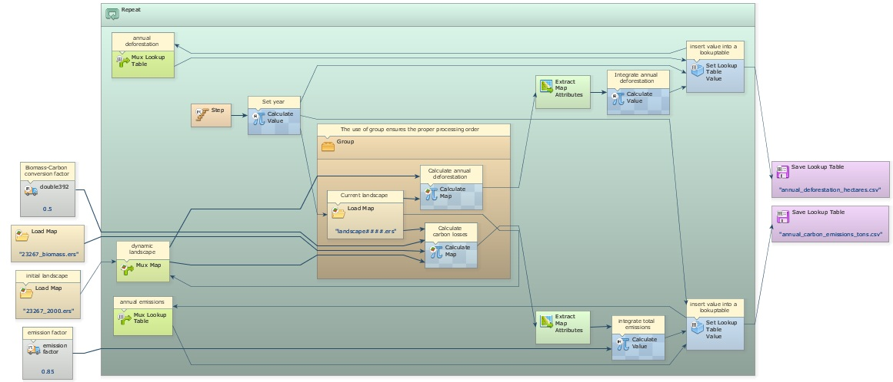

A *[Load Map](../functors/Load-Map.html)* is placed within a *[Group](../functors/Group.html)* to ensure a proper order of execution. The previous land-use map is kept in *[Mux Map](../functors/Mux-Map.html)*, so both *[Calculate Map](../functors/Calculate-Map.html)* functors in this container receive the previous land-use map as **i1** and the current as **i2**.

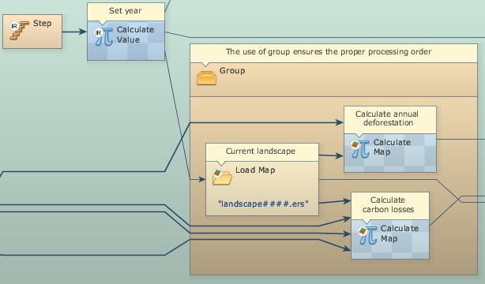

After annual deforestation cells are identified, the model picks up the corresponding biomass stocks in the biomass map and convert them into carbon and then into emissions. *[Extract Map Attributes](../functors/Extract-Map-Attributes.html)* is applied to calculate the total amount of cells and *[Calculate Value](../functors/Calculate-Value.html)* integrates those figures on an annual basis. Its output is passed to *[Set Lookup Table Value](../functors/Set-Lookup-Table-Value.html)* that updates a table with annual carbon emissions (Fig. 3).

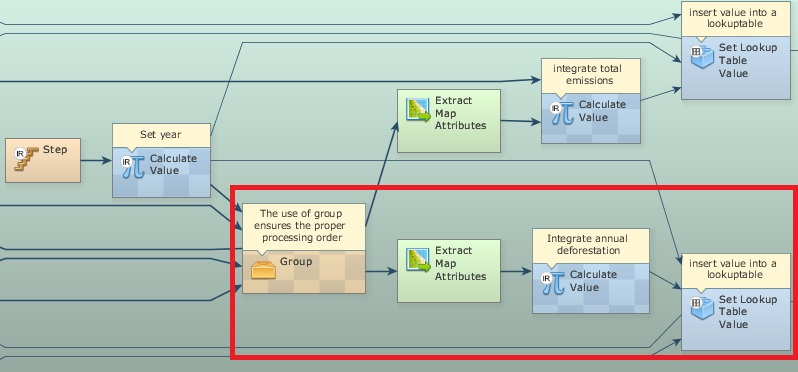

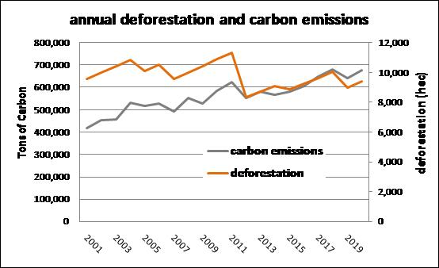

### Congratulations, you have successfully completed this lesson!

☞[Next: Intensity Analysis](Intensity-Analysis.html)

