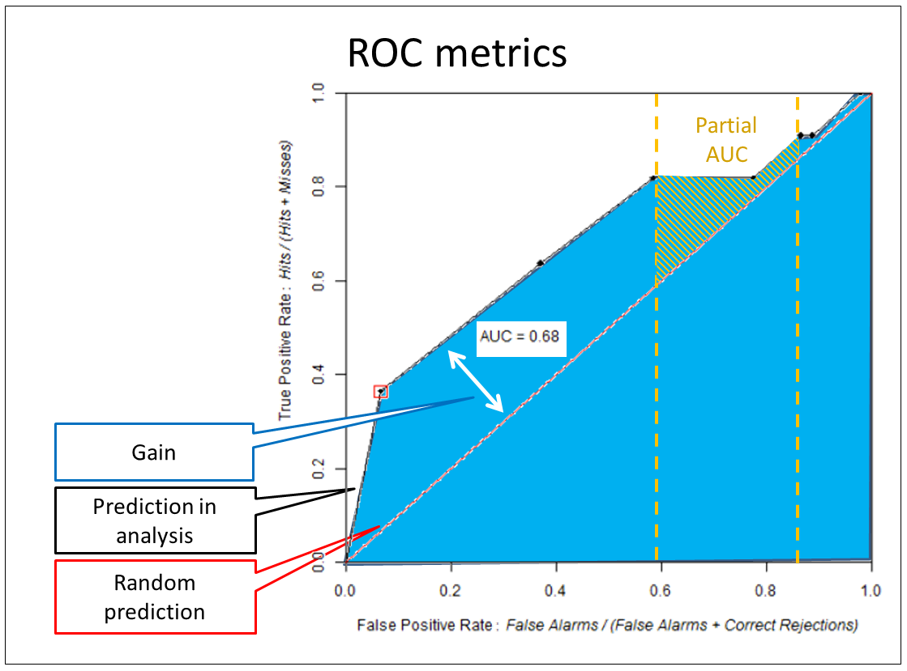


# Receiver Operating Characteristic (ROC) suite

## Brief description

The Receiver Operating Characteristic (ROC) evaluates map similarity considering a reference binary pattern. ROC compares the amount of true positive and false positive cells through an incremental binary classification (Mas et al. 2013a). ROC is commonly used in GIS to evaluate spatial predictions versus observed data. An ROC suite developed by Mas et al (2013) is available on Dinamica-EGO. There are some study cases that apply ROC to evaluate binary predictions through a probability or suitability map using a suite of functors and submodels on Dinamica-EGO.

## About metrics

The main ROC metrics used to evaluate the results are the area under curve (AUC) and the partial area under curve (pAUC). Figure 01 presents the standard ROC graph of true positive and false positive. The red diagonal curve represents a hypothetical model that predicts the same number of hits and false alarms. The suitability maps are interpreted on the ROC as prediction curves compared with the fixed diagonal. Each suitability evaluation generates a new curve on the graph. Curves over the fixed diagonal represent models that perform better than a random model. The final gain (relative to the suitability map) is summarized by the AUC measure. An equivalent metric can be applied to measure hit rate or error rate, this partial measure is called pAUC, as illustrated in the figure 01.

Figure 01: ROC curve and respective metrics.

## Cases

- Evaluating Weights of Evidence method for habitat suitability modeling: a comparison with Maximum Entropy for a case of few presence records;
- [Kolb, M.; Mas, J.F.; Galicia, L. Evaluating drivers of land-use change and transition potential models in a complex landscape in Southern Mexico. International Journal of Geographical Information Science. Volume 27, Issue 9, 2013.](http://dx.doi.org/10.1080/13658816.2013.770517)

## References

- [Mas, J.F.; Soares-Filho, B. S.; Pontius Jr, R. G.; Gutiérrez, M. F.; Rodrigues, H. O. A Suite of Tools for ROC Analysis of Spatial Models. ISPRS International Journal of Geo-Information. 2013a; 2(3):869-887;](http://www.mdpi.com/2220-9964/2/3/869)
- Mas, J.F. Tools for ROC analysis of spatial models Installation instructions and application examples. Centro de Investigaciones en Geografía Ambiental Universidad Nacional Autónoma de México (UNAM), 2013b.

## Resources

The ROC suite models, submodels and example data are in `guidebook dinamica\models\roc suite`, part of [guidebook_dinamica.7z](../extra/guidebook_dinamica.7z). The folder also contains the installation instructions and application examples by Mas (2013b), in Spanish (`analisis roc instrucciones.pdf`).

☞[Next: Final Remarks](Final-Remarks.html)

