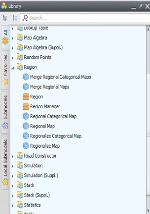
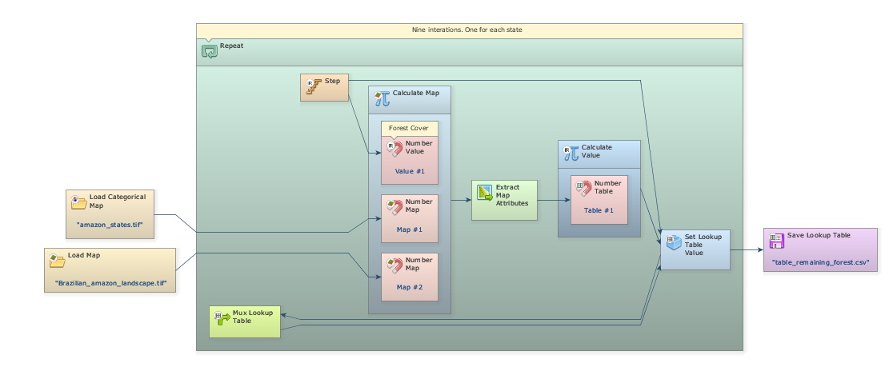
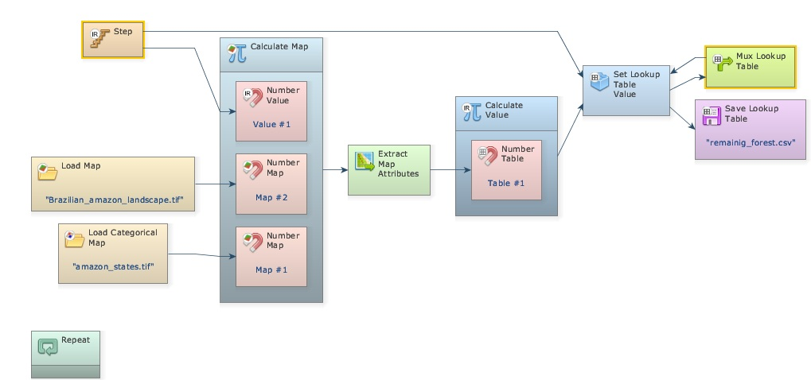
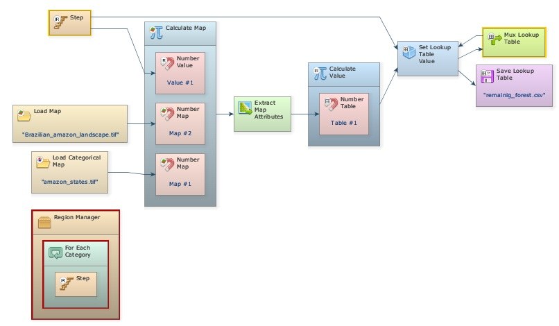
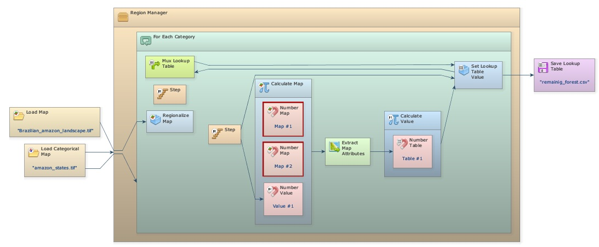
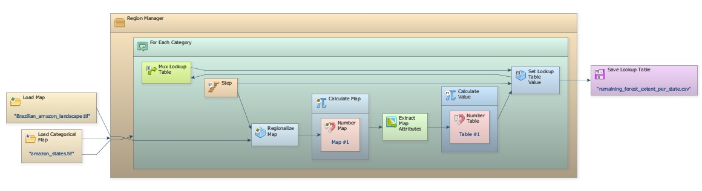
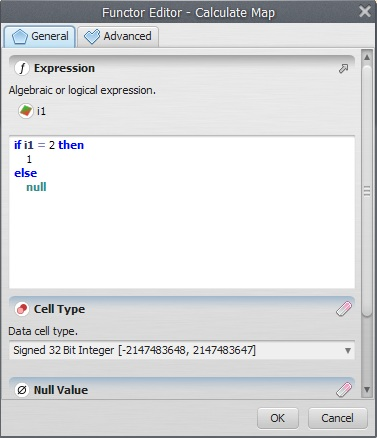


# Lesson 14: Using "For Each Category" and "Region Manager" to work with the concept of region

## What will you learn?

- How to use the concept of Regions
- Functors:   - *[Region Manager](../functors/Region-Manager.html)*  - *[For Each Category](../functors/For-Each-Category.html)*

This subset of functors permits division of a map into several regional maps, which can be input for separate models or submodels, whose parameters are customized for each map’s region. Let’s adapt the model `Calc_forest_remaining_extent_per_state` (You can find this model in the folder: `\Guidebook_Dinamica_5\Models\using_concept_of_region`) to use the concept of regions. First open the Region Tab in the library window.

These functors can be combined to produce regional maps and submodels, as well as to merge the regional maps into a single map after a processing is performed. In this lesson you will learn how to retrieve the area of the remaining forest for each state; as a result each regional map will correspond to a state area. Open the model the model `Calc_forest_remaining_extent_per_state`. Select the functors within the container *[Repeat](../functors/Repeat.html)* with the Hand tool and then drag them out of *[Repeat](../functors/Repeat.html)*.

> **Tip:** **TIP**: Use Ctrl + right button to keep continually selecting the functors, this will avoid selecting *[Repeat](../functors/Repeat.html)* as well. The functor *[Repeat](../functors/Repeat.html)* will shrink.

Delete the container *[Repeat](../functors/Repeat.html)* and place the containers *[Region Manager](../functors/Region-Manager.html)* from the Region tab and *[For Each Category](../functors/For-Each-Category.html)* from the Control tab. Place the latter within the first.

*[Region Manager](../functors/Region-Manager.html)* manages the regionalization process, while *[For Each Category](../functors/For-Each-Category.html)* replaces the *[Repeat](../functors/Repeat.html)* making the model iterate for each category present in the categorical map used to define the regions, in this case the map of the Brazilian Amazon states.

> **Note:** While *[Repeat](../functors/Repeat.html)* iterates sequentially, *[For Each Category](../functors/For-Each-Category.html)* iterates according to the map categories, which do not need to be sequential.

Now select all functors, except the input and output maps, and place them within *[For Each Category](../functors/For-Each-Category.html)*.

> **Tip:** **TIP**: it is easier to select everything to be placed within *[For Each Category](../functors/For-Each-Category.html)* and then to take only *[Load Map](../functors/Load-Map.html)* and *[Save Map](../functors/Save-Map.html)* out of it.

Now break the link between *[Load Categorical Map](../functors/Load-Categorical-Map.html)* and *[Calculate Map](../functors/Calculate-Map.html)* (use the Remove Items tool and click on the arrow connecting both functors); next, connect the first to *[Region Manager](../functors/Region-Manager.html)* and to *[For Each Category](../functors/For-Each-Category.html)* too. This map will control the regionalization process splitting the other maps into several regions according to its cell classes or categories through the functor *[Regionalize Map](../functors/Regionalize-Map.html)*. Drag this functor and place it within *[For Each Category](../functors/For-Each-Category.html)*, break the link between Map `brazilian_amazon_lanscape.tif` (You can find this map in the folder: `\Guidebook_Dinamica_5\Database\using_concept_of_region`) and *[Calculate Map](../functors/Calculate-Map.html)* and finally connect the first to *[Regionalize Map](../functors/Regionalize-Map.html)*.

Note that there are two *[Number Map](../functors/Number-Map.html)* functors disconnected within *[Calculate Map](../functors/Calculate-Map.html)*. You do not need the Map #2 and Value #1 anymore, so delete them. Now connect *[Regionalize Map](../functors/Regionalize-Map.html)* to Map #1. Open the [Save 
[Save Lookup Table](../functors/Save-Lookup-Table.html) functor and change the file name to `remaining_forest_extent_per_state`. Make sure it will be saved into folder `\Guidebook_Dinamica_5\Models\using_concept_of_region`

At a last step, you will need to modify the *[Calculate Map](../functors/Calculate-Map.html)*. Open it with Edit Functor. Write: **if i1 = 2 then 1 else null**. Remember that "2" represents forest.

Finally save the model as a new file `calc_forest_remaining_extent_per_state_using_subregions` into folder `\Guidebook_Dinamica_5\Database\using_concept_of_region` and run it.

Can you explain how this model works?

Observe that you did not need to segregate the information per state in *[Calculate Map](../functors/Calculate-Map.html)* because *[Regionalize Map](../functors/Regionalize-Map.html)* already did it.

> **Note:** The region approach is a helpful way to break the map into several subsets either to customize a submodel, for example to run with different parameters per country, state or county, or to optimize the memory usage as the model does not need to handle all the map cells for a specific calculation or processing, but only the cells selected from a region per time

### Congratulations, you have successfully completed this lesson!

☞[Next Lesson](Successive-Calculations-With-Repeat.html)

