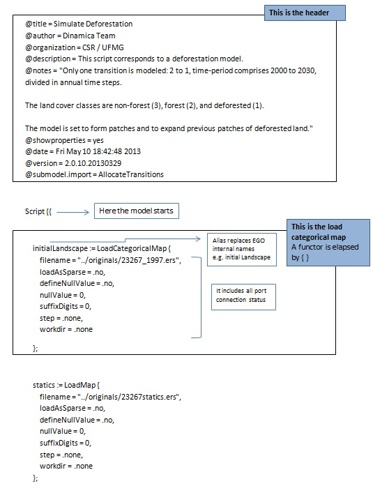
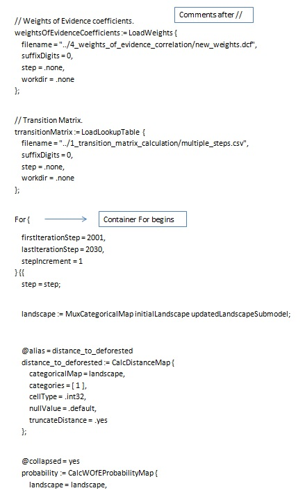
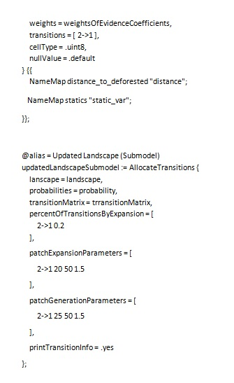
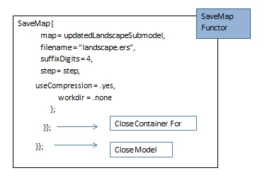


# Dinamica EGO script language and command line tool

## What will you learn?

- Naming variables with alias
- [Dinamica EGO programming language](../EGO-Script.html)
- Dinamica EGO Command Line Tool

Alternatively, you may want to save the model in EGO format in [EGO programming language](../EGO-Script.html). You can open an edit EGO script language on a text editor, (e.g. [NotePad++](http://notepad-plus-plus.org/) or [Context](http://www.contexteditor.org)). But still it is much easier to use the graphical interface. For example, the Amazon logging model [(Merry et al, 2009)](http://dx.doi.org/10.1007/s00267-009-9337-1) developed in Dinamica EGO has more than one thousand script lines, even a skilled programmer would take longer writing the script than by using the graphical interface. Both script formats ([EGOML/XML](../EGOML-Script.html), [EGO](../EGO-Script.html)) are 100% compatible, so users can take back and forth a model from the graphical interface to the text editor without losing any information. Advanced modelers may use this well structured and tractable programming language.

Open again the model “simulate deforestation from 1997 2000 30years ahead.egoml”. To make the model more intelligible on the text editor, you first need to name some key variables and then add comments to parts of the model. Let’s do this. Select the Edit Functor tool and click on the [Categorical Map](../functors/Categorical-Map.html) “23267 1997.tif”.

Write in the alias field “initial_landscape”, click on *[Calc Distance Map](../functors/Calc-Distance-Map.html)* and write the alias “distance_to_deforested”. Now save the model in EGO format.

Open in a text editor, the model “simulate deforestation from 1997 2000 30years ahead.ego”. The EGO script is as follows:

Now that you have learned a bit about programming with EGO script language, another resource available in Dinamica EGO is the Command Line Tool. Any model saved in Dinamica EGO, either EGOML/XML or EGO, can be run from the command prompt.

To run Dinamica EGO from the command line, simply run `DinamicaConsole` from a command prompt. DinamicaConsole utility is located in the Dinamica EGO installation folder. The parameters accepted by Dinamica Command Line Tool are:

| Dinamica Command Line Option | Option Description |
|---|---|
| -verifier=&lt;name> | Set functor verifier. |
| -output=&lt;filename> | Write an output file representing the input model script. |
| -log-level=&lt;level number> | Set the maximum execution log level. UNCONDITIONAL=0, ERROR=1, WARNING=2, RESULT=3, INFO=4, INFO2=5, DEBUG=6, or DEBUG2=7. |
| -log-subsystem=&lt;flags> | Set the execution log subsystem level. GENERAL=1, OPENCL=2, SCRIPT_READER_WRITER=4, FUNCTOR_SCHEDULER=8, FUNCTOR_DEPENDENCE_GRAPH=16, FUNCTOR_EXECUTION=32, FILESYSTEM=64, MAP_IO_HANDLER=128, FUNCTOR_COPY_ANALYSIS=256, SUBMODEL=512, EXECUTION_BASICS=1024, GRAPHICAL_INTERFACE=2048, DATABASE=4096, TABLE_IO_HANDLER=8192, MAP_HANDLING=16384, TABLE_HANDLING=32768, and SYSTEM_COMMUNICATION=65536. To use more than one, use the sum of the corresponding values. Only takes effect when the log level is DEBUG or DEBUG2. |
| -predefined-seed | Use a predefined value as the seed of the random number generators. |
| -processors=&lt;number> | Override the number of logical processors that should be used. 0=use total number of processor cores instead. |
| -granularity=&lt;number> | Override the default granularity value. |
| -dont-run | Do not run the model script. |
| -propagate-exceptions | Propagate top-level exceptions. |
| -beep | Beep to indicate that the execution has completed. |
| -ask-to-close | Wait a confirmation to close the window. |
| -disable-parallel-map-load | Disable loading maps in parallel. |
| -disable-parallel-functors | Disable parallel processing of functors. |
| -disable-parallel-steps | Disable parallel processing of loop steps. |
| -memory-allocation-policy=&lt;code> | Policy used to control memory allocation. PREFER_MEMORY=0, BALANCED=1, PREFER_DISK=2, MEMORY_ONLY=3 and AGGRESSIVE=4 |
| -accelerators-policy=&lt;code> | Policy used to select accelerator devices. NO_DEVICES=0, ALL_DEVICES=1, and USER_CONFIG=2 |
| -disable-native-expressions | Disable compilation of image expressions to native representation. |
| -metadata-profile=&lt;code> | Type of the profile used to write file metadata. CUSTOM=0, CSR/UFMG_ptBR=1, and CSR/UFMG_en=2. |
| -map-metadata-template-filename=&lt;filename> | Filename with the template used to to write map metadata. Assume the use of CUSTOM profile. |
| -map-metadata-file-extension=&lt;extension> | File extension used to write map metadata. Assume the use of CUSTOM profile. |
| -write-semicolon-in-csv | Write CSV files using semicolons as value separators. |
| -session-name=&lt;name> | Create session with the given name to share data between Dinamica EGO and an external application. |
| -list-accelerators | Show the available accelerator devices. |
| -list-functors | Show the available functors. |
| -version | Show version info. |
| -help | Show this help. |

> **Tip:** **TIP**: another way to loosely couple other computer programs with Dinamica EGO is by means of functor [Run External Process](../functors/Run-External-Process.html), available in the Control Tab.  By using this functor, you will be able to make a call to an external program from within Dinamica, pass to this program intermediate results and feed its output back again into the Dinamica EGO model.

☞[Next: Heuristic calibration of models using Genetic Algorithm](Genetic-Algorithm-Calibration.html)

