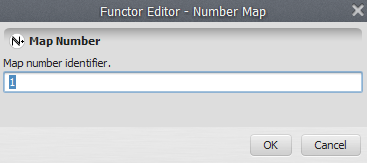
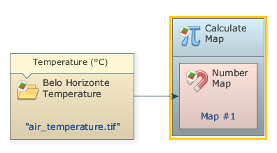
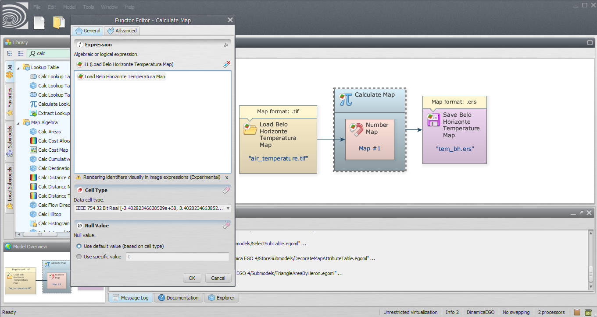
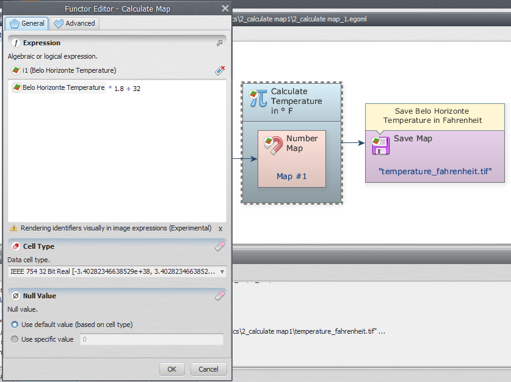
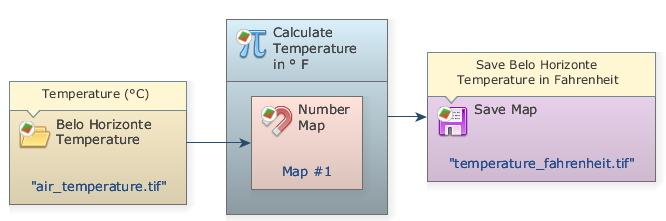
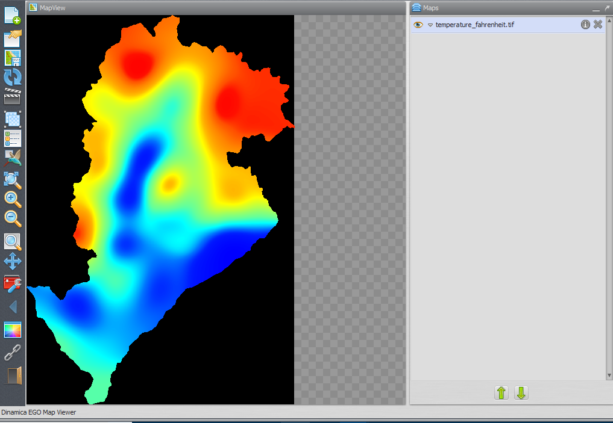


# Lesson 5: Implementing simple map algebra on Dinamica EGO

In this lesson we demonstrate how to use Dinamica EGO to convert the values of Belo Horizonte temperature map from Celsius into the Fahrenheit scale.

**Which Functors will you use in this lesson?** [Load Map](../functors/Load-Map.html), [Calculate Map](../functors/Calculate-Map.html) and [Save Map](../functors/Save-Map.html)

The [Calculate Map](../functors/Calculate-Map.html) functor is for map algebra: to combine and process maps, tables and constants. Inside [Calculate Map](../functors/Calculate-Map.html) it is possible to write expressions that including arithmetic, logical and conditional elements.

**Let's go!**

Click on the Input/Output tab, drag a [Load Map](../functors/Load-Map.html) to the sketch and open the `air_temperature.tif` file used in the previous lesson. Next, click on the Map Algebra tab, grab and place on the sketch one [Calculate Map](../functors/Calculate-Map.html) and one [Save Map](../functors/Save-Map.html) functor. In the [Save Map](../functors/Save-Map.html) functor browse to `Guidebook_Dinamica_5\Models\simple_map_algebra` and write the file name `temperature_fahrenheit.tif`.

Select the [Calculate Map](../functors/Calculate-Map.html) and click on the hook tool on action bar to create a [Number Map](../functors/Number-Map.html) inside the [Calculate Map](../functors/Calculate-Map.html) if there isn't one already. The container will resize to accommodate the [Number Map](../functors/Number-Map.html). Double click on the Number Map and enter “1” (do not write the quotation marks) as the Map Number. This is a number identifier for a map and will be represented within the equation box as `i1` (input 1).



> **Tip:** Each map processed by this container will be represented by the [Number Map](../functors/Number-Map.html) functor. You can enter other maps by adding more [Number Map](../functors/Number-Map.html) functors, each one having an unique number identifier. This is a common usage pattern in Dinamica EGO models allowing an unlimited number of inputs to be used by a given container.

Now you can connect the functor [Load Map](../functors/Load-Map.html) to the [Number Map](../functors/Number-Map.html). Use the connect tool (the lightning icon) to establish the connections. Note that the connection must be established between the [Load Map](../functors/Load-Map.html) functor and the [Number Map](../functors/Number-Map.html) inside of [Calculate Map](../functors/Calculate-Map.html) and not to [Calculate Map](../functors/Calculate-Map.html) itself.



Open [Calculate Map](../functors/Calculate-Map.html) by double clicking on it. Note that map #1 is represented by `i1`. The [Calculate Map](../functors/Calculate-Map.html) enables the formulation of various algebraic and logic equations containing maps, tables and constants.

Besides writing the equation, there are two parameters that must be set: The Cell Type and the Null Value. You will always find these parameters in functors that produce maps as output. The default is set to “Signed 32 Bit Integer”, but you can use “IEEE 754 32 Bit Real” to represent fractional numbers.

> **Tip:** Always aim at the most economical representation for data cell type to save memory. If you are not sure about the numeric range of the output, use real number representation.



Now, let’s write a simple equation to convert the Belo Horizonte temperature in the Celsius scale to Fahrenheit:

```
i1 * 1.8 + 32
```

where `i1` represents the `Belo Horizonte Temperature` map.

Despite the fact that the expression is presented using the alias of the functor from where the corresponding map is coming, you specify the map in the expression just typing the identifier i1. Momentarily, that identifier will be automatically replaced by the corresponding map alias. Another easy option to enter the map identifier is to click on the corresponding map name on the list above the image expression.

> **Note:** Although you won’t need it in this lesson, you might set the null value by first turning on the Null Value option on the Load Map and then setting its value to a value outside the range of values represented in the map.



> **Tip:** You can rearrange the model on the sketch by clicking on the Execute Layout button.

The final model will look like this:



Save and run the model by clicking on the run model script button on the main toolbar. After adjusting limits and choosing a suitable transformation, as in the previous lesson, the map will look like this:



Congratulations, you have successfully completed this lesson!

☞[Next Lesson](Map-Attributes-And-Basic-Statistics.html)

