
# Simulating the patterns of change

## What will you learn?

- How **Dinamica EGO** can be calibrated, as well as its potential to replicate the evolving spatial patterns of a variety of dynamic phenomena;
- The capability of the **Dinamica EGO** to reproduce a wide range of spatial patterns of change;

The combination of Dinamica's transition function presents numerous possibilities with respect to the generation and evolvement of spatial patterns of change. As a result, **Dinamica EGO** can be considered as a potential tool for the replication of dynamic landscape structures. The calibration of a simulated landscape can be achieved by a series of simulation using varying parameters. An approximated solution can be attained comparing landscape metrics, such as fractal index, patch cohesion index, nearest neighbor distance, and mean patch size, of the simulated maps with the ones of the reference landscape.

## The calibration of Land-use and Land-cover model on Dinamica EGO

The calibration of Land-use and Land-cover model on Dinamica EGO is divided into two steps:

I) The spatial arrangement of the simulated landscape needs to be approximated to the one of the reference landscape by defining the weights of evidence for the modeled transitions and thereby their transition probabilities maps (see [Lesson 18: Building a land-use and land-cover change simulation model](Land-Use-Change-Simulation-Model.html));

II) The reference landscape structure can be replicated by fine-tuning the parameters of the Dinamica's transition functions ([Patcher](../functors/Patcher.html) and [Expander](../functors/Expander.html)).

## Dinamica's Collection of Spatial Patterns of Change

In order to evaluate the possibilities of **Dinamica EGO**, we present a collection of spatial patterns produced by various combinations of its transition functions. A series of simulations, which one representing a different hypothesis, was run using simplified synthetic maps. Their results are presented as follows. To see how [Patcher](../functors/Patcher.html) and [Expander](../functors/Expander.html) choose the cells that change, read [How Patches Are Formed](../functors/Patcher.html#how-patches-are-formed) and [Neighbor Window and Prune Factor](../functors/Expander.html#neighbor-window-and-prune-factor) first.

The hypotheses are summarized below. Each one is described in detail after the table.

| Hypothesis | Transition functions | Patch mean size (cells) | Patch size variance | Isometry | Notes |
|---|---|---|---|---|---|
| H0 | None | – | – | – | Random allocation, no patch formation |
| H1 | Patcher | 5 | 0 | 0 | Most linear patches |
| H2 | Patcher | 5 | 0 | 1 | Linear but shorter patches |
| H3 | Patcher | 5 | 0 | 1.5 | More isometric patches |
| H4 | Expander | 1742 | 0 | 1.5 | A single expanded patch |
| H5 | 0.8 Expander, 0.2 Patcher | 600 | 0 | 1.5 | Two more patches around the expanded one |
| H6 | Patcher | 20 | 0 | 2 | Spatial probability from weights of evidence, 15 steps at a rate of 0.005 |
| H7 | None | 1 | 0 | – | 6 by 6 transition matrix, random allocation, 10 steps |
| H8 | Patcher | 5 | 0 | – | 6 by 6 transition matrix, patch aggregation, 10 steps |
| H9 | None | 1 | 0 | – | 6 by 6 transition matrix, spatial probability from weights of evidence, 10 steps |

> **Note:** H0 to H5 are run, for a sole time step, by using a transition matrix 2x2 that models only one transition - from class 2 to 1 - with a rate of 0.01. The landscape map encompasses a matrix of 132 by 132 cells and all cells have equivalent spatial transition probability, which  means that ancillary variables are not used to influence the cell allocation process;

**H0:** There is no spatial arrangement and no patch aggregation. The allocation process takes place randomly and does not interact with the neighborhood. The dynamics is only controlled by the transition matrix.

**H1:** The allocation process is set to form patches with a patch mean size of five cells, patch size variance is set to zero. Only the [Patcher](../functors/Patcher.html) function is used. The Patcher isometry factor is set to zero, which means that the patches tend to be most linear as possible.

**H2:** The allocation process is set to form patches with a patch mean size of five cells, patch size variance is set to zero. Only the [Patcher](../functors/Patcher.html) function is used. The Patcher isometry factor is set to 1, the patches still take linear form, although shorter.

**H3:** The allocation process is set to form patches with a patch mean size of five cells,patch size variance is set to zero. Only the [Patcher](../functors/Patcher.html) function is used. The Patcher isometry factor is set to 1.5. Now the patches assume a more isometric form.

**H4:** Only the Expander function is used with patch mean size of 1742 cells, which is tantamount to the expected number of transitions. Patch variance is set to 0. The [Expander](../functors/Expander.html) isometry factor is set to 1.5. Notice the single patch produced around a cell of class 1 located at the center of the map.

**H5:** The transition functions are used in a combination of 0.8 of [Expander](../functors/Expander.html) and 0.2 of [Patcher](../functors/Patcher.html). Patch mean size is set to 600 with patch size variance of 0. The isometry factor is set to 1.5. Two more patches are produced around the expanded central cell.

The Maps output by hypotheses H0 to H5 are showed in the figure below:

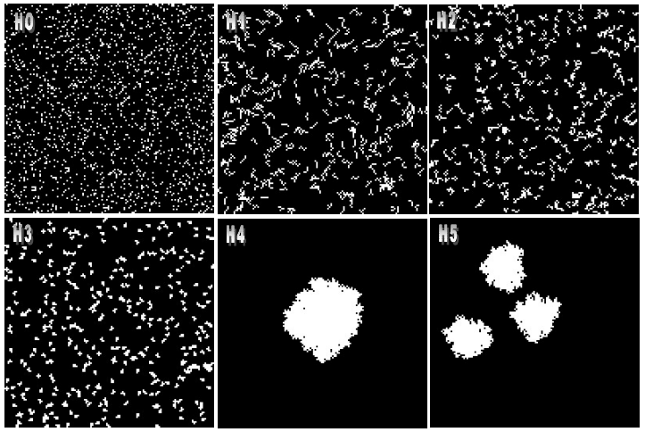

The fractal dimension reveals the patch complexity. It is as a function of inner area in relation to the patch edge and varies from 1 to 2. Therefore, the fractal dimension is affected by the patch shape and size (Forman and Godron, 1986). According to McGarigal and Marks (1995), the patch cohesion index gives an indication of the level of fragmentation of a landscape and thereby the habitat connectivity, thus large cohesion index indicates less fragmentation.

> **Note:** The nearest neighbor distance shows the dispersion of patches in a landscape.

The next figure shows how these indices vary as a function of the patch mean size set in Dinamica [Patcher](../functors/Patcher.html) function. The results of the landscape indices show a predictable behavior, indicating that Dinamica can be set to replicate the structure of a reference landscape by fine-tuning the parameters of its transition functions.

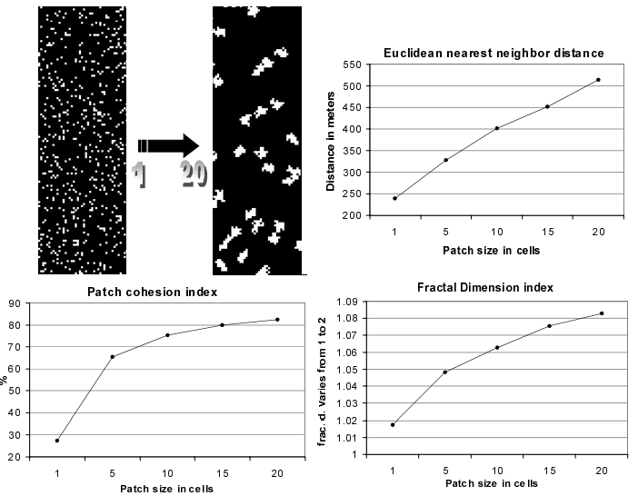

**H6:** Transitions occur as a function of the spatial probability. Dinamica sets up a spatial transition probability map for each transition, based on the weights of evidence chosen for specific ranges of each spatial variable stored in the static cube raster dataset. Simulation was run in 15 steps, with a rate of 0.005 per step. Only the [Patcher](../functors/Patcher.html) function is used with patch mean size of 20 and patch size variance of 0. Patch isometry is equal to 2.

The next figure depicts the static variable map, the calculated spatial transition probability map, and the simulated landscape. Notice the concentration of changed cells in the higher probability areas at the center of the map.

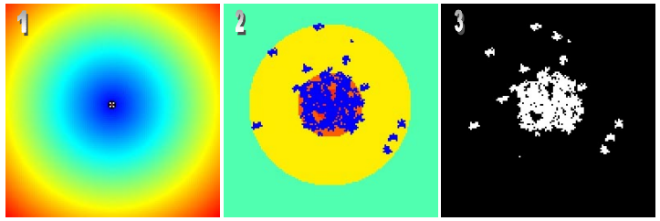

Dinamica can perform multiple transitions, up to 255 classes and 64770 transitions (255² - 255). To test its ability in simulating multiple transitions, simulations from H7 to H9 are run for a transition matrix 6 by 6 with 5 transitions.

**H7:** There is no spatial arrangement and no patch aggregation. Expander percentage is 0, patch mean size is 1, and patch size variance is 0. Transitions take place randomly only obeying the amounts of change set by the transition matrix. Simulations are run for 10 time steps.

**H8:** There is no spatial arrangement but patch aggregation. Patch mean size is set to 5, and simulation is run for 10 time steps. The next figure depicts the original landscape map, and the simulated landscapes for H7 and H8.

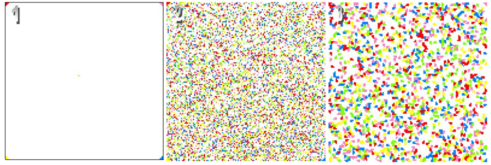

**H9:** There is no patch aggregation, but now each transition is influenced by its spatial probability map computed over maps stored in the static raster cube. Expander percentage is 0, patch mean size is 1, and patch size variance is 0. Simulations are run for 10 time steps.

The B&W maps in the Figure below represent the weights of evidence functions, respectively, for transitions 1-2, 1-3, 1-4, 1-5, 1-6. The color map (7) represents the transition probability map for 1-2 computed by integrating the single weights of evidence functions. The last two color maps (8, 9) depict the simulated landscape after 1 and 10 iterations.

> **Tip:** Notice again the concentration of changed cells in the higher transition probability area.

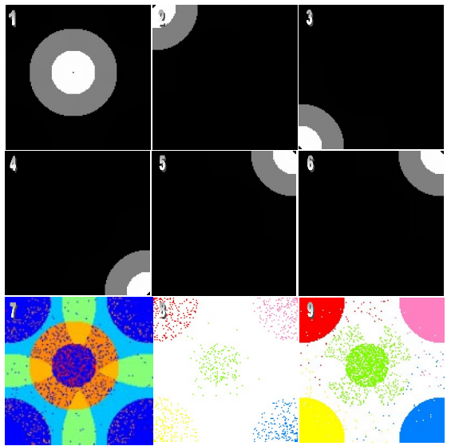

### Additional Experiments

The following experiments use the same synthetic map and a single time step with a rate of 0.01 for the transition from class 2 to 1, unless stated otherwise.

**Patch size and variance.** Only [Patcher](../functors/Patcher.html) is used, with isometry 1.5 and no spatial probability. The left map has a patch mean size of 20 cells and a variance of 0, giving fewer and larger patches than H3. The middle map has a patch mean size of 200 cells, which forms only seven patches that tend to aggregate. The right map has a patch mean size of 20 cells and a variance of 180, and the patch sizes vary greatly.

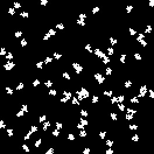 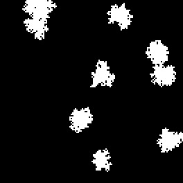 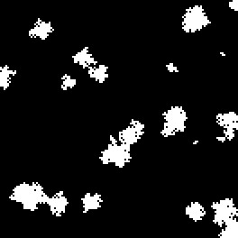

**Dynamic transition probability.** Dinamica calculates the distance to the cells that were already in the destination class and uses it to set up the spatial transition probability map, based on the weights of evidence chosen for specific ranges of distance. Because the distance map changes, a new transition probability map is calculated in each iteration. The simulation runs for 15 steps at a rate of 0.005 per step, using only Patcher with patch mean size 20, patch size variance 0, and isometry 2. As a result, new patches nucleate around the previous ones. The figures show, respectively, the dynamic distance map, the dynamically calculated transition probability map, and the simulated landscape.

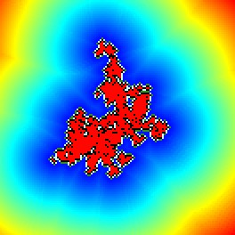 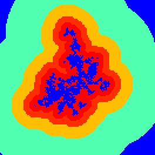 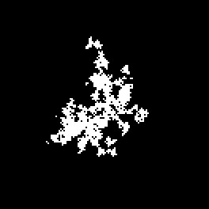

**Expansion with multiple transitions.** Using the 6 by 6 transition matrix of H7 to H9, there is no spatial arrangement and patches are produced only by [Expander](../functors/Expander.html), with patch mean size 1, for 10 time steps. The left map uses isometry 1 and the right map isometry 1.2.

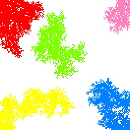 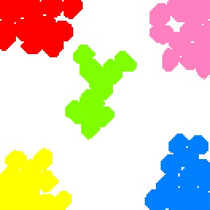

> **Tip:** These examples presented are only a small set of possibilities; they aimed to show how Dinamica can be adapted to replicate various dynamic phenomena.

### References

Soares-Filho et al, 2003. Simulating the spatial patterns of change through the use of the DINAMICA model. Anais XI SBSR.

[http://citeseerx.ist.psu.edu/viewdoc/download?doi=10.1.1.4.9617&rep=rep1&type=pdf](http://citeseerx.ist.psu.edu/viewdoc/download?doi=10.1.1.4.9617&rep=rep1&type=pdf)

Wu, Jianguo. (2013). Landscape Ecology. 10.1007/978-1-4614-5755-8_11.

