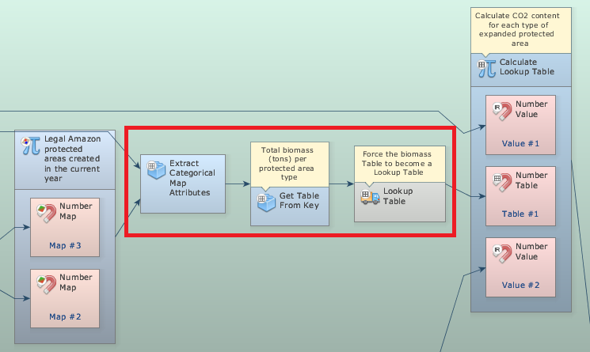
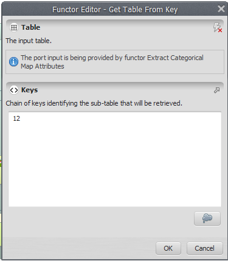
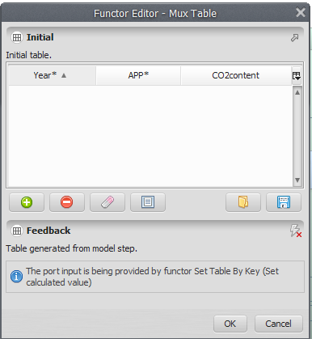
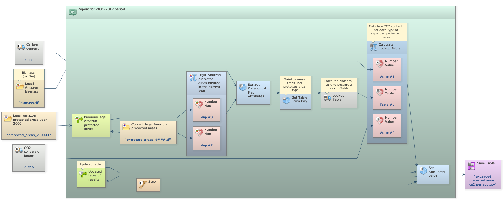
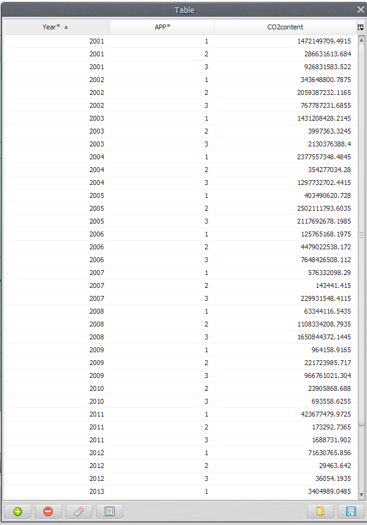


# Lesson 15: Using "while" to make successive calculations

In the previous exercise we calculated the biomass of the new protected areas (PA) per year of designation. Here we will calculate the biomass of per PA per each year of designation and category, i.e. strictly protected and sustainable use conservation units and indigenous reserves.

For this, we will use:

- The protected areas map in the year 2000 (`Guidebook_Dinamica_5/Database/Protected_areas/protected_areas_2000.tif`)
- The Legal Amazon Biomass map (`Guidebook_Dinamica_5/Database/biomass/biomass.tif`)

**This exercise is very similar to the previous model. But now Calculate Map produces a map containing the remaining forest for each category and every year.**

Grab the container Repeat from the Control tab and place it on the sketch. Drag the previous model into it. It will automatically resize to envelop Calculate Map. We extract the attributes and statistics by category using an Extract Categorical Map Attributes. This functor calculates basic statistics from a map for each area delimited by a class. Also grab the functors Get table from key and Lookup table and place it within the Repeat.

The functor Lookup Table is a structure used as a link to other functors, transforming a table into a lookup table if the table has only two columns, one for numeric keys and another for values.

The functor Get Table From Key retrieves the sub-table corresponding to the given chain of keys (In this case: “12”) from a given input table.

Click on the Mux Table with the Edit Functor Ports. Every Mux functor has two input ports. In the first iteration, the model reads the input from the Initial port; thereafter from the port Feedback.

> **Tip:** TIP:Note that in addition to the Year and CO2 content columns we have the category of Protected Areas.

Mark the eye button at the top of “Save Table” to view the results after model run.

Click on the layout tool Left to Right and your final model will look like the one below:

**Save and run the model!**

Now, click on eye button of “Save Lookup Table” to see the result. This functor output is a table that looks like this:

The result is returned in a table that contains the extracted classes and their corresponding attributes per year and category.

## Congratulations, you have successfully completed this lesson!

☞[Next Lesson](Landscape-Metrics.html)

