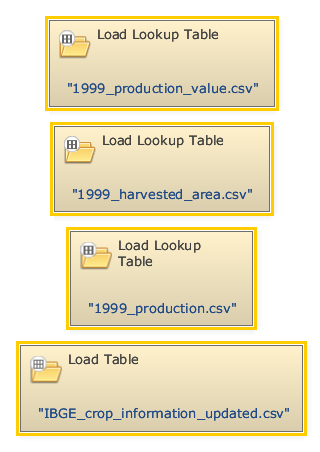
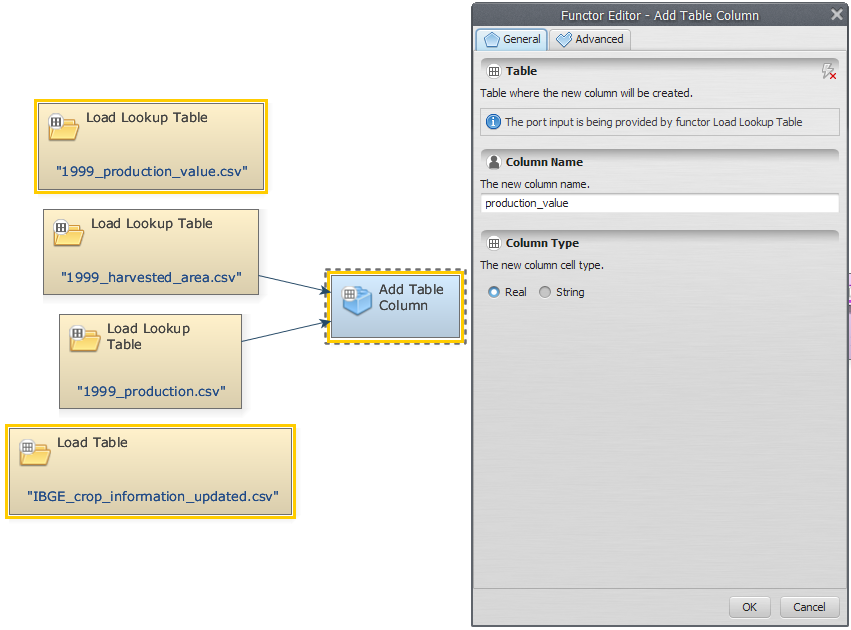
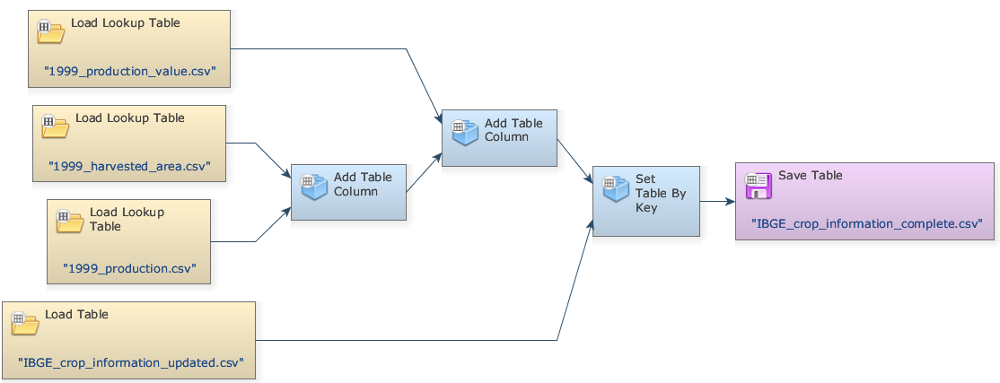
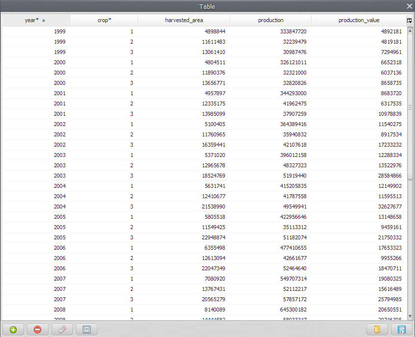
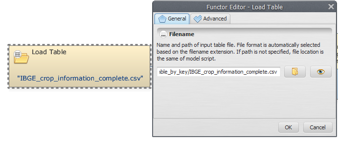
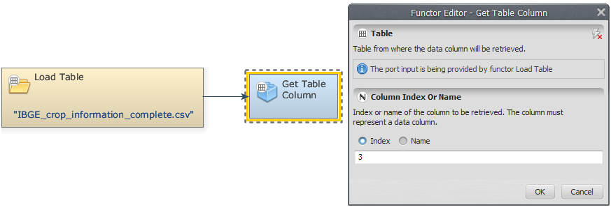
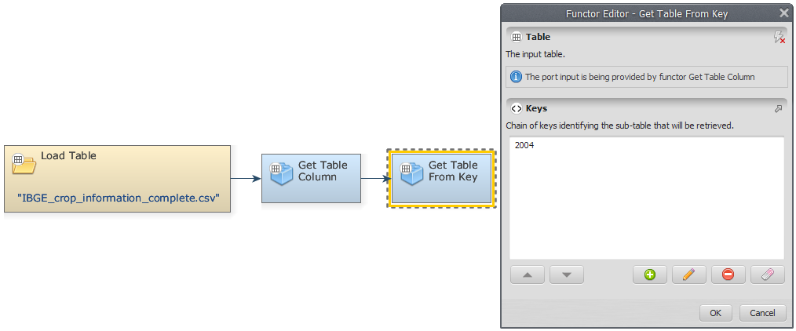
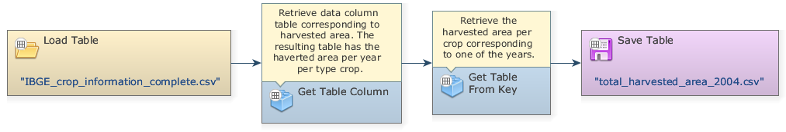
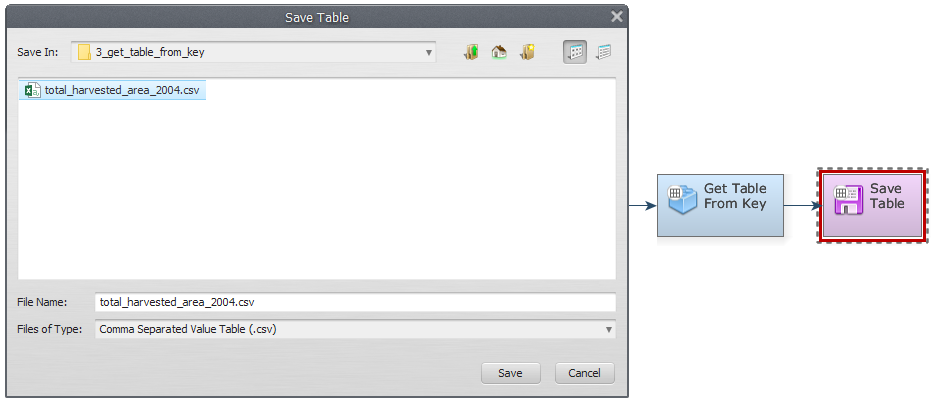
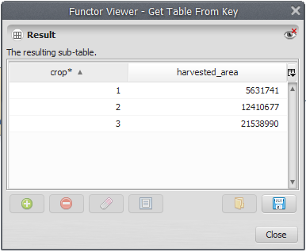


# Lesson 7: Creating a new column and retrieving a data column from tables

- To create a new column in a given table we must open all the files that will be used to retrieve data from. Click on the Input/Output tab from the library window and grab three [Load Lookup Table](../functors/Load-Lookup-Table.html) Functors and one [Load Table](../functors/Load-Table.html) placing them on the sketch. Open the [Load Lookup Table](../functors/Load-Lookup-Table.html) functors and load the files `1999 production value.csv`, `1999 harvested area.csv` and `1999 production.csv` from the folder `guidebook dinamica\database\tables\`. Next, open [Load Table](../functors/Load-Table.html) and load `ibge crop information updated.csv`.

- Now we can create a new column merge between the `1999 harvested area.csv` and `1999 production.csv` files. On the Table tab, grab an [Add Table Column](../functors/Add-Table-Column.html) and place it on the sketch. Connect the [Load Lookup Table](../functors/Load-Lookup-Table.html) which contains the file `1999 harvested area.csv` to [Add Table Column](../functors/Add-Table-Column.html), selecting <u>Table</u> as an input port. On the Functor Editor window, write a name for the created column (e.g. “production_value”).

> **Important:** The position where the new column is inserted determines whether the new column is a key or data column.

- Connect the [Load Lookup Table](../functors/Load-Lookup-Table.html) which contains the file `1999 production.csv` to [Add Table Column](../functors/Add-Table-Column.html), the <u>Column Values</u> port will be automatically assigned as an input port.

- Add another [Add Table Column](../functors/Add-Table-Column.html) to the sketch, assign the output of the previous [Add Table Column](../functors/Add-Table-Column.html) to the <u>Table</u> input port of the recently added functor. Connect the [Load Lookup Table](../functors/Load-Lookup-Table.html) with `1999 production value.csv` to the new [Add Table Column](../functors/Add-Table-Column.html). In the Functor Editor window, choose a name for the created column (e.g. "production").

- Add a [Set Table By Key](../functors/Set-Table-By-Key.html) to the sketch, assign the output of [Add Table Column](../functors/Add-Table-Column.html) to the <u>Subtable</u> input port of [Set Table By Key](../functors/Set-Table-By-Key.html) and the [Load Table](../functors/Load-Table.html) with `ibge crop information updated.csv` to the <u>Table</u> port. In the Functor Editor window, enter `1999` as the key identifying the sub-table that will be updated or inserted. Additionally, toggle the <u>Ignore Column Names</u> flag in the Functor Editor Window.

- To save the result to a file, place a [Save Table](../functors/Save-Table.html) on the sketch, browse to `\guidebook dinamica\models\add table column set table by key` and write the file name `ibge crop information complete.csv`.

- Click on the layout tool Execute Layout. Your final model should be similar to the one below:

- Save and run the model. Select the [Save Table](../functors/Save-Table.html) functor and click on the eye button to open the resulting table.

---

Using the table generated previously, we would like to demonstrate how to retrieve a data column from it.

- Grab a [Load Table](../functors/Load-Table.html), placing it on the sketch. Double click it and open the file generated in last step (e.g. `ibge crop information complete.csv`).

- To retrieve a data column corresponding to the harvested area, we will use [Get Table Column](../functors/Get-Table-Column.html). Connect the [Load Table](../functors/Load-Table.html) to [Get Table Column](../functors/Get-Table-Column.html). In the input <u>Column Index or Name</u> of the Functor Editor window, insert the index of the column to be retrieved (“3” or “harvested area”).

- Now, we can retrieve the harvested area per crop corresponding to the year of 2004.  For this, grab a [Get Table from Key](../functors/Get-Table-From-Key.html) and place it on the sketch. Connect [Get Table Column](../functors/Get-Table-Column.html) to [Get Table from Key](../functors/Get-Table-From-Key.html). In the input <u>Keys</u> of the Functor Editor window, insert the year you want to retrieve the harvested area per crop (in this example, “2004”).

- Grab a [Save Table](../functors/Save-Table.html) and place it on the sketch. Connect [Get Table From Key](../functors/Get-Table-From-Key.html) and [Save Table](../functors/Save-Table.html). The final model should have the following structure:

- To save the result to a file, edit [Save Table](../functors/Save-Table.html), browse to `\guidebook dinamica\models\get table from key` and write the file name (e.g. `total harvested area 2004.csv`).

- Save and run the model. To see the resulting table, click on eye button of [Save Table](../functors/Save-Table.html). This functor output is a table that looks like this:

## Congratulations, you have successfully completed this lesson!

☞[Next: Lesson 8: Inserting a value into a table](Inserting-A-Value-Into-A-Table.html)

