
# The wizard editor in Dinamica EGO

## What will you learn?

- Dinamica EGO wizard tools
- Creating Wizards
- Formatting Wizards

## Wizards

A Wizard is an easy way to create a presentation for a model developed in Dinamica EGO with formatted text, images and other graphical features. In a Wizard it is also possible alter the models' inputs to run an easy simulation without an advanced understanding of the Dinamica GUI and its functors.

A Wizard Tutorial is a sequence of pages containing formatted text, tables, images, diagrams, animations, embedded videos or any other internet browser compatible technology inserted by the author. Each page can contain general information about the model and the simulation inputs. Simulation inputs can be directly linked to script inputs, making it a fast and easy way to set parameters and run a simulation.

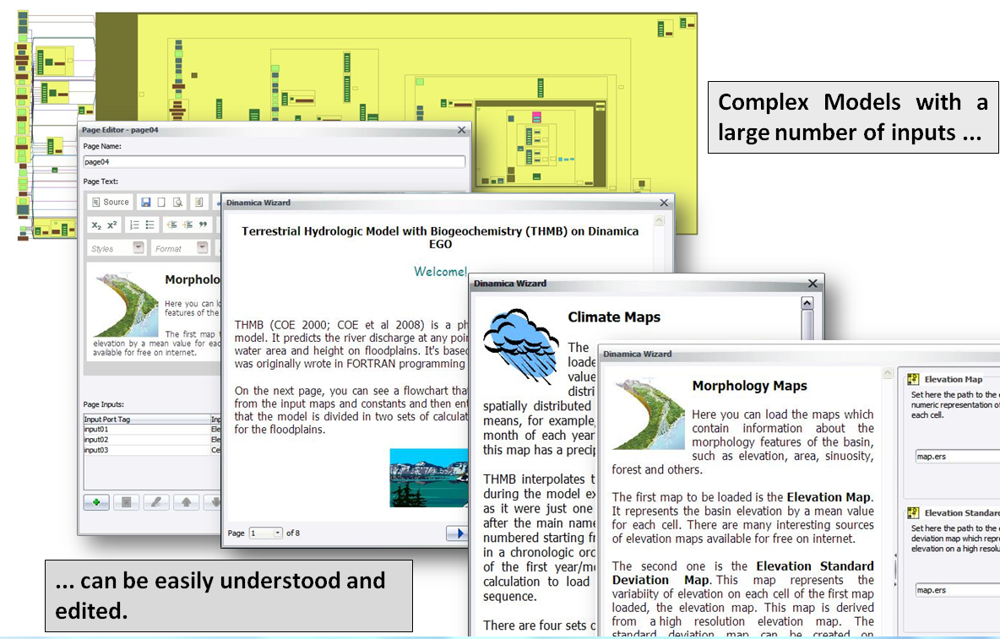

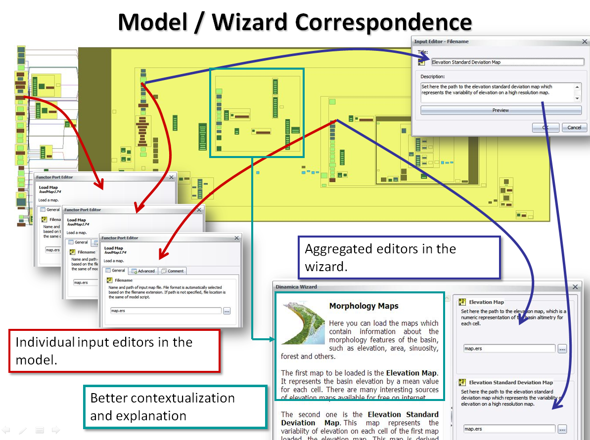

An author can create his own Wizard Tutorial to present and explain its concepts and ideas. The Wizard Editor is a powerful tool to create text, format information and illustrations visually, include tables, and set inputs/outputs. The author selects model script functors to include in the Wizard so not all functors are visible to Wizard users.

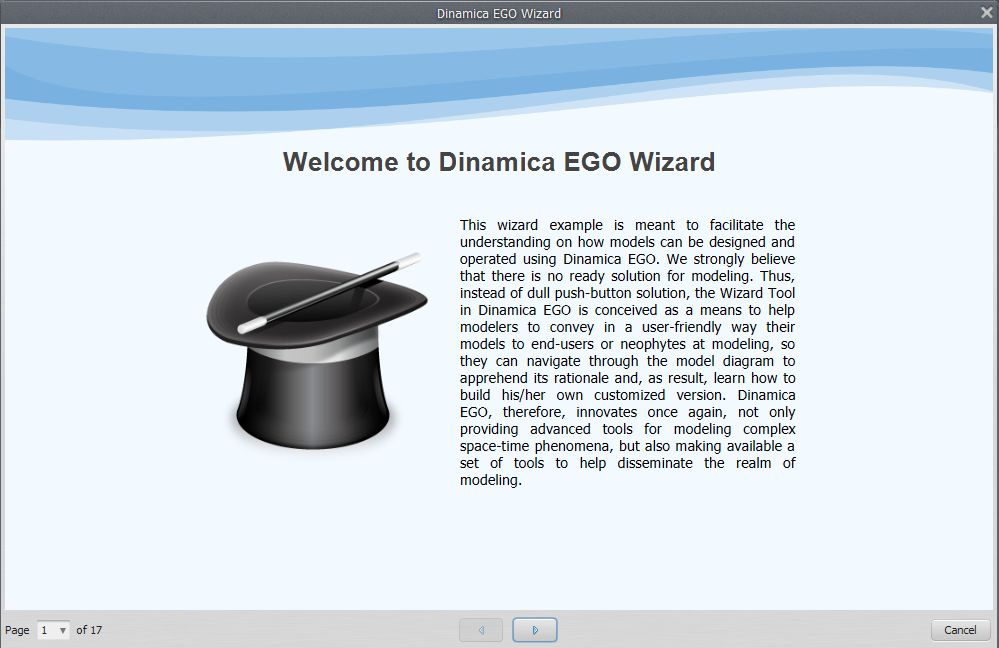

## The Tool

The Wizard should be a logical sequence of pages, each using a graphical area to convey information and possibly ports linked to the model. This is a very clear idea that can be seen in the wizard editor. The following videos provide directions on using the wizard tool:

[Video: YouTube](https://www.youtube.com/watch?v=_Jc61ARsHuA)

Here is how to run a Wizard in the current interface:

[Video: YouTube](https://www.youtube.com/watch?v=I7DPear5yao)

To open the Wizard tool click on the edit bar in the menu:

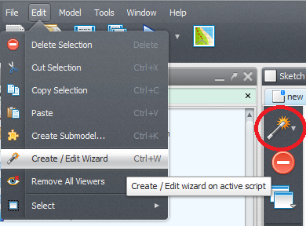

It has an intuitive interface that we are going to learn how to use through the following examples.

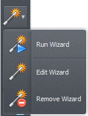

### Simple Wizard

Lets start with a quick example where we create a wizard for a script that performs only a simple map algebra operation.

We are going to need the functors:

- [Load Map](../functors/Load-Map.html)
- [Calculate Map](../functors/Calculate-Map.html)
- [Number Map](../functors/Number-Map.html)
- [Save Map](../functors/Save-Map.html)

### Building the model

Assemble the functors according to the following picture.

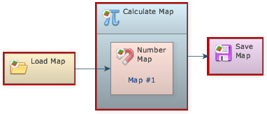

In the [Calculate Map](../functors/Calculate-Map.html) we are going to perform a simple operation with the input that, for values equals to **null**, set them to **1** , **0** to the others.

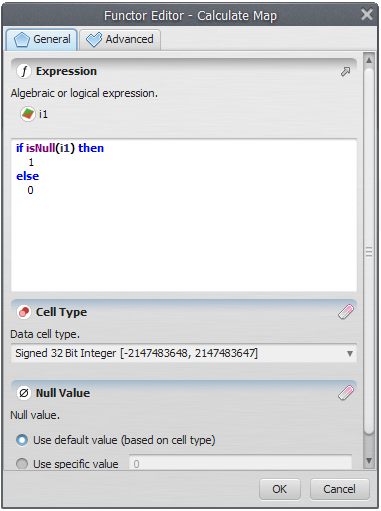

### Creating the Wizard

To create a wizard o need first to save your model. Save it with XML extension and open the wizard
editor.

#### Wizard Pages

In the Dinamica Wizard Editor toolbar click in the wizard icon to input ports.

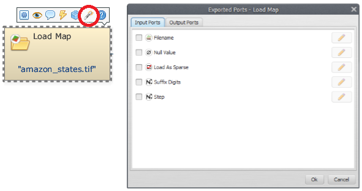

It is necessary to give a page a name, but it is only for identification. The tutorial user will not
see this name:

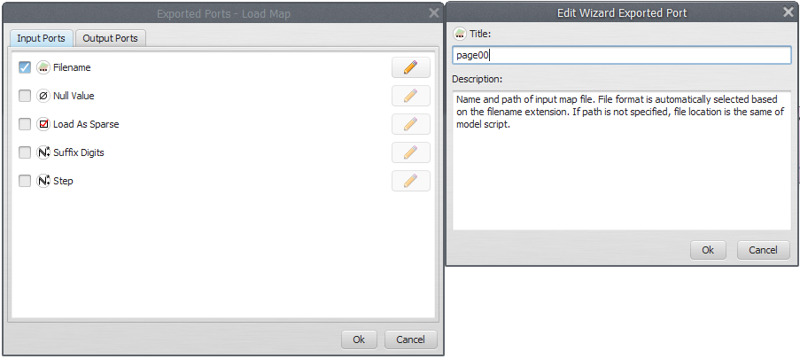

Now lets edit this page and add some text. To edit a page can just click on edit wizard at the
icon wizard:

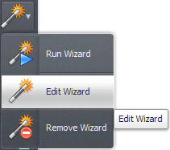

The page editor will be showed up:

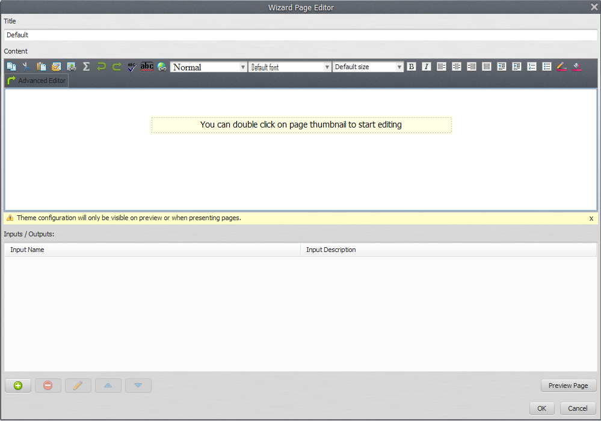

Indeed, it is a visual text editor, "what you see is what you get" style. Lets add some text about
our model.

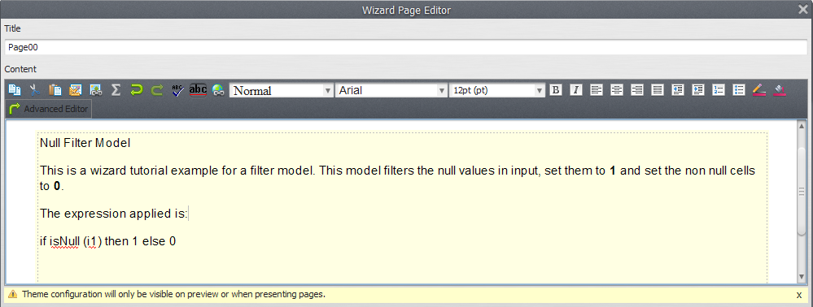

#### Formatting

We can use the editor features to add some formatting:

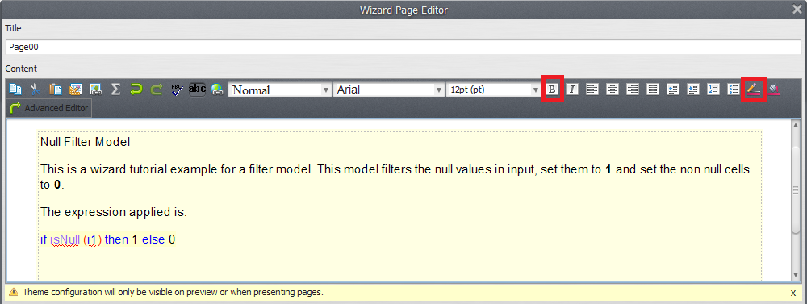

By clicking ok the page will be visualized in the Wizard Editor:

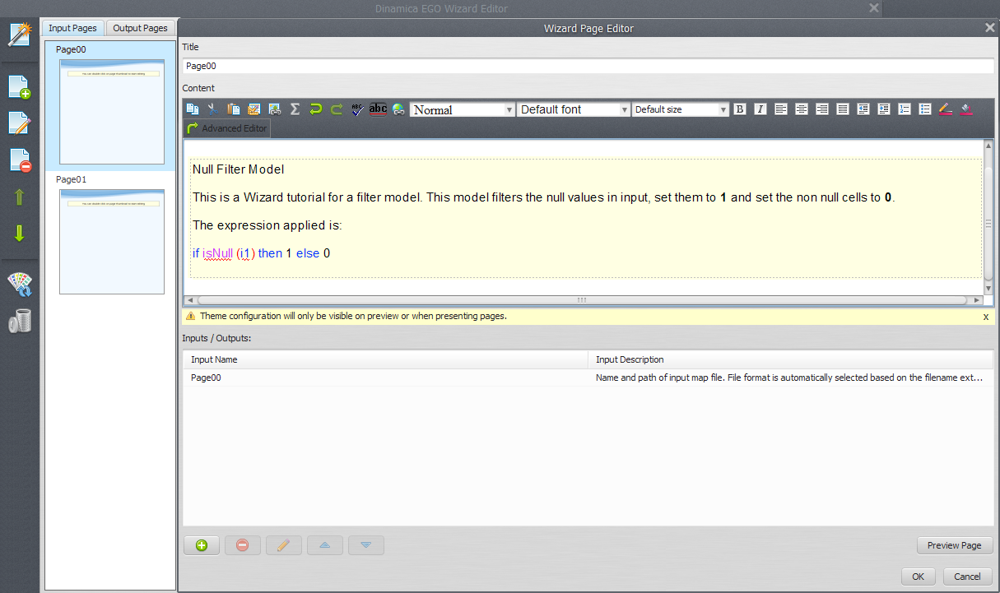

#### Another Page

Now lets add another page. You already know how to proceed.

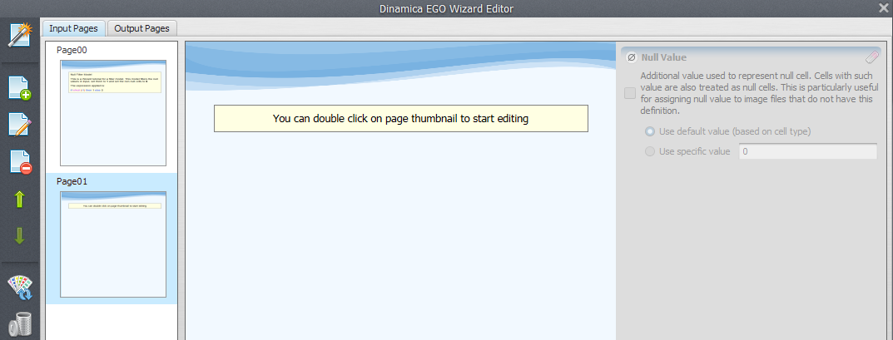

In this second page we are going to allow the user to set the input map file path for the filtering.
For now, lets add a text about it and soon we will add the input in the wizard.

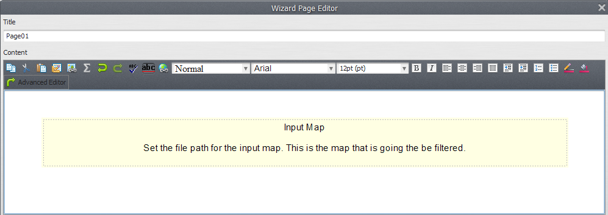 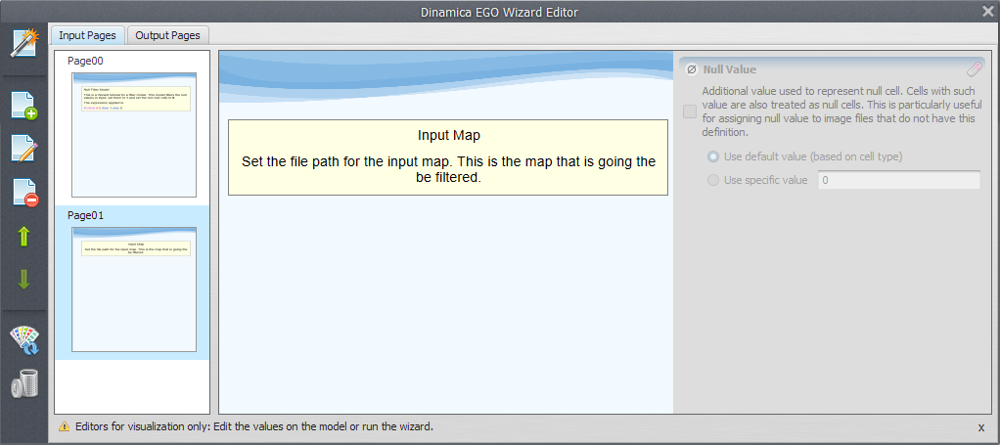

#### Adding Inputs

Now, lets add one input to our wizard. To do this, double click the second page to edit it. In the
page inputs area, click in the **Add input** button to add a new input.

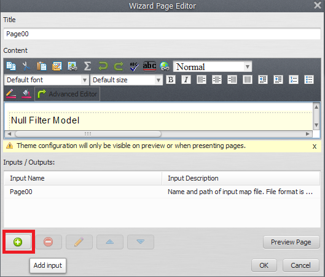

The **Select functor port** window will open up. In this window, the [Load Map](../functors/Load-Map.html) functor present in our model can be
seen. Select page 00 and press ok.

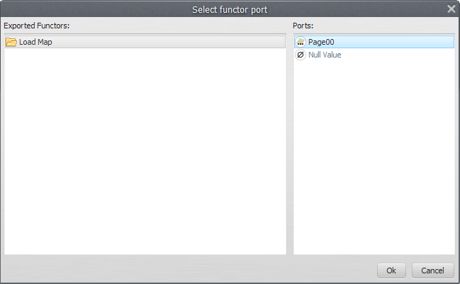

> **Tip:** Tip: Assign meaningful alias to each of the functors. It is easier to identify them while selecting functors and ports.

Now, you can edit the port title and description. This is an important feature because ports for a functor
have all the same title and description. With the wizard you can specify this information with an intuitive
text, something that explain better what is this input for your simulation.

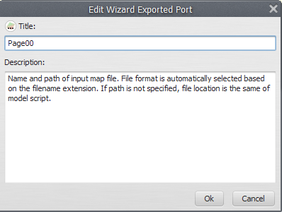

Lets add a new title and description that explains better this input:

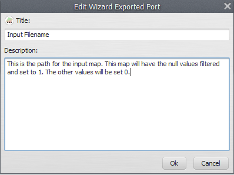

After clicking ok the input will appear in the page inputs area:

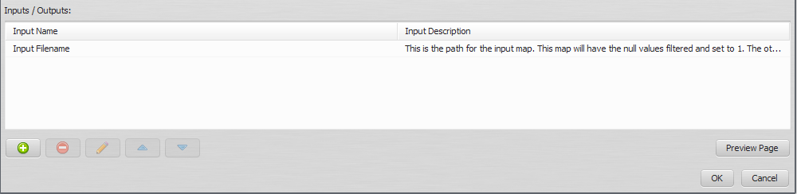

If you select an input from this area the buttons will be available. Through this you can remove the selected
input, edit its information again (modify title and description) or change the inputs order (move it up or down)
when there are more than one input.

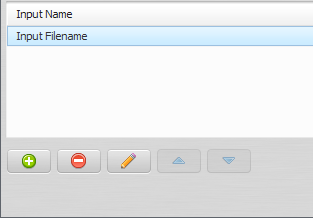

#### Testing the Wizard

To test the wizard you have made you can click the button **Run Wizard** in the tool bar:

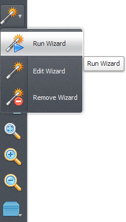

After clicking Run Wizard you must select the model that will contain the wizard and run the model.

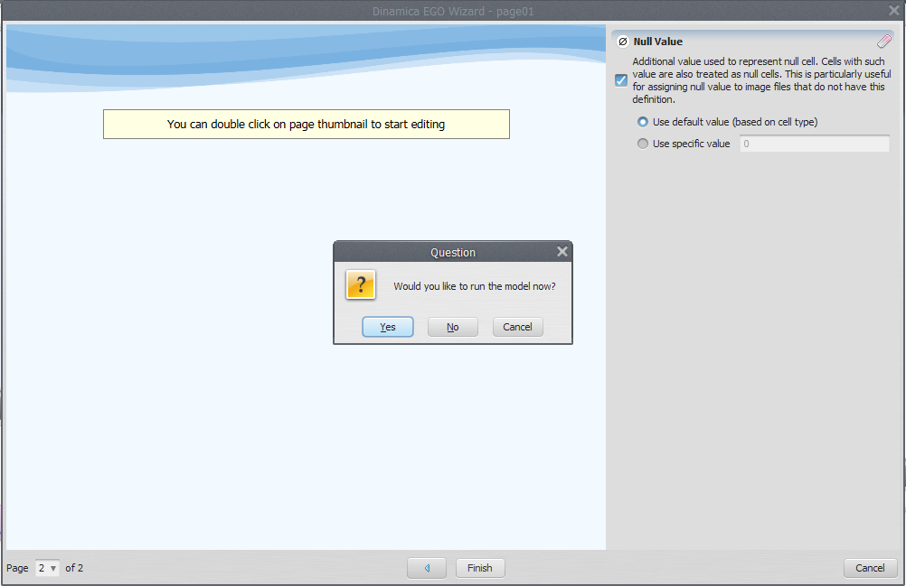

Clicking **Cancel** you can keep editing the Wizard.

> **Important:** Remember to save the wizard every time you close the Wizard Editor. Once finished the Wizard it
> is also important to save your model.

#### A third page

Now you know the process to create a page and add an input. Lets do it faster. In the third page we are going
to add some information about the output map and after export the [Save Map](../functors/Save-Map.html) **Filename** port we are going
to add it as an input to the third page.

We create the page and add information.

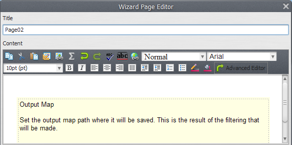

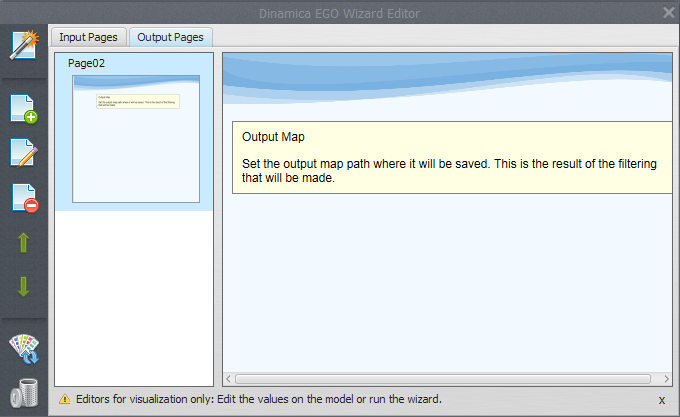

Now add an input, choose the [Save Map](../functors/Save-Map.html) functor (you need to click in the wizard tool on the save map) and then his input port named "Filename".

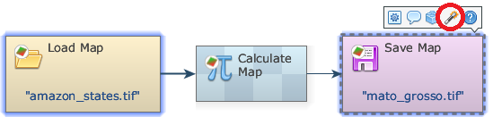 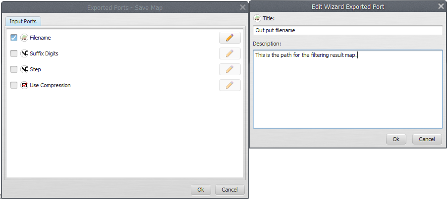

After that you have to click in Edit Wizard.

Choose a name for the input and set a meaningful title and description.

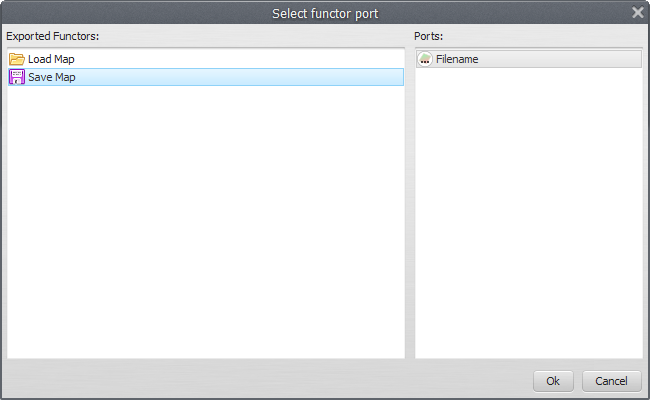

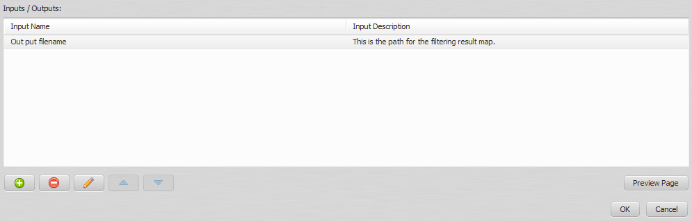

#### Finishing the Simple Wizard

You have just created a complete wizard tutorial for your model! Save the wizard and close the editor. It is also
important to save your model again.

Now, every time an user opens your model, he will be prompted about running the wizard tutorial you have created.

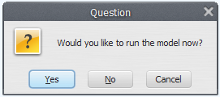

It is also possible to run the wizard tutorial through the **Run Wizard** button in the tool bar.

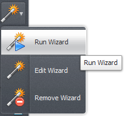

☞[Next: R Coupling](R-Coupling.html)

