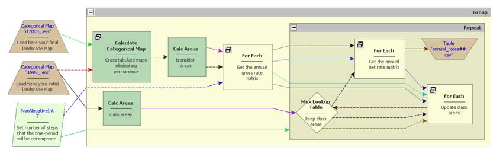


# Calculate variable time-step net transition rates

Here we provide an example of a model that can be used to run multiple time step simulations when the time-period matrix cannot be decomposed to a multiple-step transition matrix because it is not an ergodic matrix, i.e. [Markov chain matrix](https://en.wikipedia.org/wiki/Markov_chain).

For matrices that cannot be decomposed into multiple-step transition matrices, this models calculates first gross transition rates for a time-period and a specified time-step and then derives variable net transition rates, producing, as a result, a unique transition matrix for each model iteration. Output transition matrices are saved into files that can be loaded in a simulation with the same number of time-steps.

This model, `calculate time-step transition rates.egoml`, and the model that runs the simulation with the resulting matrices, `savassi1996 2003 in annual steps.egoml`, are in `guidebook dinamica\models\variable time step net transition rates\simulate 2003 in annual time steps`, part of [guidebook_dinamica.7z](../extra/guidebook_dinamica.7z). Their input maps, from the urban dynamics example of the Savassi neighborhood in Belo Horizonte, are in the `originals` folder next to it.

--- *[Britaldo Soares Filho](mailto:britaldo@csr.ufmg.br) 2011/03/11 13:16*

> **See also:** [Varying Parameters in a Simulation](../Additional-LUCC-Resources.html#varying-parameters-in-a-simulation) shows how to use a different transition matrix at each step of a simulation.

☞[Next: Receiver Operating Characteristic (ROC) suite](ROC-Suite.html)

