
# Lesson 9: Working with maps and tables

The aim of this lesson is introducing the calculation of area of each source feature on Dinamica EGO to the user. For this, we will calculate the area of each category of Legal Amazon Protected Areas map in the year 2000 and calculate biomass and Carbon Dioxide content in Biomass within high priority conservation areas.

In this lesson we will use the following files:

- The protected areas map in the year 2000 (`Guidebook_Dinamica_5\Database\Protected_areas\protected_areas_2000.tif`)

- The Legal Amazon conservation priority map (`Guidebook_Dinamica_5\Database\Priority_areas\priority_areas.tif`)

- The Legal Amazon biomass map (`Guidebook_Dinamica_5\Database\biomass\biomass.tif`)

**Let's go!**

- From the library window grab and place on the sketch the **[Load Categorical Map](../functors/Load-Categorical-Map.html)**, which is located in the Input/Output tab. Double click it and open the `protected_areas_2000.tif` file.

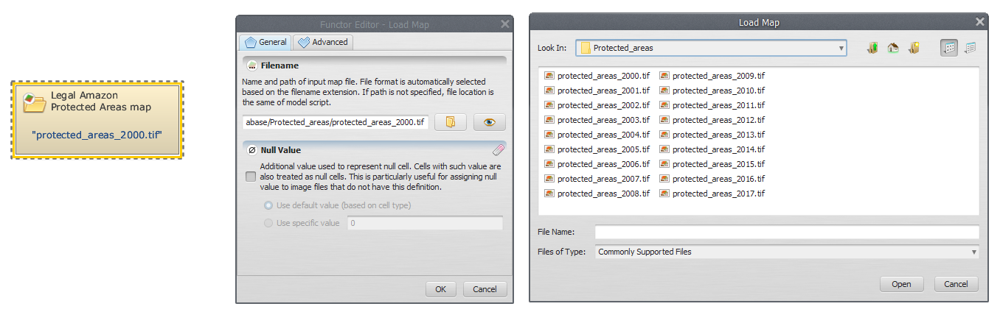

- Click on the Map Algebra tab from the library window, select **[Calc Areas](../functors/Calc-Areas.html)**, place it on the sketch and connect **Load Categorical Map** to it. The expression is calculated as a real value and converted to the same data cell type as of the output map.

- To save the result to a file, grab and place on the sketch **[Save Table](../functors/Save-Table.html)** and connect the functor **Calc Areas** to it. Open **Save Table**, select a folder and write a suitable file name (e.g. areas_of_legal_amazon_protected_areas.csv).

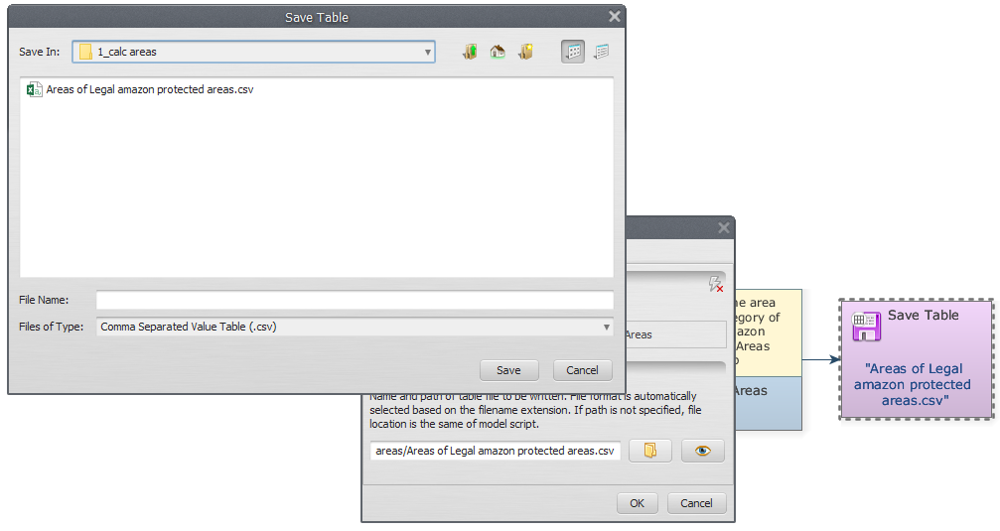

- Save and run your model. Click on the eye button of **Save Table** to see the result.

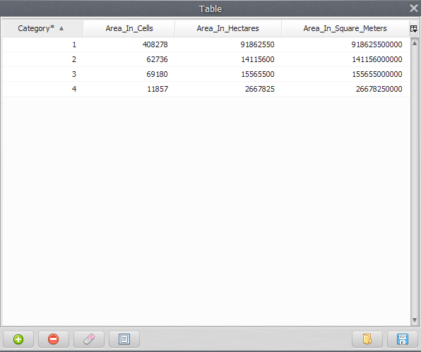

> **Note:** **What is your model doing?**
>
> It is loading “protected_areas_2000.tif” file and then calculating the area of each category of the Legal Amazon protected areas.

## For the second part of this lesson we calculate the biomass and Carbon Dioxide content within it in high priority conservation areas.

- Initially, we must open all the files that will be used. On the Input/Output tab from the library window, grab two **Load Categorical Map** and place them on the sketch. Double click each **Load Categorical Map** and load the Legal Amazon Conservation Priority (`Guidebook_Dinamica_5\Database\Priority_areas\priority_areas.tif`) and Protected Areas maps (`Guidebook_Dinamica_5\Database\Protected_areas\protected_areas_2000.tif`). Place a **[Load Map](../functors/Load-Map.html)** and open the Legal Amazon Biomass map (`Guidebook_Dinamica_5\Database\biomass\biomass.tif`).

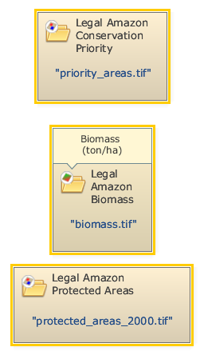

- Place a **[Calculate Map](../functors/Calculate-Map.html)** on the sketch. Click on the hook tool to create three **[Number Map](../functors/Number-Map.html)** hook functors within **Calculate Map**. Assign a number to each **Number Map** (e.g. “1”, “2” and “3”, respectively). This is a number identifier for each map and will be represented within the equation box as i1, i2 and i3. Connect **Load Map** and **Load Categorical Map**  to each **Number Map**.

- Write the following equation in Calculate Map to calculate the biomass of each high priority conservation areas category.

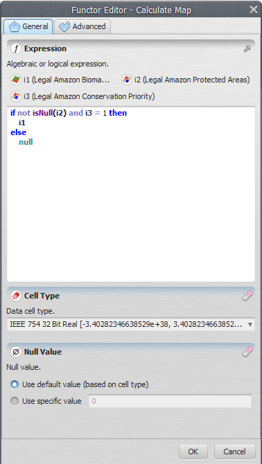

- Now, you need save the result of biomass to a file. Place a **[Save Map](../functors/Save-Map.html)** on the sketch and connect **Calculate Map** to it. Open **Save Map**, browse to a suitable folder and write the file name (e.g. biomass_high_priority_conservation_protected_areas_map.tif).

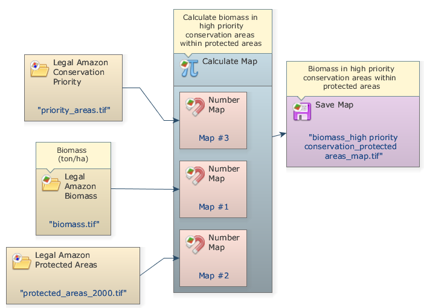

- Now, we will extract the attributes and calculate basic statistics from Biomass in high priority conservation protected areas. Grab and place on the sketch an **[Extract Map Attributes](../functors/Extract-Map-Attributes.html)** (this functor produces as output a table with map attributes) and connect **Calculate Map** to it.

- Grab and place on the sketch a **[Calculate Value](../functors/Calculate-Value.html)**. Click in the hook tool to create three hook functors inside **Calculate Value**: one **[Number Table](../functors/Number-Table.html)** and two **[Number Value](../functors/Number-Value.html)**. Assign a number to each **Number Value** and **Number Table**.

> **Important:** In some cases, is very useful to add a constant value to the operations in Dinamica. In the next step, we will demonstrate how to do this.

- Grab and place on the sketch two **[Real Value](../functors/Real-Value.html)** located on the `Map Algebra (Suppl.)` tab to insert two double precision real constants:

    1. A CO2 conversion factor (3.666)
    1. Carbon Content in Biomass (0.47).

- Connect **Extract Map Attributes** to **Number Table** and the two **Real Value** functors to the **Number Value** functors inside the **Calculate Value**. At this step you should have something like this:

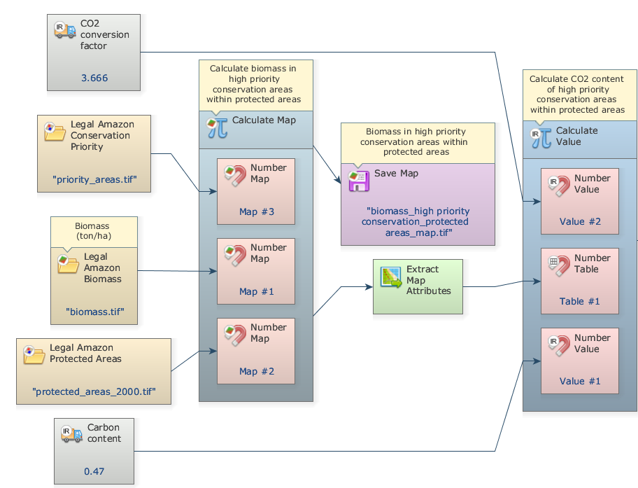

- Write the following equation in **Calculate Value** to estimate CO2 content of high priority conservation areas using the map statistics calculated by **Extract Map Attributes** ("cellSum" and "cellArea") and the two constant values added (v1 and v2): `t1["cellSum"] * t1["cellArea"] * v1 * v2`

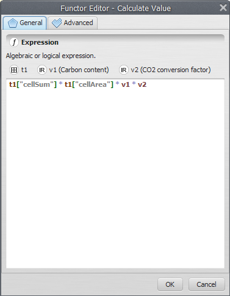

    - Grab a **[Set Lookup Table Value](../functors/Set-Lookup-Table-Value.html)** functor and place it on the sketch to insert the calculated values into a lookup table. It is important to pay attention to add the correct key to the line where the value will be inserted:

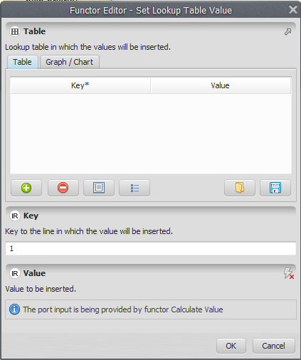

> **Important:** If the table is already filled in, it replaces the old values with new values.

- Now you need to save the result to a file. Grab and place on the sketch a **[Save Lookup Table](../functors/Save-Lookup-Table.html)** and connect **Set Lookup Table** to it. Open **Save Lookup Table**, select a folder and write a suitable file name (e.g. high priority_cons_prot_areas_CO2.csv).

- The final model will look like this:

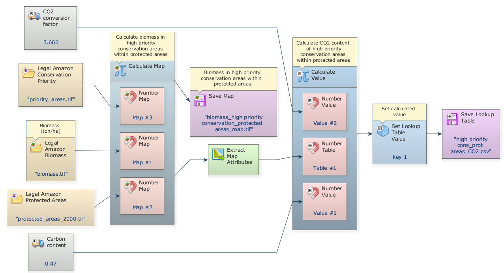

- Save and run your model, click on eye button of “Save Lookup Table” to see the result. This functor output is a table that looks like this:

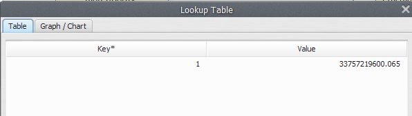

## Congratulations, you have successfully completed this lesson!

☞[Next Lesson](What-Is-A-Submodel.html)

