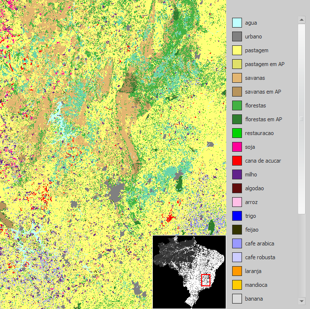


# Categorical Map Type

A **Categorical Map** is a [Map](Map-Type.html) whose cells represent classes or categories — vegetation type, soil type, sub-regions, and similar — and which is guaranteed to carry a [Categorization](Categorization-Type.html) associating those cell values with category names and colors. See [Map Type](Map-Type.html) for the grid, geographic format, and layer structure shared by both kinds of maps; a Categorical Map differs only in that its Categorization is required rather than optional.



## GUI Editor

Input ports of type Categorical Map are non-editable, so a categorical map cannot be defined using an editor in the graphical interface — the same restriction described for the plain [Map](Map-Type.html) type. A Categorical Map value must always come from connecting an output produced by another functor — a loader such as [Load Categorical Map](../functors/Load-Categorical-Map.html), or a calculator such as [Calculate Categorical Map](../functors/Calculate-Categorical-Map.html) — supplied by wiring that output to the input.

## EGO Script

For the same reason, input ports of type Categorical Map cannot receive a constant in [EGO Script](../EGO-Script.html) — see [Constants](../EGO-Script.html#constants). A Categorical Map is always obtained by calling a functor that produces one, and reused by referencing the variable bound to its output. Its filename input, like [Map](Map-Type.html)'s, is typed [Map Filename](Map-Filename-Type.html) — there is no separate filename type for categorical maps:

```
// Loads a categorical map with no null value defined, using the default storage mode.
landscape := LoadCategoricalMap "c:/data/landscape.tif" .none .default 0;
```

The storage options described on the [Map Type](Map-Type.html) page — in memory, as a sparse mapping of non-null cells, or paged from disk — apply equally to Categorical Maps, through functors such as [Load Categorical Map](../functors/Load-Categorical-Map.html) and [Calculate Categorical Map](../functors/Calculate-Categorical-Map.html).

## Automatic Conversions

- **Converted from**: None.
- **Converted to**: [Map Type](Map-Type.html) — this is **subtyping**: a Categorical Map is already, structurally, a Map, so no conversion logic runs; any port declared for Map Type accepts a Categorical Map directly. [Projection Type](Projection-Type.html) and [Categorization Type](Categorization-Type.html) — these are ordinary registered conversions.

See [Type System](../Type-System.html) for the complete conversion reference across all types.

