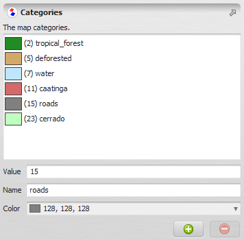


# Categorization Type

A **categorization** is a set of categories (classes) used to label the cells of a [Categorical Map](Categorical-Map-Type.html) — each category defined by a value, a name, and a display color.

## GUI Editor



## EGO Script

A constant representing a set of categories is written in [EGO Script](../EGO-Script.html) using the following syntax:

```
[
  1, "Rondonia", (139, 35, 35),
  2, "Acre", (105, 211, 169),
  3, "Amazonas", (149, 149, 238),
  4, "Roraima", (177, 177, 66),
  5, "Para", (238, 203, 149),
  6, "Amapa", (62, 12, 96),
  7, "Tocantins", (238, 149, 149),
  8, "Maranhao", (51, 255, 204),
  9, "Mato_Grosso", (211, 105, 211)
]
```

Each line describes one category through three elements: its value, name, and color.

- **Value** — a signed 32-bit integer corresponding to a cell value in a categorical map, in the range -2,147,483,648 to 2,147,483,647. Ex: `-10`, `1`, `200`.
- **Name** — a non-empty string enclosed in double quotes. It must start with a letter, followed by letters, numbers, and underscores (`_`). Ex: `"forest"`, `"deforestation"`, `"class_1"`.
- **Color** — a three-element tuple enclosed in parentheses, using the [(R, G, B) notation](https://en.wikipedia.org/wiki/RGB_color_model): red, green, and blue components, in that order. Each component must be in the range \[0, 255\]. Ex: `(255, 0, 0)`, `(128, 128, 128)`. `(0, 0, 0)` is black and `(255, 255, 255)` is white.

Commas between elements are optional. Categories do not need to be contiguous.

> **Note:** Because a category value is a signed 32-bit integer, a categorization cannot be attached to a map whose cell type is Unsigned 32-bit Integer or Float 32-bit — neither type can represent the full range and precision of a signed 32-bit integer.

> **Note:** A categorization accepts at most 2,000,000,000 categories; defining more raises an error. This default is used in most situations and is rarely a practical limit.

## Automatic Conversions

- **Converted from**: [Table Type](Table-Type.html), [Categorical Map](Categorical-Map-Type.html) — a Categorical Map converts directly to its Categorization, extracting the value/name/color definitions already attached to the map; this is a separate, one-way path from the Table Type conversion below and does not pass through a Table.
- **Converted to**: [Table Type](Table-Type.html).

The [Table Type](Table-Type.html) conversion works in both directions — from a Table into a Categorization, and from a Categorization into a Table. In either direction, the table must have the following columns, in order:

| Column | Type | Description |
| --- | --- | --- |
| Category value | `*#real` (key) | The category value. |
| Category name | `#string` | The category name. If left blank when converting into a Categorization, the category is automatically named using the pattern `class_N` — or `class_nN` if the value is negative, where N is the absolute value — the same fallback used for any category left unnamed. |
| Category red color | `#real` | The category's red color component, in the range \[0, 255\]. |
| Category green color | `#real` | The category's green color component, in the range \[0, 255\]. |
| Category blue color | `#real` | The category's blue color component, in the range \[0, 255\]. |

The following CSV table represents the same categories shown in the EGO Script example above:

```
Value*, Name, Color_Red, Color_Green, Color_Blue, 
1, Rondonia, 139, 35, 35,
2, Acre, 105, 211, 169,
3, Amazonas, 149, 149, 238,
4, Roraima, 177, 177, 66,
5, Para, 238, 203, 149,
6, Amapa, 62, 12, 96,
7, Tocantins, 238, 149, 149,
8, Maranhao, 51, 255, 204,
9, Mato_Grosso, 211, 105, 211
```

See [Type System](../Type-System.html) for the complete conversion reference across all types.

