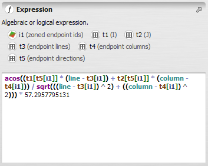


# Image Expression Type

The Image Expression Language is used by the five [calculator functors](../Calculate-Functors.html) to evaluate algebraic and logical expressions. The complete operator reference — including full syntax tables, availability notes, null value handling, EGO Script examples, and practical examples — is in [Calculate Functors — Complete Operator Documentation](../Calculate-Functors.html).

## GUI Editor



The editor supports a few interactions that make it easier to work with identifiers:

- Hovering the mouse over an identifier (`i1`, `t1`, `v1`, etc.) displays a tooltip for the functor and output port it is connected to.
- Clicking an identifier inserts it at the current cursor position in the expression.
- If the functor connected to an identifier has an alias, that alias is shown in place of the numbered identifier (`i1`, `t1`, `v1`, etc.), making the expression easier to read.

> **Note:** The editor works exclusively with the **verbose form**. Abbreviated syntax is converted to verbose form automatically when the script is read. See [Calculator functor shorthand](../EGO-Script.html#calculator-functor-shorthand) and [Conversion between forms](../EGO-Script.html#conversion-between-forms) for details.

## Identifiers

In expressions, operands are referenced by type-specific identifiers:

- `iX` — a connected map, where X is an integer from 1 to 100
- `tX` — a connected table or lookup table, where X is an integer from 1 to 100
- `vX` — a connected scalar value, where X is an integer from 1 to 100

Maps are connected via [Number Map](../functors/Number-Map.html) hook functors, tables via [Number Table](../functors/Number-Table.html), and scalar values via [Number Value](../functors/Number-Value.html).

In the **abbreviated (shorthand) syntax**, operands are referenced directly by variable name using type sigils: `#` for maps, `%` for tables and lookup tables, `$` for values — eliminating the hook block entirely. See [Calculator functor shorthand](../EGO-Script.html#calculator-functor-shorthand) for details.

During logical expression evaluation, **zero is false** and **any non-zero value is true**.

## Null Value Handling

A null value in any operand poisons the entire expression result. The keyword `null` marks the current evaluation unit as missing — it is an abstract sentinel with no numeric value, available in all five calculator functors. This is distinct from `null(iX)`, which returns the numeric sentinel value stored in a specific image and is only available in map calculators. Two operators interrupt null propagation: `isNull()` and `?`. See [Null Value Handling](../Calculate-Functors.html#null-value-handling) for the complete rules, exceptions specific to map calculators, and defensive patterns.

## Operators

### General Operators

Arithmetic, logical, and conditional operators with full precedence rules, including `if/then/else`, boolean `and`/`or`/`not`, comparison operators, `+`, `-`, `*`, `/`, `%`, `^`, and the catch-error operator `?`.

→ [General Operators](../Calculate-Functors.html#1-general-operators)

### General Functions

Mathematical functions (`sqrt`, `sin`, `cos`, `ln`, `exp`, `abs`, `ceil`, `floor`, `round`, `max`, `min`, `clamp`, `clampMod`, `signal`, `pi`), stochastic functions (`rand`, `rUniform`, `rNormal`, `rPoisson`), and control functions (`abort`, `isNull()`, `null`). All functions in this section are available in all five calculator functors.

→ [General Functions](../Calculate-Functors.html#2-general-functions)

### Value Operators

Retrieves a scalar value connected to a `vX` port.

→ [Value Operators](../Calculate-Functors.html#3-value-operators)

### Image Operators and Functions

Operators that work at the current cell: `iX` (cell value), `iX[line, col]` (coordinate lookup with boundary mirroring), `null(iX)` (numeric sentinel value of image X — distinct from the abstract `null` keyword), `line`, and `column`. Available in [Calculate Map](../functors/Calculate-Map.html) and [Calculate Categorical Map](../functors/Calculate-Categorical-Map.html) only; `line` and `column` are also available in the two lookup table calculators with row-oriented meanings.

→ [Image Operators and Functions](../Calculate-Functors.html#4-image-operators-and-functions)

### Lookup Table Operators

Single-key lookup table queries using rule-operators: exact match, lower/upper bounds, closest key, linear interpolation, key existence test, and named attribute lookup.

→ [Lookup Table Operators](../Calculate-Functors.html#5-lookup-table-operators)

### Table Operators

Multi-key table queries using a set of composite keys, returning values from a named, indexed, or default data column.

→ [Table Operators](../Calculate-Functors.html#6-multi-column-table-operators)

### Image Neighborhood Functions

Window-based spatial aggregation: `nbMin`, `nbMax`, `nbSum`, `nbProd`, `nbCount`, `nbAverage`, `nbMedian`, `nbMode`, `nbVar`, `nbStdDev`. Available in [Calculate Map](../functors/Calculate-Map.html) and [Calculate Categorical Map](../functors/Calculate-Categorical-Map.html) only.

→ [Image Neighborhood Functions](../Calculate-Functors.html#7-image-neighborhood-functions)

### Image Neighborhood Indexing Functions

Neighbourhood statistics used as indices to retrieve values from a lookup table or a second image: `nbMinRef`, `nbMaxRef`. Available in [Calculate Map](../functors/Calculate-Map.html) and [Calculate Categorical Map](../functors/Calculate-Categorical-Map.html) only.

→ [Image Neighborhood Indexing Functions](../Calculate-Functors.html#8-image-neighborhood-indexing-functions)

### Convolution

Kernel-weighted convolution via `nbConvol`. Available in [Calculate Map](../functors/Calculate-Map.html) and [Calculate Categorical Map](../functors/Calculate-Categorical-Map.html) only.

→ [Convolution Operator](../Calculate-Functors.html#9-convolution-operator)

## EGO Script

In an EGO Script `.ego` file, an image expression is enclosed in square brackets `[ ]`. The same expression can be written in **verbose form** (numbered identifiers, hook block required) or **abbreviated form** (named operands, no hook block). The following example, evaluated for each cell of a raster map, restores noisy pixels using a growing neighbourhood median window — combining multiple maps, a value operand, a neighbourhood function, and the `?` catch-error operator:

**Verbose form:**

```
if i1 = 2 then
    nbMedian(i2, v1, v1) ? i3
else
    i3
```

`i1` = map flagging original and noisy pixels; `i2` = original pixels only; `i3` = current restored image; `v1` = window size (grows with the current time step). If the neighbourhood median fails (e.g. all neighbours are null), `?` falls back to the current restored value `i3`.

**Abbreviated form:**

```
if #arePixelsOriginalOrNoisyWithCategories = 2 then
    nbMedian(#originalPixelsOnlyInRestoredImage, $lK, $lK) ? #currentRestoredImage
else
    #currentRestoredImage
```

For the full EGO Script syntax — including the hook-block form and conversion between the two — see [Calculator functor shorthand](../EGO-Script.html#calculator-functor-shorthand).

## Automatic Conversions

None — Image Expression Type converts to or from no other type.

See [Type System](../Type-System.html) for the complete conversion reference across all types.

