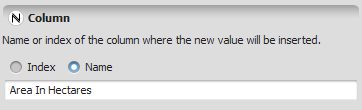


# Index Or Name Type

An **Index Or Name** value holds either a numeric index or a name — never both at once. The index is a [Positive Integer](Positive-Integer-Value-Type.html); the name is a regular [Name](Name-Type.html).

## GUI Editor



The index or name editor lets you enter either a positive integer index or a quoted name, matching whichever representation you need.

## EGO Script

Indices are positive integer values. Names are regular names enclosed in double quotes (`"`). The following examples are valid indices or names:

```
1
34
1000
"Amazon"
"North"
"landscape123"
"landscape_123"
"x1_and_a_name"
```

## Automatic Conversions

- **Converted from**: [Name Type](Name-Type.html), [Real Value Type](Real-Value-Type.html), [Integer Value Type](Integer-Value-Type.html), [Positive Integer Value Type](Positive-Integer-Value-Type.html), [Non Negative Integer Value Type](Non-Negative-Integer-Value-Type.html), [String Type](String-Type.html), and [Table Value Type](Table-Value-Type.html).
- **Converted to**: [String Type](String-Type.html) — always succeeds, converting whichever representation is held (index or name) to its text form. [Name Type](Name-Type.html), [Real Value Type](Real-Value-Type.html), [Integer Value Type](Integer-Value-Type.html), [Positive Integer Value Type](Positive-Integer-Value-Type.html), and [Non Negative Integer Value Type](Non-Negative-Integer-Value-Type.html) — each of these can fail, since an Index Or Name value holds only one representation at a time: converting to Name Type only succeeds if the value actually holds a name, and converting to any of the four numeric types only succeeds if it actually holds an index.

See [Type System](../Type-System.html) for the complete conversion reference across all types.

