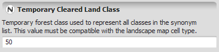


# Integer Value Type

Denotes an [integer](https://en.wikipedia.org/wiki/Integer).

An integer is any non-fractional value. Ex: ... -3, -2, -1, 0, 1, 2, 3 ...

## GUI Editor

## EGO Script

Integers in Dinamica EGO use the standard representation for integer numbers.

- 1, 2, 198, etc.

It is not possible to enter integer values using any notation other than decimal.

## Automatic Conversions

- **Converted from**: [Non Negative Integer Value Type](Non-Negative-Integer-Value-Type.html) — this is **subtyping**: a Non Negative Integer is already, structurally, an Integer, so no conversion logic runs. [Real Value Type](Real-Value-Type.html) — lossy; truncates the fractional part. [Boolean Value Type](Boolean-Value-Type.html) — True → 1, False → 0. [Index Or Name Type](Index-Or-Name-Type.html) — can fail; only succeeds if the value holds an index rather than a name. [Log Tag Type](Log-Tag-Type.html) — converts to the level's number (e.g. Info → 4). [Cell Type](Cell-Type.html) — converts to the cell type's number (e.g. Signed 32 Bit Integer → 5). [Table Value Type](Table-Value-Type.html).
- **Converted to**: [Real Value Type](Real-Value-Type.html) — lossless; widening, every integer is exactly representable as a real. [Non Negative Integer Value Type](Non-Negative-Integer-Value-Type.html) — can fail; no valid target when the value is negative. [Positive Integer Value Type](Positive-Integer-Value-Type.html) — can fail; no valid target when the value isn't positive. [Boolean Value Type](Boolean-Value-Type.html) — zero → False, any non-zero value → True. [Null Value Type](Null-Value-Type.html). [Log Tag Type](Log-Tag-Type.html) — the number selects the level by its position in Log Tag Type's table (e.g. 4 → Info). [Cell Type](Cell-Type.html) — the number selects the cell type by its position in Cell Type's table (e.g. 5 → Signed 32 Bit Integer). [String Type](String-Type.html). [Index Or Name Type](Index-Or-Name-Type.html). [Enum Type](Enum-Type.html). [Table Value Type](Table-Value-Type.html). [Table Cell Type](Table-Cell-Type.html). [Tuple Type](Tuple-Type.html).

See [Type System](../Type-System.html) for the complete conversion reference across all types.

